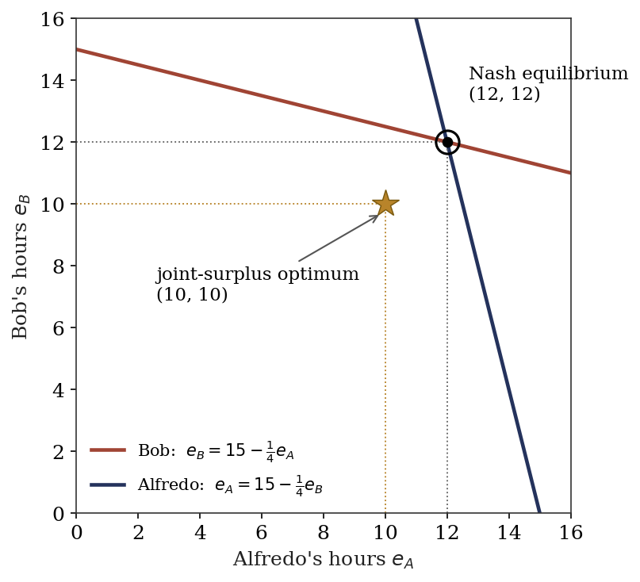

## What This Deck Is

A grab-bag of revealjs features, each on its own slide, using the same
`eco701-revealjs.scss` theme as `deck.qmd`. Not lecture content - just
proof that the mechanism works, so we know what's available if we move
this course to Quarto. See `NOTES.md` in this folder for the workflow.

---

## Columns: Two Definitions, Side by Side

::: {.columns}
::: {.column width="50%"}
**Plain language**

A Nash equilibrium is a standoff: given what everyone else is doing,
nobody can do better by switching.
:::
::: {.column width="50%"}
**Formal**

$s^*$ is Nash if for every player $i$:

$$\pi_i(s_i^*, s_{-i}^*) \geq \pi_i(s_i', s_{-i}^*) \quad \forall s_i'$$
:::
:::

---

## Columns: Three Panels

<!-- Quarto's base revealjs theme hardcodes .column { width: 50% } with no
flex/auto-distribution at all - two columns at 50% fit exactly, a third
has nowhere to go and wraps. Neither a bare width="33%" attribute nor
omitting width fixes this; only an inline style attribute has enough CSS
specificity to actually override the hardcoded class default. -->
::: {.columns}
::: {.column style="width: 33%;"}
**Setup**

Two fishers, symmetric costs, choose hours independently.
:::
::: {.column style="width: 33%;"}
**Play**

Each best-responds; both end up fishing 12 hours.
:::
::: {.column style="width: 33%;"}
**Result**

Both overfish relative to the joint optimum - a social dilemma.
:::
:::

---

## Callouts

::: {.callout-note}
## Definition
A **social dilemma**: individually rational choices produce an outcome
everyone ranks below a feasible alternative.
:::

::: {.callout-tip}
## Teaching tip
Ask the room to guess the Nash outcome *before* showing the dot-and-circle
method - most guess the efficient one.
:::

::: {.callout-warning}
## Common mix-up
Pareto efficient does **not** mean fair. It only means no free lunch is
left on the table.
:::

---

## Highlights: Click to Color a Phrase

- Fishing 12 hours is [a dominant strategy]{.fragment .highlight-blue} for both players
- The resulting Nash equilibrium is [inefficient]{.fragment .highlight-red}
- Compare the corn/tomatoes game, where self-interest lands on an outcome that is [Pareto efficient]{.fragment .highlight-green}

<!-- .fragment .highlight-{red,green,blue} are built into reveal.js itself -
no custom CSS needed, unlike the plain-color .red/.green spans below. -->

Plain inline color (no click needed): the Nash cell is always [72, 72]{style="color:#a5680f; font-weight:600;"}.

---

## Dynamic Layout: Building a Graph in Place (`.r-stack`)

```{python}
#| echo: false
#| output: false
import matplotlib.pyplot as plt
import numpy as np

e = np.linspace(0, 16, 100)
NAVY, AMBER = "#24325c", "#b8842a"

for stage in (1, 2, 3):
    fig, ax = plt.subplots(figsize=(5.0, 3.6))
    ax.set_xlim(0, 16); ax.set_ylim(0, 16)
    ax.set_xlabel("$e_A$"); ax.set_ylabel("$e_B$")
    ax.set_title(["Step 1: axes", "Step 2: + Alfredo's curve", "Step 3: + Bob's curve & Nash"][stage-1])
    if stage >= 2:
        ax.plot(e, 15 - 0.25*e, color=NAVY, label="Alfredo: $e_A=15-\\frac{1}{4} e_B$")
    if stage >= 3:
        ax.plot(15 - 0.25*e, e, color=AMBER, label="Bob: $e_B=15-\\frac{1}{4} e_A$")
        ax.plot(12, 12, 'o', color="black", markersize=9)
        ax.annotate("Nash (12, 12)", (12, 12), xytext=(4.5, 13.5))
    if stage >= 2:
        ax.legend(loc="lower left", fontsize=8)
    fig.tight_layout()
    fig.savefig(f"rstack_{stage}.png", dpi=110)
    plt.close(fig)
```

::: {.r-stack}
{.fragment .fade-out fragment-index=1 height="440"}

{.fragment .fade-in-then-out fragment-index=1 height="440"}

{.fragment .fade-in fragment-index=2 height="440"}
:::

<!-- Same technique works for annotating any single figure step by step
(e.g. the reaction-curve or PPF graphs) without the image jumping around. -->

---

## Tabsets: Three Views of the Same Game

::: {.panel-tabset}
### Table

|  | Bob: 10 hours | Bob: 12 hours |
|---|---|---|
| **Alfredo: 10 hours** | 75, 75 | 70, 78 |
| **Alfredo: 12 hours** | 78, 70 | 72, 72 |

### Reaction Curves

{width="55%"}

### Equations

$$u_A(e_A, e_B) = \left(15 - \tfrac14 e_B\right)e_A - \tfrac12 e_A^2$$

Symmetric for $u_B$. Nash: $e^* = 15 - \tfrac14 e^* \Rightarrow e^*=12$.
:::

---

## Syntax-Highlighted Code, Revealed by Line

Click through: sets up the system, then solves it.

```{.python code-line-numbers="|1-2|4-6|8"}
import sympy as sp

eA, eB = sp.symbols('e_A e_B', positive=True)

uA = (15 - eB/4)*eA - eA**2/2
uB = (15 - eA/4)*eB - eB**2/2
focs = [sp.diff(uA, eA), sp.diff(uB, eB)]

sp.solve(focs, [eA, eB], dict=True)
```

---

## Interactive Plotly: Hover, Zoom, Pan

```{python}
#| echo: false
import plotly.graph_objects as go
import numpy as np

e = np.linspace(0, 16, 100)
fig = go.Figure()
fig.add_scatter(x=e, y=15 - 0.25*e, name="Bob: e_B = 15 − ¼e_A", line=dict(color="#b8842a"))
fig.add_scatter(x=15 - 0.25*e, y=e, name="Alfredo: e_A = 15 − ¼e_B", line=dict(color="#24325c"))
fig.add_scatter(x=[12], y=[12], mode="markers+text", text=["Nash (12,12)"],
                textposition="top right", marker=dict(size=12, color="black"),
                name="Nash equilibrium")
fig.update_layout(
    xaxis_title="e_A", yaxis_title="e_B",
    height=460, margin=dict(l=40, r=20, t=20, b=40),
    legend=dict(orientation="h", y=-0.2),
    font=dict(family="-apple-system, Segoe UI, Helvetica, Arial, sans-serif", size=13),
    paper_bgcolor="rgba(0,0,0,0)", plot_bgcolor="rgba(0,0,0,0)",
)
fig
```

---

## A Slider That Survives Static Export

```{python}
#| echo: false
import plotly.graph_objects as go
import numpy as np

e = np.linspace(0, 16, 100)
gammas = [0.0, 0.1, 0.2, 0.25, 0.35, 0.5]

frames = []
for g in gammas:
    nash = 15 / (1 + g)
    frames.append(go.Frame(
        data=[
            go.Scatter(x=e, y=np.clip(15 - g*e, 0, None), line=dict(color="#b8842a")),
            go.Scatter(x=np.clip(15 - g*e, 0, None), y=e, line=dict(color="#24325c")),
            go.Scatter(x=[nash], y=[nash], mode="markers+text",
                       text=[f"({nash:.1f}, {nash:.1f})"], textposition="middle left",
                       marker=dict(size=12, color="black")),
        ],
        name=f"{g}",
    ))

fig = go.Figure(
    data=frames[0].data,
    frames=frames,
    layout=go.Layout(
        xaxis=dict(title="e_A", range=[0, 17.5]),
        yaxis=dict(title="e_B", range=[0, 16]),
        height=440, margin=dict(l=40, r=20, t=10, b=40),
        showlegend=False,
        paper_bgcolor="rgba(0,0,0,0)", plot_bgcolor="rgba(0,0,0,0)",
        sliders=[dict(
            active=0,
            currentvalue=dict(prefix="externality strength γ = "),
            steps=[dict(method="animate", label=f"{g}",
                        args=[[f"{g}"], dict(mode="immediate", frame=dict(duration=0, redraw=True))])
                   for g in gammas],
        )],
    ),
)
fig
```

Drag the slider - all frames are precomputed and shipped as JSON, so this
keeps working after static export with no Python running behind it.

::: {.callout-important}
## Where this stops working
`ipywidgets.interact`-style widgets that re-run a Python function per move
need a **live kernel** and will not work once exported to static HTML -
that pattern still belongs in the companion Jupyter notebooks (as it
already does for the Schelling model), not directly in a deployed slide.
:::

---

## Speaker Notes {auto-animate="true"}

::: {data-id="note-demo-box"}
What the audience sees: just this.
:::

Press **S** in the exported HTML to open presenter view and see the notes
below - they're invisible here on purpose.

::: {.notes}
This is where the "raise verbally" asides from the BFH slides would live
instead of an HTML comment nobody but us ever reads - e.g. the three
caveats from §1.17 (collective best responses, equilibrium selection,
out-of-equilibrium dynamics) mentioned on the Method/Road-Ahead slide.
:::

---

## Auto-Animate: Same Element, Next Slide {auto-animate="true"}

::: {data-id="note-demo-box"}
**Nash equilibrium**: no one gains by deviating alone - self-enforcing,
no outside agreement or enforcer required.
:::

<!-- Both this slide and the previous one mark data-id="note-demo-box" on
matching elements; reveal.js morphs position/size/content between them
automatically on advance - good for "zoom into this term" transitions. -->

---

## Recap

::: {.incremental}
- **Columns** - `::: {.columns}` / `::: {.column width="X%"}`
- **Callouts** - `.callout-note` / `-tip` / `-warning` / `-important`
- **Highlights** - `[text]{.fragment .highlight-red}` (built into reveal.js)
- **Dynamic layout** - `.r-stack` for same-position sequential builds
- **Tabsets** - `.panel-tabset`, one `###` per tab
- **Code** - syntax highlighting + `code-line-numbers="|1|2-3"` progressive reveal
- **Interactive Plotly** - genuinely interactive (hover/zoom), no server needed
- **Plotly slider (frames)** - the static-export-safe stand-in for `ipywidgets.interact`
- **Speaker notes** - `.notes`, replaces invisible HTML-comment asides
- **Auto-animate** - `{auto-animate="true"}` + matching `data-id`
:::
