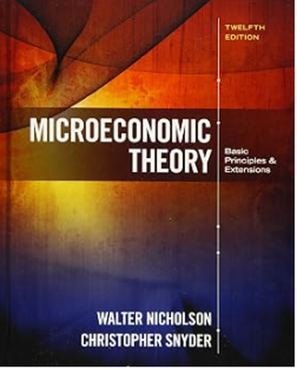
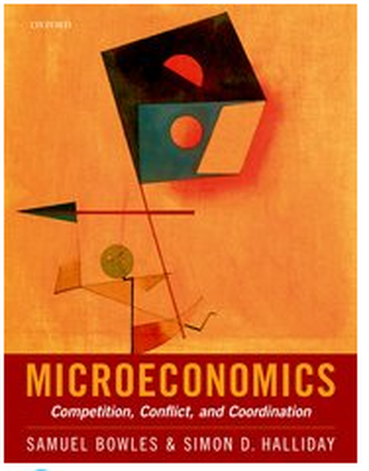
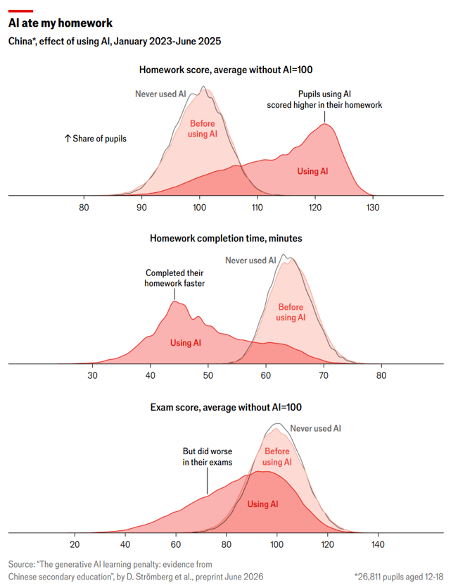

## ECO 701 -- Fall 2026

**Jonathan Conning**

**Office Hours:** HW 1504A after class Mon & Wed 2-3, and by appointment 

jconning@hunter.cuny.edu

**Teaching Assistant:** tba

---

## Course Materials {footer=""}

:::: {.columns}
::: {.column width="75%"}
- **Primary text:** Nicholson & Snyder, *Microeconomic Theory: Basic Principles and Extensions*, any edition from the 11th forward
- **Supplementary:** Bowles & Halliday (2022), *Microeconomics: Competition, Conflict, and Coordination* — selected chapters; free online [PDF](https://sites.santafe.edu/~bowles/wp-content/uploads/BH_22_merged.pdf). 
- I'll add notes, handouts, and notebooks as we go
:::

::: {.column width="25%"}

  
  

:::
::::

---

## Slides & Announcements

- An evolving collection of slides is main guide to material.
- Slides and reading schedules posted to site: **[jhconning.github.io/hunter_eco701/](https://jhconning.github.io/hunter_eco701/)**
   - Brightspace only for announcements. 
   - gradescope.com for problem sets (details to follow)
   - Slides are revised up to the last minute before class — check for updates

---

## Code and notebooks

- I use Jupyter notebooks and python to build visualizations and simulations. An evolving collection.
- All computational notebooks and resources are hosted on GitHub: [https://jhconning.github.io/hunter_eco701/](https://jhconning.github.io/hunter_eco701/)
- **Not strictly required**, but exploring open-source scientific stack tools is increasingly a part of research and applied work in economics.
- See past notebooks at [jhconning.github.io/Econ-Teach/](https://jhconning.github.io/Econ-Teach/) and for an intro to python, and more advanced work at 
[quantecon.org/lectures/](https://quantecon.org/lectures/)

---

## Grading

| Component | Weight |
|---|---|
| Problem sets / participation | 25% |
| Higher of midterm or final | 45% |
| Lower of midterm or final | 30% |

- Only 13 lectures this semester — problem sets carry real weight and will take real time
- Work in groups to build shared understanding but **write up and submit your own answers individually**

---

## Reading & Problem Sets

- **Reading** follows the schedule (check online) — come to class having done the reading
- **4 problem sets**, graded by the TA — submitted via **Gradescope** (details to follow)
  - 1st due 3rd class, Mon Sep 28 (posted a few days ahead)
- Study groups welcome and encouraged — but write up solutions on your own

---

#### How to use (and not use) AI {footer=""}

:::: {.columns}
::: {.column width="45%"}
- **As a complement, not a substitute:** as a tutor to explain derivations, check algebra, debug code, and generate practice problems.
- **Do not outsource thinking:** Evidence shows shortcuts lower exam performance.
- **No AI on exams** (closed-book / closed-device).
- **Acknowledge AI use** on problem sets and show your own steps.

> *"Armed with generative AI, a B student can produce A work while turning into a C student."*
:::

::: {.column width="45%"}

  

:::
::::

---

## Reading for Next Class

- [Bowles & Halliday (BH)](https://sites.santafe.edu/~bowles/wp-content/uploads/BH_22_merged.pdf) — Ch. 1, *"Society: Coordination Problems and Institutions"* (conclude)
- **Nicholson & Snyder — Ch. 2, *"Mathematics for Micro"***
  - Focus on unconstrained and constrained optimization, the method of Lagrange, second-order conditions, and the envelope theorem
  - Dense if you haven't seen this before — don't worry, we'll reinforce it step-by-step

---

## Introductions

Please fill out an index card:

::: {.incremental}
- **Front:** name (preferred name / pronunciation), program & year, recent econ/math coursework
- **Back:** a bit about yourself — background, job/experience, plans
- Return the card at the end of class
:::

---

## Today's Plan

- Introductions
- A first look at game theory — strategies and equilibrium concepts; social dilemmas vs. invisible-hand games (from BH Ch 1)
- Best responses, incentives, equilibrium.  Mechanisms and mechanism design.
