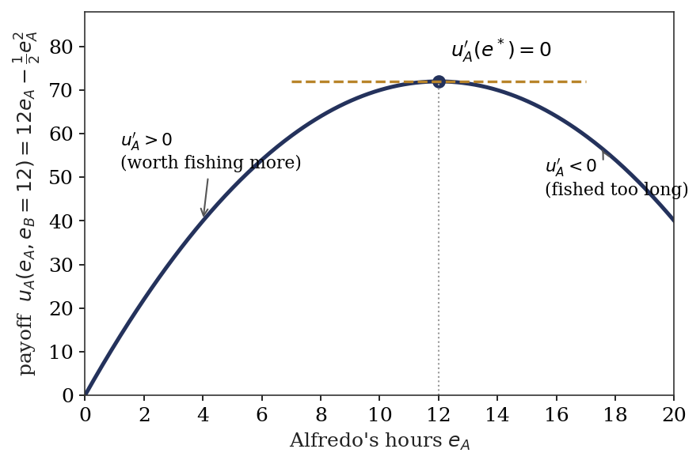
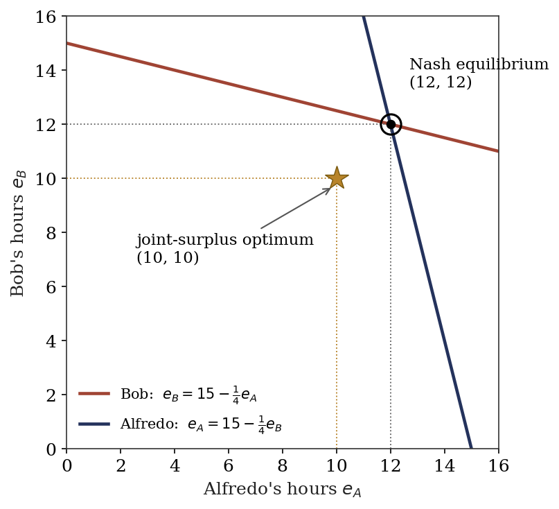
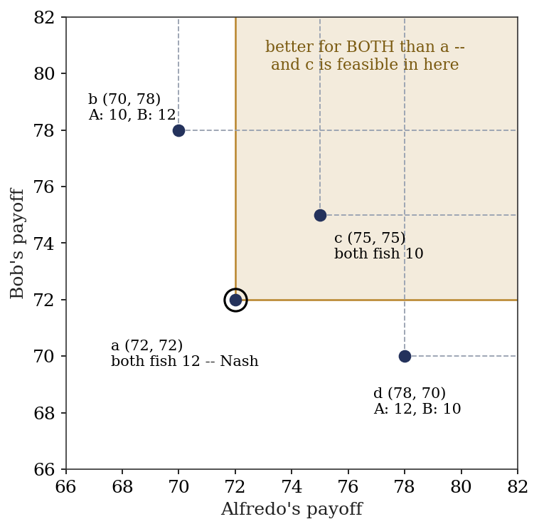
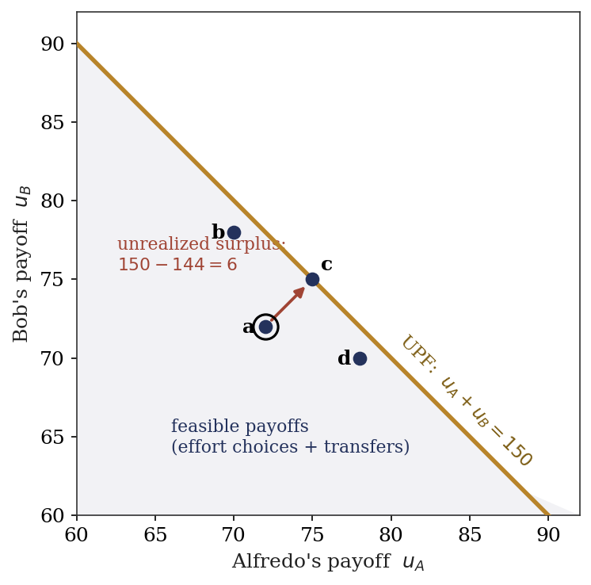
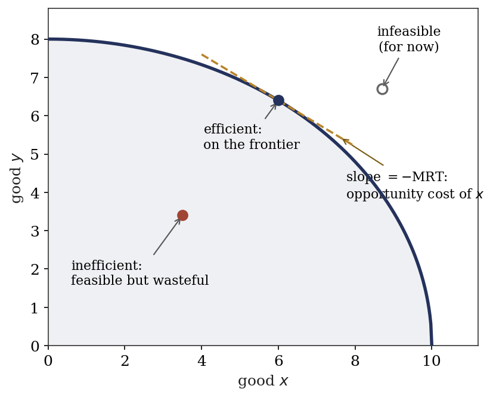

<!-- _class: lead -->

### ECO 701
# Microeconomic Theory
```text
Topic 1: Definitions and Key Tools
```

Jonathan Conning
Hunter College
Dept of Economics

---

## What Is This Course About?

- How societies allocate scarce resources — through **markets**, and through much else: firms, contracts, families, common-property rules, government policy
- Each of these is a **mechanism**: a set of *rules of the game* determining who decides what, who knows what, and who gets what
- Given the rules, optimizing players settle into an **equilibrium**
- We evaluate equilibria twice: **efficiency** — are all gains from cooperation realized? — and **distribution** — who captures them?

**rules of the game → optimizing play → equilibrium → efficiency & distribution**

> *The competitive market is one remarkable mechanism among many — not the only one, and not always available. Today builds the vocabulary; the rest of the course builds the machinery.*

<!-- Framing per BFH Ch. 1's institutions-first approach; "mechanism" language is ours. -->

---

## Two Eighteenth-Century Conjectures

- **David Hume (1739):** two neighbors "may agree to drain a meadow, which they possess in common … but 'tis very difficult, and indeed impossible, that a thousand persons shou'd agree in any such action," as each "seeks a pretext to free himself of the trouble and expence"
  - **coordination can fail**
- **Adam Smith (1776):** each merchant "intends only his own gain," yet is "led by an invisible hand" to promote an end that was no part of his intention
  - **self-interest can coordinate**
- Same assumptions about people; opposite predictions about society
- Which conjecture prevails depends on the **rules of the game** — the classical institutional challenge, and this course's recurring question

<!-- BFH §1.2 (epigraph + HISTORY box). Hume and Smith quotes are public domain. -->

---

## Coordination Problems, Then and Now

- Palanpur, Uttar Pradesh: farmers plant winter crops **weeks later** than would maximize yields — a lone early planter's seeds get eaten by birds, so early pays only if *most* plant early
- *"If we knew how to do that, we would not be poor."*
- A **coordination problem**: all could be better off (or some better, none worse) deciding *jointly* how to act than acting independently
- The same structure at every scale:
  - **climate** — everyone prefers someone else cut emissions (overuse of the atmosphere)
  - **congestion** — my driving slows everyone else (overuse of roads)
  - **knowledge** — patents restrict what costs nothing to share (underuse of ideas)
- A **coordination failure** is a coordination problem left unsolved: an outcome worse for some, better for none

<!-- BFH §1.1 (Palanpur), §1.3 (modern examples), §1.4 (overuse/underuse; tragedy of the commons named on the next pass — full commons treatment lands in Topic 9). -->

---

<!-- _class: divider -->

# Games and the Rules of the Game

A minimal toolkit: payoff matrices, best responses, Nash equilibrium

---

## Institutions Are the Rules of the Game

- **Institutions**: the laws, informal rules, and mutual expectations that regulate social interactions
  - why do you drive on the right? law **+** social pressure **+** the expectation that others will
- **Game theory** is the mathematics of *strategic* interaction: my payoff depends on what others do — and we all know it
- Describing a game means specifying **players**, their **strategy sets**, the **order of play and information**, and **payoffs**
- We play games **noncooperatively** — no binding agreements. That is the honest benchmark for many-person interactions: the whole village, not two neighbors who can talk

<!-- BFH §1.5. Cooperative game theory "assumes away" the coordination problem — worth saying aloud. -->

---

## The Fishermen's Dilemma

Alfredo and Bob fish the same lake. Each independently chooses to fish **10 or 12 hours** a day. More hours for me means fewer fish per hour *for both of us*: my choice imposes a **negative external effect** on you.

|  | Bob: 10 hours | Bob: 12 hours |
|---|---|---|
| **Alfredo: 10 hours** | 75, 75 | 70, 78 |
| **Alfredo: 12 hours** | 78, 70 | 72, 72 |

- Payoffs are utils — value of the catch **minus** the cost of effort; Alfredo's payoff listed first in each cell
- Nothing here is arbitrary: we will *derive* all four cells from one formula in a few slides
- (Ranks match Bowles & Halliday Fig. 1.8: 4 > 3 > 2 > 1)

<!-- BFH §1.6. Cardinal payoffs come from the continuous model — see notebooks/topic01_definitions_key_tools_figures.ipynb, which asserts these numbers. -->

---

## Best Response, Dot and Circle

**Best response**: the strategy that maximizes *my* payoff, taking the others' strategies as fixed.

|  | Bob: 10 hours | Bob: 12 hours |
|---|---|---|
| **Alfredo: 10 hours** | 75, 75 | 70, 78 ○ |
| **Alfredo: 12 hours** | 78 ●, 70 | **72 ●, 72 ○** |

- If Bob fishes 10, Alfredo compares 75 vs. **78** → best response: fish 12 (mark ●)
- If Bob fishes 12: 70 vs. **72** → fish 12 again (●)
- Fishing 12 is a **dominant strategy** for Alfredo: best against *anything* Bob does
- Bob's problem is symmetric — his best responses get the hollow circle ○

<!-- BFH §1.7, the dot-and-circle method of Figs 1.10-1.12, transplanted into a plain table. -->

---

## Nash Equilibrium

- A **Nash equilibrium** is a strategy profile in which *every* player best-responds to the others: a **mutual best response**
- No one gains by deviating alone, so the outcome is *self-enforcing* — it persists without agreements, promises, or enforcement
- In the table: the cell holding both ● and ○ — the unique Nash equilibrium **(12, 12)**, payoffs **(72, 72)**
- Because both players have dominant strategies it is also a **dominant-strategy equilibrium**, the most compelling special case (every dominant-strategy equilibrium is Nash; few Nash equilibria are dominant-strategy)

> *Why insist on equilibrium? A prediction the players themselves would immediately overturn falsifies itself — like predicting a marble will rest halfway up the side of a bowl.*

<!-- BFH §1.7. The bowl-of-honey variant (out-of-equilibrium dynamics) is a caveat to raise verbally; it returns in Topics 9 and 14 contexts. -->

---

## The Verdict: A Social Dilemma

- Both prefer **(10, 10)** with payoffs **(75, 75)** — yet individually rational play lands at **(72, 72)**: the famous **Prisoners' Dilemma** structure
- A **social dilemma**: individually optimal choices produce an outcome everyone ranks below another feasible one
- The prize from cooperating is an **economic rent**: 75 − 72 = 3 each above the **fallback position** of mutual defection
- If the rent is real, why not just agree to fish less?
  - **limited information** — hours at sea are hard to observe, harder to *verify*; no court can enforce what no one can prove
  - **conflict over distribution** — equal restraint is only one way to split the surplus; the fight over shares can sink every deal
- Cooperation and conflict are not opposites: **common interest** in creating the surplus, **conflicting interest** in dividing it

<!-- BFH §1.10: rent, fallback, and the two impediments to coordination. -->

---

<!-- _class: divider -->

# Under the Hood: Optimization

Calculus review — where best responses come from

---

## Where Did Those Numbers Come From?

A model. Let $e_A, e_B$ be hours fished. Alfredo's payoff is the value of his catch minus his cost of effort:

$$u_A(e_A, e_B) = \underbrace{\left(15 - \tfrac{1}{4}\,e_B\right)e_A}_{\text{value of catch}} - \underbrace{\tfrac{1}{2}\,e_A^2}_{\text{cost of effort}}$$

- Bob's hours sit inside *my* payoff: each hour he fishes lowers my catch per hour by $\tfrac14$ — the external effect is now a **term in a function**
- Bob is symmetric: $u_B = \left(15 - \tfrac14\,e_A\right)e_B - \tfrac12\,e_B^2$
- Best response means "doing the best you can, given your circumstances": solve $\max_{e_A} u_A(e_A, e_B)$ treating $e_B$ as given
- One tool required: the **first-order condition**

<!-- Model from the 2018 course notes on the BFH draft; the 2x2 is its restriction to {10, 12}. -->

---

## Calculus Review: First-Order Conditions



- At an interior maximum the payoff hill is flat: $u'(e^*) = 0$ — **necessary** but not sufficient (a minimum is flat too)
- The **second-order condition** $u''(e^*) < 0$ (locally concave) confirms a maximum; if $u$ is globally concave, the FOC alone is sufficient
- Economics reads every FOC as **marginal benefit = marginal cost**
- Fixing $e_B = 12$: $u_A = 12e_A - \tfrac12 e_A^2$, so $u_A' = 12 - e_A = 0$ gives $e_A^* = 12$, with $u_A'' = -1 < 0$: a maximum

<!-- Compressed calculus review (N&S Ch. 2, legacy slidesI 44-47); the full treatment with constraints is Topic 2. -->

---

## The Best-Response Function



For *any* $e_B$, Alfredo's FOC $15 - \tfrac14 e_B - e_A = 0$ traces out a **reaction curve**:

$$e_A^{BR}(e_B) = 15 - \tfrac{1}{4}\,e_B$$

- Downward-sloping: the more Bob fishes, the less an extra hour is worth to me
- Bob's is symmetric: $e_B^{BR}(e_A) = 15 - \tfrac14\,e_A$
- **Nash equilibrium = where the curves cross** — both best-responding at once
- By symmetry: $e^* = 15 - \tfrac14 e^*$, so $e^* = 12$ — *the "12 hours" in the matrix*

<!-- Continuous-action games return with full optimization machinery in Topic 2. -->

---

## The Planner's Problem: an Externality in One Derivative

Maximize joint surplus $W = u_A + u_B$. The first-order condition for $e_A$:

$$\frac{\partial W}{\partial e_A} = \underbrace{\left(15 - \tfrac14 e_B - e_A\right)}_{\text{private marginal payoff}} + \underbrace{\left(-\tfrac14\,e_B\right)}_{\text{external cost on Bob}} = 0$$

- Alfredo alone sets only the *first* bracket to zero; the planner also counts the harm
- Symmetric solution: $15 - \tfrac32 e = 0$, so $e^P = 10$ — *the "10 hours" in the matrix*
- Nash overfishes ($12 > 10$) precisely because each ignores the $-\tfrac14 e_B$ term
- Restrict strategies to $\{10, 12\}$ and evaluate $u$: exactly **78 > 75 > 72 > 70** — the 2×2 was this model all along
- An institution that makes each fisher *face* the external term — a tax, a liability rule — aligns private and social optimality. That is where this lecture is headed

<!-- The Pigouvian moment: external effects (Part I) meet the FOC (Part II). -->

---

<!-- _class: divider -->

# Judging Outcomes

Pareto efficiency, and the possibility frontiers of an economy

---

## Pareto Comparisons and Pareto Efficiency



- Outcome $A$ is **Pareto superior** to $B$ if at least one player is better off and nobody worse; the move is a **Pareto improvement**
- **Pareto efficient**: no feasible outcome is Pareto superior to it
- In payoff space, "superior" means **northeast**
- Only **a** has a feasible point to its northeast — **b, c, d are all Pareto efficient**, lopsided ones included
- The single Pareto-*inefficient* outcome: the Nash equilibrium

<!-- BFH §1.8, Fig 1.13 recreated from code. -->

---

## Efficiency Is Not Fairness

- Pareto efficiency is silent about **distribution**: one person getting the whole cake is Pareto efficient — any change hurts them
- It is coherent to prefer a *fair but inefficient* outcome to an *unfair efficient* one — though a fair **and** efficient outcome beats both
- Pareto-efficient outcomes cannot be Pareto-ranked against each other: the criterion delivers only a **partial ordering**
- Its real job is **screening out waste** — "leave no cake on the table"
- Mechanisms are judged on **both margins**: do we reach the frontier (efficiency), and where on it do we land (distribution)?

<!-- BFH §1.9, cake-division argument. -->

---

## The Utility Possibility Frontier



- Now let hours vary continuously and allow **side payments** of catch: feasible payoff pairs fill out a whole region
- Maximum joint surplus is $75 + 75 = 150$, at $e_A = e_B = 10$; utils transfer one-for-one, so the boundary is the line $u_A + u_B = 150$ — the **utility possibility frontier**
- All four matrix outcomes lie on or inside it; the Nash outcome leaves $150 - 144 = 6$ unrealized
- **Social dilemmas trap society *inside* its possibility frontier** — the recurring image of this course

<!-- The UPF is linear because payoffs are transferable (quasilinear) — the clarification flagged in the old course notes. General UPFs curve; Topic 7. -->

---

## The Production Possibility Frontier



- The same idea in **goods space**: the PPF bounds what an economy *could* produce from its resources and technology
- Slope = **marginal rate of transformation**: the opportunity cost of $x$ in units of $y$
- Frontier: productively efficient; inside: waste. Choosing *which* frontier point requires preferences (Topics 4–7)
- Trade and specialization are **Pareto improvements** toward the frontier (Edgeworth box: Topic 7)

> *Frontiers describe what could be; equilibrium analysis predicts what will be.*

<!-- Absorbs legacy slidesI 22-26 (Pareto criterion, gains to trade, UPF). Replaces the stub's textbook-scan PPF with a code-generated figure. -->

---

<!-- _class: divider -->

# A Catalog of Games — and Better Rules

Same rational players, different rules, different verdicts

---

## An Invisible Hand Game: Corn or Tomatoes?

Arkady's land favors tomatoes, Barbara's favors corn — and both do badly when they glut the market with the same crop.

|  | Barbara: Corn | Barbara: Tomatoes |
|---|---|---|
| **Arkady: Corn** | 1, 2.5 ○ | 2, 2 |
| **Arkady: Tomatoes** | **4 ●, 4 ○** | 2.5 ●, 1 |

- Each farmer's dominant strategy is their best crop → unique Nash equilibrium **(Tomatoes, Corn)**, payoffs **(4, 4)** — and it is **Pareto efficient**
- Self-interest alone coordinates specialization and gains from trade: Smith's conjecture in miniature
- *This* is why the machinery of markets is worth building — and why Topic 7 asks exactly when real markets behave like this game

<!-- BFH §1.11, Fig 1.15 — payoff placement verified against the rendered PDF page, not the flaky text extraction. -->

---

## An Assurance Game: Planting in Palanpur

Aram and Bina choose to plant **early or late**. Early gives the best harvest — *if the other also plants early*; a lone early planter loses seed to the birds.

|  | Bina: Early | Bina: Late |
|---|---|---|
| **Aram: Early** | **4 ●, 4 ○** | 0, 3 |
| **Aram: Late** | 3, 0 | **2 ●, 2 ○** |

- Best response to Early is Early; to Late is Late (**strategic complements**) → **two Nash equilibria**, Pareto-ranked: (4, 4) beats (2, 2)
- No conflict of interest — everyone prefers (Early, Early) — yet the village can stay **stuck** at (Late, Late): reaching the good equilibrium takes *assurance* about what others will do
- **History selects equilibria**: last season's expectations carry forward (path dependence). Palanpur's late planting is a **poverty trap** — same people, same technology, poorer history

<!-- BFH §1.12 (Fig 1.16 verified), §1.14. Schelling segregation (§1.15) cut for lecture time — parked in new_ideas.md as a notebook simulation. -->

---

<!-- _class: compact -->

## The Lecture in One Table

| Game | Nash equilibria | Equilibria vs. frontier | The challenge | Institutional lever |
|---|---|---|---|---|
| **Fishermen's / Prisoners' Dilemma** | one (dominant) | inefficient | *staying* there: cooperation unravels | change payoffs: liability, taxes, repetition |
| **Assurance** (Palanpur) | two, Pareto-ranked | one efficient, one not | *getting* there: assurance | coordinate expectations: signals, mandates |
| **Disagreement** (Language game) | two, both efficient | both efficient | *which* one: distributional conflict | bargaining, convention, power (Topic 10) |
| **Invisible Hand** (Corn–Tomatoes) | one (dominant) | efficient | none — decentralized play suffices | protect the mechanism: property, competition |

> *Classify any interaction by where its equilibria sit relative to its frontier, and you know which institutional problem you face. The Disagreement game (a.k.a. Battle of the Sexes) has payoffs (4, 2) and (2, 4) at its two equilibria — conflict baked into coordination.*

<!-- BFH §1.10 catalog + §1.13 (Fig 1.17 verified: NE at (Stick to Swahili, Improve Swahili) = (4,2) and (Improve English, Stick to English) = (2,4)). -->

---

## Changing the Rules: Liability for Harm

Append a **tort rule** to the Fishermen's Dilemma: whoever breaks the fish-10 agreement compensates the other's loss (75 − 70 = 5).

|  | Bob: Cooperate | Bob: Defect |
|---|---|---|
| **Alfredo: Cooperate** | **75 ●, 75 ○** | 75 ●, 73 |
| **Alfredo: Defect** | 73, 75 ○ | 72, 72 |

- Defecting on a cooperator now nets 78 − 5 = 73 < 75: **Cooperate becomes dominant**; the unique Nash equilibrium sits **on the frontier** — an engineered invisible-hand game
- The planner's FOC in legal clothing: liability makes each fisher **internalize** the harm term $-\tfrac14 e_B$
- The fix needs **verifiable information** and an **enforcer** — scarce on open oceans, improvised in local commons: Maine lobster territories, Turkish spot lotteries, Senegal's one-trip rule (Ostrom)

<!-- BFH §1.16 (Fig 1.23), §1.18. Repetition as the other PD-transformer (→ Assurance) deferred to Topic 8b material. -->

---

## The Method — and the Road Ahead

Every topic in this course runs the same loop:

**model the rules → find the equilibrium → evaluate efficiency & distribution → redesign the rules**

- **Topics 2–3:** the machinery of optimization — Lagrange, Kuhn–Tucker, duality (we re-derive today's 10 vs. 12 from first principles, then generalize)
- **Topics 4–6:** consumers; choices over time and risk; households that produce *and* consume
- **Topic 7:** general equilibrium — when is Smith's conjecture a theorem?
- **Topics 9–10:** when mechanisms fail — externalities and public goods; information, contracts, and power
- **Reading:** Bowles & Halliday, *Microeconomics: Competition, Conflict, and Coordination*, Ch. 1 (this lecture); Nicholson & Snyder Ch. 2 for next week

> *"Better outcomes require better rules of the game" — Bowles & Halliday's closing line, and this course's thesis.*

<!-- BFH §1.17's three caveats (collective best responses, equilibrium selection, out-of-equilibrium dynamics) — raise verbally here. -->

---

<!-- _class: compact -->

## Vocabulary Checklist

You should now be able to define, use, and illustrate:

| Framing | Games | Evaluating & designing |
|---|---|---|
| coordination problem / failure | player, strategy set, payoff | Pareto superior / inferior / improvement |
| institutions = rules of the game | best response (● / ○ method) | **Pareto efficient** |
| strategic interaction | dominant strategy | economic rent; fallback position |
| external effect; internalizing | **Nash equilibrium** (mutual best response) | efficiency vs. distribution |
| social dilemma | reaction curve; FOC / SOC | **PPF, UPF**, marginal rate of transformation |
| path dependence; poverty trap | Prisoners' / Assurance / Invisible Hand / Disagreement | liability rule; internalization |

> *Bowles & Halliday Ch. 1's "Important Ideas" list, trimmed and regrouped to today's route through it.*

<!-- Doubles as the study guide for PS1. -->
