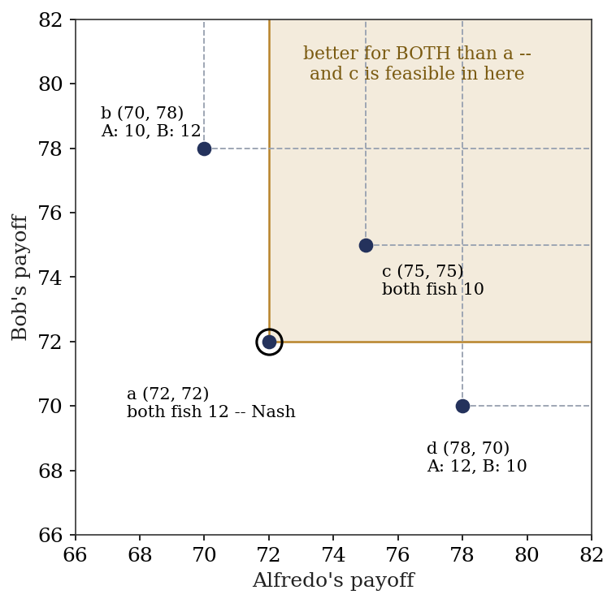
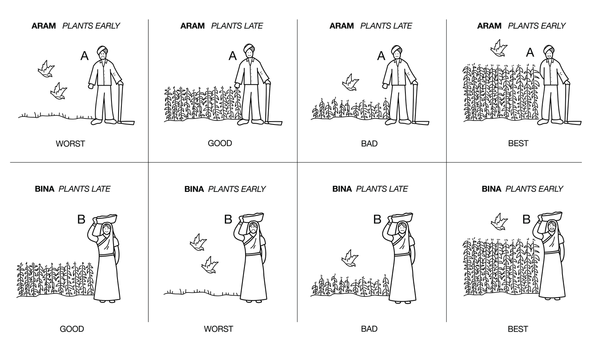
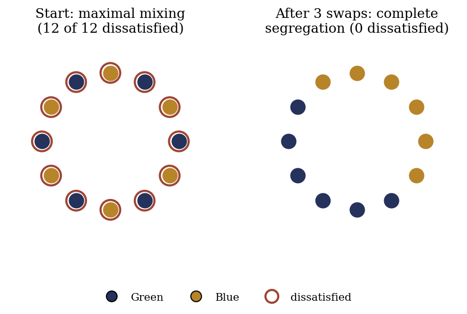
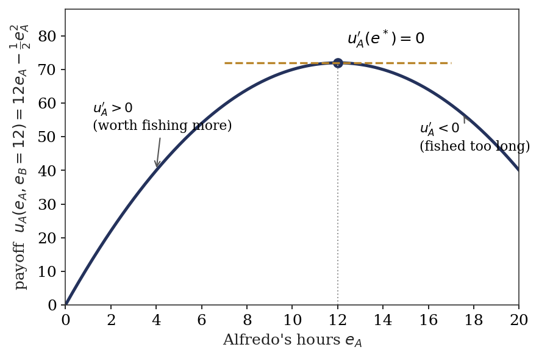
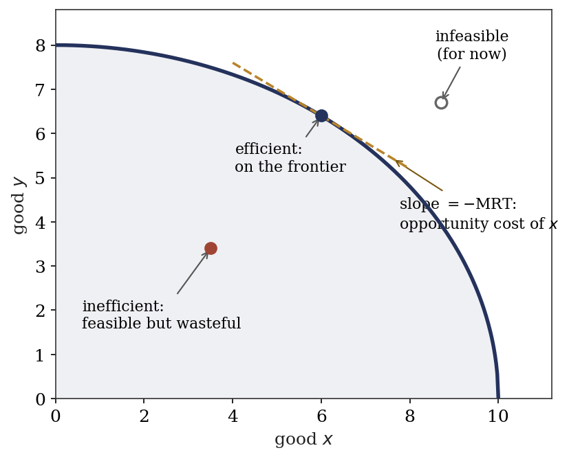

## What Is This Course About? {.compact}

::: {.incremental}
- **Resource allocation**: how societies decide who gets what
- The result of **strategic action** — individuals acting alone, or in concert through organizations (firms, governments, contract arrangements)
- A **mechanism**: what participants can do or report — a bid, a contract, a vote — and a rule mapping those choices to an outcome
  - markets, auctions, and screening contracts are all mechanisms
- Add **payoffs** and a mechanism becomes a **game**; play settles into an **equilibrium** — reverse the logic and that's **mechanism design**
- **Evaluate:**
  - **Efficiency** — are all gains from cooperation realized?
  - **Distribution** — who captures them?
- **The mechanisms keep coming**: ad auctions, kidney exchange — and now markets for (and by) AI agents. New rules, same questions
:::

::: {.fragment}
**Reading for this slide deck:** Bowles & Halliday, *Microeconomics: Competition, Conflict, and Coordination*, Ch. 1; Nicholson & Snyder Ch. 2 for next week
:::

<!-- Framing per BFH Ch. 1's institutions-first approach; "mechanism" is used in the mechanism-design sense (message space + outcome function, Hurwicz/Myerson/Maskin) rather than loosely equated with "rules of the game" - so auctions and screening contracts fit as cleanly as markets do. -->

---

##### **mechanism  → strategic play → equilibrium → efficiency & distribution**

> *The competitive market is one remarkable mechanism among many — not the only one, and not always available. Today builds the vocabulary; the rest of the course builds the machinery.*

::: {.fragment}
> *Economists design mechanisms for spectrum, kidneys, and ads; the next generation is being designed for — and by — machines. The tools in this course are the tools of that trade.*
:::


---

## Two Eighteenth-Century Conjectures

::: {.incremental}
- **David Hume (1739):** two neighbors "may agree to drain a meadow, which they possess in common … but 'tis very difficult, and indeed impossible, that a thousand persons shou'd agree in any such action," as each "seeks a pretext to free himself of the trouble and expence"
  - **coordination can fail**
- **Adam Smith (1776):** each merchant "intends only his own gain," yet is "led by an invisible hand" to promote an end that was no part of his intention
  - **self-interest can coordinate**
- Same assumptions about people; opposite predictions about society
- Which conjecture prevails? Depends on strategic incentives shaped by the **rules of the game.** This is the classical institutional challenge, a recurring question in the course.
:::

<!-- BFH §1.2 (epigraph + HISTORY box). Hume and Smith quotes are public domain. -->

---

## Coordination Problems, Then and Now {.compact}

:::: {.columns}
::: {.column width="62%"}
::: {.incremental}
- **Palanpur, Uttar Pradesh:** Farmers plant winter crops **weeks later** than would maximize yields. A lone early planter's seeds are eaten by birds, so early planting pays only if *most* plant early.
- Why not coordinate? *"If we knew how to do that, we would not be poor."*
- A **coordination problem**: all could be better off deciding *jointly* how to act than acting independently.
- Same structure at different scales:
  - **climate:** overuse of the global atmosphere
  - **congestion:** overuse of public roads
  - **knowledge:** underuse of shared ideas due to restrictions
- **Coordination failures** are coordination problems left unsolved.
:::
:::

::: {.column width="38%"}
<div style="text-align: center; margin-top: 10px;">
  
  <p style="font-size: 0.6em; color: #666; margin-top: 6px;">Palanpur, Uttar Pradesh: traditional agriculture constrained by coordination failure.</p>
</div>
:::
::::

<!-- BFH §1.1 (Palanpur), §1.3 (modern examples), §1.4 (overuse/underuse; tragedy of the commons named on the next pass — full commons treatment lands in Topic 9). -->

---

## Games and the Rules of the Game {.divider}

A minimal toolkit: payoff matrices, best responses, Nash equilibrium

---

## Institutions are "The Rules of the Game"
::: {.incremental}
- **Institutions**: the laws, informal rules, and mutual expectations that regulate social interactions
  - why do you drive on the right? law **+** social pressure **+** the expectation that others will
- **Game theory** is the mathematics of *strategic* interaction: my payoff depends on what others do — and we all know it
- Describing a game requires specifying **players**, their **strategy sets**, the **order of play and information**, and **payoffs**
- We study **non-cooperative games** — no binding agreements (outcomes must be self-enforcing). That is realistic benchmark for many-person interactions (e.g. the whole village, non-related individuals, etc). Cooperative game theory is a different branch of game theory allowing binding agreements.
:::

<!-- BFH §1.5. Cooperative game theory "assumes away" the coordination problem — worth saying aloud. -->

---

## The Fishermen's Dilemma

Alfredo and Bob fish the same lake. Each independently chooses to fish **10 or 12 hours** a day. More hours for me means fewer fish per hour *for both of us*: my choice imposes a **negative external effect** on you.

|  | Bob: 10 hours | Bob: 12 hours |
|:---:|:---:|:---:|
| **Alfredo: 10 hours** | 75, 75 | 70, 78 |
| **Alfredo: 12 hours** | 78, 70 | 72, 72 |

::: {.incremental}
- Payoffs are utils — value of the catch **minus** the cost of effort; Alfredo's payoff listed first in each cell
- Nothing here is arbitrary: we will *derive* all four cells from one formula later in the lecture
- (Ranks match Bowles & Halliday Fig. 1.8: 4 > 3 > 2 > 1)
:::

<!-- BFH §1.6. Cardinal payoffs come from the continuous model — see notebooks/topic01_definitions_key_tools_figures.ipynb, which asserts these numbers. -->

---

## Best Response, Dot and Circle

**Best response**: the strategy that maximizes *my* payoff, taking the others' strategies as fixed.

|  | Bob: 10 hours | Bob: 12 hours |
|:---|:---:|:---:|
| **Alfredo: 10 hours** | 75, 75 | 70, 78 ○ |
| **Alfredo: 12 hours** | 78 ●, 70 | **72 ●, 72 ○** |

::: {.incremental}
- If Bob fishes 10, Alfredo compares 75 vs. **78** → best response: fish 12 (mark ●)
- If Bob fishes 12: 70 vs. **72** → fish 12 again (●)
- Fishing 12 is a **dominant strategy** for Alfredo: best against *anything* Bob does
- Bob's problem is symmetric — his best responses get the hollow circle ○
:::

<!-- BFH §1.7, the dot-and-circle method of Figs 1.10-1.12, transplanted into a plain table. -->

---

## Nash Equilibrium

::: {.incremental}
- A **Nash equilibrium** is a strategy profile in which *every* player best-responds to the others: a **mutual best response**
- At a NE no one gains by deviating alone, so the outcome is *self-enforcing* 
- In the table: the cell holding both ● and ○ — the unique Nash equilibrium **(12, 12)**, payoffs **(72, 72)**
- Because both players have dominant strategies it is also an equilibrium in **dominant-strategies**, the most compelling special case (every dominant-strategy equilibrium is Nash; Not all Nash equilibria are dominant-strategy)
:::


---

## Nash Equilibrium: Formal Definition {.compact}

For a game with players $i \in \{1, \dots, n\}$, strategy sets $S_i$, and payoff functions $u_i(s_i, s_{-i})$:

::: {.callout-note icon=false}
## Definition: Nash Equilibrium (Pure Strategies)
A strategy profile $s^* = (s_1^*, \dots, s_n^*)$ is a **Nash Equilibrium** if every player simultaneously best-responds:
$$u_i(s_i^*, s_{-i}^*) \ge u_i(s_i, s_{-i}^*) \quad \forall s_i \in S_i, \quad \forall i$$
Equivalently, $s_i^* \in BR_i(s_{-i}^*) = \arg\max_{s_i \in S_i} u_i(s_i, s_{-i}^*)$ for all $i = 1, \dots, n$.
:::

::: {.callout-tip icon=false}
## Strategic Consistency
*Each player plays a best response to their belief that others will play their equilibrium strategies — and in equilibrium, those beliefs are mutually consistent and correct.*
:::

<!-- Quarto proof-of-concept #2 (see "Before We Begin" for #1): same fix, another slide Marp's fragment pass had to skip. -->

---

## Aside: John Nash

:::: {.columns}
::: {.column width="70%"}
::: {.incremental}
- Nash's 1950 PhD dissertation. 27 pages. Proved that *every* finite game has at least one Nash equilibrium, possibly in mixed strategies
- Cournot (1838) had used a version of the same idea nearly a century earlier to model duopoly competition. But never stated it in general form 
- Von Neumann & Morgenstern's *Theory of Games and Economic Behavior* (1944) couldn't pin down equilibrium beyond special cases like dominant strategies. Their minimax theorem only works for zero-sum games
- Recommended: Sylvia Nasar's 1998 biography *A Beautiful Mind* and Ron Howard's 2001 film adaptation
:::
:::

::: {.column width="30%"}
<div style="text-align: center; margin-top: 15px;">
  
</div>
:::
::::

<!-- Cannibalized (2026-07-18) from slides/08_essentials-of-game-theory/deck.md's two Nash-bio asides, text-only. -->

---

## The Verdict: A Social Dilemma

::: {.incremental}
- Both prefer **(10, 10)** with payoffs **(75, 75)** — yet individually rational play lands at **(72, 72)**: the famous **Prisoners' Dilemma** structure
- A **social dilemma**: individually optimal choices produce an outcome everyone ranks below another feasible one
- The prize from cooperating is an **economic rent**: 75 − 72 = 3 each above the **fallback position** of mutual defection
- If the rent is real, why not just agree to fish less?
  - **limited information** — hours at sea are hard to observe, harder to *verify*; no court can enforce what no one can prove
  - **conflict over distribution** — equal restraint is only one way to split the surplus; the fight over shares can sink every deal
- Cooperation and conflict are not opposites: **common interest** in creating the surplus, **conflicting interest** in dividing it
:::

<!-- BFH §1.10: rent, fallback, and the two impediments to coordination. -->

---

## Judging Outcomes: The Pareto Criterion {.divider}

Efficiency, distribution, and the payoff space

---

## Pareto Comparisons and Pareto Efficiency

::: {.columns}
::: {.column width="56%"}
::: {.incremental}
- An outcome $A$ is **Pareto superior** to $B$ if at least one player is better off and nobody worse; the move is a **Pareto improvement**
- **Pareto efficient**: no feasible outcome is Pareto superior to it
- In payoff space, "superior" means **northeast**
- Only outcome **a** in original matrix has a feasible point to its northeast — **b, c, d are all Pareto efficient**, lopsided ones included
- The single Pareto-*inefficient* outcome: the Nash equilibrium
:::
:::
::: {.column width="44%"}

:::
:::

<!-- BFH §1.8, Fig 1.13 recreated from code. -->

---

## Efficiency Is Not Fairness {.compact}

::: {.incremental}
- Pareto efficiency is silent about **distribution**: one person getting the whole pie is Pareto efficient — any change hurts them
- It is coherent to prefer a *fair but inefficient* outcome to an *unfair efficient* one — though a fair **and** efficient outcome beats both
- Pareto-efficient outcomes cannot be Pareto-ranked against each other: the criterion delivers only a **partial ordering**
- Its real job is **screening out waste** — "leave no pie on the table"
- Mechanisms are judged on **both margins**: do we reach the frontier (efficiency), and where on it do we land (distribution)?
:::

::: {.fragment}
> *"Can't we maximize total surplus first and redistribute later?"* Only if utility is transferable (side payments) and transfers are truly lump-sum. In general, how the pie is grown and how it is divided cannot be separated.
:::

<!-- BFH §1.9, pie-division argument. -->

---

## A Catalog of Games {.divider}

When does self-interest work, and when does it fail?

---

## Two Questions for Every Game {.compact}

When rational individuals pursue their own interests:

::: {.incremental}
1. **Do the players shrink the pie? (Efficiency)**
   - Do decentralized choices lead to an outcome where the pie is smaller than it could be — where **someone could have had a bigger slice without anyone getting less?**
   - If an equilibrium is Pareto-dominated by another feasible outcome, we call it a **social dilemma**.
   - If an equilibrium reaches the frontier, waste is eliminated — **no dilemma**.

2. **Who gets which slice? (Distribution)**
   - Once the pie is as large as possible, players still have conflicting interests over how it is divided.
   - That is **distributional conflict** — not a problem of waste, but a dispute over shares.

- For each game below, ask: *is this a social dilemma, a distributional conflict, both, or neither?*
:::

---

## An Invisible Hand Game: Corn or Tomatoes?

Arkady's land favors tomatoes, Barbara's favors corn — and both do badly when they glut the market with the same crop.

|  | Barbara: Corn | Barbara: Tomatoes |
|:---|:---:|:---:|
| **Arkady: Corn** | 1, 2.5 ○ | 2, 2 |
| **Arkady: Tomatoes** | **4 ●, 4 ○** | 2.5 ●, 1 |

::: {.incremental}
- Each farmer's dominant strategy is their best crop → unique Nash equilibrium **(Tomatoes, Corn)**, payoffs **(4, 4)** — and it is **Pareto efficient**
- Self-interest alone coordinates specialization and gains from trade: Smith's conjecture in miniature
- *This* is why the machinery of markets is worth building — and why Topic 7 asks exactly when real markets behave like this game
:::

<!-- BFH §1.11, Fig 1.15 — payoff placement verified against the rendered PDF page, not the flaky text extraction. -->

---

## Planting in Palanpur: The Biological Dilemma {.compact}

Why do farmers in Palanpur plant late? Pests and bird predation create a threshold effect:

<div style="text-align: center; margin: 0 auto 8px auto;">
  
</div>

::: {.incremental}
- **Lone early planter:** Seed devoured by birds before sprouting $\implies$ **Worst (0)**
- **Both plant late:** Safe from bird flocks, but shorter season lowers yields $\implies$ **Bad (2)**
- **Both plant early:** Seed overwhelms the flock $\to$ bountiful harvest $\implies$ **Best (4)**
:::

<!-- BFH §1.12, Fig 1.16 illustration. -->

---

## An Assurance Game: Planting in Palanpur {.compact}

Translating the biological coordination problem into a strategic game:

|  | Bina: Early | Bina: Late |
|:---|:---:|:---:|
| **Aram: Early** | **4 ●, 4 ○** | 0, 3 |
| **Aram: Late** | 3, 0 | **2 ●, 2 ○** |

::: {.incremental}
- Best response to Early is Early; to Late is Late (**strategic complements**) → **two Nash equilibria**, Pareto-ranked: (4, 4) beats (2, 2)
- No conflict of interest — everyone prefers (Early, Early) — yet the village can stay **stuck** at (Late, Late): reaching the good equilibrium takes *assurance* about what others will do
- **History selects equilibria**: last season's expectations carry forward (path dependence). Palanpur's late planting is a **poverty trap** — same people, same technology, poorer history
:::

<!-- BFH §1.12 (Fig 1.16 verified), §1.14. -->

---

## A Coordination Game With Conflict: Opera or Football?

{width="55%" fig-align="center"}

::: {.incremental}
- Both players prefer coordinating to not — but **disagree on which equilibrium**: Player 1's best outcome is (Opera, Opera), Player 2's is (Football, Football)
- Two Nash equilibria, but **not Pareto-ranked** the way Palanpur's were — unlike an assurance game, no outcome is best for both
- Echoes the Fishermen's lesson from a different angle: **common interest** in coordinating at all, **conflicting interest** in which equilibrium
- This catalog has now shown both a **unique** equilibrium (Corn/Tomatoes) and **multiple** (Palanpur, here) — existence is guaranteed in every finite game; uniqueness is not
:::

<!-- Salvaged (2026-07-19) from slides/08_essentials-of-game-theory/deck.md's "Example: Coordination Games (Opera vs. Football)" ahead of archiving that topic (dissolved per TOPIC_PLAN.md, 2026-07-18) - the one example there not otherwise duplicated in this deck: Palanpur is multiple-equilibria-without-conflict (assurance game), this is multiple-equilibria-with-conflict, completing the taxonomy. Diagram (with its hand-drawn best-response arrows/circled equilibria) copied verbatim from the source topic's media/ - see that topic's source.yml for the render_diagram.py provenance. Folded in a brief existence/uniqueness closing line rather than reviving Topic 8's separate abstract theorem-statement slide, to stay consistent with this deck's applied/example-first style. -->

---

## Schelling's Segregation Model: Rules & Preferences {.compact}

12 households on a circle (positions 1–12), split evenly between two groups (Blue & Orange).

::: {.incremental}
- **Neighborhood:** Each household cares only about its **two immediate neighbors** ($i-1$ and $i+1$). Let $k_i \in \{0, 1, 2\}$ be the number of same-type neighbors.
- **Preferences & Payoffs:**
  - **Stated Ideal:** 1 Blue and 1 Orange neighbor ($k_i = 1$) — *nobody desires segregation*.
  - **Satisfied ($u = 1$):** At least one neighbor shares their type ($k_i \ge 1$). Both mixed ($k_i = 1$) and all-same ($k_i = 2$) are fully satisfied.
  - **Dissatisfied ($u = 0$):** Isolated among opposite-type neighbors ($k_i = 0$). Tolerant of integration, intolerant of isolation.
- **How the Game is Played:**
  - Satisfied households stay put. Dissatisfied households want to move.
  - Two dissatisfied agents of different types **swap houses** if moving makes them satisfied.
  - **Nash Equilibrium:** Any arrangement where **everyone is satisfied** ($k_i \ge 1$ for all $i$) — no household wants to move.
:::

---

## Schelling's Segregation: Cascades & Multiple Equilibria {.compact}

:::: {.columns}
::: {.column width="60%"}
::: {.incremental}
- **Fully Integrated ($t=0$):** Alternating pairs (e.g. $AABBAABB...$) give everyone $k_i = 1$. Everyone is satisfied $\rightarrow$ **Nash equilibrium!**
- **The Shock & Cascade:** If a small disruption leaves two households dissatisfied ($k_i = 0$), they swap.
- **The Tipping Dynamics:** When an agent moves, they change the neighbor counts for adjacent homes — triggering new dissatisfaction!
- **Complete Segregation ($t=3$):** In just 3 swaps, the neighborhood locks into complete segregation (6 Blue together, 6 Orange together).
- **Punchline:** Both integrated and segregated worlds are **Nash equilibria** under identical tolerant preferences. Macro-outcomes do not reflect micro-motives.
:::
:::

::: {.column width="40%"}
<div style="text-align: center; margin-top: 5px;">
  
</div>
:::
::::

<!-- BFH §1.15 (model due to Schelling, 1971). Full walkthrough, verified against the book's own swap sequence, plus an interactive sensitivity widget: notebooks/topic01_schelling_segregation.ipynb -->

---

## Types of Games Summary {.compact}

| Game | Nash equilibria | Social dilemma? | Core challenge | Institutional lever |
|---|---|:---:|---|---|
| **Prisoners' Dilemma** (Fishermen) | one (dominant) | **Yes** (unavoidable) | Sustaining cooperation | Change payoffs: liability, taxes, repetition |
| **Assurance** (Palanpur) | two, Pareto-ranked | **Potential** (coordination trap) | Reaching the good equilibrium | Coordinate expectations: signals, mandates |
| **Disagreement** (Opera / Football) | two, both efficient | **No** (distributional conflict) | Dividing the surplus | Bargaining, convention, power (Topic 10) |
| **Invisible Hand** (Corn–Tomatoes) | one (dominant) | **No** (aligned incentives) | None — self-interest suffices | Protect the mechanism: property, competition |

::: {.fragment}
> *Does self-interest shrink the pie (a social dilemma), or do players fight over how to divide it (distributional conflict)? Classify any interaction by where its equilibria sit relative to the frontier, and you know which institutional problem you face.*
:::

<!-- BFH §1.10 catalog + §1.13. -->

---

## In the News: An AI Slowdown — Safety or Barriers to Entry? {.compact}

:::: {.columns}
::: {.column width="40%"}
<div style="text-align: center; margin-top: 5px;">
  
  <p style="font-size: 0.6em; color: #666; margin-top: 6px;"><em>Financial Times</em> (Sept 12, 2026): Tech rivals unite behind call for an AI slowdown.</p>
</div>
:::

::: {.column width="60%"}
::: {.incremental}
- **Reading 1: Escaping a Prisoners' Dilemma (Safety)**
  - If rivals race, slowing down to test safety means losing the market $\implies$ **(Race, Race)** is the dominant-strategy equilibrium.
  - Everyone deploys risky models too quickly; mutual restraint **(Slow, Slow)** is Pareto-superior.
  - A public truce or state mandate is an attempt to escape this bad equilibrium.
- **Reading 2: "Baptists & Bootleggers" (Barriers to Entry)**
  - Incumbents have sunk billions; open-weight models (and foreign rivals) threaten to erode their rents.
  - Heavy regulation (compute caps, licensing) creates massive **barriers to entry** that keep out startups and open-source models.
  - The *Baptists* (safety advocates) supply the moral cause; the *Bootleggers* (incumbents) capture the monopoly rents (Yandle 1983).
:::

::: {.fragment}
> **Discussion:** *Which game are they playing? Can a voluntary truce hold without enforcement? If the state regulates, who captures the rents?*
:::
:::
::::

---

## Aligning Incentives: Institutional Mechanisms {.divider}

Bargaining, legal rules, taxes, and community norms

---

## The Utility Possibility Frontier & Coasian Bargaining {.compact}

::: {.columns}
::: {.column width="56%"}
::: {.incremental}
- **Private Contracting:** If fishers can negotiate with **side payments** $t$, they produce the largest pie ($e_A = e_B = 10, W^* = 150$) and transfer catch to split it
- Utils transfer 1-for-1: $(75 + t) + (75 - t) = 150$, tracing the linear **Utility Possibility Frontier: $u_A + u_B = 150$**
- **The Coase Theorem:** Zero transaction costs + defined property rights $\implies$ private bargaining reaches the UPF
- Nash $(72, 72)$ is the **threat point / fallback** — bargaining splits the $150 - 144 = 6$ unit **economic rent**
- *Why Coase fails:* information asymmetry (hidden hours at sea) and distributional conflict over shares
:::
:::
::: {.column width="44%"}
```{python}
#| echo: false
#| fig-align: center
import plotly.graph_objects as go
import numpy as np

uA_grid = np.linspace(65, 85, 50)
uB_upf = 150 - uA_grid

fig = go.Figure()

# UPF frontier line
fig.add_trace(go.Scatter(
    x=uA_grid, y=uB_upf,
    mode="lines",
    name="UPF: u_A + u_B = 150",
    line=dict(color="#24325c", width=3),
    hovertemplate="UPF: u_A = %{x:.1f}, u_B = %{y:.1f}<extra></extra>"
))

# Inefficient Nash point a
fig.add_trace(go.Scatter(
    x=[72], y=[72],
    mode="markers+text",
    text=["a: (12,12) Nash Fallback"],
    textposition="bottom left",
    marker=dict(size=11, color="#c83232"),
    name="a: Nash (72,72)",
    hovertemplate="Nash Threat Point: (72, 72)<br>Leaves 6 utils unrealized<extra></extra>"
))

# Matrix outcomes b, c, d
fig.add_trace(go.Scatter(
    x=[78, 75, 70], y=[70, 75, 78],
    mode="markers+text",
    text=["b: (12,10)", "c: (10,10) Coase Optimum", "d: (10,12)"],
    textposition=["bottom right", "top right", "top left"],
    marker=dict(size=11, color="#2e7d32"),
    name="Matrix Outcomes",
    hovertemplate="%{text}: u_A=%{x}, u_B=%{y}<extra></extra>"
))

fig.update_layout(
    xaxis=dict(title="Alfredo's utility (u_A)", range=[66, 84], showgrid=True, gridcolor="#e5e9f0"),
    yaxis=dict(title="Bob's utility (u_B)", range=[66, 84], showgrid=True, gridcolor="#e5e9f0"),
    height=410,
    width=470,
    margin=dict(l=35, r=15, t=15, b=35),
    legend=dict(orientation="h", y=1.20, font=dict(size=10)),
    font=dict(family="-apple-system, Segoe UI, Helvetica, Arial, sans-serif", size=11),
    paper_bgcolor="rgba(0,0,0,0)",
    plot_bgcolor="rgba(0,0,0,0)"
)
fig
```
:::
:::

---

## Changing the Rules: Liability for Harm

Append a **tort rule** to the Fishermen's Dilemma: whoever breaks the fish-10 agreement compensates the other's loss (75 − 70 = 5).

|  | Bob: Cooperate | Bob: Defect |
|:---|:---:|:---:|
| **Alfredo: Cooperate** | **75 ●, 75 ○** | 75 ●, 73 |
| **Alfredo: Defect** | 73, 75 ○ | 72, 72 |

::: {.incremental}
- Defecting on a cooperator now nets 78 − 5 = 73 < 75: **Cooperate becomes dominant**; the unique Nash equilibrium sits **on the frontier** — an engineered invisible-hand game
- The planner's FOC in legal clothing: liability makes each fisher **internalize** the external harm
- The fix needs **verifiable information** and an **enforcer** — scarce on open oceans, improvised in local commons: Maine lobster territories, Turkish spot lotteries, Senegal's one-trip rule (Ostrom)
:::

<!-- BFH §1.16 (Fig 1.23), §1.18. Repetition as the other PD-transformer (→ Assurance) deferred to Topic 8b material. -->

---

## Governing the Commons: Beyond Markets and the State {.compact}

How does society solve the "Tragedy of the Commons"? Bowles & Halliday (Ch. 1) contrast three institutional paradigms:

::: {.incremental}
- **1. The State (Pigou):** Top-down regulation — taxes on effort $\tau$, fishing licenses, or legal quotas enforced by courts and coast guards
- **2. The Market (Coase):** Assign private property rights to the lake and let fishers trade to the UPF via contracts and side payments
- **3. Community Governance (Elinor Ostrom, 2009 Nobel):**
  - Rebutted Garrett Hardin's (1968) claim that resource users are trapped prisoners of the dilemma
  - Documented hundreds of real-world fisheries, pastures, and irrigation systems governed sustainably without state coercion or private enclosure
  - **The Mechanism:** Clear group boundaries, peer monitoring, graduated sanctions, social norms, and repeated interactions turn social dilemmas into cooperative equilibria
:::

::: {.fragment}
> *"Neither the state nor the market is uniformly successful in solving common-pool resource problems... communities of resource users frequently devise ingenious institutions."* — Elinor Ostrom (1990)
:::

<!-- The UPF is linear because payoffs are transferable (quasilinear) — the clarification flagged in the old course notes. General UPFs curve; Topic 7. -->

---

## Under the Hood: Optimization {.divider}

Calculus review — where best responses and social optima come from

---

## Where Did Those Numbers Come From?

A model. Let $e_A, e_B$ be hours fished. Alfredo's payoff is the value of his catch minus his cost of effort:

$$u_A(e_A, e_B) = \underbrace{\left(15 - \tfrac{1}{4}\,e_B\right)e_A}_{\text{value of catch}} - \underbrace{\tfrac{1}{2}\,e_A^2}_{\text{cost of effort}}$$

::: {.incremental}
- Bob's hours sit inside *my* payoff: each hour he fishes lowers my catch per hour by $\tfrac14$ — the external effect is now a **term in a function**
- Bob is symmetric: $u_B = \left(15 - \tfrac14\,e_A\right)e_B - \tfrac12\,e_B^2$
- Best response means "doing the best you can, given your circumstances": solve $\max_{e_A} u_A(e_A, e_B)$ treating $e_B$ as given
- One tool required: the **first-order condition**
:::

<!-- Model from the 2018 course notes on the BFH draft; the 2x2 is its restriction to {10, 12}. -->

---

## Calculus Review: First-Order Conditions

::: {.columns}
::: {.column width="56%"}
::: {.incremental}
- At an interior maximum the payoff hill is flat: $u'(e^*) = 0$ — **necessary** but not sufficient (a minimum is flat too)
- The **second-order condition** $u''(e^*) < 0$ (locally concave) confirms a maximum; if $u$ is globally concave, the FOC alone is sufficient
- Economics reads every FOC as **marginal benefit = marginal cost**
- Fixing $e_B = 12$: $u_A = 12e_A - \tfrac12 e_A^2$, so $u_A' = 12 - e_A = 0$ gives $e_A^* = 12$, with $u_A'' = -1 < 0$: a maximum
:::
:::
::: {.column width="44%"}

:::
:::

<!-- Compressed calculus review (N&S Ch. 2, legacy slidesI 44-47); the full treatment with constraints is Topic 2. -->

---

## Interactive: From Payoffs to the Reaction Curve

For each choice of Bob ($e_B$), Alfredo solves $\max_{e_A} u_A(e_A, e_B)$ at the peak (left). Tracing these peaks across all $e_B$ forms Alfredo's **reaction curve** (right).

*Drag the ball on the slider to start* 

```{python}
#| echo: false
#| fig-align: center
import plotly.graph_objects as go
from plotly.subplots import make_subplots
import numpy as np

e_A = np.linspace(0, 18, 200)
eb_grid = np.linspace(0, 18, 100)
eb_values = [0, 2, 4, 6, 8, 10, 12, 14, 16, 18]

# Static reaction curve on right panel: e_A = 15 - 0.25 * e_B
ea_br_curve = 15 - 0.25 * eb_grid

def get_traces(eb):
    marginal_val = 15 - 0.25 * eb
    u_A = marginal_val * e_A - 0.5 * e_A**2
    ea_star = marginal_val
    ua_star = marginal_val * ea_star - 0.5 * ea_star**2
    
    t1 = go.Scatter(
        x=e_A, y=u_A,
        mode="lines",
        line=dict(color="#24325c", width=3),
        name="u_A(e_A)",
        hovertemplate="e_A = %{x:.1f}<br>u_A = %{y:.1f}<extra>Payoff</extra>",
        xaxis="x", yaxis="y"
    )
    t2 = go.Scatter(
        x=[ea_star], y=[ua_star],
        mode="markers+text",
        text=[f"e_A*={ea_star:.1f}"],
        textposition="top center",
        marker=dict(size=11, color="#c83232"),
        name="Peak (FOC)",
        hovertemplate=f"Max at e_A* = {ea_star:.1f}<br>u_A* = {ua_star:.1f}<extra></extra>",
        xaxis="x", yaxis="y"
    )
    t3 = go.Scatter(
        x=[max(0, ea_star - 2.5), min(18, ea_star + 2.5)], y=[ua_star, ua_star],
        mode="lines",
        line=dict(color="#c83232", width=2, dash="dash"),
        hoverinfo="skip",
        xaxis="x", yaxis="y"
    )
    t4 = go.Scatter(
        x=[ea_star, ea_star], y=[0, ua_star],
        mode="lines",
        line=dict(color="#8892a4", width=1.5, dash="dot"),
        hoverinfo="skip",
        xaxis="x", yaxis="y"
    )
    
    t5 = go.Scatter(
        x=ea_br_curve, y=eb_grid,
        mode="lines",
        line=dict(color="#24325c", width=2.5),
        name="Reaction Curve: e_A = 15 − ¼ e_B",
        hovertemplate="e_A = %{x:.1f}<br>e_B = %{y:.1f}<extra>Reaction Curve</extra>",
        xaxis="x2", yaxis="y2"
    )
    t6 = go.Scatter(
        x=[ea_star], y=[eb],
        mode="markers+text",
        text=[f"({ea_star:.1f}, {eb})"],
        textposition="top right" if eb < 14 else "bottom left",
        marker=dict(size=12, color="#c83232"),
        name="Current (e_A*, e_B)",
        hovertemplate=f"Alfredo's Best Response:<br>e_A* = {ea_star:.1f} when e_B = {eb}<extra></extra>",
        xaxis="x2", yaxis="y2"
    )
    t7 = go.Scatter(
        x=[ea_star, ea_star, 0], y=[0, eb, eb],
        mode="lines",
        line=dict(color="#c83232", width=1.5, dash="dot"),
        hoverinfo="skip",
        xaxis="x2", yaxis="y2"
    )
    return [t1, t2, t3, t4, t5, t6, t7]

initial_eb = 12
initial_idx = eb_values.index(initial_eb)

fig = make_subplots(
    rows=1, cols=2,
    subplot_titles=("(1) Alfredo's Payoff Hill: max u_A(e_A; e_B)", "(2) Reaction Curve in (e_A, e_B) Space"),
    horizontal_spacing=0.10
)

# Add initial traces directly using row/col
init_traces = get_traces(initial_eb)
for t in init_traces[:4]:
    fig.add_trace(t, row=1, col=1)
for t in init_traces[4:]:
    fig.add_trace(t, row=1, col=2)

# Add frames for animation
frames = [go.Frame(data=get_traces(eb), name=f"{eb}") for eb in eb_values]
fig.frames = frames

steps = []
for eb in eb_values:
    step = dict(
        method="animate",
        args=[
            [f"{eb}"],
            dict(
                mode="immediate",
                frame=dict(duration=150, redraw=True),
                transition=dict(duration=100)
            )
        ],
        label=f"{eb}h"
    )
    steps.append(step)

sliders = [dict(
    active=initial_idx,
    currentvalue=dict(
        prefix="Bob's effort (e_B): ",
        visible=True,
        xanchor="center",
        offset=10,
        font=dict(size=13, color="#24325c", family="-apple-system, Segoe UI, sans-serif")
    ),
    pad=dict(t=30, b=5),
    len=0.92,
    x=0.04,
    steps=steps
)]

fig.update_layout(
    xaxis=dict(title="Alfredo's hours (e_A)", range=[0, 18], showgrid=True, gridcolor="#e5e9f0"),
    yaxis=dict(title="Payoff u_A", range=[0, 120], showgrid=True, gridcolor="#e5e9f0"),
    xaxis2=dict(title="Alfredo's hours (e_A)", range=[0, 18], showgrid=True, gridcolor="#e5e9f0"),
    yaxis2=dict(title="Bob's hours (e_B)", range=[0, 18], showgrid=True, gridcolor="#e5e9f0"),
    height=430,
    width=1080,
    margin=dict(l=45, r=25, t=35, b=50),
    showlegend=False,
    paper_bgcolor="rgba(0,0,0,0)",
    plot_bgcolor="rgba(0,0,0,0)",
    font=dict(family="-apple-system, Segoe UI, Helvetica, Arial, sans-serif", size=12),
    sliders=sliders
)
fig
```

---

## The Best-Response Function

::: {.columns}
::: {.column width="56%"}
For *any* $e_B$, Alfredo's FOC $15 - \tfrac14 e_B - e_A = 0$ traces out a **reaction curve**:

$$e_A^{BR}(e_B) = 15 - \tfrac{1}{4}\,e_B$$

::: {.incremental}
- Downward-sloping: the more Bob fishes, the less an extra hour is worth to me
- Bob's is symmetric: $e_B^{BR}(e_A) = 15 - \tfrac14\,e_A$
- **Nash equilibrium = where the curves cross** — both best-responding at once
- By symmetry: $e^* = 15 - \tfrac14 e^*$, so $e^* = 12$ — *the "12 hours" in the matrix*
:::
:::
::: {.column width="44%"}
```{python}
#| echo: false
#| fig-align: center
import plotly.graph_objects as go
import numpy as np

e = np.linspace(0, 16, 100)
fig = go.Figure()
fig.add_trace(go.Scatter(
    x=e, y=15 - 0.25*e,
    name="Bob: e_B = 15 − ¼ e_A",
    line=dict(color="#b8842a", width=3),
    hovertemplate="e_A = %{x:.1f}, e_B = %{y:.1f}<extra>Bob's BR</extra>"
))
fig.add_trace(go.Scatter(
    x=15 - 0.25*e, y=e,
    name="Alfredo: e_A = 15 − ¼ e_B",
    line=dict(color="#24325c", width=3),
    hovertemplate="e_A = %{x:.1f}, e_B = %{y:.1f}<extra>Alfredo's BR</extra>"
))
fig.add_trace(go.Scatter(
    x=[12], y=[12],
    mode="markers+text",
    text=["Nash (12,12)"],
    textposition="top right",
    marker=dict(size=11, color="#1c2430"),
    name="Nash (12,12)",
    hovertemplate="Nash Equilibrium: (12, 12)<extra></extra>"
))
fig.add_trace(go.Scatter(
    x=[10], y=[10],
    mode="markers+text",
    text=["Planner (10,10)"],
    textposition="bottom left",
    marker=dict(size=11, color="#2e7d32"),
    name="Social Optimum (10,10)",
    hovertemplate="Social Optimum: (10, 10)<extra></extra>"
))
fig.update_layout(
    xaxis=dict(title="Alfredo's hours (e_A)", range=[0, 16.5], showgrid=True, gridcolor="#e5e9f0"),
    yaxis=dict(title="Bob's hours (e_B)", range=[0, 16.5], showgrid=True, gridcolor="#e5e9f0"),
    height=410,
    width=470,
    margin=dict(l=35, r=15, t=15, b=35),
    legend=dict(orientation="h", y=1.18, font=dict(size=11)),
    font=dict(family="-apple-system, Segoe UI, Helvetica, Arial, sans-serif", size=12),
    paper_bgcolor="rgba(0,0,0,0)",
    plot_bgcolor="rgba(0,0,0,0)"
)
fig
```
:::
:::

<!-- Continuous-action games return with full optimization machinery in Topic 2. -->

---

## The Planner's Problem (takes externalities into account) {.compact}

A Planner maximizes total joint surplus $W = u_A + u_B$:
$$W(e_A, e_B) = \underbrace{\left[\left(15 - \tfrac14 e_B\right)e_A - \tfrac12 e_A^2\right]}_{u_A} + \underbrace{\left[\left(15 - \tfrac14 e_A\right)e_B - \tfrac12 e_B^2\right]}_{u_B}$$

The Planner's FOC for $e_A$:
$$\frac{\partial W}{\partial e_A} = \underbrace{\left(15 - \tfrac14 e_B - e_A\right)}_{\text{private marginal payoff}} + \underbrace{\left(-\tfrac14\,e_B\right)}_{\text{external cost on Bob}} = 0$$

::: {.incremental}
- Alfredo alone sets only the *first* bracket to zero; ignores harm of his choice to others.
- Planner at symmetric solution ($e=e_A=e_B$) solves: $15 - \tfrac32 e = 0$, so $e^P = 10$ — *"10 hours"*
- Versus non-cooperative Nash: each overfishes ($12 > 10$) because each ignores external $-\tfrac14 e_B$ harm
:::

<!-- The Pigouvian moment: external effects meet the FOC. -->

---

## Internalizing Harm: The Pigouvian Mechanism {.compact}

::: {.columns}
::: {.column width="38%"}
::: {.incremental}
- **Baseline ($\tau = 0$):** Private curves cross at **$(12, 12)$ (Overfishing)** — each fisher ignores their $-\tfrac14 e$ external damage
- **Pigouvian Solution:** Charge fee/tax $\tau$ per hour of fishing
- **Taxed Optimization:**
  $$\max_{e_A} \left[ u_A - \tau \cdot e_A \right]$$
  $$\mathbf{e_A^{\text{taxed}}(e_B) = (15 - \tau) - \tfrac14\,e_B}$$
- The tax **shifts the reaction curve inward**
- Raising $\tau$ from $0 \rightarrow 2.5$ moves decentralized market play from **$(12, 12)$ to the social optimum $(10, 10)$**!
:::
:::

::: {.column width="62%"}
```{python}
#| echo: false
#| fig-align: center
import plotly.graph_objects as go
import numpy as np

e_grid = np.linspace(0, 16, 100)
tau_values = [0.0, 0.5, 1.0, 1.5, 2.0, 2.5, 3.0]
initial_tau = 0.0
initial_idx = tau_values.index(initial_tau)

def get_pigou_traces(tau):
    ea_taxed = (15 - tau) - 0.25 * e_grid
    eb_taxed = (15 - tau) - 0.25 * e_grid
    eqm_e = (15 - tau) / 1.25
    
    t1 = go.Scatter(
        x=e_grid, y=15 - 0.25*e_grid,
        mode="lines",
        name="Untaxed Bob: e_B = 15 − ¼ e_A",
        line=dict(color="#b8842a", width=2),
        hovertemplate="Untaxed Bob: e_B = 15 − ¼ e_A<extra></extra>"
    )
    t2 = go.Scatter(
        x=15 - 0.25*e_grid, y=e_grid,
        mode="lines",
        name="Untaxed Alfredo: e_A = 15 − ¼ e_B",
        line=dict(color="#24325c", width=2),
        hovertemplate="Untaxed Alfredo: e_A = 15 − ¼ e_B<extra></extra>"
    )
    t_opt_fixed = go.Scatter(
        x=[10], y=[10],
        mode="markers+text",
        text=["Target: Optimum (10,10)"],
        textposition="bottom left",
        marker=dict(size=11, color="#2e7d32", symbol="star"),
        name="Social Target (10,10)",
        hoverinfo="skip"
    )
    t5 = go.Scatter(
        x=e_grid, y=eb_taxed,
        mode="lines",
        name=f"Taxed Bob: e_B = {15-tau:.1f} − ¼ e_A",
        line=dict(color="#2e7d32", width=2.5, dash="dash"),
        hovertemplate=f"Taxed Bob: e_B = {15-tau:.1f} − ¼ e_A<extra></extra>"
    )
    t6 = go.Scatter(
        x=ea_taxed, y=e_grid,
        mode="lines",
        name=f"Taxed Alfredo: e_A = {15-tau:.1f} − ¼ e_B",
        line=dict(color="#1b5e20", width=2.5, dash="dash"),
        hovertemplate=f"Taxed Alfredo: e_A = {15-tau:.1f} − ¼ e_B<extra></extra>"
    )
    
    if tau == 0:
        label = "Untaxed Overfishing (12, 12)"
        tpos = "top right"
        mcolor = "#c83232"
    elif abs(tau - 2.5) < 1e-4:
        label = "Social Optimum (10, 10) ✓"
        tpos = "bottom left"
        mcolor = "#2e7d32"
    else:
        label = f"Market Eqm ({eqm_e:.1f}, {eqm_e:.1f})"
        tpos = "top right"
        mcolor = "#c83232"
        
    t7 = go.Scatter(
        x=[eqm_e], y=[eqm_e],
        mode="markers+text",
        text=[label],
        textposition=tpos,
        marker=dict(size=12, color=mcolor),
        name="Market Equilibrium",
        hovertemplate=f"Equilibrium under τ={tau:.1f}: e* = {eqm_e:.2f}<extra></extra>"
    )
    return [t1, t2, t_opt_fixed, t5, t6, t7]

fig_pigou = go.Figure()
for t in get_pigou_traces(initial_tau):
    fig_pigou.add_trace(t)

frames = [
    go.Frame(
        data=get_pigou_traces(tau),
        name=f"{tau:.1f}"
    )
    for tau in tau_values
]
fig_pigou.frames = frames

steps = [
    dict(
        method="animate",
        args=[[f"{tau:.1f}"], dict(mode="immediate", frame=dict(duration=150, redraw=True), transition=dict(duration=100))],
        label=f"{tau:.1f}"
    )
    for tau in tau_values
]

sliders = [dict(
    active=initial_idx,
    currentvalue=dict(prefix="Tax per hour (τ): ", visible=True, xanchor="center", offset=8, font=dict(size=12, color="#1b5e20")),
    pad=dict(t=20, b=0), len=0.92, x=0.04, y=-0.08, steps=steps
)]

fig_pigou.update_layout(
    xaxis=dict(title=dict(text="Alfredo's hours (e_A)", standoff=6), range=[0, 17], showgrid=True, gridcolor="#e5e9f0"),
    yaxis=dict(title="Bob's hours (e_B)", range=[0, 16], showgrid=True, gridcolor="#e5e9f0"),
    height=415,
    width=610,
    margin=dict(l=35, r=35, t=20, b=45),
    showlegend=False,
    font=dict(family="-apple-system, Segoe UI, Helvetica, Arial, sans-serif", size=11),
    paper_bgcolor="rgba(0,0,0,0)",
    plot_bgcolor="rgba(0,0,0,0)",
    sliders=sliders
)
fig_pigou
```
:::
:::

---

## From Free Choice to Constraints {.divider}

The Production Possibility Frontier and the road to Topic 2

---

## The Production Possibility Frontier {.compact}

::: {.columns}
::: {.column width="56%"}
::: {.incremental}
- The same idea in **goods space**: the PPF bounds what an economy *could* produce from its resources and technology
- Slope = **marginal rate of transformation**: the opportunity cost of $x$ in units of $y$
- Frontier: productively efficient; inside: waste. Choosing *which* frontier point requires preferences (Topics 4–7)
- Trade and specialization are **Pareto improvements** toward the frontier (Edgeworth box: Topic 7)
:::
:::
::: {.column width="44%"}

:::
:::

::: {.fragment}
> *Frontiers describe what could be; equilibrium analysis predicts what will be.*
:::

<!-- Absorbs legacy slidesI 22-26. -->

---

## The Next Step: Constrained Optimization {.compact}

::: {.incremental}
- Today, Alfredo chose his fishing hours freely: $\max_{e_A} u_A(e_A, e_B)$. There was no budget, no quota, no limit on total lake hours. That was **unconstrained optimization**.
- Real economic choices are rarely unconstrained:
  - **Consumers** maximize utility subject to a **budget constraint**
  - **Firms** minimize costs subject to a **production target**
  - **Relief agencies** allocate supplies subject to **transport capacity**
- The PPF on the previous slide is a constraint: society wants to reach the highest welfare, but cannot choose points outside the frontier.
- **Topic 2** introduces the mathematical machinery for choice under scarcity: the **Method of Lagrange** and **Kuhn–Tucker conditions**.
:::

::: {.fragment}
> *Unconstrained choice asks: "Where is the hill flat?" Constrained choice asks: "How high can you climb before hitting the fence?"*
:::

---

## Application: Information Constraints and Mechanism Design {.compact}


::: {.columns}
::: {.column width="50%"}
**Corporate Finance & Banking (Tirole)**

- Asset pricing on secondary markets takes cash flows as given and typically assumes complete competitive markets (no strategic interaction)
- Corporate finance asks why those financial contracts exist in the first place and are structured as they are:
  - **Asymmetric information & moral hazard:** induce (unobservable and not contractible)borrower effort and risk choices 
  - Explains why banks *ration* credit rather than raise interest rate price to clear.
  - Debt covenants, collateral, and equity are **incentive mechanisms**
:::

::: {.column width="50%"}
**Algorithmic Systems & AI (Jordan 2025)**

- An autonomous agent optimizing a prompt computes a **best response**; two agents negotiating play a **game**
- Aligning machine behavior with human goals is a **principal–agent problem**:
  - The model's internal computation is unobservable
  - "Reward hacking" is multitasking agency failure (Holmström–Milgrom)
  - Aggregating dispersed human data is a challenging mechanism-design problem (Hayek 1945)
:::
:::


---

## The Road Ahead {.compact}

Most topics in the course run the same loop:

**model the rules → find the equilibrium → evaluate efficiency & distribution → redesign the rules**

::: {.incremental}
- **Topics 2–3:** the machinery of optimization — Lagrange, Kuhn–Tucker, duality (we re-derive today's 10 vs. 12 from first principles, then generalize)
- **Topics 4–6:** consumers; choices over time and risk; households that produce *and* consume
- **Topic 7:** general equilibrium — under what conditions is Smith's invisible hand conjecture a theorem? 
- **Topics 9–10:** when  markets fail — externalities and public goods; information, contracts, and power. Policy design and evaluation.
- **Applications:** corporate finance, labor and credit markets, development, algorithmic mechanisms — seeing how these tools apply to modern institutional problems

:::

---

## Vocabulary Checklist {.compact}

You should now be able to define, use, and illustrate:

| Framing | Games | Evaluating & designing |
|---|---|---|
| coordination problem / failure | player, strategy set, payoff | Pareto superior / inferior / improvement |
| institutions = rules of the game | best response (● / ○ method) | **Pareto efficient** |
| strategic interaction | dominant strategy | economic rent; fallback position |
| external effect; internalizing | **Nash equilibrium** (mutual best response) | efficiency vs. distribution |
| social dilemma | reaction curve; FOC / SOC | **PPF, UPF**, marginal rate of transformation |
| path dependence; poverty trap | Prisoners' / Assurance / Invisible Hand / Disagreement | liability rule; internalization |

> *Bowles & Halliday Ch. 1's "Important Ideas" list, trimmed and regrouped to today's route through it.*

<!-- Doubles as the study guide for PS1. -->
