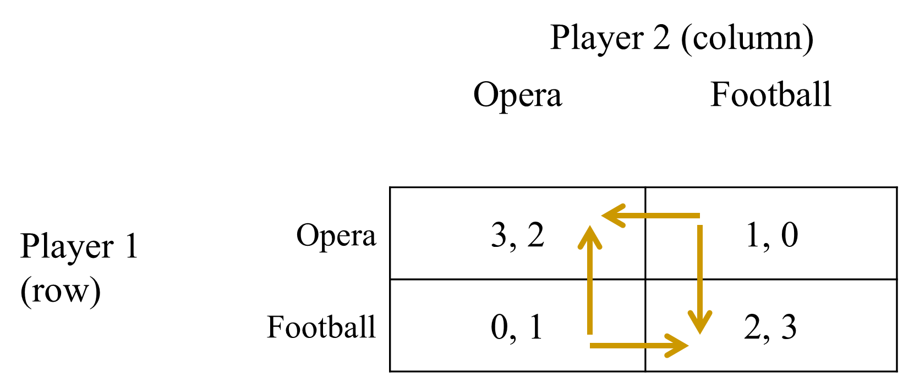

## What Is This Course About? {.compact}

::: {.incremental}
- **Resource allocation**: how societies decide who gets what
- The result of **strategic action** — individuals acting alone, or in concert through organizations (firms, governments, contract arrangements)
- A **mechanism**: what participants can do or report — a bid, a contract, a vote — and a rule mapping those choices to an outcome
  - markets, auctions, and screening contracts are all mechanisms
- Add **payoffs** and a mechanism becomes a **game**; play settles into an **equilibrium** — reverse the logic and that's **mechanism design**
- **Evaluate:**
  - **Efficiency** — are all gains from cooperation realized?
  - **Distribution** — who captures them?
- **The mechanisms keep coming**: ad auctions, kidney exchange — and now markets for (and by) AI agents. New rules, same questions
:::

<!-- Framing per BFH Ch. 1's institutions-first approach; "mechanism" is used in the mechanism-design sense (message space + outcome function, Hurwicz/Myerson/Maskin) rather than loosely equated with "rules of the game" - so auctions and screening contracts fit as cleanly as markets do. -->

---

##### **mechanism  → strategic play → equilibrium → efficiency & distribution**

> *The competitive market is one remarkable mechanism among many — not the only one, and not always available. Today builds the vocabulary; the rest of the course builds the machinery.*

::: {.fragment}
> *Economists design mechanisms for spectrum, kidneys, and ads; the next generation is being designed for — and by — machines. The tools in this course are the tools of that trade.*
:::

---

## Two Eighteenth-Century Conjectures

::: {.incremental}
- **David Hume (1739):** two neighbors "may agree to drain a meadow, which they possess in common … but 'tis very difficult, and indeed impossible, that a thousand persons shou'd agree in any such action," as each "seeks a pretext to free himself of the trouble and expence"
  - **coordination can fail**
- **Adam Smith (1776):** each merchant "intends only his own gain," yet is "led by an invisible hand" to promote an end that was no part of his intention
  - **self-interest can coordinate**
- Same assumptions about people; opposite predictions about society
- Which conjecture prevails? Depends on strategic incentives shaped by the **rules of the game.** This is the classical institutional challenge, a recurring question in the course.
:::

<!-- BFH §1.2 (epigraph + HISTORY box). Hume and Smith quotes are public domain. -->

---

## Coordination Problems, Then and Now

::: {.incremental}
- BF book:  Palanpur, Uttar Pradesh: farmers plant winter crops **weeks later** than would maximize yields. A lone early planter's seeds is eaten by birds, so early pays only if *most* plant early.  
- Why not coordinate?  *"If we knew how to do that, we would not be poor."*
- A **coordination problem**: all could be better off (or some better, none worse) deciding *jointly* how to act than acting independently
- Same structure at different scales:
  - **climate:** everyone prefers someone else cut emissions (overuse of the atmosphere)
  - **congestion:** my driving slows everyone else (overuse of roads)
  - **knowledge:** patents restrict what costs nothing to share (underuse of ideas)
- **coordination failures** are coordination problems left unsolved 
:::

<!-- BFH §1.1 (Palanpur), §1.3 (modern examples), §1.4 (overuse/underuse; tragedy of the commons named on the next pass — full commons treatment lands in Topic 9). -->

---

## Games and the Rules of the Game {.divider}

A minimal toolkit: payoff matrices, best responses, Nash equilibrium

---

## Institutions Are the Rules of the Game

::: {.incremental}
- **Institutions**: the laws, informal rules, and mutual expectations that regulate social interactions
  - why do you drive on the right? law **+** social pressure **+** the expectation that others will
- **Game theory** is the mathematics of *strategic* interaction: my payoff depends on what others do — and we all know it
- Describing a game means specifying **players**, their **strategy sets**, the **order of play and information**, and **payoffs**
- We play games **noncooperatively** — no binding agreements. That is the honest benchmark for many-person interactions: the whole village, not two neighbors who can talk
:::

<!-- BFH §1.5. Cooperative game theory "assumes away" the coordination problem — worth saying aloud. -->

---

## The Fishermen's Dilemma

Alfredo and Bob fish the same lake. Each independently chooses to fish **10 or 12 hours** a day. More hours for me means fewer fish per hour *for both of us*: my choice imposes a **negative external effect** on you.

|  | Bob: 10 hours | Bob: 12 hours |
|:---:|:---:|:---:|
| **Alfredo: 10 hours** | 75, 75 | 70, 78 |
| **Alfredo: 12 hours** | 78, 70 | 72, 72 |

::: {.incremental}
- Payoffs are utils — value of the catch **minus** the cost of effort; Alfredo's payoff listed first in each cell
- Nothing here is arbitrary: we will *derive* all four cells from one formula in a few slides
- (Ranks match Bowles & Halliday Fig. 1.8: 4 > 3 > 2 > 1)
:::

<!-- BFH §1.6. Cardinal payoffs come from the continuous model — see notebooks/topic01_definitions_key_tools_figures.ipynb, which asserts these numbers. -->

---

## Best Response, Dot and Circle

**Best response**: the strategy that maximizes *my* payoff, taking the others' strategies as fixed.

|  | Bob: 10 hours | Bob: 12 hours |
|:---|:---:|:---:|
| **Alfredo: 10 hours** | 75, 75 | 70, 78 ○ |
| **Alfredo: 12 hours** | 78 ●, 70 | **72 ●, 72 ○** |

::: {.incremental}
- If Bob fishes 10, Alfredo compares 75 vs. **78** → best response: fish 12 (mark ●)
- If Bob fishes 12: 70 vs. **72** → fish 12 again (●)
- Fishing 12 is a **dominant strategy** for Alfredo: best against *anything* Bob does
- Bob's problem is symmetric — his best responses get the hollow circle ○
:::

<!-- BFH §1.7, the dot-and-circle method of Figs 1.10-1.12, transplanted into a plain table. -->

---

## Nash Equilibrium

::: {.incremental}
- A **Nash equilibrium** is a strategy profile in which *every* player best-responds to the others: a **mutual best response**
- No one gains by deviating alone, so the outcome is *self-enforcing* — it persists without agreements, promises, or enforcement
- In the table: the cell holding both ● and ○ — the unique Nash equilibrium **(12, 12)**, payoffs **(72, 72)**
- Because both players have dominant strategies it is also a **dominant-strategy equilibrium**, the most compelling special case (every dominant-strategy equilibrium is Nash; few Nash equilibria are dominant-strategy)
:::

::: {.fragment}
> *Why insist on equilibrium? A prediction the players themselves would immediately overturn falsifies itself — like predicting a marble will rest halfway up the side of a bowl.*
:::

<!-- Quarto proof-of-concept #2 (see "Before We Begin" for #1): same fix, another slide Marp's fragment pass had to skip. -->

---

## Aside: John Nash

:::: {.columns}
::: {.column width="70%"}
::: {.incremental}
- Nash's 1950 PhD dissertation. 27 pages. Proved that *every* finite game has at least one Nash equilibrium, possibly in mixed strategies
- Cournot (1838) had used a version of the same idea nearly a century earlier to model duopoly competition. But never stated it in general form 
- Von Neumann & Morgenstern's *Theory of Games and Economic Behavior* (1944) couldn't pin down equilibrium beyond special cases like dominant strategies. Their minimax theorem only works for zero-sum games
- Recommended: Sylvia Nasar's 1998 biography *A Beautiful Mind* and Ron Howard's 2001 film adaptation
:::
:::

::: {.column width="30%"}
<div style="text-align: center; margin-top: 15px;">
  
</div>
:::
::::

<!-- Cannibalized (2026-07-18) from slides/08_essentials-of-game-theory/deck.md's two Nash-bio asides, text-only. -->

---

## The Verdict: A Social Dilemma

::: {.incremental}
- Both prefer **(10, 10)** with payoffs **(75, 75)** — yet individually rational play lands at **(72, 72)**: the famous **Prisoners' Dilemma** structure
- A **social dilemma**: individually optimal choices produce an outcome everyone ranks below another feasible one
- The prize from cooperating is an **economic rent**: 75 − 72 = 3 each above the **fallback position** of mutual defection
- If the rent is real, why not just agree to fish less?
  - **limited information** — hours at sea are hard to observe, harder to *verify*; no court can enforce what no one can prove
  - **conflict over distribution** — equal restraint is only one way to split the surplus; the fight over shares can sink every deal
- Cooperation and conflict are not opposites: **common interest** in creating the surplus, **conflicting interest** in dividing it
:::

<!-- BFH §1.10: rent, fallback, and the two impediments to coordination. -->

---

## Under the Hood: Optimization {.divider}

Calculus review — where best responses come from

---

## Where Did Those Numbers Come From?

A model. Let $e_A, e_B$ be hours fished. Alfredo's payoff is the value of his catch minus his cost of effort:

$$u_A(e_A, e_B) = \underbrace{\left(15 - \tfrac{1}{4}\,e_B\right)e_A}_{\text{value of catch}} - \underbrace{\tfrac{1}{2}\,e_A^2}_{\text{cost of effort}}$$

::: {.incremental}
- Bob's hours sit inside *my* payoff: each hour he fishes lowers my catch per hour by $\tfrac14$ — the external effect is now a **term in a function**
- Bob is symmetric: $u_B = \left(15 - \tfrac14\,e_A\right)e_B - \tfrac12\,e_B^2$
- Best response means "doing the best you can, given your circumstances": solve $\max_{e_A} u_A(e_A, e_B)$ treating $e_B$ as given
- One tool required: the **first-order condition**
:::

<!-- Model from the 2018 course notes on the BFH draft; the 2x2 is its restriction to {10, 12}. -->

---

## Calculus Review: First-Order Conditions

::: {.columns}
::: {.column width="56%"}
::: {.incremental}
- At an interior maximum the payoff hill is flat: $u'(e^*) = 0$ — **necessary** but not sufficient (a minimum is flat too)
- The **second-order condition** $u''(e^*) < 0$ (locally concave) confirms a maximum; if $u$ is globally concave, the FOC alone is sufficient
- Economics reads every FOC as **marginal benefit = marginal cost**
- Fixing $e_B = 12$: $u_A = 12e_A - \tfrac12 e_A^2$, so $u_A' = 12 - e_A = 0$ gives $e_A^* = 12$, with $u_A'' = -1 < 0$: a maximum
:::
:::
::: {.column width="44%"}

:::
:::

<!-- Compressed calculus review (N&S Ch. 2, legacy slidesI 44-47); the full treatment with constraints is Topic 2. -->

---

## Interactive: From Payoffs to the Reaction Curve

For each choice of Bob ($e_B$), Alfredo solves $\max_{e_A} u_A(e_A, e_B)$ at the peak (left). Tracing these peaks across all $e_B$ forms Alfredo's **reaction curve** (right).

```{python}
#| echo: false
#| fig-align: center
import plotly.graph_objects as go
from plotly.subplots import make_subplots
import numpy as np

e_A = np.linspace(0, 18, 200)
eb_grid = np.linspace(0, 18, 100)
eb_values = [0, 2, 4, 6, 8, 10, 12, 14, 16, 18]

# Static reaction curve on right panel: e_A = 15 - 0.25 * e_B
ea_br_curve = 15 - 0.25 * eb_grid

frames = []
for eb in eb_values:
    marginal_val = 15 - 0.25 * eb
    u_A = marginal_val * e_A - 0.5 * e_A**2
    ea_star = marginal_val
    ua_star = marginal_val * ea_star - 0.5 * ea_star**2
    
    frame_data = [
        # Panel 1: u_A curve
        go.Scatter(
            x=e_A, y=u_A,
            mode="lines",
            line=dict(color="#24325c", width=3),
            name="u_A(e_A)",
            hovertemplate="e_A = %{x:.1f}<br>u_A = %{y:.1f}<extra>Payoff</extra>",
            xaxis="x1", yaxis="y1"
        ),
        # Panel 1: Peak point
        go.Scatter(
            x=[ea_star], y=[ua_star],
            mode="markers+text",
            text=[f"e_A*={ea_star:.1f}"],
            textposition="top center",
            marker=dict(size=11, color="#c83232"),
            name="Peak (FOC)",
            hovertemplate=f"Max at e_A* = {ea_star:.1f}<br>u_A* = {ua_star:.1f}<extra></extra>",
            xaxis="x1", yaxis="y1"
        ),
        # Panel 1: Flat tangent line at peak
        go.Scatter(
            x=[max(0, ea_star - 2.5), min(18, ea_star + 2.5)], y=[ua_star, ua_star],
            mode="lines",
            line=dict(color="#c83232", width=2, dash="dash"),
            hoverinfo="skip",
            xaxis="x1", yaxis="y1"
        ),
        # Panel 1: Vertical drop line
        go.Scatter(
            x=[ea_star, ea_star], y=[0, ua_star],
            mode="lines",
            line=dict(color="#8892a4", width=1.5, dash="dot"),
            hoverinfo="skip",
            xaxis="x1", yaxis="y1"
        ),
        
        # Panel 2: Full Reaction Curve line
        go.Scatter(
            x=ea_br_curve, y=eb_grid,
            mode="lines",
            line=dict(color="#24325c", width=2.5),
            name="Reaction Curve: e_A = 15 − ¼ e_B",
            hovertemplate="e_A = %{x:.1f}<br>e_B = %{y:.1f}<extra>Reaction Curve</extra>",
            xaxis="x2", yaxis="y2"
        ),
        # Panel 2: Current operating point (e_A*(e_B), e_B)
        go.Scatter(
            x=[ea_star], y=[eb],
            mode="markers+text",
            text=[f"({ea_star:.1f}, {eb})"],
            textposition="top right" if eb < 14 else "bottom left",
            marker=dict(size=12, color="#c83232"),
            name="Current (e_A*, e_B)",
            hovertemplate=f"Alfredo's Best Response:<br>e_A* = {ea_star:.1f} when e_B = {eb}<extra></extra>",
            xaxis="x2", yaxis="y2"
        ),
        # Panel 2: Crosshair guide lines
        go.Scatter(
            x=[ea_star, ea_star, 0], y=[0, eb, eb],
            mode="lines",
            line=dict(color="#c83232", width=1.5, dash="dot"),
            hoverinfo="skip",
            xaxis="x2", yaxis="y2"
        )
    ]
    frames.append(go.Frame(data=frame_data, name=f"{eb}"))

initial_idx = 6  # eb = 12

steps = []
for eb in eb_values:
    step = dict(
        method="animate",
        args=[
            [f"{eb}"],
            dict(
                mode="immediate",
                frame=dict(duration=150, redraw=True),
                transition=dict(duration=100)
            )
        ],
        label=f"{eb}h"
    )
    steps.append(step)

sliders = [dict(
    active=initial_idx,
    currentvalue=dict(
        prefix="Bob's effort (e_B): ",
        visible=True,
        font=dict(size=14, color="#24325c", family="-apple-system, Segoe UI, sans-serif")
    ),
    pad=dict(t=25, b=5),
    len=0.92,
    x=0.04,
    steps=steps
)]

fig = make_subplots(
    rows=1, cols=2,
    subplot_titles=("(1) Alfredo's Payoff Hill: max u_A(e_A; e_B)", "(2) Reaction Curve in (e_A, e_B) Space"),
    horizontal_spacing=0.10
)

for trace in frames[initial_idx].data:
    if trace.xaxis == "x1":
        fig.add_trace(trace, row=1, col=1)
    else:
        fig.add_trace(trace, row=1, col=2)

fig.frames = frames

fig.update_layout(
    xaxis1=dict(title="Alfredo's hours (e_A)", range=[0, 18], showgrid=True, gridcolor="#e5e9f0"),
    yaxis1=dict(title="Payoff u_A", range=[0, 120], showgrid=True, gridcolor="#e5e9f0"),
    xaxis2=dict(title="Alfredo's hours (e_A)", range=[0, 18], showgrid=True, gridcolor="#e5e9f0"),
    yaxis2=dict(title="Bob's hours (e_B)", range=[0, 18], showgrid=True, gridcolor="#e5e9f0"),
    height=450,
    width=1080,
    margin=dict(l=40, r=20, t=35, b=65),
    showlegend=False,
    paper_bgcolor="rgba(0,0,0,0)",
    plot_bgcolor="rgba(0,0,0,0)",
    font=dict(family="-apple-system, Segoe UI, Helvetica, Arial, sans-serif", size=12),
    sliders=sliders
)
fig
```

---

## The Best-Response Function

::: {.columns}
::: {.column width="56%"}
For *any* $e_B$, Alfredo's FOC $15 - \tfrac14 e_B - e_A = 0$ traces out a **reaction curve**:

$$e_A^{BR}(e_B) = 15 - \tfrac{1}{4}\,e_B$$

::: {.incremental}
- Downward-sloping: the more Bob fishes, the less an extra hour is worth to me
- Bob's is symmetric: $e_B^{BR}(e_A) = 15 - \tfrac14\,e_A$
- **Nash equilibrium = where the curves cross** — both best-responding at once
- By symmetry: $e^* = 15 - \tfrac14 e^*$, so $e^* = 12$ — *the "12 hours" in the matrix*
:::
:::
::: {.column width="44%"}
```{python}
#| echo: false
#| fig-align: center
import plotly.graph_objects as go
import numpy as np

e = np.linspace(0, 16, 100)
fig = go.Figure()
fig.add_trace(go.Scatter(
    x=e, y=15 - 0.25*e,
    name="Bob: e_B = 15 − ¼ e_A",
    line=dict(color="#b8842a", width=3),
    hovertemplate="e_A = %{x:.1f}, e_B = %{y:.1f}<extra>Bob's BR</extra>"
))
fig.add_trace(go.Scatter(
    x=15 - 0.25*e, y=e,
    name="Alfredo: e_A = 15 − ¼ e_B",
    line=dict(color="#24325c", width=3),
    hovertemplate="e_A = %{x:.1f}, e_B = %{y:.1f}<extra>Alfredo's BR</extra>"
))
fig.add_trace(go.Scatter(
    x=[12], y=[12],
    mode="markers+text",
    text=["Nash (12,12)"],
    textposition="top right",
    marker=dict(size=11, color="#1c2430"),
    name="Nash (12,12)",
    hovertemplate="Nash Equilibrium: (12, 12)<extra></extra>"
))
fig.add_trace(go.Scatter(
    x=[10], y=[10],
    mode="markers+text",
    text=["Planner (10,10)"],
    textposition="bottom left",
    marker=dict(size=11, color="#2e7d32"),
    name="Social Optimum (10,10)",
    hovertemplate="Social Optimum: (10, 10)<extra></extra>"
))
fig.update_layout(
    xaxis=dict(title="Alfredo's hours (e_A)", range=[0, 16.5], showgrid=True, gridcolor="#e5e9f0"),
    yaxis=dict(title="Bob's hours (e_B)", range=[0, 16.5], showgrid=True, gridcolor="#e5e9f0"),
    height=410,
    width=470,
    margin=dict(l=35, r=15, t=15, b=35),
    legend=dict(orientation="h", y=1.18, font=dict(size=11)),
    font=dict(family="-apple-system, Segoe UI, Helvetica, Arial, sans-serif", size=12),
    paper_bgcolor="rgba(0,0,0,0)",
    plot_bgcolor="rgba(0,0,0,0)"
)
fig
```
:::
:::

<!-- Continuous-action games return with full optimization machinery in Topic 2. -->

---

## The Planner's Problem: an Externality in One Derivative

Maximize joint surplus $W = u_A + u_B$. The first-order condition for $e_A$:

$$\frac{\partial W}{\partial e_A} = \underbrace{\left(15 - \tfrac14 e_B - e_A\right)}_{\text{private marginal payoff}} + \underbrace{\left(-\tfrac14\,e_B\right)}_{\text{external cost on Bob}} = 0$$

::: {.incremental}
- Alfredo alone sets only the *first* bracket to zero; the planner also counts the harm
- Symmetric solution: $15 - \tfrac32 e = 0$, so $e^P = 10$ — *the "10 hours" in the matrix*
- Nash overfishes ($12 > 10$) precisely because each ignores the $-\tfrac14 e_B$ term
- Restrict strategies to $\{10, 12\}$ and evaluate $u$: exactly **78 > 75 > 72 > 70** — the 2×2 was this model all along
- An institution that makes each fisher *face* the external term — a tax, a liability rule — aligns private and social optimality. That is where this lecture is headed
:::

<!-- The Pigouvian moment: external effects (Part I) meet the FOC (Part II). -->

---

## Judging Outcomes {.divider}

Pareto efficiency, and the possibility frontiers of an economy

---

## Pareto Comparisons and Pareto Efficiency

::: {.columns}
::: {.column width="56%"}
::: {.incremental}
- Outcome $A$ is **Pareto superior** to $B$ if at least one player is better off and nobody worse; the move is a **Pareto improvement**
- **Pareto efficient**: no feasible outcome is Pareto superior to it
- In payoff space, "superior" means **northeast**
- Only **a** has a feasible point to its northeast — **b, c, d are all Pareto efficient**, lopsided ones included
- The single Pareto-*inefficient* outcome: the Nash equilibrium
:::
:::
::: {.column width="44%"}

:::
:::

<!-- BFH §1.8, Fig 1.13 recreated from code. -->

---

## Efficiency Is Not Fairness

::: {.incremental}
- Pareto efficiency is silent about **distribution**: one person getting the whole cake is Pareto efficient — any change hurts them
- It is coherent to prefer a *fair but inefficient* outcome to an *unfair efficient* one — though a fair **and** efficient outcome beats both
- Pareto-efficient outcomes cannot be Pareto-ranked against each other: the criterion delivers only a **partial ordering**
- Its real job is **screening out waste** — "leave no cake on the table"
- Mechanisms are judged on **both margins**: do we reach the frontier (efficiency), and where on it do we land (distribution)?
:::

<!-- BFH §1.9, cake-division argument. -->

---

## The Utility Possibility Frontier

::: {.columns}
::: {.column width="56%"}
::: {.incremental}
- Now let hours vary continuously and allow **side payments** of catch: feasible payoff pairs fill out a whole region
- Maximum joint surplus is $75 + 75 = 150$, at $e_A = e_B = 10$; utils transfer one-for-one, so the boundary is the line $u_A + u_B = 150$ — the **utility possibility frontier**
- All four matrix outcomes lie on or inside it; the Nash outcome leaves $150 - 144 = 6$ unrealized
- **Social dilemmas trap society *inside* its possibility frontier** — the recurring image of this course
:::
:::
::: {.column width="44%"}
```{python}
#| echo: false
#| fig-align: center
import plotly.graph_objects as go
import numpy as np

uA_grid = np.linspace(65, 85, 50)
uB_upf = 150 - uA_grid

fig = go.Figure()

# UPF frontier line
fig.add_trace(go.Scatter(
    x=uA_grid, y=uB_upf,
    mode="lines",
    name="UPF: u_A + u_B = 150",
    line=dict(color="#24325c", width=3),
    hovertemplate="u_A: %{x:.1f}, u_B: %{y:.1f}<extra>UPF Frontier</extra>"
))

# Inefficient Nash point a
fig.add_trace(go.Scatter(
    x=[72], y=[72],
    mode="markers+text",
    text=["a: (12,12) Nash"],
    textposition="bottom left",
    marker=dict(size=11, color="#c83232"),
    name="a: Nash (72,72)",
    hovertemplate="Nash (12,12): u_A=72, u_B=72<br>(Inefficient: inside frontier)<extra></extra>"
))

# Efficient matrix outcomes b, c, d
fig.add_trace(go.Scatter(
    x=[70, 75, 78], y=[78, 75, 70],
    mode="markers+text",
    text=["b: (10,12)", "c: (10,10) Planner", "d: (12,10)"],
    textposition=["top left", "top right", "bottom right"],
    marker=dict(size=11, color="#2e7d32"),
    name="b, c, d: Efficient",
    hovertemplate="%{text}: u_A=%{x}, u_B=%{y}<extra></extra>"
))

fig.update_layout(
    xaxis=dict(title="Alfredo's utility (u_A)", range=[66, 84], showgrid=True, gridcolor="#e5e9f0"),
    yaxis=dict(title="Bob's utility (u_B)", range=[66, 84], showgrid=True, gridcolor="#e5e9f0"),
    height=410,
    width=470,
    margin=dict(l=35, r=15, t=15, b=35),
    legend=dict(orientation="h", y=1.18, font=dict(size=10)),
    font=dict(family="-apple-system, Segoe UI, Helvetica, Arial, sans-serif", size=12),
    paper_bgcolor="rgba(0,0,0,0)",
    plot_bgcolor="rgba(0,0,0,0)"
)
fig
```
:::
:::

<!-- The UPF is linear because payoffs are transferable (quasilinear) — the clarification flagged in the old course notes. General UPFs curve; Topic 7. -->

---

## The Production Possibility Frontier {.compact}

::: {.columns}
::: {.column width="56%"}
::: {.incremental}
- The same idea in **goods space**: the PPF bounds what an economy *could* produce from its resources and technology
- Slope = **marginal rate of transformation**: the opportunity cost of $x$ in units of $y$
- Frontier: productively efficient; inside: waste. Choosing *which* frontier point requires preferences (Topics 4–7)
- Trade and specialization are **Pareto improvements** toward the frontier (Edgeworth box: Topic 7)
:::
:::
::: {.column width="44%"}

:::
:::

::: {.fragment}
> *Frontiers describe what could be; equilibrium analysis predicts what will be.*
:::

<!-- Quarto proof-of-concept #3: another Marp-blocked slide (list + trailing blockquote), now fully sequenced. Absorbs legacy slidesI 22-26. The closing blockquote sits below the full-width .columns block (not inside the 56% left column, where it wrapped to two lines and collided with the footer at that narrower width - caught by tools/verify_deck.py during the Phase 0 smoke test). -->

---

## A Catalog of Games — and Better Rules {.divider}

Same rational players, different rules, different verdicts

---

## An Invisible Hand Game: Corn or Tomatoes?

Arkady's land favors tomatoes, Barbara's favors corn — and both do badly when they glut the market with the same crop.

|  | Barbara: Corn | Barbara: Tomatoes |
|:---|:---:|:---:|
| **Arkady: Corn** | 1, 2.5 ○ | 2, 2 |
| **Arkady: Tomatoes** | **4 ●, 4 ○** | 2.5 ●, 1 |

::: {.incremental}
- Each farmer's dominant strategy is their best crop → unique Nash equilibrium **(Tomatoes, Corn)**, payoffs **(4, 4)** — and it is **Pareto efficient**
- Self-interest alone coordinates specialization and gains from trade: Smith's conjecture in miniature
- *This* is why the machinery of markets is worth building — and why Topic 7 asks exactly when real markets behave like this game
:::

<!-- BFH §1.11, Fig 1.15 — payoff placement verified against the rendered PDF page, not the flaky text extraction. -->

---

## An Assurance Game: Planting in Palanpur

Aram and Bina choose to plant **early or late**. Early gives the best harvest — *if the other also plants early*; a lone early planter loses seed to the birds.

|  | Bina: Early | Bina: Late |
|:---|:---:|:---:|
| **Aram: Early** | **4 ●, 4 ○** | 0, 3 |
| **Aram: Late** | 3, 0 | **2 ●, 2 ○** |

::: {.incremental}
- Best response to Early is Early; to Late is Late (**strategic complements**) → **two Nash equilibria**, Pareto-ranked: (4, 4) beats (2, 2)
- No conflict of interest — everyone prefers (Early, Early) — yet the village can stay **stuck** at (Late, Late): reaching the good equilibrium takes *assurance* about what others will do
- **History selects equilibria**: last season's expectations carry forward (path dependence). Palanpur's late planting is a **poverty trap** — same people, same technology, poorer history
:::

<!-- BFH §1.12 (Fig 1.16 verified), §1.14. -->

---

## A Coordination Game With Conflict: Opera or Football?

{width="55%" fig-align="center"}

::: {.incremental}
- Both players prefer coordinating to not — but **disagree on which equilibrium**: Player 1's best outcome is (Opera, Opera), Player 2's is (Football, Football)
- Two Nash equilibria, but **not Pareto-ranked** the way Palanpur's were — unlike an assurance game, no outcome is best for both
- Echoes the Fishermen's lesson from a different angle: **common interest** in coordinating at all, **conflicting interest** in which equilibrium
- This catalog has now shown both a **unique** equilibrium (Corn/Tomatoes) and **multiple** (Palanpur, here) — existence is guaranteed in every finite game; uniqueness is not
:::

<!-- Salvaged (2026-07-19) from slides/08_essentials-of-game-theory/deck.md's "Example: Coordination Games (Opera vs. Football)" ahead of archiving that topic (dissolved per TOPIC_PLAN.md, 2026-07-18) - the one example there not otherwise duplicated in this deck: Palanpur is multiple-equilibria-without-conflict (assurance game), this is multiple-equilibria-with-conflict, completing the taxonomy. Diagram (with its hand-drawn best-response arrows/circled equilibria) copied verbatim from the source topic's media/ - see that topic's source.yml for the render_diagram.py provenance. Folded in a brief existence/uniqueness closing line rather than reviving Topic 8's separate abstract theorem-statement slide, to stay consistent with this deck's applied/example-first style. -->

---

## Example: Segregation as a Nash Equilibrium

::: {.columns}
::: {.column width="60%"}
::: {.incremental}
- Households on a circle, two groups — everyone's stated ideal is **one neighbor of each type**
- Satisfied unless **both** neighbors are the other type — tolerant of integration, intolerant of isolation
- From maximum mixing, small individually sensible moves can cascade into **complete segregation** — shown at right
- Segregated *and* integrated arrangements are both Nash equilibria — same preferences, different societies; which one occurs is a matter of history, not preference
:::
:::
::: {.column width="40%"}

:::
:::

<!-- BFH §1.15 (model due to Schelling, 1971). Full walkthrough, verified against the book's own swap sequence, plus an interactive sensitivity widget: notebooks/topic01_schelling_segregation.ipynb -->

---

## The Lecture in One Table {.compact}

| Game | Nash equilibria | Equilibria vs. frontier | The challenge | Institutional lever |
|---|---|---|---|---|
| **Fishermen's / Prisoners' Dilemma** | one (dominant) | inefficient | *staying* there: cooperation unravels | change payoffs: liability, taxes, repetition |
| **Assurance** (Palanpur) | two, Pareto-ranked | one efficient, one not | *getting* there: assurance | coordinate expectations: signals, mandates |
| **Disagreement** (Language game) | two, both efficient | both efficient | *which* one: distributional conflict | bargaining, convention, power (Topic 10) |
| **Invisible Hand** (Corn–Tomatoes) | one (dominant) | efficient | none — decentralized play suffices | protect the mechanism: property, competition |

> *Classify any interaction by where its equilibria sit relative to its frontier, and you know which institutional problem you face. The Disagreement game (a.k.a. Battle of the Sexes) has payoffs (4, 2) and (2, 4) at its two equilibria — conflict baked into coordination.*

<!-- BFH §1.10 catalog + §1.13 (Fig 1.17 verified: NE at (Stick to Swahili, Improve Swahili) = (4,2) and (Improve English, Stick to English) = (2,4)). -->

---

## Changing the Rules: Liability for Harm

Append a **tort rule** to the Fishermen's Dilemma: whoever breaks the fish-10 agreement compensates the other's loss (75 − 70 = 5).

|  | Bob: Cooperate | Bob: Defect |
|:---|:---:|:---:|
| **Alfredo: Cooperate** | **75 ●, 75 ○** | 75 ●, 73 |
| **Alfredo: Defect** | 73, 75 ○ | 72, 72 |

::: {.incremental}
- Defecting on a cooperator now nets 78 − 5 = 73 < 75: **Cooperate becomes dominant**; the unique Nash equilibrium sits **on the frontier** — an engineered invisible-hand game
- The planner's FOC in legal clothing: liability makes each fisher **internalize** the harm term $-\tfrac14 e_B$
- The fix needs **verifiable information** and an **enforcer** — scarce on open oceans, improvised in local commons: Maine lobster territories, Turkish spot lotteries, Senegal's one-trip rule (Ostrom)
:::

<!-- BFH §1.16 (Fig 1.23), §1.18. Repetition as the other PD-transformer (→ Assurance) deferred to Topic 8b material. -->

---

## Application: Information Constraints and Mechanism Design {.compact}

Why the microeconomic toolkit matters across fields:

::: {.columns}
::: {.column width="50%"}
**Corporate Finance & Banking (Tirole)**

- Asset pricing on secondary markets takes cash flows as given and assumes complete markets
- Corporate finance asks why those financial contracts exist in the first place and are structured as they are:
  - **Asymmetric information & moral hazard:** borrower effort and risk choices are unobservable
  - Explains why banks *ration* credit rather than clear markets by raising interest rates
  - Debt covenants, collateral, and equity are **incentive mechanisms**
:::

::: {.column width="50%"}
**Algorithmic Systems & AI (Jordan 2025)**

- An autonomous model optimizing a prompt computes a **best response**; two models negotiating play a **game**
- Aligning machine behavior with human goals is a **principal–agent problem**:
  - The model's internal computation is unobservable
  - "Reward hacking" is multitasking agency failure (Holmström–Milgrom)
  - Aggregating dispersed human data is a mechanism-design problem (Hayek 1945)
:::
:::

::: {.fragment}
> *Whether governing firms, financial intermediaries, or algorithmic markets, the central question is the same: how to structure rules and contracts when information is asymmetric and agents act strategically.*
:::

---

## The Method — and the Road Ahead {.compact}

Every topic in this course runs the same loop:

**model the rules → find the equilibrium → evaluate efficiency & distribution → redesign the rules**

::: {.incremental}
- **Topics 2–3:** the machinery of optimization — Lagrange, Kuhn–Tucker, duality (we re-derive today's 10 vs. 12 from first principles, then generalize)
- **Topics 4–6:** consumers; choices over time and risk; households that produce *and* consume
- **Topic 7:** general equilibrium — when is Smith's conjecture a theorem? *(promise kept)*
- **Topics 9–10:** when mechanisms fail — externalities and public goods; information, contracts, and power
- **Applications throughout:** corporate finance, credit markets, and algorithmic mechanisms — seeing how these tools apply to modern institutional problems
- **Reading:** Bowles & Halliday, *Microeconomics: Competition, Conflict, and Coordination*, Ch. 1 (this lecture); Nicholson & Snyder Ch. 2 for next week
:::

::: {.fragment}
> *"Better outcomes require better rules of the game" — Bowles & Halliday's closing line, and this course's thesis.*
:::

<!-- Quarto proof-of-concept #4: the last of the 4 Marp-blocked slides, now fully sequenced. -->

---

## Vocabulary Checklist {.compact}

You should now be able to define, use, and illustrate:

| Framing | Games | Evaluating & designing |
|---|---|---|
| coordination problem / failure | player, strategy set, payoff | Pareto superior / inferior / improvement |
| institutions = rules of the game | best response (● / ○ method) | **Pareto efficient** |
| strategic interaction | dominant strategy | economic rent; fallback position |
| external effect; internalizing | **Nash equilibrium** (mutual best response) | efficiency vs. distribution |
| social dilemma | reaction curve; FOC / SOC | **PPF, UPF**, marginal rate of transformation |
| path dependence; poverty trap | Prisoners' / Assurance / Invisible Hand / Disagreement | liability rule; internalization |

> *Bowles & Halliday Ch. 1's "Important Ideas" list, trimmed and regrouped to today's route through it.*

<!-- Doubles as the study guide for PS1. -->
