<!-- _class: divider -->

# Part I
# Mathematical Preliminaries

Unconstrained optimization, multivariable calculus, and implicit differentiation - the toolkit behind the Method of Lagrange

---

## Math for Optimization: A First Example

A profit-maximizing quantity choice, $\pi(q) = P \cdot q - C(q)$ with $P = 10$, $C(q) = 10 + q^2$:

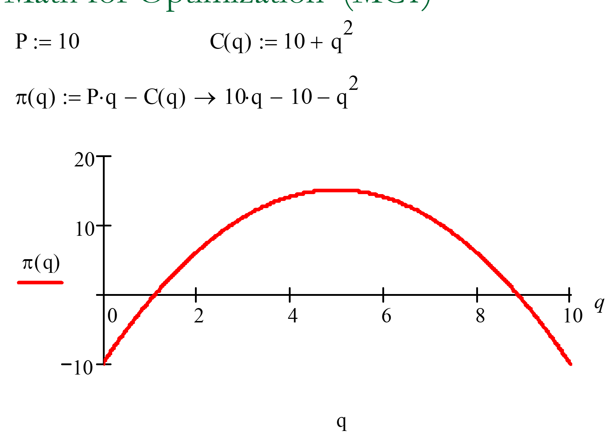

$$\pi(q) = 10q - 10 - q^2 \qquad \frac{d\pi(q)}{dq} = 0 \;\Longrightarrow\; q = 5$$

- The first-order condition — setting the derivative to zero — is **necessary** for a maximum

---

## Necessary but Not Sufficient

$$f(x) = x^2 - 10x + 20, \qquad \frac{d^2f(x)}{dx^2} = 2 > 0$$

- $f'(x)=0$ alone doesn't tell you whether you've found a max or a min — here it's a **minimum**, not a maximum, at $x=5$
- The sign of the second derivative is what distinguishes them

---

## Necessary vs. Sufficient

- $f(x^*)$ is a maximum $\Rightarrow$ $f'(x^*) = 0$
  - $f'(x^*)=0$ is a *necessary* condition for a max
  - It does **not** follow that $f'(x^*)=0 \Rightarrow f(x^*)$ is a maximum — necessary is not sufficient
- $f(x^*)$ is a maximum $\Leftarrow$ $f'(x^*) = 0$ **and** $f''(x^*) < 0$
  - Together, these are necessary *and* sufficient

---

## Necessary and Sufficient Conditions

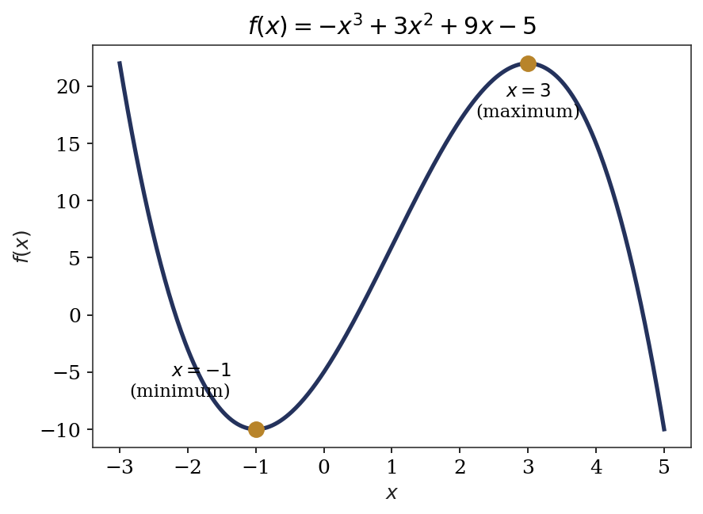

$$\text{Maximum:} \quad f'(x) = 0, \; f''(x) < 0 \qquad \text{Minimum:} \quad f'(x) = 0, \; f''(x) > 0$$

---

## Inflection Points

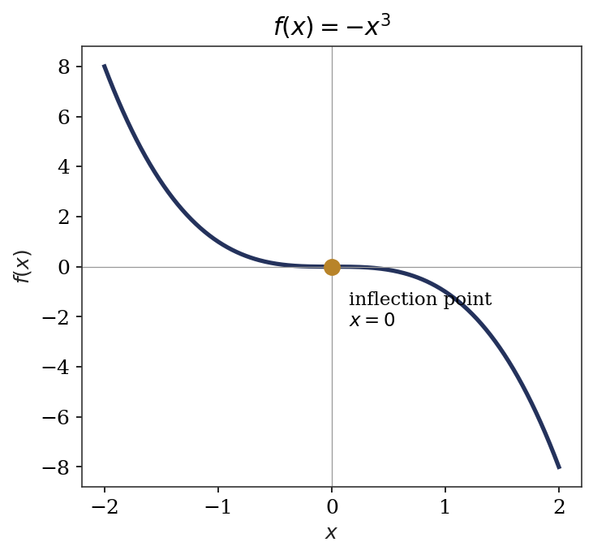

$$f(x) = -x^3, \qquad \left.\frac{df(x)}{dx}\right|_{x=0} = 0, \qquad \frac{d^2f(x)}{dx^2} = -6x, \qquad \left.\frac{d^2f(x)}{dx^2}\right|_{x=0} = 0$$

- At $x=0$ both derivatives vanish — neither a max nor a min, an **inflection point**

---

## Multivariable Functions

Optimization problems in economics almost always involve more than one choice variable:

---

## Surface and Contour Plots

$$f(x,y) = \sqrt{x} \cdot \sqrt{y}$$

 

- The 3-D surface and its contour map are two views of the same function
- *(Rotate this surface yourself — see [`topic02_constrained_optimization_figures.ipynb`](../../notebooks/topic02_constrained_optimization_figures.ipynb))*

---

## Partial Derivatives

$$f(x,y) = x^{1/4} y^{3/4}$$

$$f_x = \frac{\partial f(x,y)}{\partial x} = \frac{1}{4} x^{-3/4} y^{3/4} \qquad f_y = \frac{\partial f(x,y)}{\partial y} = \frac{3}{4} x^{1/4} y^{-1/4}$$

- $f_x$ shows how the objective changes with a marginal increase in $x$, holding $y$ constant
- Evaluated at $(10,10)$: $f_x(10,10) = \frac{1}{4}$, $\quad f_y(10,10) = \frac{3}{4}$

---

## Partial Derivatives: A Graphical View

> *Both cross-sections keep rising without bound — confirming this function is unbounded, with no unconstrained maximum.*

---

## Unconstrained Maximization: An Example

$$f(x,y) = 100 - (x-5)^2 - (y-10)^2$$

---

## Solving for the Unconstrained Maximum

$$f(x,y) = 100 - (x-5)^2 - (y-10)^2$$

First-order conditions:

$$f_x = -2(x-5) = 0 \;\Rightarrow\; x = 5 \qquad\qquad f_y = -2(y-10) = 0 \;\Rightarrow\; y = 10$$

$$f(5,10) = 100$$

---

## Implicit Functions

$$\begin{array}{cc} y = mx+b & \text{explicit} \\ y - mx - b = 0 & \text{implicit} \\ f(x,y;m,b) = 0 & \text{implicit, general} \end{array}$$

$$f(x,y) = 2x^2+y^2 \qquad\qquad f(x,y) = 100 \;\Longrightarrow\; y = \sqrt{100 - 2x^2}$$

---

## The Chain Rule

$f(x,y)$ where $x$ and $y$ are themselves functions of $t$: $f(x(t), y(t))$.

Chain rule for the derivative of $f$ with respect to $t$:

$$\frac{df(x(t),y(t))}{dt} = \frac{\partial f(x,y)}{\partial x}\cdot\frac{dx}{dt} + \frac{\partial f(x,y)}{\partial y}\cdot\frac{dy}{dt} = f_x \cdot \frac{dx}{dt} + f_y \cdot \frac{dy}{dt}$$

---

## Chain Rule and Total Differentiation

If you haven't seen a total differential before, think of it this way: suppose $x$ and $y$ are both functions of $t$. Applying the chain rule gives:

$$f_x \cdot \frac{dx}{dt} + f_y \cdot \frac{dy}{dt} = 0 \qquad \Longrightarrow \qquad f_x \, dx + f_y \, dy = 0$$

**Example:** $xy - 10 = 0$

$$y \cdot \frac{dx}{dt} + x \cdot \frac{dy}{dt} = 0 \quad\Longrightarrow\quad \frac{dy}{dx} = -\frac{y}{x} = -\frac{10}{x^2} \qquad \left(\text{directly: } y = \frac{10}{x} \Rightarrow \frac{dy}{dx} = -\frac{10}{x^2}\right)$$

- Two routes to the same slope: total differentiation, or solving for $y$ and differentiating directly

---

## Contour Lines and Total Differentiation

An **iso-height contour line** for $f(x,y)$ is the set of all $(x,y)$ that give $f$ the same height $c$ — i.e., the set satisfying

$$(\ast\ast) \qquad f(x,y) = c$$

Totally differentiating both sides of $(\ast\ast)$:

$$f_x \, dx + f_y \, dy = 0$$

---

## Contour Lines: The Slope

$$f_y \, dy = -f_x \, dx \qquad\Longrightarrow\qquad \frac{dy}{dx} = -\frac{f_x}{f_y}$$

**Example:** $f(x,y) = xy$, so $f_x = y$ and $f_y = x$:

$$\frac{dy}{dx} = -\frac{f_x}{f_y} = -\frac{y}{x}$$

- At $(x,y) = (10,10)$: $\dfrac{dy}{dx} = -1$
- At $(x,y) = (20,5)$: $\dfrac{dy}{dx} = -\dfrac{5}{20} = -\dfrac{1}{4}$

---

## Isoquants

$q = f(x,y)$ is an **isoquant** — $x, y$ are inputs, $q$ the quantity produced; $f(x,y)=100$ defines the $q=100$ isoquant.

---

## Iso-Level (Contour) Lines

- The tangent line's slope *flattens* as you move along the curve — a declining **MRTS** (Marginal Rate of Technical Substitution)
- *(Try different output levels and evaluation points interactively — see [`topic02_constrained_optimization_figures.ipynb`](../../notebooks/topic02_constrained_optimization_figures.ipynb))*

---

## Implicit Differentiation: Another Route

$$f(x,y) = 2x^2 + y^2 = 100$$

Differentiating $4x\,dx + 2y\,dy = 0$ with respect to $t$ (or directly as differentials):

$$4x \frac{dx}{dt} + 2y \frac{dy}{dt} = 0 \qquad\Longrightarrow\qquad \frac{dy}{dx} = -2\frac{x}{y}$$

- Same result whether you think of $x,y$ as functions of $t$, or work directly with differentials

---

## Two Equations, Two Unknowns

$$f(x,y) = xy + 10y + 10x - x^2 - y^2$$

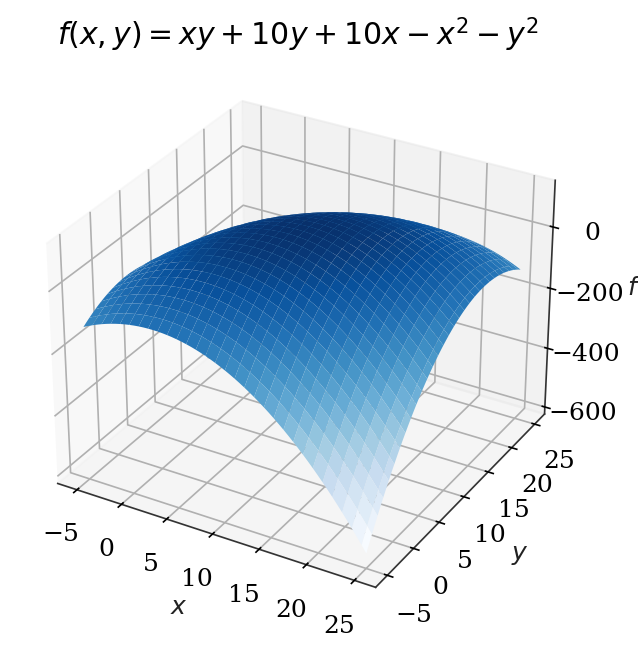

---

## The Substitution Method

Solve the first FOC for $y$ as a function of $x$, then substitute back into $f$:

$$y(x) := \frac{d}{dx}f(x,y) = 0 \;\Longrightarrow\; y = 2x - 10$$

$$\frac{d}{dx}f(x,y(x)) = 0 \;\Longrightarrow\; x = 10$$

---

## Utility as a Multivariable Function

$$u(c_1,c_2) = c_1 c_2$$

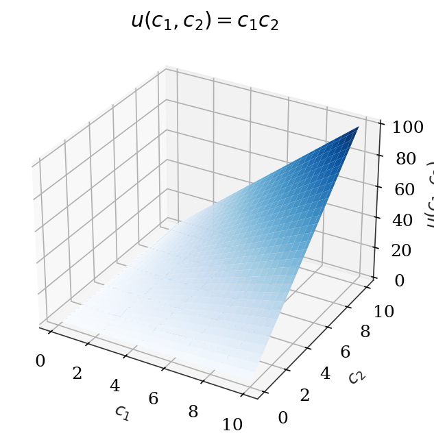

- The same calculus toolkit — partial derivatives, the chain rule, total differentiation — applies directly to utility maximization, which is where we're headed next

---

<!-- _class: divider -->

# Part II
# The Tangency and Lagrange Methods

Solving constrained optimization problems: substitution, tangency, arbitrage, and the Method of Lagrange

---

## A Motivating Example

$$\max_{c_1,c_2} \; u(c_1,c_2) = c_1 c_2 \qquad \text{s.t.} \quad p_1 c_1 + p_2 c_2 \le I$$

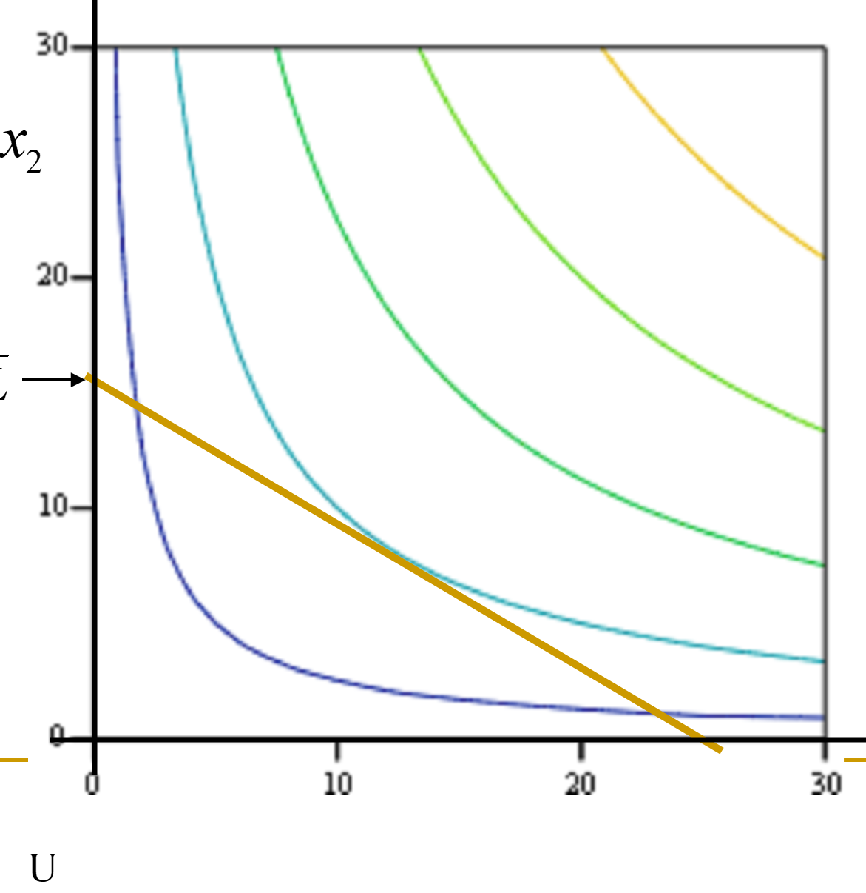

- Each curve is an indifference curve; the line is the budget line — we want the highest indifference curve still touching it

---

## The Substitution Method

Solve the constraint for $c_2$ as a function of $c_1$, then substitute into the objective:

$$c_2(c_1) = \frac{I}{p_2} - \frac{p_1}{p_2}c_1 \qquad\Longrightarrow\qquad \max_{c_1} \; c_1\left(\frac{I}{p_2} - \frac{p_1}{p_2}c_1\right)$$

$$\frac{du}{dc_1} = \frac{I}{p_2} - 2\frac{p_1}{p_2}c_1 = 0 \qquad\Longrightarrow\qquad c_1 = \frac{I}{2p_1}, \qquad p_1 c_1 = \frac{I}{2}$$

- Turns a 2-variable constrained problem into a 1-variable unconstrained one — works, but doesn't generalize well once constraints get more complicated

---

## Indifference Curves and the MRS

$$u(c_1,c_2) = c_1 c_2$$

Along an indifference curve $u(c_1,c_2) = \bar u$, totally differentiating gives $u_1\,dc_1 + u_2\,dc_2 = 0$, so

$$\frac{dc_2}{dc_1} = -\frac{u_1}{u_2} = MRS \qquad \text{where} \quad u_1 = \frac{\partial u}{\partial c_1} = MU_1, \quad u_2 = \frac{\partial u}{\partial c_2} = MU_2$$

- The **MRS** is the slope of the indifference curve — how much $c_2$ the consumer would give up for one more unit of $c_1$, staying equally happy

---

## The Tangency Method

Budget constraint $p_1c_1 + p_2c_2 = I$ has slope $\dfrac{dc_2}{dc_1} = -\dfrac{p_1}{p_2}$.

At an optimum, the indifference curve must be tangent to the budget line — the two slopes match:

$$\frac{u_1}{u_2} = \frac{p_1}{p_2} \qquad\Longleftrightarrow\qquad \frac{u_1}{p_1} = \frac{u_2}{p_2}$$

- Necessary condition for a maximum: **marginal utility per dollar spent must be equalized** across goods

---

## The Arbitrage Argument

*Why* must MU per dollar be equalized? Suppose instead $\dfrac{u_1}{p_1} > \dfrac{u_2}{p_2}$ — good 1 delivers more utility per dollar than good 2:

- Reallocating income toward good 1 (and away from good 2) raises utility — so this **cannot** be optimal
- Symmetrically, if $\dfrac{u_1}{p_1} < \dfrac{u_2}{p_2}$, reallocate the other way
- Only when $\dfrac{u_1}{p_1} = \dfrac{u_2}{p_2}$ are there no more utility-improving reallocations left

---

## The Marginal Utility of Income

$$\lambda := \frac{u_1}{p_1} = \frac{u_2}{p_2}$$

- $\lambda$ is the common MU-per-dollar at the optimum — interpreted as the **marginal utility of income**: how much utility rises from slightly relaxing the budget constraint

---

## Solving the Cobb-Douglas Example

Two equations, two unknowns — tangency condition plus budget constraint. For $u(c_1,c_2) = c_1 c_2$: $u_1 = c_2$, $u_2 = c_1$, so

$$\frac{c_2}{c_1} = \frac{p_1}{p_2} \;\Rightarrow\; p_1 c_1 = p_2 c_2 \qquad\qquad p_1c_1 + p_2c_2 = I \;\Rightarrow\; p_1c_1 + p_1c_1 = I$$

$$\Longrightarrow \qquad c_1 = \frac{I}{2p_1}, \qquad c_2 = \frac{I}{2p_2}$$

- Same answer as the substitution method — the tangency condition is just a more general route to it

---

## The Method of Lagrange

A way to remember — and generalize — the tangency method. Build a new function $L$ combining the objective and the constraint:

$$L(c_1,c_2,\lambda) = u(c_1,c_2) + \lambda\big(I - p_1c_1 - p_2c_2\big)$$

First-order conditions for an unconstrained maximum of $L$:

$$\frac{\partial L}{\partial c_1} = u_1 - \lambda p_1 = 0 \qquad \frac{\partial L}{\partial c_2} = u_2 - \lambda p_2 = 0 \qquad \frac{\partial L}{\partial \lambda} = I - p_1c_1 - p_2c_2 = 0$$

- The first two FOCs together give exactly the tangency condition $\frac{u_1}{u_2} = \frac{p_1}{p_2}$; the third just restates the budget constraint

---

## Checking the Answer Symbolically

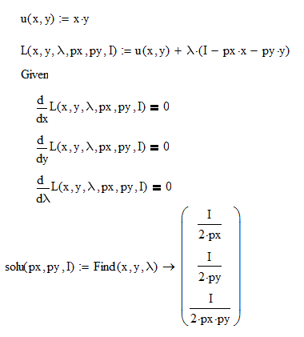 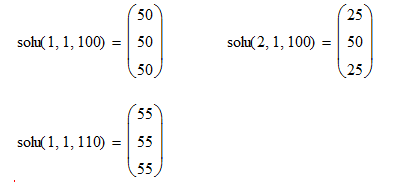

- A computer algebra system confirms the closed form solved by hand: $c_1 = \frac{I}{2p_1}$, $c_2 = \frac{I}{2p_2}$, $\lambda = \frac{I}{2 p_1 p_2}$
- *(The companion notebook rebuilds this exact check with Python/SymPy — see [`notebooks/`](../../notebooks/))*

---

## The Arbitrage Argument, Generalized

The same reallocation logic applies to **any** problem $\max f(x_1,x_2)$ s.t. $g(x_1,x_2) = c$, not just utility maximization:

- Start from a candidate $(x_1,x_2)$ satisfying the constraint exactly, and consider a small reallocation along it: $g_1\,dx_1 + g_2\,dx_2 = 0$, so a move of $dx_1 = dc/g_1$ requires $dx_2 = -dc/g_2$
- Marginal benefit from more $x_1$: $\;dx_1 \cdot f_1 = \frac{dc}{g_1}f_1\qquad$ Marginal cost from less $x_2$: $\;dx_2 \cdot f_2 = -\frac{dc}{g_2}f_2$
- Worthwhile whenever $\left(\dfrac{f_1}{g_1} - \dfrac{f_2}{g_2}\right)dc > 0$ — so at an optimum, with no further improving reallocations:

$$\frac{f_1}{g_1} = \frac{f_2}{g_2} \qquad \Big(\text{each} = \lambda,\ \text{the benefit-cost ratio}\Big)$$

---

## Method of Lagrange: General Form

$$L(x_1,x_2,\lambda) = f(x_1,x_2) + \lambda\big(c - g(x_1,x_2)\big)$$

$$\frac{\partial L}{\partial x_1} = f_1 - \lambda g_1 = 0 \qquad \frac{\partial L}{\partial x_2} = f_2 - \lambda g_2 = 0 \qquad \frac{\partial L}{\partial \lambda} = c - g(x_1,x_2) = 0$$

$$\Longrightarrow \qquad \frac{f_1}{g_1} = \frac{f_2}{g_2} = \lambda, \qquad g(x_1,x_2) = c$$

- Exactly the utility-maximization Lagrangian, with $f \to u$ and $g \to$ the budget constraint — the method doesn't care what $f$ and $g$ *mean*

---

## Application: Labor Allocation and a PPF

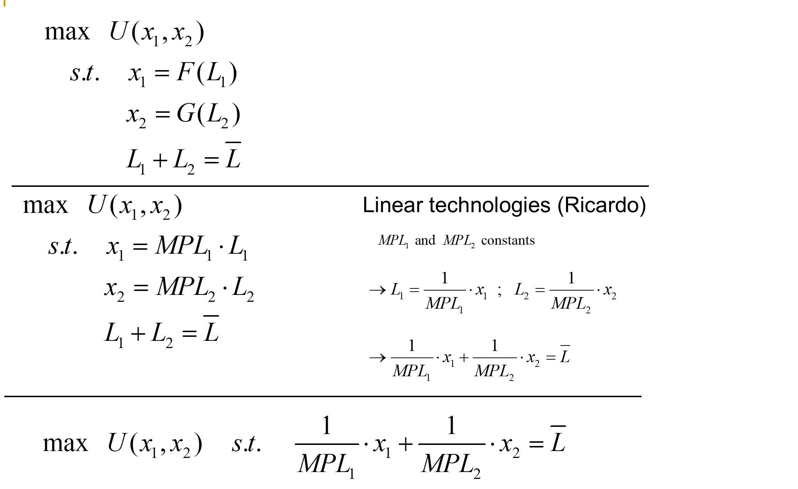

- With linear technologies (constant $MPL_1$, $MPL_2$ — a Ricardian production possibility frontier), labor requirements $L_1, L_2$ can be written directly in terms of outputs $x_1, x_2$, turning the resource constraint $L_1+L_2=\bar L$ into a constraint on $(x_1,x_2)$ directly

---

## Solving It: Welfare Maximization Along the PPF

$$\max_{x_1,x_2} \; U(x_1,x_2) \quad\text{s.t.}\quad \frac{x_1}{MPL_1}+\frac{x_2}{MPL_2} = \bar L$$

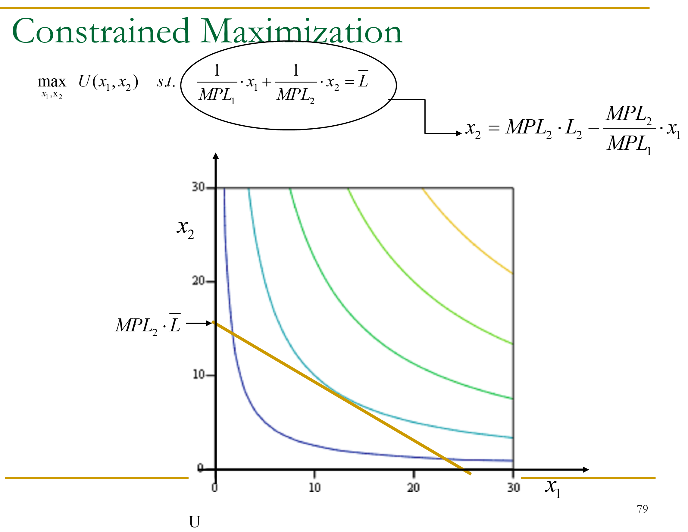

---

## The PPF Lagrangian

$$L(x_1,x_2,\lambda) = u(x_1,x_2) + \lambda\left(\bar L - \frac{x_1}{MPL_1} - \frac{x_2}{MPL_2}\right)$$

$$\frac{u_1}{u_2} = \frac{MPL_2}{MPL_1} \qquad\qquad \frac{x_1}{MPL_1}+\frac{x_2}{MPL_2} = \bar L$$

- $\lambda = u_1 \cdot MPL_1 = u_2 \cdot MPL_2$ — the value, in utility, of one more unit of labor
- *(Solved symbolically and checked numerically — see [`topic02_constrained_optimization_numerical.ipynb`](../../notebooks/topic02_constrained_optimization_numerical.ipynb))*

---

## Generalizing: $n$ Variables, $M$ Constraints

One constraint, $n$ choice variables:

$$L = f(x_1,\dots,x_n) + \lambda\big(c - g(x_1,\dots,x_n)\big) \qquad\qquad \frac{\partial L}{\partial x_i} = f_i - \lambda g_i = 0 \;\; \forall i$$

$$\lambda = \frac{f_1}{g_1} = \frac{f_2}{g_2} = \cdots = \frac{f_n}{g_n}$$

$M$ constraints, one multiplier per constraint:

$$L = f(x_1,\dots,x_n) + \sum_{m=1}^{M} \lambda_m\big(c_m - g^m(x_1,\dots,x_n)\big)$$

- $\lambda$ is always a **benefit-cost ratio**: how much the objective improves per unit of relaxing a constraint

---

## Corner Solutions and Non-Binding Constraints

So far we've implicitly assumed an **interior** solution and a **binding** constraint — FOCs hold as equalities, second-order conditions (concavity) guarantee a max. Most examples in this course are set up this way.

- But a full treatment of the Method of Lagrange needs to allow for **corner solutions** (some $x_i = 0$) and **non-binding constraints** too

---

## Example: A Corner Solution

$$\frac{MU_1}{MU_2} < \frac{p_1}{p_2} \quad \text{everywhere along the budget line}$$

- Good 2 delivers higher marginal utility per dollar than good 1 at *every* affordable bundle — so it's optimal to spend nothing on good 1: $c_1 = 0$
- At the corner, the FOC becomes an inequality rather than an equality: $\dfrac{\partial u}{\partial c_1} - \lambda p_1 < 0$
- *(A genuine corner, solved numerically — `scipy` lands on it directly — see [`topic02_constrained_optimization_numerical.ipynb`](../../notebooks/topic02_constrained_optimization_numerical.ipynb))*

---

## Complementary Slackness

Restating the Lagrangian FOCs to allow for corners (with $L = u(c_1,c_2)+\lambda(I-p_1c_1-p_2c_2)$), for each choice variable $c_i$:

$$\frac{\partial L}{\partial c_i} = u_i - \lambda p_i = 0, \; c_i > 0 \quad\text{(interior)} \qquad\text{or}\qquad \frac{\partial L}{\partial c_i} = u_i - \lambda p_i \le 0, \; c_i = 0 \quad\text{(corner)}$$

Similarly, the constraint itself may or may not bind:

$$\frac{\partial L}{\partial \lambda} = I - p_1c_1 - p_2c_2 = 0, \; \lambda > 0 \quad\text{(binds)} \qquad\text{or}\qquad \frac{\partial L}{\partial \lambda} > 0, \; \lambda = 0 \quad\text{(slack)}$$

- Each pair summarized as a single **complementary slackness** condition: $\dfrac{\partial L}{\partial c_i}\cdot c_i = 0$ and $\dfrac{\partial L}{\partial \lambda}\cdot \lambda = 0$

---

## As a Practical Matter

- Often we make enough assumptions up front to know the solution is interior — then Lagrange with equality constraints (as in Part I) is all that's needed
- When you're *not* sure:
  - Specify the different possible cases and use economic logic to narrow down the likely ones
  - A non-binding constraint can simply be dropped — solve using the remaining equalities
  - Compare the objective across candidate solutions to find the best one
  - *(An alternative method using slack variables is described in the textbook)*

---

## Application: Multiple Constraints

**Earthquake relief (Problem Set 1, Q3).** A non-profit has raised $I = \$100K$ to buy food and water for delivery by boat:

$$p_F = \$1K/\text{ton} \qquad p_W = \$2K/\text{ton} \qquad \text{boat capacity } T = 80 \text{ tons}$$

$$\max_{c_F,c_W} u(c_F,c_W) \quad\text{s.t.}\quad p_F c_F + p_W c_W \le I \qquad\qquad c_F + c_W \le T$$

- Two constraints — budget **and** boat capacity — so two multipliers, $\lambda$ and $\mu$

---

## Complementary Slackness with Two Constraints

$$L(c_F,c_W,\lambda,\mu) = u(c_F,c_W) + \lambda(I - p_Fc_F - p_Wc_W) + \mu(T - c_F - c_W)$$

$$\frac{\partial L}{\partial \lambda}\cdot\lambda = 0: \qquad \frac{\partial L}{\partial\lambda} = I - p_Fc_F - p_Wc_W = 0 \text{ if } \lambda>0, \qquad {}>0 \text{ if } \lambda = 0$$

$$\frac{\partial L}{\partial \mu}\cdot\mu = 0 \qquad \text{(same logic for the capacity constraint)}$$

- Each constraint binds ($\lambda,\mu>0$) or is slack ($\lambda,\mu=0$) independently — solving the earthquake problem itself means working out *which* case applies here, continued next

---

## The Feasible Region

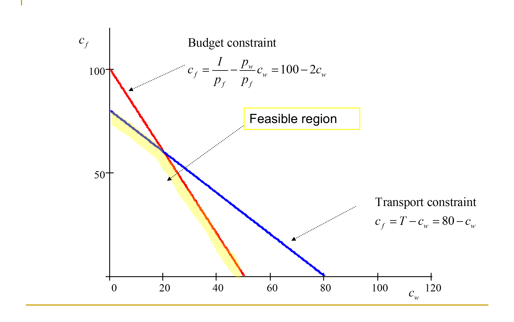

- The budget line and the transport-capacity line each cut off part of the plane; only bundles below **both** are affordable *and* shippable

---

## Three Possible Cases

Depending on preferences — which constraint(s) actually bind — the optimum falls into one of three cases:

1. $\lambda > 0,\ \mu = 0$ — budget binds, transport capacity has room to spare
2. $\lambda = 0,\ \mu > 0$ — transport capacity binds, budget has money to spare
3. $\lambda > 0,\ \mu > 0$ — both bind at once (the kink point)

- These are **three different possible preference maps**, not three indifference curves for one consumer — indifference curves can never cross, so for any *given* set of preferences only one case actually holds

---

## Case: Transport Binds, Budget Slack

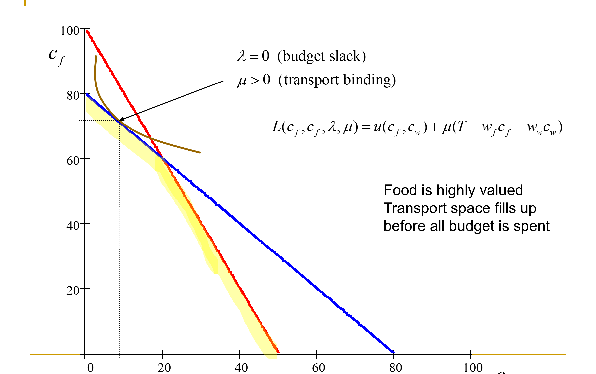

- Food ($c_F$) is highly valued relative to its cost — the consumer fills up the boat's capacity before spending the whole budget

---

## Case: Budget Binds, Transport Slack

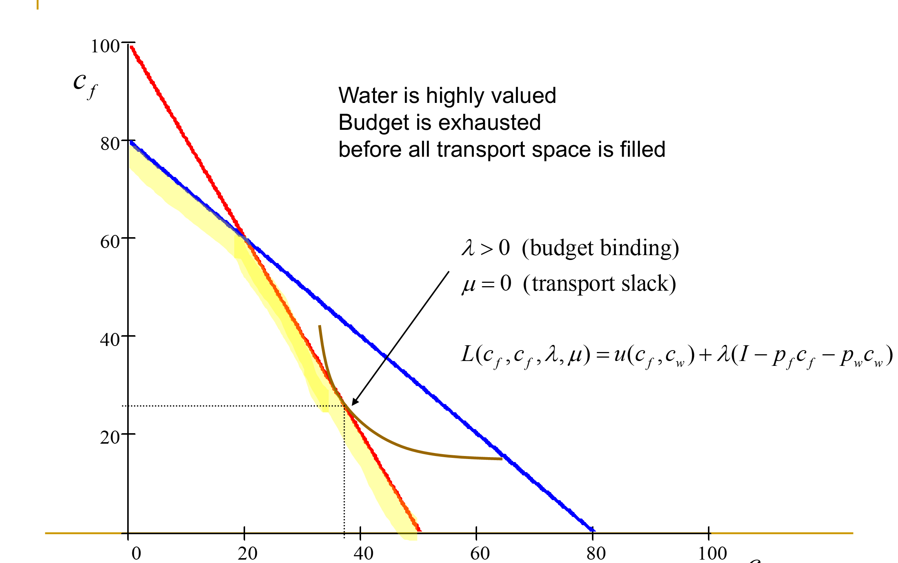

- Water ($c_W$) is highly valued relative to its cost — the consumer exhausts the budget while the boat still has room left

---

## Case: Both Constraints Bind

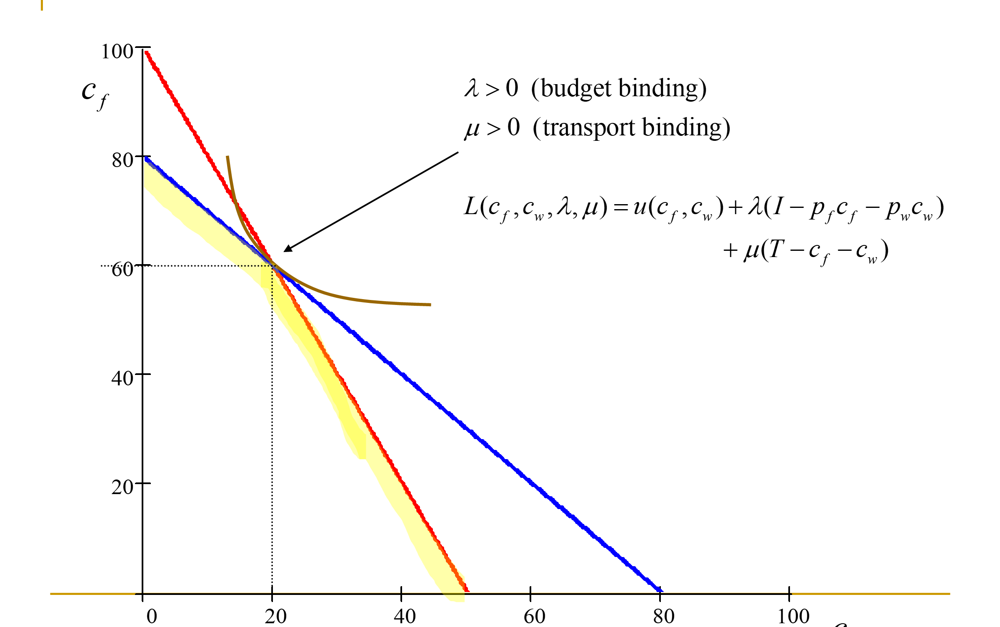

- Preferences are balanced enough that the optimum sits exactly at the corner where the budget and capacity lines cross

---

## Solving Problems with Multiple Constraints

Work out the solution under each possible combination of binding/non-binding constraints separately:

- Solve assuming $(\lambda>0,\mu=0)$, then $(\lambda=0,\mu>0)$, then $(\lambda>0,\mu>0)$
- Each case hands you *a* candidate solution — but setting a multiplier to zero ignores that constraint, so the resulting candidate may violate it and turn out **infeasible**
- Discard infeasible candidates, then choose whichever feasible candidate gives the **highest objective value**

---

## Worked Example: The Earthquake Relief Problem

$$U(c_F,c_W) = c_F \cdot c_W \qquad p_F=1,\ p_W=2,\ I=100,\ T=80$$

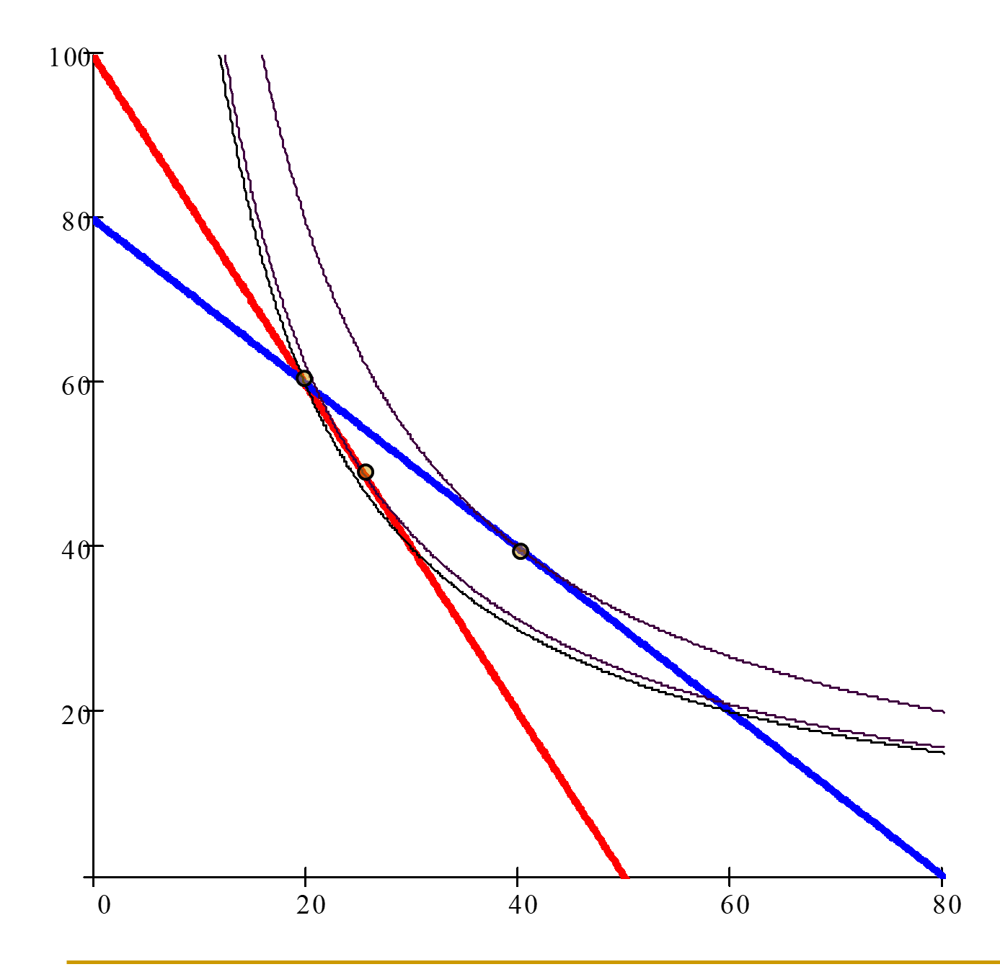

- Solving each of the three cases gives three candidate bundles, marked above

---

## Worked Example: Choosing the Winner

| Case | $(c_W^*, c_F^*)$ | Feasible? | $U$ |
|---|---|---|---|
| Budget binds only | $(25, 50)$ | Yes (transport slack: $75 \le 80$) | $\mathbf{1250}$ |
| Both bind | $(20, 60)$ | Yes | $1200$ |
| Transport binds only | $(40, 40)$ | **No** — violates budget ($40+80=120>100$) | 1600 |

- Discarding the infeasible candidate, the winner is **budget-binds-only**: $(c_W^*,c_F^*)=(25,50)$, $U^*=1250$
- *(Solved two ways — case-by-case and in one `scipy` call — plus a numerical check of $\lambda$ as a shadow price: see [`topic02_constrained_optimization_numerical.ipynb`](../../notebooks/topic02_constrained_optimization_numerical.ipynb))*

---

## The Art of the Solve

- Setting up a full Lagrangian is often more work than needed
- Look for easy substitutions to reduce the number of constraints, or rescale the objective when the scale itself doesn't matter
- Use economic intuition to rule out unlikely cases before grinding through the algebra
- Learn to recognize familiar problem "families" — once you've solved one Cobb-Douglas budget problem, you've essentially solved them all
- One more family worth recognizing: the same first-order-condition logic, run for two agents at once, is exactly how you solve a **game** — Part III

---

<!-- _class: divider -->

# Part III
# Optimization Meets Strategy

Same first-order conditions, but now two agents optimize at once

---

## Remember the Fisherman's Dilemma?

Topic 1 met Alfredo and Bob: $u_A(e_A,e_B) = \left(15-\tfrac14 e_B\right)e_A - \tfrac12 e_A^2$, and symmetrically for Bob.

- Setting the FOC to zero gave a best response, $e_A^{BR}(e_B)=15-\tfrac14 e_B$ — but only informally, for the symmetric case, without checking the second-order condition
- Nash equilibrium **(12, 12)**; planner's optimum **(10, 10)** — asserted there, not derived as a general system
- Now that Lagrange and Kuhn–Tucker are fully in hand, we come back and do it properly

---

## A Game Is a System of Optimization Problems

- A single-agent problem: **one** objective, one or more choice variables — everything Part II has been about
- A **game**: *each* player solves their own optimization problem — but the objective depends on a variable *someone else* chooses
- Player A's problem: $\max_{e_A} u_A(e_A, e_B)$, treating $e_B$ as **given**, not chosen
- Solving each player's FOC alone gives a **best-response function**; a Nash equilibrium is where every player's best response holds *simultaneously* — a system of equations, not a single optimization

---

## Deriving the Best Response, Properly

First-order condition for Alfredo, holding $e_B$ fixed:

$$\frac{\partial u_A}{\partial e_A} = \left(15-\tfrac14 e_B\right) - e_A = 0 \quad\Longrightarrow\quad e_A^{BR}(e_B) = 15-\tfrac14 e_B$$

Second-order condition — this time actually checked, not waved at:

$$\frac{\partial^2 u_A}{\partial e_A^2} = -1 < 0 \qquad\checkmark\ \text{concave: a genuine maximum}$$

By symmetry, Bob's best response is $e_B^{BR}(e_A)=15-\tfrac14 e_A$

<!-- Verified symbolically (sympy diff + solve) in topic02_constrained_optimization_numerical.ipynb, Worked Example 5. -->

---

## Solving the System: Nash as Simultaneous Equations

Two first-order conditions, two unknowns — solved together, not assumed symmetric:

$$e_A = 15-\tfrac14 e_B \qquad\qquad e_B = 15-\tfrac14 e_A$$

Substituting: $e_A = 15-\tfrac14\left(15-\tfrac14 e_A\right) \;\Rightarrow\; \tfrac{15}{16}e_A = \tfrac{45}{4} \;\Rightarrow\; e_A^*=12$

$$\boxed{(e_A^*,e_B^*) = (12,12)}$$

Symmetry was never assumed — it fell out of the algebra, because the underlying model is itself symmetric. Matches Topic 1 exactly.

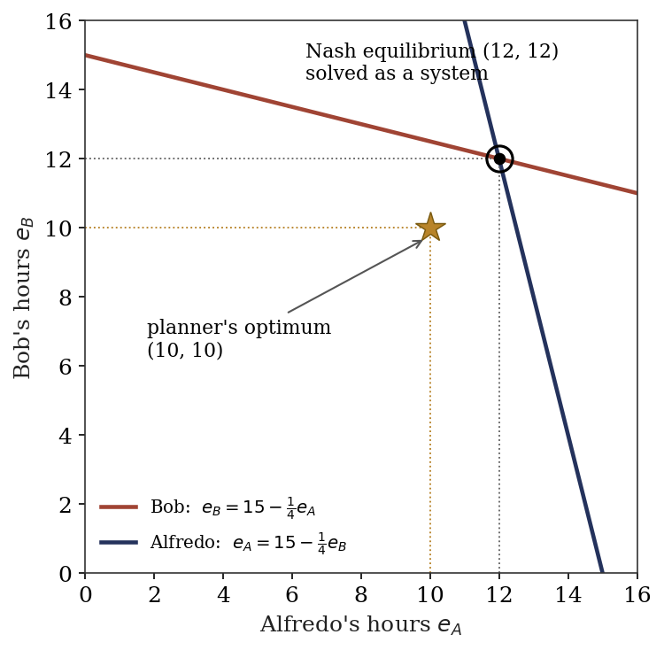

---

## The Planner's Problem, Fully

The planner controls **both** efforts at once — one decision-maker, two choice variables — an unconstrained optimization, solved by the same method with zero constraints:

$$W(e_A,e_B) = u_A+u_B = 15e_A+15e_B-\tfrac12 e_Ae_B - \tfrac12e_A^2-\tfrac12e_B^2$$

$$\frac{\partial W}{\partial e_A}=15-\tfrac12 e_B - e_A = 0 \qquad\qquad \frac{\partial W}{\partial e_B}=15-\tfrac12 e_A - e_B=0$$

Symmetric solution: $e^P=10$. Both second partials are $-1$ and the cross partial is $-\tfrac12$ — negative definite, a genuine maximum, confirmed rather than assumed

**Nash overprovides effort relative to the planner** ($12>10$) precisely because each player ignores the $-\tfrac14 e_B$ (or $-\tfrac14 e_A$) term in the *other's* payoff — the externality, made visible as a missing term in a first-order condition

---

## What If Effort Can't Go Negative?

Every solution so far assumed an **interior** optimum — but effort must satisfy $e\ge 0$, a constraint quietly ignored until now

- Could a strong externality push a best response negative? Worth *checking*, not assuming — the same complementary-slackness logic as "Corner Solutions and Non-Binding Constraints"
- Alfredo's best response hits zero when $15-\tfrac14 e_B=0 \;\Rightarrow\; e_B=60$
- Actual $e_B$ in this game never exceeds 12 — far below 60 — so $e_A\ge0$ never binds
- The interior solution is the *genuine* optimum: a fact confirmed, not an assumption that happened to get away with it

---

## A Second Game, Same Math: Cournot Duopoly

Two firms choose **quantities** $q_1,q_2$. Price is set by a linear inverse demand curve; both share a constant marginal cost $c$:

$$P = a-b(q_1+q_2) \qquad\qquad \pi_i = (P-c)\,q_i$$

- Same skeleton as the fisherman's game: each firm's profit depends on a choice *someone else* makes
- Best response, from the FOC: $\dfrac{\partial \pi_1}{\partial q_1} = (a-c)-2bq_1-bq_2=0 \;\Rightarrow\; q_1^{BR}(q_2)=\dfrac{a-c}{2b}-\dfrac{q_2}{2}$
- With $a=20,\ b=1,\ c=2$: $q_1^{BR}(q_2) = 9-\tfrac12 q_2$ — a linear reaction function, exactly like the fisherman's

---

## Solving Cournot

$$q_1=9-\tfrac12 q_2 \qquad q_2=9-\tfrac12 q_1 \quad\Longrightarrow\quad \boxed{q_1^*=q_2^*=6}$$

| | Cournot-Nash | Collusive (joint-profit max) |
|---|---|---|
| Total quantity | $Q^*=12$ | $Q^m=9$ |
| Price | $P^*=8$ | $P^m=11$ |
| Profit **per firm** | $36$ | $40.5$ |

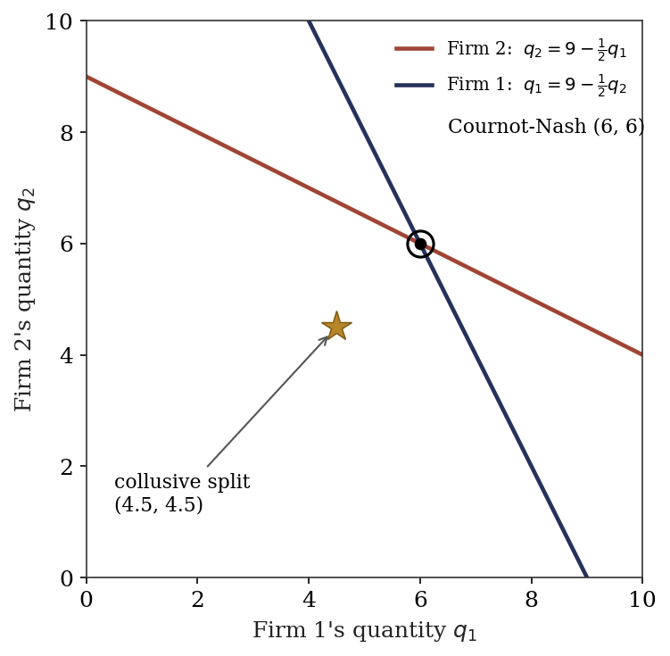

---

## Same Story, New Market

- Individually rational competition produces **more** of the strategic variable than the jointly optimal level, in *both* games — effort in the fishery, quantity here
- Total surplus left on the table: $72$ vs. $81$ under collusion
- Competition dissipates rents exactly the way overfishing dissipates the fishery's rent — market power is just the externality wearing a different economic costume

---

## Wrap-Up: The Same Toolkit, Two New Uses

- A game is a **system** of optimization problems — solve each player's FOC, then solve the system simultaneously; a Nash equilibrium is nothing more exotic than that
- Two examples, one underlying mathematical skeleton: linear reaction functions crossing at a unique equilibrium, generically *short of* the jointly efficient outcome
- **Ahead:** the *N*-player generalization — commons and public goods with many players, not just two — waits properly in Topic 9; contest games and other variants are candidates for problem sets

<!-- New Part III, added 2026-07-18 - not from the legacy pptx (Topic 2's original source material has no game-theory content). Reuses Topic 1's fisherman model exactly (Nash 12,12 / planner 10,10) and introduces Cournot duopoly as a twin example. Every number verified symbolically + numerically in topic02_constrained_optimization_numerical.ipynb (Worked Examples 5-6, including a new nash_solve helper generalizing the deck's existing lagrangian_solve); figures from topic02_constrained_optimization_figures.ipynb. See new_ideas.md for the original proposal and TOPIC_PLAN.md context. -->

