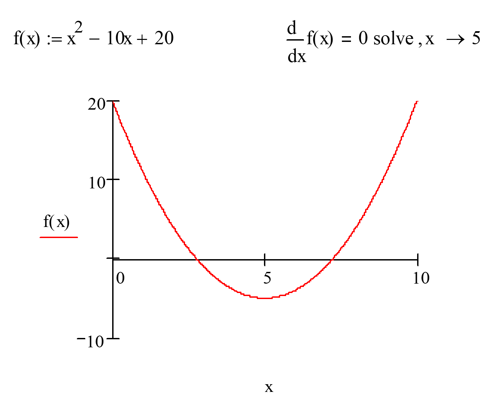
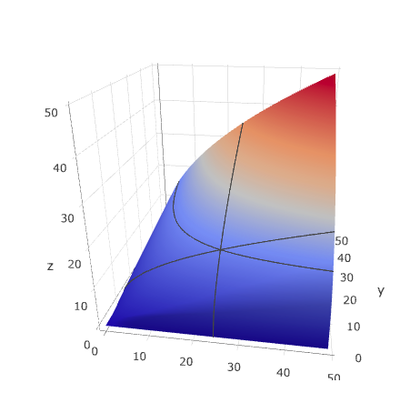
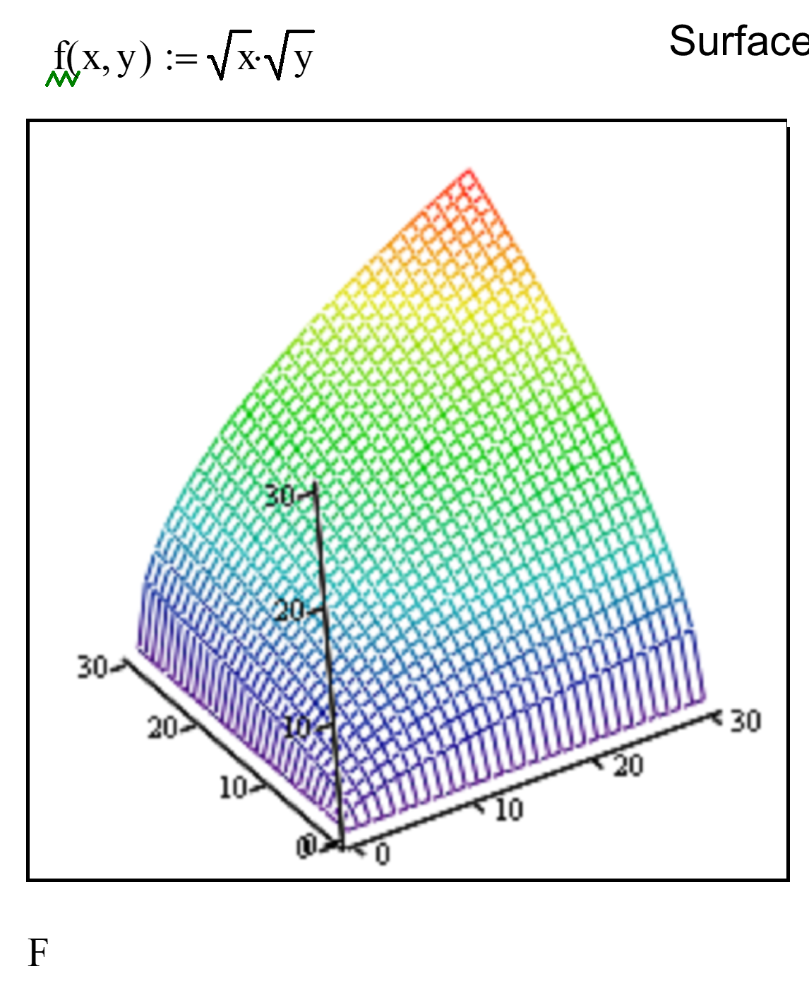
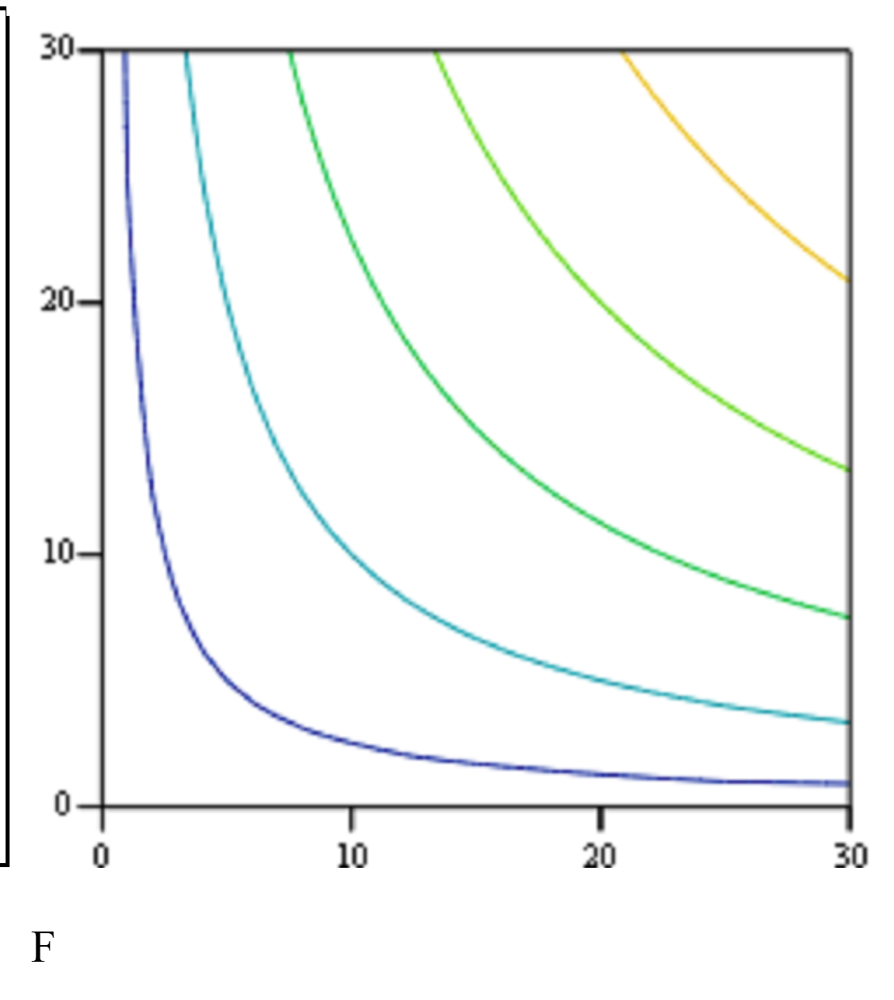
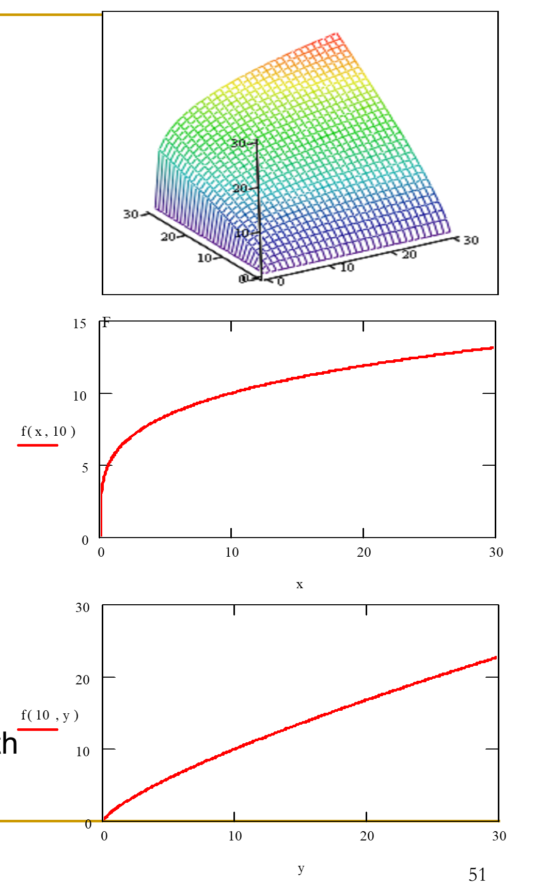
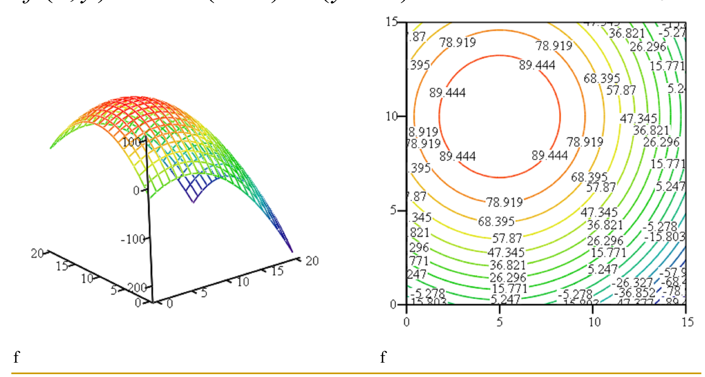
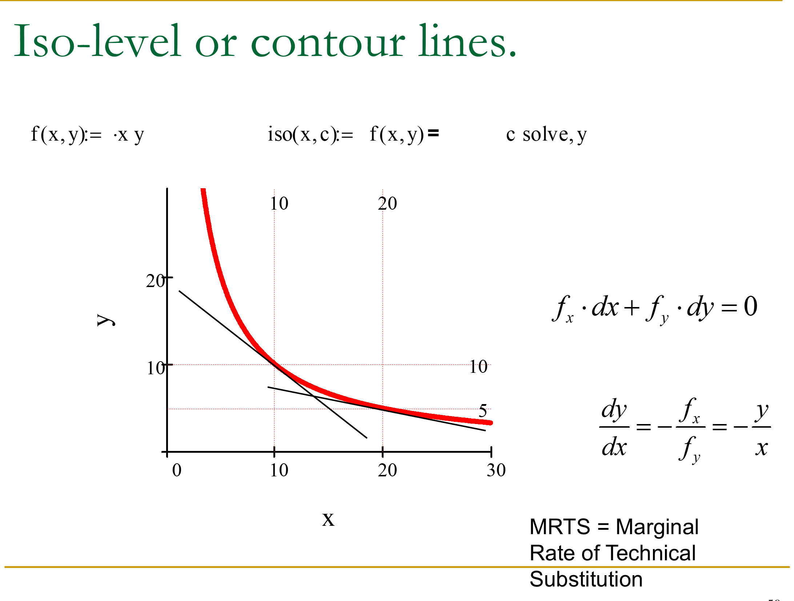
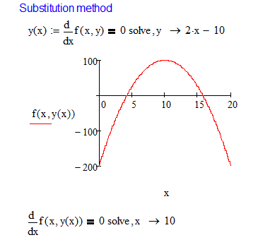

<!-- _class: divider -->

# Part I
# Mathematical Preliminaries

Unconstrained optimization, multivariable calculus, and implicit differentiation - the toolkit behind the Method of Lagrange

---

## Math for Optimization: A First Example

A profit-maximizing quantity choice, $\pi(q) = P \cdot q - C(q)$ with $P = 10$, $C(q) = 10 + q^2$:

$$\pi(q) = 10q - 10 - q^2 \qquad \frac{d\pi(q)}{dq} = 0 \;\Longrightarrow\; q = 5$$

- The first-order condition — setting the derivative to zero — is **necessary** for a maximum

---

## Necessary but Not Sufficient

$$f(x) = x^2 - 10x + 20, \qquad \frac{d^2f(x)}{dx^2} = 2 > 0$$

- $f'(x)=0$ alone doesn't tell you whether you've found a max or a min — here it's a **minimum**, not a maximum, at $x=5$
- The sign of the second derivative is what distinguishes them

---

## Necessary vs. Sufficient

- $f(x^*)$ is a maximum $\Rightarrow$ $f'(x^*) = 0$
  - $f'(x^*)=0$ is a *necessary* condition for a max
  - It does **not** follow that $f'(x^*)=0 \Rightarrow f(x^*)$ is a maximum — necessary is not sufficient
- $f(x^*)$ is a maximum $\Leftarrow$ $f'(x^*) = 0$ **and** $f''(x^*) < 0$
  - Together, these are necessary *and* sufficient

---

## Necessary and Sufficient Conditions

$$\text{Maximum:} \quad f'(x) = 0, \; f''(x) < 0 \qquad \text{Minimum:} \quad f'(x) = 0, \; f''(x) > 0$$

---

## Inflection Points

$$f(x) = -x^3, \qquad \left.\frac{df(x)}{dx}\right|_{x=0} = 0, \qquad \frac{d^2f(x)}{dx^2} = -6x, \qquad \left.\frac{d^2f(x)}{dx^2}\right|_{x=0} = 0$$

- At $x=0$ both derivatives vanish — neither a max nor a min, an **inflection point**

---

## Multivariable Functions

Optimization problems in economics almost always involve more than one choice variable:

---

## Surface and Contour Plots

$$f(x,y) = \sqrt{x} \cdot \sqrt{y}$$

 

- The 3-D surface and its contour map are two views of the same function

---

## Partial Derivatives

$$f(x,y) = x^{1/4} y^{3/4}$$

$$f_x = \frac{\partial f(x,y)}{\partial x} = \frac{1}{4} x^{-3/4} y^{3/4} \qquad f_y = \frac{\partial f(x,y)}{\partial y} = \frac{3}{4} x^{1/4} y^{-1/4}$$

- $f_x$ shows how the objective changes with a marginal increase in $x$, holding $y$ constant
- Evaluated at $(10,10)$: $f_x(10,10) = \frac{1}{4}$, $\quad f_y(10,10) = \frac{3}{4}$

---

## Partial Derivatives: A Graphical View

> *Both cross-sections keep rising without bound — confirming this function is unbounded, with no unconstrained maximum.*

---

## Unconstrained Maximization: An Example

$$f(x,y) = 100 - (x-5)^2 - (y-10)^2$$

---

## Solving for the Unconstrained Maximum

$$f(x,y) = 100 - (x-5)^2 - (y-10)^2$$

First-order conditions:

$$f_x = -2(x-5) = 0 \;\Rightarrow\; x = 5 \qquad\qquad f_y = -2(y-10) = 0 \;\Rightarrow\; y = 10$$

$$f(5,10) = 100$$

---

## Implicit Functions

$$\begin{array}{cc} y = mx+b & \text{explicit} \\ y - mx - b = 0 & \text{implicit} \\ f(x,y;m,b) = 0 & \text{implicit, general} \end{array}$$

$$f(x,y) = 2x^2+y^2 \qquad\qquad f(x,y) = 100 \;\Longrightarrow\; y = \sqrt{100 - 2x^2}$$

---

## The Chain Rule

$f(x,y)$ where $x$ and $y$ are themselves functions of $t$: $f(x(t), y(t))$.

Chain rule for the derivative of $f$ with respect to $t$:

$$\frac{df(x(t),y(t))}{dt} = \frac{\partial f(x,y)}{\partial x}\cdot\frac{dx}{dt} + \frac{\partial f(x,y)}{\partial y}\cdot\frac{dy}{dt} = f_x \cdot \frac{dx}{dt} + f_y \cdot \frac{dy}{dt}$$

---

## Chain Rule and Total Differentiation

If you haven't seen a total differential before, think of it this way: suppose $x$ and $y$ are both functions of $t$. Applying the chain rule gives:

$$f_x \cdot \frac{dx}{dt} + f_y \cdot \frac{dy}{dt} = 0 \qquad \Longrightarrow \qquad f_x \, dx + f_y \, dy = 0$$

**Example:** $xy - 10 = 0$

$$y \cdot \frac{dx}{dt} + x \cdot \frac{dy}{dt} = 0 \quad\Longrightarrow\quad \frac{dy}{dx} = -\frac{y}{x} = -\frac{10}{x^2} \qquad \left(\text{directly: } y = \frac{10}{x} \Rightarrow \frac{dy}{dx} = -\frac{10}{x^2}\right)$$

- Two routes to the same slope: total differentiation, or solving for $y$ and differentiating directly

---

## Contour Lines and Total Differentiation

An **iso-height contour line** for $f(x,y)$ is the set of all $(x,y)$ that give $f$ the same height $c$ — i.e., the set satisfying

$$(\ast\ast) \qquad f(x,y) = c$$

Totally differentiating both sides of $(\ast\ast)$:

$$f_x \, dx + f_y \, dy = 0$$

---

## Contour Lines: The Slope

$$f_y \, dy = -f_x \, dx \qquad\Longrightarrow\qquad \frac{dy}{dx} = -\frac{f_x}{f_y}$$

**Example:** $f(x,y) = xy$, so $f_x = y$ and $f_y = x$:

$$\frac{dy}{dx} = -\frac{f_x}{f_y} = -\frac{y}{x}$$

- At $(x,y) = (10,10)$: $\dfrac{dy}{dx} = -1$
- At $(x,y) = (20,5)$: $\dfrac{dy}{dx} = -\dfrac{5}{20} = -\dfrac{1}{4}$

$q = f(x,y)$ is an **isoquant** — $x, y$ are inputs, $q$ the quantity produced; $f(x,y)=100$ defines the $q=100$ isoquant.

---

## Iso-Level (Contour) Lines

- The tangent line's slope *flattens* as you move along the curve — a declining **MRTS** (Marginal Rate of Technical Substitution)

---

## Implicit Differentiation: Another Route

$$f(x,y) = 2x^2 + y^2 = 100$$

Differentiating $4x\,dx + 2y\,dy = 0$ with respect to $t$ (or directly as differentials):

$$4x \frac{dx}{dt} + 2y \frac{dy}{dt} = 0 \qquad\Longrightarrow\qquad \frac{dy}{dx} = -2\frac{x}{y}$$

- Same result whether you think of $x,y$ as functions of $t$, or work directly with differentials

---

## Two Equations, Two Unknowns

$$f(x,y) = xy + 10y + 10x - x^2 - y^2$$

---

## The Substitution Method

Solve the first FOC for $y$ as a function of $x$, then substitute back into $f$:

$$y(x) := \frac{d}{dx}f(x,y) = 0 \;\Longrightarrow\; y = 2x - 10$$

$$\frac{d}{dx}f(x,y(x)) = 0 \;\Longrightarrow\; x = 10$$

---

## Utility as a Multivariable Function

$$u(c_1,c_2) = c_1 c_2$$

- The same calculus toolkit — partial derivatives, the chain rule, total differentiation — applies directly to utility maximization, which is where we're headed next
