## The Hill and the Fence {.compact}

:::: {.columns}
::: {.column width="55%"}
::: {.incremental}
- In Topic 1, choices were **unconstrained** (e.g., fishing effort with no budget or quota).
- Real economic choices are defined by **scarcity**:
  - **Consumers:** utility subject to an **income budget**
  - **Firms:** cost minimization subject to an **output quota**
  - **Relief agencies:** aid subject to **transport capacity**
- **Unconstrained:** *"Where is the hill flat?"*
- **Constrained:** *"How high can you climb before hitting the fence?"*
:::
:::

::: {.column width="45%"}
<div style="text-align: center; margin-top: 10px;">
  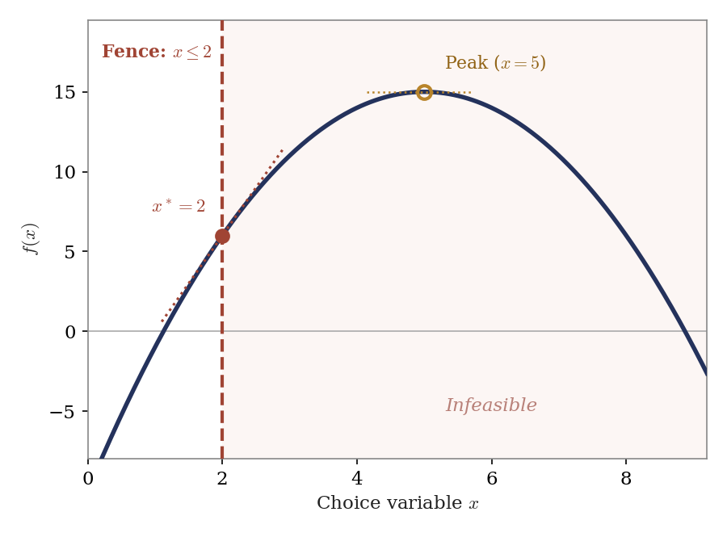
</div>
:::
::::

---

## Tangency Fails at the Fence {.compact}

:::: {.columns}
::: {.column width="55%"}
::: {.incremental}
- **The Hill:** $f(x) = 15 - (x - 5)^2$
- **Unconstrained Peak ($x = 5$):**
  - Tangent is flat: $f'(5) = 0$.
  - But $x = 5$ lies in the **infeasible zone** ($x > 2$).
- **Constrained Optimum ($x^* = 2$):**
  - The decision maker climbs until hitting the fence.
  - At the fence, the slope is strictly positive: $f'(2) = 6 > 0$.
- **The Core Lesson:**
  - Tangency ($f'(x^*) = 0$) characterizes only unconstrained peaks.
  - When scarcity binds, you stop before the hill is flat!
:::
:::

::: {.column width="45%"}
<div style="text-align: center; margin-top: 10px;">
  
</div>
:::
::::

---

## The Optimization Engine

##### **model the rules $\longrightarrow$ find the equilibrium $\longrightarrow$ evaluate efficiency $\longrightarrow$ redesign the rules**

::: {.incremental}

  1. **Part I: Mathematical Preliminaries** — Functions of multiple variables, 3D surfaces, contour lines, gradients ($\nabla f = 0$), and implicit differentiation ($dy/dx = -f_x / f_y$).
  2. **Part II: The Method of Lagrange** — Three pedagogical routes (Substitution, Tangency/Arbitrage, and Lagrange), shadow prices ($\lambda^* = \partial f / \partial c$), and corner solutions (Kuhn–Tucker).
  3. **Part III: Multi-Constraint Problems** — Solving when multiple fences bind at once (the Earthquake Relief problem), case checking ($2^K$ regimes), and modern computational methods (`scipy.optimize`).
:::


---

## Part I: Mathematical Preliminaries {.divider}

### Multivariable Calculus and Implicit Differentiation
The mathematical toolkit behind the Method of Lagrange

---

## Single-Variable Review: A Profit Maximum {.compact}

:::: {.columns}
::: {.column width="55%"}
A firm maximizes profits by choosing output $q$ while facing a competitive price $P = 10$ and production cost $C(q) = 10 + q^2$

$$\max_q \pi(q) = P \cdot q - C(q) = 10q - 10 - q^2$$

::: {.incremental}
- The **first-order condition (FOC)** sets marginal profit to zero:
  $$\frac{d\pi(q)}{dq} = 10 - 2q = 0 \;\Longrightarrow\; q^* = 5$$
- Profit at the optimum: $\pi(5) = 50 - 10 - 25 = 15$.
- Setting the derivative to zero finds a stationary point where the tangent is horizontal.
- A flat slope is necessary but not sufficient.
:::
:::

::: {.column width="45%"}
<div style="text-align: center;">
  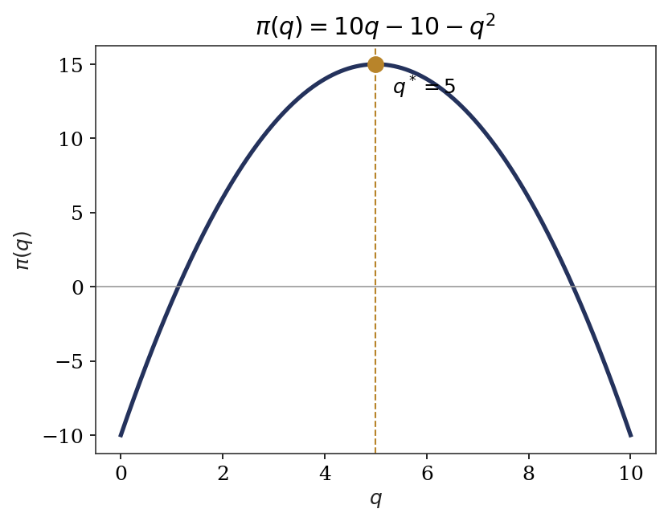
  <p style="font-size: 0.65em; color: #666;">Profit peak at $q^*=5$ with zero slope.</p>
</div>
:::
::::

---

## Necessary but Not Sufficient {.compact}

:::: {.columns}
::: {.column width="55%"}
Consider the quadratic function $f(x) = x^2 - 10x + 20$:

::: {.incremental}
- First derivative vanishes at $x = 5$:
  $$f'(x) = 2x - 10 = 0 \;\Longrightarrow\; x = 5$$
- Evaluating the second derivative:
  $$f''(x) = \frac{d^2f(x)}{dx^2} = 2 > 0$$
- Because the slope is *increasing* ($f'' > 0$), the curve bends upward: $x = 5$ is a **local minimum**, not a maximum!
- $f'(x^*) = 0$ is **necessary** for an interior optimum, but **not sufficient** to identify whether it is a peak or a valley.
:::
:::

::: {.column width="45%"}
<div style="text-align: center;">
  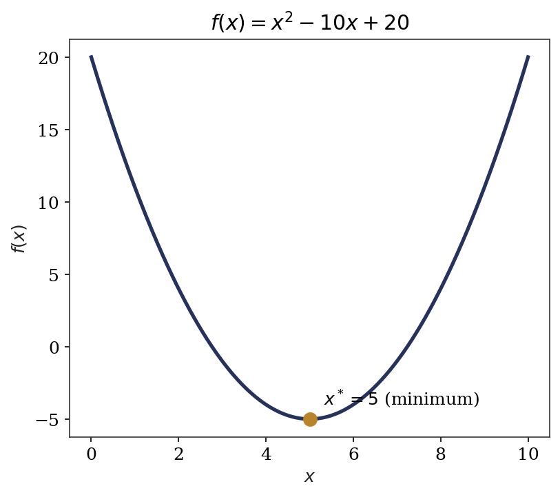
  <p style="font-size: 0.65em; color: #666;">$f'(5)=0$ marks the bottom of the bowl.</p>
</div>
:::
::::

---

## Necessary vs. Sufficient Conditions {.compact}

:::: {.columns}
::: {.column width="50%"}
::: {.callout-warning icon=false}
## Necessary (First-Order) Condition
$$f(x^*) \text{ is a local optimum} \implies f'(x^*) = 0$$

- Flat slope is required at every smooth interior optimum.
- **Pitfall:** Flat tangents also occur at valleys and inflection points!
:::
:::

::: {.column width="50%"}
::: {.callout-note icon=false}
## Sufficient (Second-Order) Conditions
At a stationary point ($f'(x^*) = 0$):

- $f''(x^*) < 0 \implies$ **Strict Local Maximum** (concave $\cap$)
- $f''(x^*) > 0 \implies$ **Strict Local Minimum** (convex $\cup$)
:::
:::
::::

::: {.callout-tip icon=false}
## The Core Intuition
*The first derivative tells you the ground is flat. The second derivative tells you whether you are standing on a peak or at the bottom of a valley.*
:::

---

## Characterizing Stationary Points {.compact}

:::: {.columns}
::: {.column width="50%"}
Consider the cubic polynomial:

$$f(x) = -x^3 + 3x^2 + 9x - 5$$

::: {.incremental}
- First-order condition:
  $$f'(x) = -3x^2 + 6x + 9 = -3(x-3)(x+1) = 0$$
  Stationary points at $x = -1$ and $x = 3$.
- Second-order condition: $f''(x) = -6x + 6$.
  - At $x = 3$: $f''(3) = -12 < 0 \implies$ **Local Maximum** ($f(3) = 22$)
  - At $x = -1$: $f''(-1) = +12 > 0 \implies$ **Local Minimum** ($f(-1) = -10$)
:::
:::

::: {.column width="50%"}
<div style="text-align: center;">
  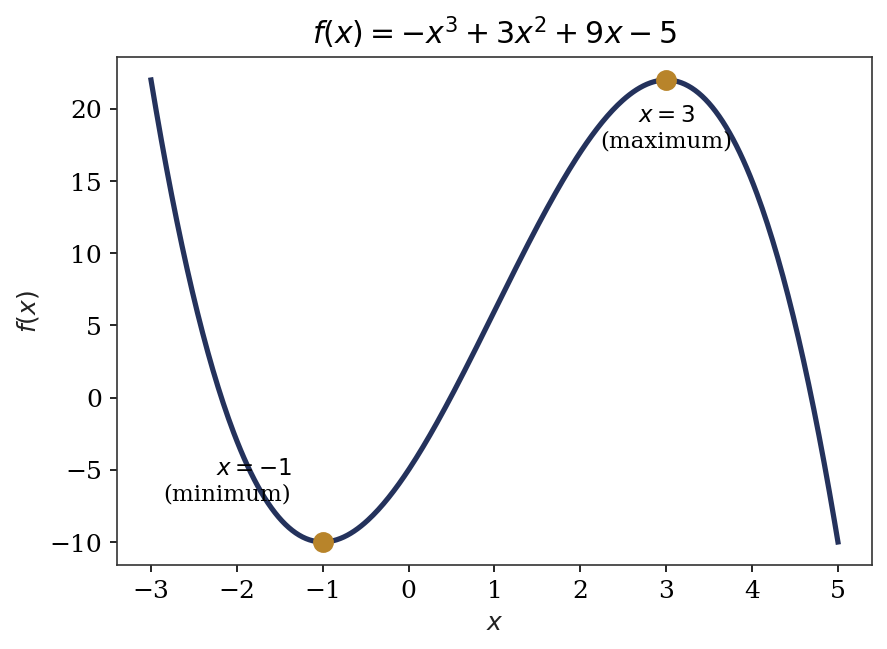
  <p style="font-size: 0.65em; color: #666;">Peak (maximum) at $x=3$, trough (minimum) at $x=-1$.</p>
</div>
:::
::::

---

## Inflection Points: When Both Derivatives Vanish {.compact}

:::: {.columns}
::: {.column width="55%"}
Consider $f(x) = -x^3$:

::: {.incremental}
- First derivative:
  $$f'(x) = -3x^2 \;\Longrightarrow\; f'(0) = 0$$
- Second derivative:
  $$f''(x) = -6x \;\Longrightarrow\; f''(0) = 0$$
- Both derivatives vanish at $x = 0$.
- For $x < 0$, $f'(x) < 0$; for $x > 0$, $f'(x) < 0$.
- The function is strictly decreasing everywhere except at $x=0$.
- $x = 0$ is neither a maximum nor a minimum — it is an **inflection point** (a horizontal terrace).
:::
:::

::: {.column width="45%"}
<div style="text-align: center;">
  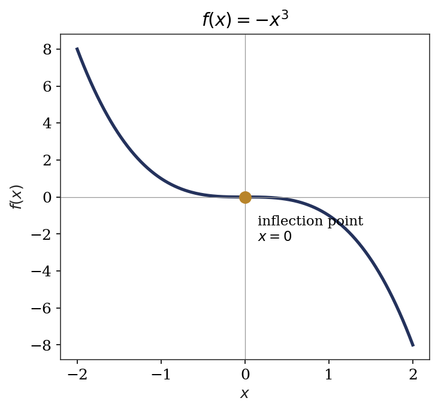
  <p style="font-size: 0.65em; color: #666;">$f'(0)=0$ and $f''(0)=0$: an inflection point.</p>
</div>
:::
::::

---

## Multivariable Functions in Economics {.compact}

:::: {.columns}
::: {.column width="55%"}
::: {.incremental}
- Economic choices rarely involve a single variable:
  - Consumers choose bundles of goods: $u(x_1, x_2, \dots, x_n)$
  - Firms choose input combinations: $q = F(K, L)$
  - Governments choose tax rates on labor and capital: $W(\tau_L, \tau_K)$
- The objective becomes a **surface** resting above the choice space $(x, y)$.
- To find peaks and level paths on this landscape, we need **multivariable calculus**.
:::
:::

::: {.column width="45%"}
<div style="text-align: center;">
  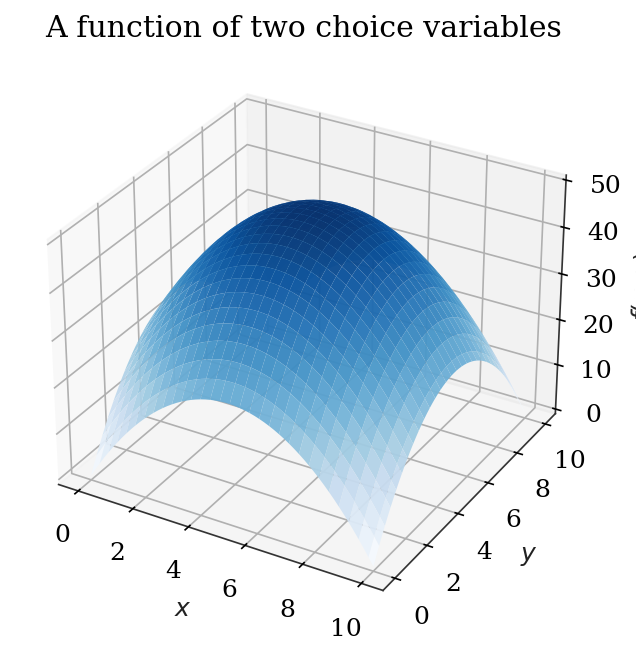
  <p style="font-size: 0.65em; color: #666;">A multivariable objective surface $z = f(x, y)$.</p>
</div>
:::
::::

---

## Surface and Contour Plots {.compact}

$$f(x, y) = \sqrt{x} \cdot \sqrt{y} = x^{1/2} y^{1/2}$$

:::: {.columns}
::: {.column width="50%"}
<div style="text-align: center;">
  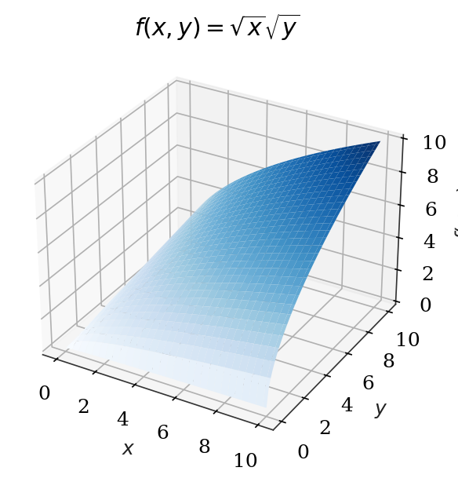
  <p style="font-size: 0.65em; color: #666; margin-top: 4px;"><strong>3D Perspective:</strong> Height represents output or utility.</p>
</div>
:::

::: {.column width="50%"}
<div style="text-align: center;">
  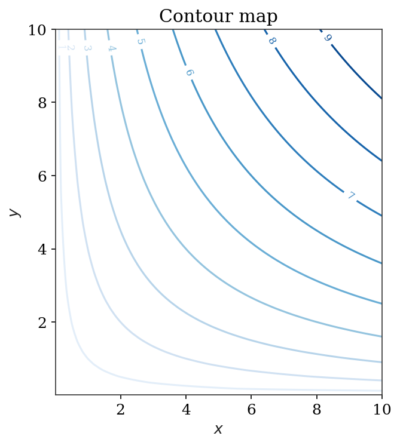
  <p style="font-size: 0.65em; color: #666; margin-top: 4px;"><strong>2D Contour Map:</strong> Level slices at constant heights $c$.</p>
</div>
:::
::::

::: {.fragment}
> *The 3D surface and the 2D contour map are dual representations of the exact same function.*
:::

---

## Partial Derivatives {.compact}

For a function $f(x, y)$, the **partial derivative** w.r.t. $x$ measures the slope in the $x$-direction holding $y$ constant:

$$f(x, y) = x^{1/4} y^{3/4}$$

::: {.incremental}
- Differentiating with respect to each variable:
  $$f_x = \frac{\partial f}{\partial x} = \frac{1}{4} x^{-3/4} y^{3/4} = \frac{1}{4} \frac{f(x, y)}{x}$$
  $$f_y = \frac{\partial f}{\partial y} = \frac{3}{4} x^{1/4} y^{-1/4} = \frac{3}{4} \frac{f(x, y)}{y}$$
- Evaluated at the bundle $(x, y) = (10, 10)$:
  $$f_x(10, 10) = \frac{1}{4} = 0.25, \qquad f_y(10, 10) = \frac{3}{4} = 0.75$$
- One additional unit of $y$ yields three times as much gain as one additional unit of $x$.
:::

## Partial Derivatives: A Graphical View {.compact}

<div style="text-align: center; margin-top: 0px;">
  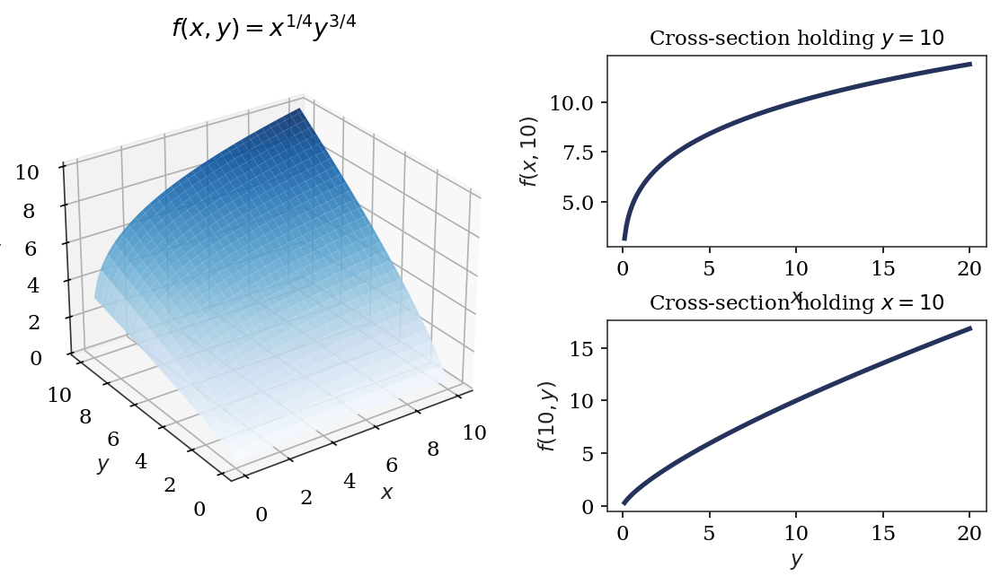
  <p style="font-size: 0.75em; color: #555; margin-top: 4px;">
    Slicing the surface along $x$ or $y$ yields cross-sections whose slopes are the partial derivatives $f_x$ and $f_y$.
  </p>
</div>

---

## Unconstrained Multivariable Maximization {.compact}

$$f(x, y) = 100 - (x - 5)^2 - (y - 10)^2 \qquad \nabla f = \mathbf{0} \;\Longrightarrow\; (x^*, y^*) = (5, 10), \quad f(5, 10) = 100$$

<div style="text-align: center; margin-top: 4px;">
  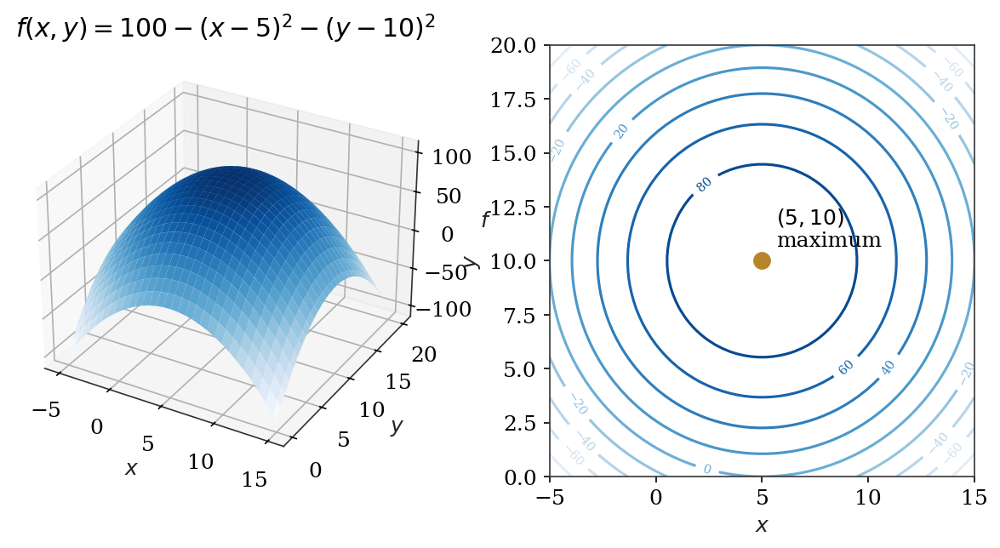
  <p style="font-size: 0.75em; color: #555; margin-top: 4px;">
    At the summit $(5, 10)$, the gradient $\nabla f = \mathbf{0}$ vanishes — the tangent plane is horizontal in all directions.
  </p>
</div>

---

## Explicit vs. Implicit Functions

::: {.incremental}
- **Explicit form:** One variable is isolated directly as a function of the other:
  $$y = g(x) \qquad \text{e.g., } y = mx + b \quad \text{or} \quad y = \sqrt{100 - 2x^2}$$
- **Implicit form:** Both variables appear inside a unified relationship:
  $$F(x, y) = 0 \qquad \text{e.g., } y - mx - b = 0 \quad \text{or} \quad 2x^2 + y^2 - 100 = 0$$
- In economics, indifference curves and production frontiers are almost always defined implicitly:
  $$u(x_1, x_2) = \bar{u} \qquad \text{or} \quad F(K, L) = \bar{q}$$
- We need a reliable way to find the slope $dy/dx$ **without** having to solve explicitly for $y$.
:::

---

## The Multivariable Chain Rule {.compact}

Suppose $z = f(x, y)$, but $x$ and $y$ both move along a trajectory parameterized by time $t$:
$$x = x(t), \qquad y = y(t)$$

::: {.incremental}
- How does $z$ change over time?
  $$\frac{df(x(t), y(t))}{dt} = \frac{\partial f}{\partial x} \frac{dx}{dt} + \frac{\partial f}{\partial y} \frac{dy}{dt} = f_x \frac{dx}{dt} + f_y \frac{dy}{dt}$$
- Each channel contributes to the total rate of change:
  1. Direct change through the $x$-coordinate: $f_x \cdot (dx/dt)$
  2. Direct change through the $y$-coordinate: $f_y \cdot (dy/dt)$
- In vector notation, this is the dot product of the gradient with the velocity vector:
  $$\frac{df}{dt} = \nabla f \cdot \mathbf{v} = \begin{pmatrix} f_x & f_y \end{pmatrix} \begin{pmatrix} dx/dt \\ dy/dt \end{pmatrix}$$
:::

---

## Chain Rule and Total Differentiation {.compact}

Multiplying the chain rule by $dt$ gives the **total differential** of $f(x, y)$:

$$df = f_x \, dx + f_y \, dy$$

::: {.incremental}
- $df$ approximates the change in height $f$ resulting from arbitrary small displacements $(dx, dy)$.
- **Example:** $f(x, y) = xy - 10 = 0$.
  - Slicing along the curve ($df = 0$):
    $$y \, dx + x \, dy = 0 \;\Longrightarrow\; \frac{dy}{dx} = -\frac{y}{x}$$
  - Solving explicitly: $y = \frac{10}{x} \implies \frac{dy}{dx} = -\frac{10}{x^2} = -\frac{y}{x}$.
- Total differentiation yields the exact same slope without requiring explicit algebraic inversion!
:::

---

## Contour Lines and Their Slopes {.compact}

An **iso-height contour line** (or level curve) is the locus of points satisfying:

$$f(x, y) = c$$

::: {.incremental}
- Along any level curve, the height is constant: $df = 0$.
- Applying total differentiation:
  $$f_x \, dx + f_y \, dy = 0 \;\Longrightarrow\; f_y \, dy = -f_x \, dx$$
- Rearranging yields the **Implicit Function Theorem for level curves**:
  $$\frac{dy}{dx} = -\frac{f_x}{f_y}$$
- **Geometric intuition:** If $x$ increases by $dx$, height rises by $f_x dx$. To keep height unchanged, $y$ must adjust by $dy$ such that $f_y dy = -f_x dx$.
:::

---

## Level Curve Slopes: Worked Examples {.compact}

$$\frac{dy}{dx} = -\frac{f_x}{f_y}$$

::: {.incremental}
- **Example 1: Linear Contours** $f(x, y) = 2x + 4y = 20$
  $$f_x = 2, \quad f_y = 4 \;\Longrightarrow\; \frac{dy}{dx} = -\frac{2}{4} = -0.5 \quad \text{(constant slope)}$$
- **Example 2: Cobb-Douglas** $f(x, y) = x y = 100$
  $$f_x = y, \quad f_y = x \;\Longrightarrow\; \frac{dy}{dx} = -\frac{y}{x}$$
  - At $(x, y) = (10, 10)$: $\dfrac{dy}{dx} = -\dfrac{10}{10} = -1.0$
  - At $(x, y) = (20, 5)$: $\dfrac{dy}{dx} = -\dfrac{5}{20} = -0.25$ (the curve flattens)
- The contour is **convex to the origin**: as $x$ rises, its slope becomes flatter (less negative).
:::

---

## Production Isoquants and MRTS {.compact}

:::: {.columns}
::: {.column width="55%"}
In production theory, a contour of output $q = F(K, L)$ is called an **isoquant**:

::: {.incremental}
- The slope of the isoquant is the negative of the **Marginal Rate of Technical Substitution (MRTS)**:
  $$\left.\frac{dK}{dL}\right|_{q=\bar{q}} = -\frac{F_L}{F_K} = -MRTS_{L, K}$$
- $MRTS_{L, K}$ measures how much capital $K$ the firm can surrender for one more unit of labor $L$ while keeping output fixed.
- **Diminishing MRTS:** As labor replaces capital, labor's marginal productivity falls relative to capital's, flattening the curve.
:::
:::

::: {.column width="45%"}
<div style="text-align: center;">
  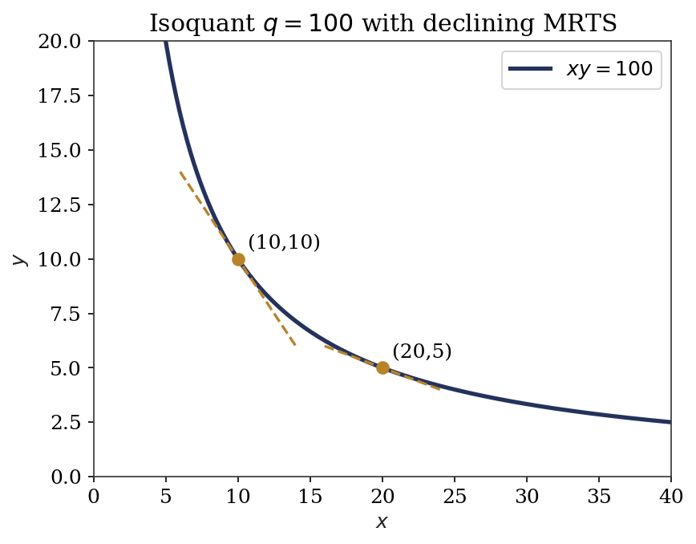
  <p style="font-size: 0.65em; color: #666;">Diminishing MRTS: tangent lines flatten as $L$ rises.</p>
</div>
:::
::::

---

## Two Equations, Two Unknowns {.compact}

:::: {.columns}
::: {.column width="55%"}
Consider maximizing an unconstrained objective with interacting choices:

$$f(x, y) = xy + 10y + 10x - x^2 - y^2$$

::: {.incremental}
- First-order conditions require both partial derivatives to vanish simultaneously:
  $$f_x = y + 10 - 2x = 0 \;\Longrightarrow\; 2x - y = 10$$
  $$f_y = x + 10 - 2y = 0 \;\Longrightarrow\; -x + 2y = 10$$
- Solving the linear system yields:
  $$x^* = 10, \qquad y^* = 10$$
  $$f(10, 10) = 100 + 100 + 100 - 100 - 100 = 100$$
:::
:::

::: {.column width="45%"}
<div style="text-align: center;">
  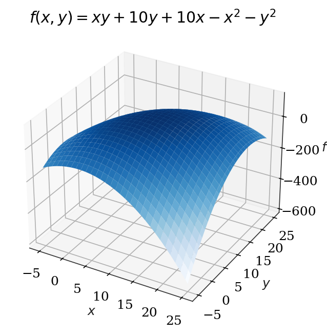
  <p style="font-size: 0.65em; color: #666;">Surface peak located at $(x^*, y^*) = (10, 10)$.</p>
</div>
:::
::::

---

## The Substitution Method (Unconstrained) {.compact}

:::: {.columns}
::: {.column width="55%"}
We can also solve the system by substitution:

::: {.incremental}
- Solve the first FOC for $y$ as a function of $x$:
  $$y(x) = 2x - 10$$
- Substitute $y(x)$ into the original function $f(x, y)$:
  $$g(x) = f(x, 2x-10) = -x^2 + 20x$$
- Now optimize the single-variable function $g(x)$:
  $$g'(x) = -2x + 20 = 0 \;\Longrightarrow\; x^* = 10$$
  $$y^* = 2(10) - 10 = 10$$
- This works whenever explicit substitution is algebraically convenient.
:::
:::

::: {.column width="45%"}
<div style="text-align: center;">
  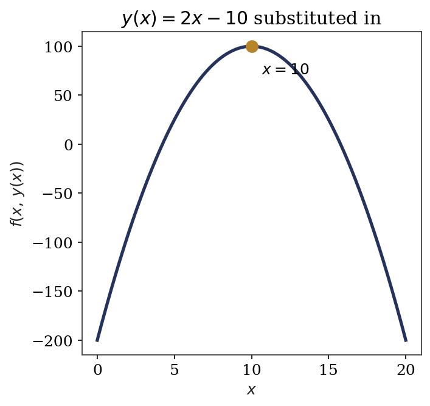
  <p style="font-size: 0.65em; color: #666;">The collapsed single-variable profile $g(x)$.</p>
</div>
:::
::::

---

## Utility as a Multivariable Surface {.compact}

:::: {.columns}
::: {.column width="55%"}
Consider a consumer evaluating bundles of goods:

$$u(c_1, c_2) = c_1 c_2$$

::: {.incremental}
- More is always preferred to less:
  $$u_1 = c_2 > 0, \qquad u_2 = c_1 > 0$$
- The surface rises forever — there is **no unconstrained peak**.
- If the consumer faced no budget, they would consume infinite quantities.
- Human desires are boundless, but resources are finite.
- **Enter constraints.**
:::
:::

::: {.column width="45%"}
<div style="text-align: center;">
  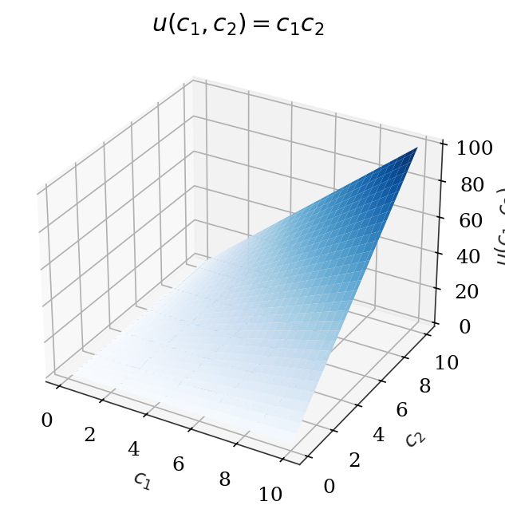
  <p style="font-size: 0.65em; color: #666;">Monotonic utility surface: choice requires a constraint.</p>
</div>
:::
::::

---

## Part II: The Tangency and Lagrange Methods {.divider}

### Solving Constrained Optimization Problems
Direct Substitution, Tangency & Arbitrage, and the Method of Lagrange

---

## The Canonical Consumer Problem {.compact}

:::: {.columns}
::: {.column width="55%"}
A consumer maximizes utility subject to an income budget:

$$\max_{c_1, c_2} \; u(c_1, c_2) = c_1 c_2 \quad \text{s.t.} \quad p_1 c_1 + p_2 c_2 \le I$$

::: {.incremental}
- **Objective:** Climb as high as possible on the utility surface.
- **Constraint:** Stay within the affordable budget triangle.
- With strictly positive marginal utility, the consumer spends all income:
  $$p_1 c_1 + p_2 c_2 = I$$
- **Three ways to solve this problem:**
  1. Direct substitution (eliminate one variable)
  2. Tangency / Arbitrage condition ($MRS = MRT$)
  3. The Method of Lagrange
:::
:::

::: {.column width="45%"}
<div style="text-align: center;">
  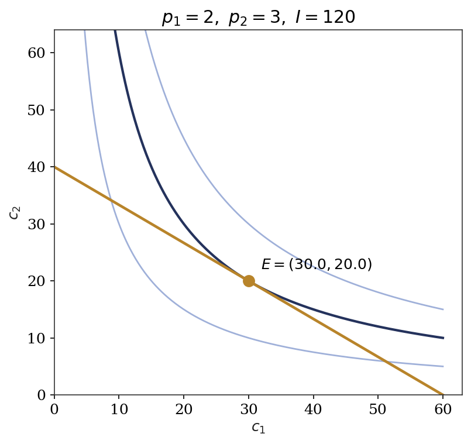
  <p style="font-size: 0.65em; color: #666;">Tangency between indifference curve and budget line.</p>
</div>
:::
::::

---

## Walking the Budget Line {.compact}

Same problem as the last slide. On the budget line, *is the next dollar better spent on good 1 or on good 2?*

:::: {.columns}
::: {.column width="60%"}
| $c_1$ | $c_2$ | $MU_1/p_1$ | $MU_2/p_2$ | move | $u$ |
|:-:|:-:|:-:|:-:|:-:|:-:|
| 15 | 30 | 15 | 5 | → good 1 | 450 |
| 24 | 24 | 12 | 8 | → good 1 | 576 |
| **30** | **20** | **10** | **10** | **stop** | **600** |
| 36 | 16 | 8 | 12 | → good 2 | 576 |

<p style="font-size: 0.6em; color: #666;">Here $MU_1/p_1 = c_2/2$ and $MU_2/p_2 = c_1/3$.</p>

::: {.incremental}
- At $(15, 30)$: moving \$1 from good 2 to good 1 loses $\approx 5$ utils and gains $\approx 15$ — **net $+10$, same spending**.
- The ratios close in from both sides and meet at $10 = \lambda^*$.
:::
:::

::: {.column width="40%"}
<div style="text-align: center;">
  
  <p style="font-size: 0.55em; color: #666;">The optimum $E = (30, 20)$ from the last slide.</p>
</div>
:::
::::

<!-- Every row lies on the budget line 2c1 + 3c2 = 120. At the optimum,
     lambda* = I/(2 p1 p2) = 120/12 = 10, matching the "stop" row. -->

---

## The Hill Along the Fence {.compact}

<div style="text-align: center;">
  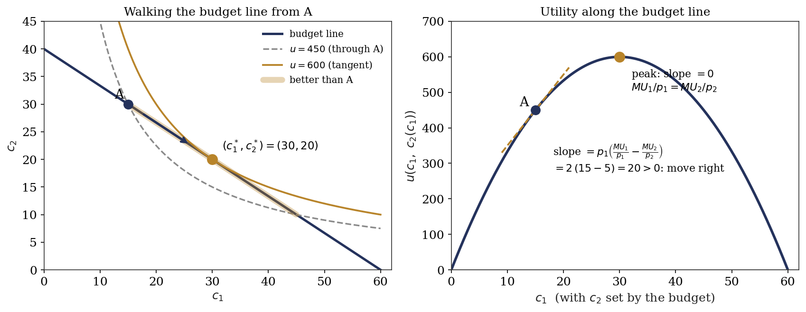
</div>

::: {.incremental}
- **Left:** from A, every bundle on the highlighted stretch of the budget line beats A. Walk toward the tangency.
- **Right:** utility measured *along* the budget line is a one-dimensional hill. A constrained problem is an ordinary climb — on the hill you see while walking the fence.
:::

---

## The Arbitrage Rule {.compact}

::: {.callout-tip icon=false}
## Explore along the constraint
::: {style="font-size: 1.45em; line-height: 1.5;"}
- **If $MU_1/p_1 > MU_2/p_2$:** buy more of good 1 and less of good 2.
- **If $MU_1/p_1 < MU_2/p_2$:** do the reverse.
- **Stop when they are equal — or when you hit a wall.**
:::
:::

::: {.incremental}
- Every step keeps you on the budget line: the dollar added to one good is the dollar taken from the other.
- "Equal" is the interior optimum, where the indifference curve is tangent to the budget line. "Hit a wall" is a corner, where you would keep going but cannot — we return to it with Kuhn–Tucker.
- Everything that follows — tangency, the multiplier, the Lagrangian — is this rule in different notation.
:::

---

## Method 1: Substitution Is Walking the Fence {.compact}

Solve the budget constraint for $c_2$, and follow the budget line:

$$c_2(c_1) = \frac{I}{p_2} - \frac{p_1}{p_2}\,c_1$$

::: {.incremental}
- $u\big(c_1, c_2(c_1)\big)$ is utility measured *along* the fence — the hill on the right of the last figure.
- Its slope, by the chain rule, is the arbitrage gap:
  $$\frac{d}{dc_1}\,u\big(c_1, c_2(c_1)\big) = u_1 - u_2\,\frac{p_1}{p_2} = p_1\left(\frac{u_1}{p_1} - \frac{u_2}{p_2}\right)$$
- So the substitution FOC, slope $= 0$, **is** the no-arbitrage condition $u_1/p_1 = u_2/p_2$.
- For $u = c_1 c_2$: $\;u = \frac{I}{p_2}c_1 - \frac{p_1}{p_2}c_1^2$, so setting $\frac{I}{p_2} - 2\frac{p_1}{p_2}c_1 = 0$ gives half of income on each good:
  $$c_1^* = \frac{I}{2p_1}, \qquad c_2^* = \frac{I}{2p_2}$$
:::

---

## Limits of the Substitution Method

::: {.incremental}
- **Why not stop here?**
  - What if the constraint is non-linear (e.g., $c_1^\rho + c_2^\rho = \bar{c}$) and cannot be inverted for $c_2$?
  - What if there are 10 choice variables and 4 constraints?
  - What if the constraint is an **inequality** that might not bind?
  - What if we need the **economic valuation** of relaxing the budget?
- Direct substitution turns a constrained problem into an unconstrained one, but destroys the geometric symmetry and conceals the **shadow prices**.
- We need a method that preserves the structure of the constraint.
:::

---

## Indifference Curves and the MRS {.compact}

Along an indifference curve, utility is constant: $u(c_1, c_2) = \bar{u}$.

::: {.incremental}
- Totally differentiating:
  $$du = u_1 \, dc_1 + u_2 \, dc_2 = 0$$
- Solving for the slope of the indifference curve:
  $$\left.\frac{dc_2}{dc_1}\right|_{u=\bar{u}} = -\frac{u_1}{u_2} = -MRS_{1, 2}$$
- **Marginal Rate of Substitution (MRS):**
  $$MRS_{1, 2} = \frac{u_1}{u_2} = \frac{\partial u / \partial c_1}{\partial u / \partial c_2} = \frac{MU_1}{MU_2}$$
- **Economic meaning:** The rate at which the consumer is *willing* to give up good 2 to obtain one more unit of good 1, remaining equally well off.
:::

---

## Method 2: The Tangency Condition {.compact}

The budget line $p_1 c_1 + p_2 c_2 = I$ has slope:
$$\left.\frac{dc_2}{dc_1}\right|_{\text{budget}} = -\frac{p_1}{p_2} = -MRT$$

::: {.incremental}
- **Marginal Rate of Transformation (MRT):** The rate at which the *market* allows trading good 2 for good 1 (relative price ratio).
- At an interior optimum, the indifference curve must be **tangent** to the budget line:
  $$MRS = MRT \;\Longleftrightarrow\; \frac{u_1}{u_2} = \frac{p_1}{p_2}$$
- Rearranging into the **equal marginal return per dollar** rule:
  $$\frac{u_1}{p_1} = \frac{u_2}{p_2}$$
- *"Marginal bang per buck must be equalized across all goods."*
:::

---

## The Arbitrage Argument {.compact}

The walk from A, stated in general: why *must* $u_1 / p_1 = u_2 / p_2$ hold at an interior optimum?

::: {.incremental}
- Suppose instead:
  $$\frac{u_1}{p_1} > \frac{u_2}{p_2}$$
- Spending $\$1$ less on good 2 costs $\dfrac{u_2}{p_2}$ units of utility.
- Spending that same $\$1$ on good 1 adds $\dfrac{u_1}{p_1}$ units of utility.
- **Net gain in utility:**
  $$\Delta u \approx \frac{u_1}{p_1} - \frac{u_2}{p_2} > 0$$
- Reallocating dollars from good 2 to good 1 increases welfare with **zero extra expenditure**.
- As long as marginal returns per dollar differ, there is an internal **arbitrage opportunity**.
- At the optimum, all such gains are exhausted: $u_1 / p_1 = u_2 / p_2$.
:::

---

## The Multiplier as Marginal Utility of Income {.compact}

Define $\lambda$ as the common marginal bang-per-buck at the optimum:

$$\lambda^* \equiv \frac{u_1(c_1^*, c_2^*)}{p_1} = \frac{u_2(c_1^*, c_2^*)}{p_2}$$

::: {.incremental}
- What are the units of $\lambda$?
  $$\text{Units of } \lambda = \frac{\text{utils}}{\text{unit of good}} \div \frac{\text{dollars}}{\text{unit of good}} = \frac{\text{utils}}{\text{dollar}}$$
- $\lambda^*$ is the **marginal utility of income**:
  $$\lambda^* = \frac{\partial u(c_1^*, c_2^*)}{\partial I}$$
- If you hand the consumer one additional dollar, utility rises by approximately $\lambda^*$ utils.
- $\lambda$ is not an algebraic nuisance — it is the **shadow price** of income!
:::

---

## Solving Cobb-Douglas via Tangency {.compact}

For $u(c_1, c_2) = c_1 c_2$, marginal utilities are $u_1 = c_2$ and $u_2 = c_1$:

::: {.incremental}
- Set $MRS = p_1 / p_2$:
  $$\frac{u_1}{u_2} = \frac{c_2}{c_1} = \frac{p_1}{p_2} \;\Longrightarrow\; p_1 c_1 = p_2 c_2$$
- Expenditure on good 1 equals expenditure on good 2!
- Substitute this tangency relation into the budget constraint:
  $$p_1 c_1 + p_2 c_2 = I \;\Longrightarrow\; p_1 c_1 + p_1 c_1 = I \;\Longrightarrow\; 2 p_1 c_1 = I$$
- **Optimal demand functions and multiplier:**
  $$c_1^* = \frac{I}{2 p_1}, \qquad c_2^* = \frac{I}{2 p_2}, \qquad \lambda^* = \frac{u_1}{p_1} = \frac{c_2^*}{p_1} = \frac{I}{2 p_1 p_2}$$
- Matches the substitution method, but reveals $\lambda^*$ immediately.
:::

---

## Method 3: The Method of Lagrange {.compact}

Joseph-Louis Lagrange (1788) invented a brilliant device: convert a constrained problem into an **unconstrained** problem by introducing an auxiliary variable $\lambda$:

$$\mathcal{L}(c_1, c_2, \lambda) = u(c_1, c_2) + \lambda \big(I - p_1 c_1 - p_2 c_2\big)$$

::: {.incremental}
- Take the unconstrained first-order conditions w.r.t. all three variables:
  $$\frac{\partial \mathcal{L}}{\partial c_1} = u_1 - \lambda p_1 = 0 \;\Longrightarrow\; u_1 = \lambda p_1$$
  $$\frac{\partial \mathcal{L}}{\partial c_2} = u_2 - \lambda p_2 = 0 \;\Longrightarrow\; u_2 = \lambda p_2$$
  $$\frac{\partial \mathcal{L}}{\partial \lambda} = I - p_1 c_1 - p_2 c_2 = 0 \;\Longrightarrow\; p_1 c_1 + p_2 c_2 = I$$
- Dividing the first two conditions reproduces tangency: $u_1 / u_2 = p_1 / p_2$.
- Differentiating w.r.t. $\lambda$ reproduces the budget constraint.
:::

---

## Symbolic & Numerical Verification {.compact}

We verify the closed form both symbolically (SymPy) and numerically (SciPy):

:::: {.columns}
::: {.column width="55%"}
```python
import sympy as sp
c1, c2, p1, p2, I, lam = sp.symbols('c1 c2 p1 p2 I lambda', positive=True)
L = c1*c2 + lam*(I - p1*c1 - p2*c2)
foc = [sp.diff(L, var) for var in (c1, c2, lam)]
sol = sp.solve(foc, (c1, c2, lam))
```

::: {.incremental}
- **Exact SymPy closed-form solution:**
  $$c_1^* = \frac{I}{2p_1}, \quad c_2^* = \frac{I}{2p_2}, \quad \lambda^* = \frac{I}{2p_1p_2}$$
- **SciPy SLSQP check** ($p_1=2, p_2=3, I=120$):
  $$c_1^* = 30.0000, \quad c_2^* = 20.0000, \quad U^* = 600.0000$$
  Formula matches numerical solver to 10 decimal places.
:::
:::

::: {.column width="45%"}
<div style="text-align: center;">
  
  <p style="font-size: 0.65em; color: #666;">Analytical tangency confirmed by numerical optimization.</p>
</div>
:::
::::

---

## The Arbitrage Argument Generalized {.compact}

The exact same reallocation logic applies to **any** constrained optimization problem:

$$\max_{x_1, x_2} \; f(x_1, x_2) \quad \text{s.t.} \quad g(x_1, x_2) = c$$

::: {.incremental}
- Along the constraint, $dg = g_1\,dx_1 + g_2\,dx_2 = 0$: resource added to $x_1$ = resource taken from $x_2$.
- Shift a small amount $\delta$ of the resource toward $x_1$: $\;dx_1 = \delta / g_1$, $\;dx_2 = -\delta / g_2$. (Budget case: $\delta = \$1$, $g_i = p_i$.)
- **Net change in objective:**
  $$df = f_1 \, dx_1 + f_2 \, dx_2 = \left(\frac{f_1}{g_1} - \frac{f_2}{g_2}\right) \delta$$
- Whenever $f_1 / g_1 \ne f_2 / g_2$, shifting resources in the right direction yields a positive net gain!
- At an interior optimum all reallocations are exhausted, and the common ratio is the constraint's **benefit-cost ratio**:
  $$\frac{f_1}{g_1} = \frac{f_2}{g_2} = \lambda^*$$
:::

---

## Method of Lagrange: General Formulation {.compact}

For $n$ choice variables and 1 equality constraint:

$$\max_{x_1, \dots, x_n} \; f(x_1, \dots, x_n) \quad \text{s.t.} \quad g(x_1, \dots, x_n) = c$$

::: {.incremental}
- **Form the Lagrangian function:**
  $$\mathcal{L}(x_1, \dots, x_n, \lambda) = f(x_1, \dots, x_n) + \lambda \big[c - g(x_1, \dots, x_n)\big]$$
- **First-Order Conditions (FOC):**
  $$\frac{\partial \mathcal{L}}{\partial x_i} = \frac{\partial f}{\partial x_i} - \lambda \frac{\partial g}{\partial x_i} = 0 \;\Longrightarrow\; \lambda = \frac{f_i}{g_i} \quad \forall i = 1, \dots, n$$
  $$\frac{\partial \mathcal{L}}{\partial \lambda} = c - g(x_1, \dots, x_n) = 0$$
- This yields $n+1$ equations in $n+1$ unknowns $(x_1^*, \dots, x_n^*, \lambda^*)$.
:::

---

## Application: Labor Allocation & Ricardian PPF {.compact}

:::: {.columns}
::: {.column width="55%"}
An economy allocates total labor $\bar{L}$ between two goods with linear technologies:
$$x_1 = MPL_1 \cdot L_1, \qquad x_2 = MPL_2 \cdot L_2$$

::: {.incremental}
- Labor required per unit: $a_{L1} = 1/MPL_1$, $a_{L2} = 1/MPL_2$.
- Total resource constraint:
  $$L_1 + L_2 = \frac{x_1}{MPL_1} + \frac{x_2}{MPL_2} \le \bar{L}$$
- Society maximizes social welfare:
  $$\max_{x_1, x_2} \; u(x_1, x_2) \quad \text{s.t.} \quad \frac{x_1}{MPL_1} + \frac{x_2}{MPL_2} = \bar{L}$$
:::
:::

::: {.column width="45%"}
<div style="text-align: center;">
  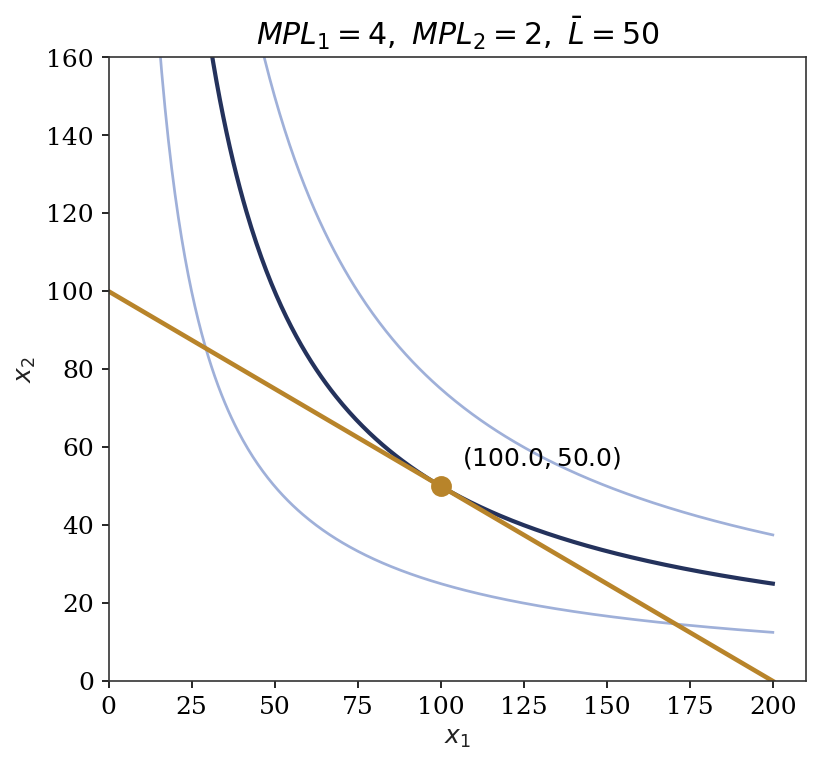
  <p style="font-size: 0.65em; color: #666;">Welfare maximization on the linear PPF.</p>
</div>
:::
::::

---

## Solving Welfare Maximization on the PPF {.compact}

$$\mathcal{L}(x_1, x_2, \lambda) = u(x_1, x_2) + \lambda \left(\bar{L} - \frac{x_1}{MPL_1} - \frac{x_2}{MPL_2}\right)$$

::: {.incremental}
- First-order conditions:
  $$\frac{\partial \mathcal{L}}{\partial x_1} = u_1 - \frac{\lambda}{MPL_1} = 0 \;\Longrightarrow\; \lambda = u_1 \cdot MPL_1$$
  $$\frac{\partial \mathcal{L}}{\partial x_2} = u_2 - \frac{\lambda}{MPL_2} = 0 \;\Longrightarrow\; \lambda = u_2 \cdot MPL_2$$
- Equating multipliers yields the tangency condition:
  $$\frac{u_1}{u_2} = \frac{MPL_2}{MPL_1} \;\Longleftrightarrow\; MRS_{1, 2} = MRT_{1, 2}$$
- **Economic interpretation of $\lambda^*$:**
  $$\lambda^* = u_1 \cdot MPL_1 = \frac{\text{utils}}{\text{unit of } x_1} \cdot \frac{\text{units of } x_1}{\text{hour of labor}} = \frac{\text{marginal utility}}{\text{hour of labor}}$$
:::

---

## Generalizing: $n$ Variables, $M$ Constraints {.compact}

Suppose an agent chooses $n$ variables subject to $M$ simultaneous constraints:

$$\max_{x_1, \dots, x_n} \; f(x_1, \dots, x_n) \quad \text{s.t.} \quad g^m(x_1, \dots, x_n) = c_m \quad (m = 1, \dots, M)$$

::: {.incremental}
- Form the generalized Lagrangian with **one multiplier per constraint**:
  $$\mathcal{L}(x, \lambda_1, \dots, \lambda_M) = f(x) + \sum_{m=1}^{M} \lambda_m \big[c_m - g^m(x)\big]$$
- First-order conditions:
  $$\frac{\partial \mathcal{L}}{\partial x_i} = f_i - \sum_{m=1}^{M} \lambda_m g_i^m = 0 \quad (i = 1, \dots, n)$$
  $$\frac{\partial \mathcal{L}}{\partial \lambda_m} = c_m - g^m(x) = 0 \quad (m = 1, \dots, M)$$
- A system of $n + M$ equations in $n + M$ unknowns.
:::

---

## The Multiplier as a Shadow Price {.compact}

Let $V(c_1, \dots, c_M) = f(x^*(c))$ be the **value function** (maximum value as a function of the constraint bounds $c$).

::: {.callout-note icon=false}
## The Envelope Theorem (Constraint Bound Formulation)
$$\frac{\partial V(c)}{\partial c_k} = \left.\frac{\partial \mathcal{L}}{\partial c_k}\right|_{x^*, \lambda^*} = \lambda_k^*$$
:::

::: {.callout-tip icon=false}
## Economic Interpretation
$\lambda_k^*$ is the **shadow price** of constraint $k$: the exact marginal valuation of relaxing scarcity by one unit. If expanding resource $k$ costs less than $\lambda_k^*$, expand capacity!
:::

---

## The General Envelope Theorem {.compact}

Consider an objective and constraint depending on an arbitrary exogenous parameter $\theta$ (e.g., price, wage, or tax rate):

$$\max_{\mathbf{x}} \; f(\mathbf{x}; \theta) \quad \text{s.t.} \quad g(\mathbf{x}; \theta) = c$$

Let $V^*(\theta) = f(\mathbf{x}^*(\theta); \theta)$ be the optimized value function, and $\mathcal{L}(\mathbf{x}, \lambda; \theta) = f(\mathbf{x}; \theta) + \lambda[c - g(\mathbf{x}; \theta)]$.

::: {.callout-note icon=false}
## The General Envelope Theorem
$$\frac{dV^*(\theta)}{d\theta} = \left. \frac{\partial \mathcal{L}}{\partial \theta} \right|_{\mathbf{x}^*(\theta), \lambda^*(\theta)}$$
:::

::: {.incremental}
- **Why do indirect effects vanish?** By the chain rule, $\frac{dV^*}{d\theta} = \sum_i \frac{\partial f}{\partial x_i} \frac{dx_i^*}{d\theta} + \frac{\partial f}{\partial \theta}$. Because the FOCs set $\nabla_{\mathbf{x}} \mathcal{L} = \mathbf{0}$ at the optimum, the response of choices $\frac{d\mathbf{x}^*}{d\theta}$ has zero first-order impact on $V^*$.
- **Recovering the Multiplier ($\theta = c_k$):** When $\theta$ is the resource bound $c_k$, $\frac{\partial \mathcal{L}}{\partial c_k} = \lambda_k^*$, recovering the shadow price.
- **Preview for Topics 3 & 4:** 
  - Firm cost minimization: $\frac{\partial C^*}{\partial w} = L^*$ (**Shephard's Lemma**)
  - Firm profit maximization: $\frac{\partial \pi^*}{\partial p} = q^*$ (**Hotelling's Lemma**)
  - Consumer welfare: $\frac{\partial V^*}{\partial p_i} = -\lambda^* x_i^*$ (**Roy's Identity**)
:::

---

## When Constraints Are Inequalities {.compact}

So far we assumed:
1. All choices are strictly positive: $x_i^* > 0$ (**interior solution**).
2. All constraints hold with exact equality: $g(x^*) = c$ (**binding constraint**).

::: {.incremental}
- What if a consumer does not buy good 1 at prevailing prices ($c_1^* = 0$)?
- What if a firm has more warehouse space than it needs ($g(x^*) < c$)?
- In an **inequality-constrained problem**:
  $$\max \; f(x) \quad \text{s.t.} \quad g(x) \le c \quad \text{and} \quad x \ge 0$$
  tangency can fail, and constraints may be **slack**.
- We need the **Kuhn–Tucker (KKT)** conditions.
:::

---

## Corner Solutions: When Tangency Fails {.compact}

:::: {.columns}
::: {.column width="60%"}
Consider quasi-linear utility with $p_1 = 5, p_2 = 1, I = 2$:
$$u(c_1, c_2) = c_1 + \sqrt{c_2}$$ 


::: {.incremental}
- Marginal utilities: $u_1 = 1$, $u_2 = \frac{1}{2\sqrt{c_2}}$.
- If consumer spends all income on good 2:
  $c_2 = \frac{I}{p_2} = 2, \quad c_1 = 0$
- Evaluate marginal bang-per-buck at this corner:
  $$\frac{u_1}{p_1} = \frac{1}{5} = 0.20 < \frac{u_2}{p_2} = \frac{1}{2\sqrt{2}} \approx 0.3536$$
- **Same arbitrage as before:** good 2 pays more per \$ *even with all income already on it*, so the rule says keep shifting dollars toward good 2 — but at $c_1 = 0$ there are none left. The consumer would *sell* good 1 if they could; $c_1 \ge 0$ forbids it.
- **Result:** Corner optimum at $(c_1^*, c_2^*) = (0, 2)$.
:::
:::

::: {.column width="40%"}
::: {.fragment}
<div style="background: #f4f6fa; padding: 15px; border-left: 4px solid #b8842a; border-radius: 4px; font-size: 0.8em; margin-top: 20px;">
  <strong>Corner FOC:</strong>
  $$\frac{\partial \mathcal{L}}{\partial c_1} = u_1 - \lambda p_1 \le 0$$
  $$1 - (0.3536)(5) = -0.768 < 0$$
  Verified numerically by SciPy SLSQP.
</div>
:::
:::
::::

---

## Complementary Slackness {.compact}

Kuhn and Tucker (1951) unified interior and corner solutions into **complementary slackness**:

::: {.incremental}
- For each choice variable $c_i \ge 0$:
  $$\frac{\partial \mathcal{L}}{\partial c_i} \le 0, \qquad c_i \ge 0, \qquad c_i \cdot \frac{\partial \mathcal{L}}{\partial c_i} = 0$$
  - Either $c_i > 0$ and $\frac{\partial \mathcal{L}}{\partial c_i} = 0$ (interior)
  - Or $c_i = 0$ and $\frac{\partial \mathcal{L}}{\partial c_i} \le 0$ (corner)
- For each constraint multiplier $\lambda_m \ge 0$:
  $$\lambda_m \ge 0, \qquad c_m - g^m(x) \ge 0, \qquad \lambda_m \big[c_m - g^m(x)\big] = 0$$
  - Either $\lambda_m > 0$ and $g^m(x) = c_m$ (**binding constraint**)
  - Or $\lambda_m = 0$ and $g^m(x) < c_m$ (**slack constraint**)
:::

::: {.fragment}
> *A constraint cannot simultaneously be slack ($g < c$) and have a positive shadow price ($\lambda > 0$).*
:::

---

## Part III: Applications and Multi-Constraint Problems {.divider}

### The Earthquake Relief Problem
Systematic Case Checking, SciPy Optimization, and Economic Intuition

---

## Application: The Earthquake Relief Problem {.compact}

:::: {.columns}
::: {.column width="60%"}
**Worked example.** A disaster relief agency delivers food ($c_F$) and water/tents ($c_W$) to an island:

::: {.incremental}
- **Preferences:** $U(c_F, c_W) = c_F \cdot c_W$
- **Prices:** Food costs $p_F = \$1\text{K/ton}$; Water costs $p_W = \$2\text{K/ton}$
- **Budget Constraint:** Total donation fund $I = \$100\text{K}$:
  $$c_F + 2 c_W \le 100$$
- **Transport Capacity:** Maximum cargo vessel displacement $T = 80\text{ tons}$:
  $$c_F + c_W \le 80$$
- The agency faces **two simultaneous fences**: money *and* weight!
:::
:::

::: {.column width="40%"}
<div style="text-align: center; margin-top: 15px;">
  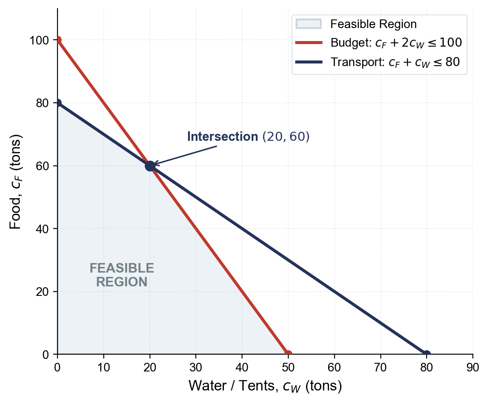
  <p style="font-size: 0.65em; color: #666;">The feasible region is the intersection of both half-spaces.</p>
</div>
:::
::::

---

## Dual Constraints & Two Multipliers {.compact}

Form the two-constraint Lagrangian:

$$\mathcal{L}(c_F, c_W, \lambda, \mu) = c_F c_W + \lambda\big(100 - c_F - 2c_W\big) + \mu\big(80 - c_F - c_W\big)$$

::: {.incremental}
- $\lambda$ is the shadow price of **money** (utils per $\$1\text{K}$)
- $\mu$ is the shadow price of **cargo space** (utils per ton)
- **Complementary slackness conditions:**
  $$\lambda \ge 0, \quad 100 - c_F - 2c_W \ge 0, \quad \lambda(100 - c_F - 2c_W) = 0$$
  $$\mu \ge 0, \quad 80 - c_F - c_W \ge 0, \quad \mu(80 - c_F - c_W) = 0$$
- Each constraint can independently bind ($>0$) or be slack ($=0$).
- How do we know which case applies?
:::

---

## The Three Candidate Regimes {.compact}

With two constraints, there are $2^2 = 4$ possible combinations. Dropping the trivial case where neither binds leaves **three candidate regimes**:

:::: {.columns}
::: {.column width="33%"}
<div style="text-align: center;">
  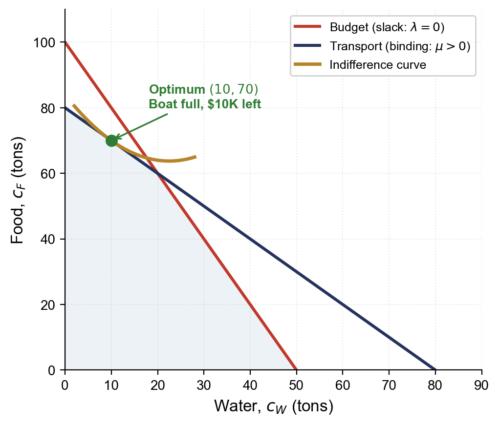
  <p style="font-size: 0.65em; color: #666;"><strong>Case 1: Boat Binds</strong><br>$\lambda = 0, \; \mu > 0$</p>
</div>
:::

::: {.column width="33%"}
<div style="text-align: center;">
  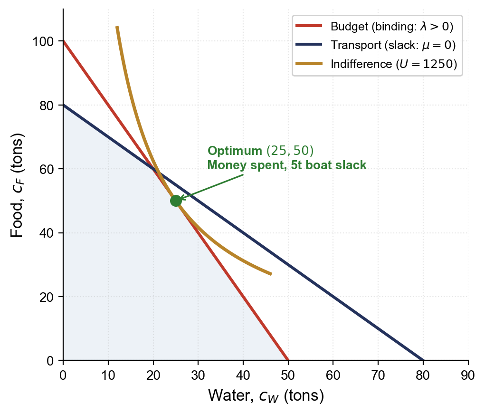
  <p style="font-size: 0.65em; color: #666;"><strong>Case 2: Money Binds</strong><br>$\lambda > 0, \; \mu = 0$</p>
</div>
:::

::: {.column width="33%"}
<div style="text-align: center;">
  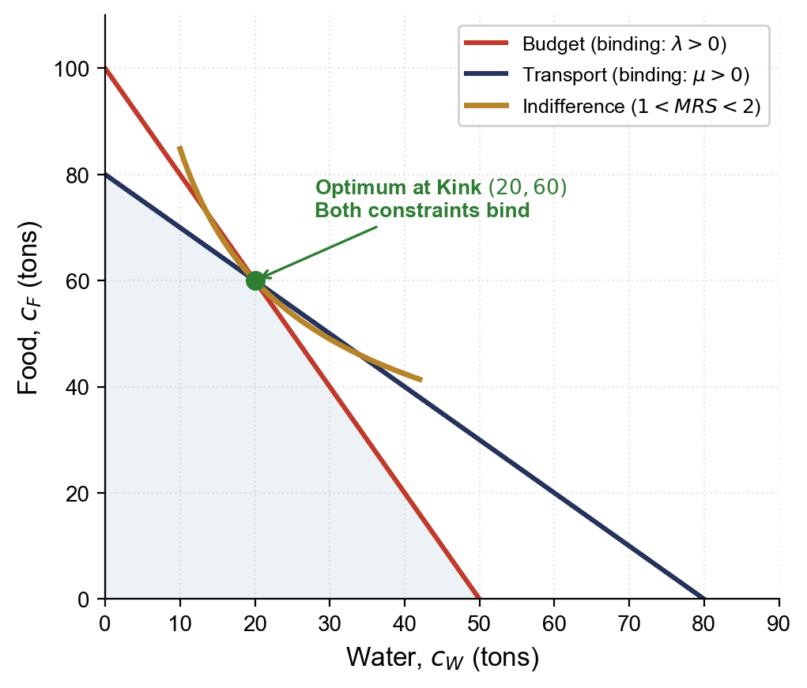
  <p style="font-size: 0.65em; color: #666;"><strong>Case 3: Both Bind</strong><br>$\lambda > 0, \; \mu > 0$</p>
</div>
:::
::::

::: {.fragment}
> *These reflect different preference alignments: which fence you hit first depends on the slope of your indifference curves.*
:::

---

## Solving Each Regime Systematically {.compact}

::: {.incremental}
- **Regime 1: Budget Binds Only ($\lambda > 0, \mu = 0$)**
  - Ignore boat capacity. Standard Cobb-Douglas budget problem:
    $$c_W = \frac{I}{2 p_W} = \frac{100}{2(2)} = 25, \qquad c_F = \frac{I}{2 p_F} = \frac{100}{2(1)} = 50$$
  - **Check Feasibility:** $c_F + c_W = 50 + 25 = 75 \le 80$ tons. **FEASIBLE!**
  - Objective: $U = 50 \times 25 = 1250$. Multipliers: $\lambda = 25, \mu = 0$.
- **Regime 2: Transport Binds Only ($\lambda = 0, \mu > 0$)**
  - Ignore money budget. Equal weights ($w_F = 1, w_W = 1$):
    $$c_W = \frac{T}{2 w_W} = 40, \qquad c_F = \frac{T}{2 w_F} = 40$$
  - **Check Feasibility:** $c_F + 2 c_W = 40 + 2(40) = 120 > 100$. **INFEASIBLE!**
- **Regime 3: Both Constraints Bind ($\lambda > 0, \mu > 0$)**
  - Sits at the intersection vertex: $c_F + 2c_W = 100$ and $c_F + c_W = 80$.
  - Subtracting: $c_W = 20 \implies c_F = 60$. Feasible, with $U = 60 \times 20 = 1200$.
:::

---

## Choosing the Winner {.compact}

:::: {.columns}
::: {.column width="55%"}
Summary of candidate solutions:

| Candidate Regime | Bundle $(c_W, c_F)$ | Feasible? | Utility $U$ |
|---|---|:---:|:---:|
| **1. Budget Binds Only** | $(25, 50)$ | **Yes** ($75 \le 80$) | **1,250** |
| **2. Both Bind (Kink)** | $(20, 60)$ | **Yes** ($80 \le 80$) | 1,200 |
| **3. Transport Binds Only** | $(40, 40)$ | **No** ($120 > 100$) | *(1,600)* |

::: {.incremental}
- Candidate 3 is discarded because it runs out of money.
- Comparing feasible candidates: $U(\text{Regime 1}) = 1250 > 1200 = U(\text{Regime 3})$.
- **Optimal Choice:** The agency exhausts its $\$100\text{K}$ budget and ships 75 tons, leaving 5 tons of boat capacity unused!
:::
:::

::: {.column width="45%"}
<div style="text-align: center;">
  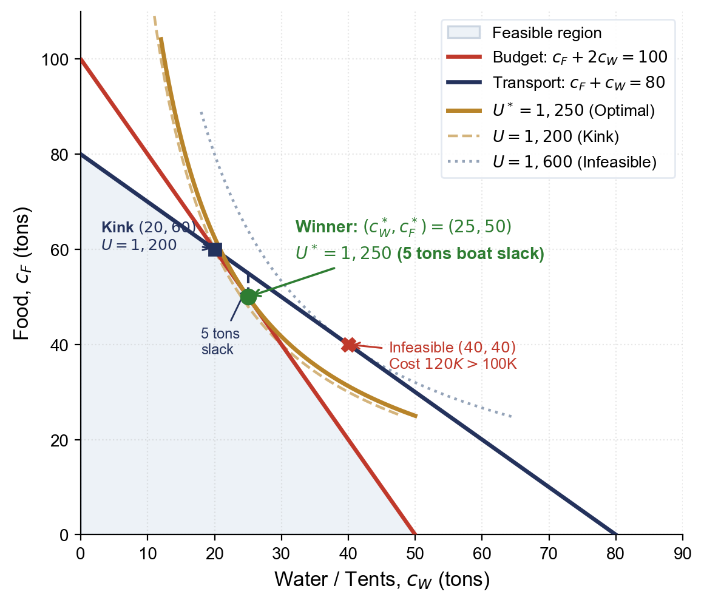
  <p style="font-size: 0.65em; color: #666;">Optimal bundle $(25, 50)$ sits on the budget boundary.</p>
</div>
:::
::::

---

## Why Economists Still Solve This by Hand {.compact}

:::: {.columns}
::: {.column width="52%"}
::: {.incremental}
- **For 2 constraints:**
  - $2^2 = 4$ regimes ($3$ non-trivial).
  - Checking 3 cases by hand is completely manageable on a blackboard or exam.
- **The Combinatorial Explosion:**
  - With $K$ inequality constraints, there are $2^K$ potential regimes:
    - $K = 5 \implies 32$ regimes
    - $K = 10 \implies 1,024$ regimes
    - $K = 20 \implies 1,048,576$ regimes!
  - Hand checking quickly becomes impossible.
- **Why do we teach the hand solve?**
  - It trains you to identify the **economic bottleneck** — which resource is genuinely binding.
  - It reveals how shadow prices respond to parameter shifts.
:::
:::

::: {.column width="48%"}
::: {.fragment}
<div style="background: #eef1f6; border-left: 4px solid #24325c; padding: 14px; border-radius: 4px; font-size: 0.82em; margin-top: 10px;">
  <strong>Hand Solve vs. Algorithmic Solve:</strong>
  <ul>
    <li><strong>Hand solve (Microeconomic Theory):</strong><br>
    Builds intuition, characterizes comparative statics, identifies economic mechanisms.</li>
    <li><strong>Numerical solve (Applied Econometrics & Policy):</strong><br>
    Uses Sequential Least Squares Quadratic Programming (SLSQP) or interior-point algorithms to evaluate 100s of constraints instantly.</li>
  </ul>
</div>
:::
:::
::::

---

## Solving It With Python (`scipy.optimize`) {.compact}

In modern practice, we write the objective, pass the constraints as a list of dictionaries, and let `scipy.optimize.minimize` find the regime:

```python
from scipy.optimize import minimize

# Scipy minimizes, so we minimize negative utility
objective = lambda c: -(c[0] * c[1])

# Inequality constraints: fun(c) >= 0
constraints = [
    {"type": "ineq", "fun": lambda c: 100.0 - (c[0] + 2.0 * c[1])}, # Budget: 100 - cF - 2cW >= 0
    {"type": "ineq", "fun": lambda c: 80.0  - (c[0] + c[1])}        # Cargo:  80 - cF - cW  >= 0
]

result = minimize(objective, x0=[10.0, 10.0], constraints=constraints,
                  bounds=[(0, None), (0, None)], method="SLSQP")

print(f"Optimal bundle: cF* = {result.x[0]:.2f}, cW* = {result.x[1]:.2f}")
print(f"Max Utility:    U*  = {-result.fun:.2f}")
# Output: Optimal bundle: cF* = 50.00, cW* = 25.00 | Max Utility: U* = 1250.00
```

::: {.fragment}
> *One 5-line call replaces checking every combinatorial regime by hand.*
:::

---

## The Envelope Theorem: Sensitivity Check {.compact}

Let's verify the shadow prices numerically by perturbing the constraints:

:::: {.columns}
::: {.column width="50%"}
**Perturbing the Budget ($I: 100 \to 101$):**

::: {.incremental}
- Solve again with $I = 101$:
  $$c_F^* = 50.5, \quad c_W^* = 25.25$$
  $$U^*(101) = 50.5 \times 25.25 = 1275.125$$
- Numerical change in welfare:
  $$\Delta U^* = 1275.125 - 1250 = 25.125$$
  $$\frac{\Delta U^*}{\Delta I} = \frac{25.125}{1} = 25.125$$
- Exact analytical multiplier:
  $$\lambda^* = \frac{I}{4} = 25 \approx \frac{\Delta U^*}{\Delta I}$$
:::
:::

::: {.column width="50%"}
**Perturbing Capacity ($T: 80 \to 81$):**

::: {.incremental}
- Solve again with $T = 81$:
  $$c_F^* = 50.0, \quad c_W^* = 25.0$$
  $$U^*(T=81) = 1250.000$$
- Numerical change in welfare:
  $$\Delta U^* = 1250 - 1250 = 0$$
- Shadow price of boat capacity:
  $$\mu^* = 0$$
- **Insight:** Expanding boat capacity has **zero marginal value** because money is the binding bottleneck!
:::
:::
::::

---

## The Art of the Solve {.compact}

When approaching constrained optimization problems in economics:

::: {.incremental}
- **1. Inspect Before Grinding:**
  - Check whether preferences are monotonic. If so, budget constraints bind with equality.
  - Check whether functional forms satisfy standard concavity / diminishing MRS.
- **2. Simplify the Algebra:**
  - Any monotonic transformation preserves the optimum: $\max \ln u(x)$ is often much easier than $\max u(x)$ (turns products into sums!).
- **3. Eliminate Obvious Regimes:**
  - Use economic intuition to rule out unlikely regimes before writing out full Lagrangians.
- **4. Check Feasibility:**
  - If you solve dropping a constraint, always plug your candidate back in to verify it satisfies the omitted fence!
:::

---

## Duality Preview: Two Sides of the Same Coin {.compact}

Every constrained optimization problem has an intimately linked **dual** counterpart:

:::: {.columns}
::: {.column width="50%"}
::: {.callout-note icon=false}
## Primal Problem: Maximize Value
$$\max_{c_1, c_2} \; u(c_1, c_2) \quad \text{s.t.} \quad p_1 c_1 + p_2 c_2 \le I$$

- **Question:** *Given a budget $I$, what is the highest utility level $\bar{u}$ I can achieve?*
- **Solution:** Optimal demand bundle $(c_1^*, c_2^*)$
- **Value Function:** Indirect utility $V(p_1, p_2, I) = \bar{u}$
- **Multiplier:** $\lambda^* = \frac{\partial V}{\partial I}$ (marginal utility of income)
:::
:::

::: {.column width="50%"}
::: {.callout-tip icon=false}
## Dual Problem: Minimize Cost
$$\min_{c_1, c_2} \; p_1 c_1 + p_2 c_2 \quad \text{s.t.} \quad u(c_1, c_2) \ge \bar{u}$$

- **Question:** *To reach target utility $\bar{u}$, what is the minimum expenditure $I$ required?*
- **Solution:** Compensated bundle $(c_1^c, c_2^c)$
- **Value Function:** Expenditure function $E(p_1, p_2, \bar{u}) = I$
- **Multiplier:** $\mu^* = \frac{\partial E}{\partial \bar{u}} = \frac{1}{\lambda^*}$ (marginal cost of utility)
:::
:::
::::

::: {.incremental}
- **Symmetry:** Both problems produce the **identical optimal bundle** and tangency condition ($MRS = p_1/p_2$).
- **Direct Application to Topic 3:** Next, we encounter the producer's dual problem: **minimizing cost** $wL + rK$ subject to an output quota $F(K, L) \ge \bar{q}$.
:::

---

## Vocabulary Checklist {.compact}

You should now be able to define, calculate, and interpret:

| Mathematical Tools | Economic Concepts | Optimization Frameworks |
|---|---|---|
| First-Order Condition (FOC) | Marginal Utility ($MU_i$) | Direct Substitution |
| Second-Order Condition (SOC) | Marginal Rate of Substitution ($MRS$) | Tangency Condition ($MRS = MRT$) |
| Level Curve / Contour | Marginal Rate of Technical Substitution ($MRTS$) | Method of Lagrange ($\mathcal{L}$) |
| Implicit Differentiation | Marginal Utility of Income | Shadow Price ($\lambda^* = \partial V / \partial c$) |
| Gradient Vector ($\nabla f = 0$) | Internal Arbitrage Condition | Envelope Theorem |
| Total Differential ($df = 0$) | Bottleneck Constraint | Kuhn–Tucker Conditions (KKT) |
| Non-Negativity Constraints | Production Possibility Frontier (PPF) | Complementary Slackness ($\lambda \cdot \text{slack} = 0$) |

::: {.fragment}
> *Next in Topic 3: We point this machinery at the firm — cost minimization, the cost function, profit maximization, and the duality between them.*
:::
