<!-- _class: divider -->

# Part I
# Production Technology and Cost Minimization

The production function, isoquants, and the Method of Lagrange applied to a firm's cost-minimizing choice of inputs

---

## The Production Function

A firm's production function gives the maximum output attainable from any combination of inputs — here capital $K$ and labor $L$:

$$q = F(K,L)$$

- $F(K,L)$ is the *maximum* amount of the good producible using $K$ units of capital and $L$ units of labor — anything less than the max is technically inefficient and never optimal to choose

---

## Marginal Physical Product

$$MP_K = \frac{\partial q}{\partial K} = F_K(K,L) \qquad\qquad MP_L = \frac{\partial q}{\partial L} = F_L(K,L)$$

- The additional output from employing one more unit of an input, holding the other input constant

---

## Diminishing Marginal Productivity

$$\frac{\partial MP_K}{\partial K} = F_{KK} < 0 \qquad\qquad \frac{\partial MP_L}{\partial L} = F_{LL} < 0 \qquad\qquad \frac{\partial MP_L}{\partial K} = F_{LK} > 0$$

- We generally assume diminishing marginal productivity in each input — it implies a downward-sloping demand for factors
- $F_{LK} > 0$: capital and labor are **complements** in most production functions — more of one raises the marginal product of the other

---

## Production Technology vs. Production Technique

- A **production technology** is like a recipe book — the full set of available techniques for producing any amount $q$ of output
- A **production technique** is like a single recipe: e.g. "combine 20 units of $K$ and 10 units of $L$" to make $q=10$ widgets
- An **isoquant map** summarizes the technology; a point on an isoquant is a technique

---

## From Discrete Techniques to a Smooth Isoquant

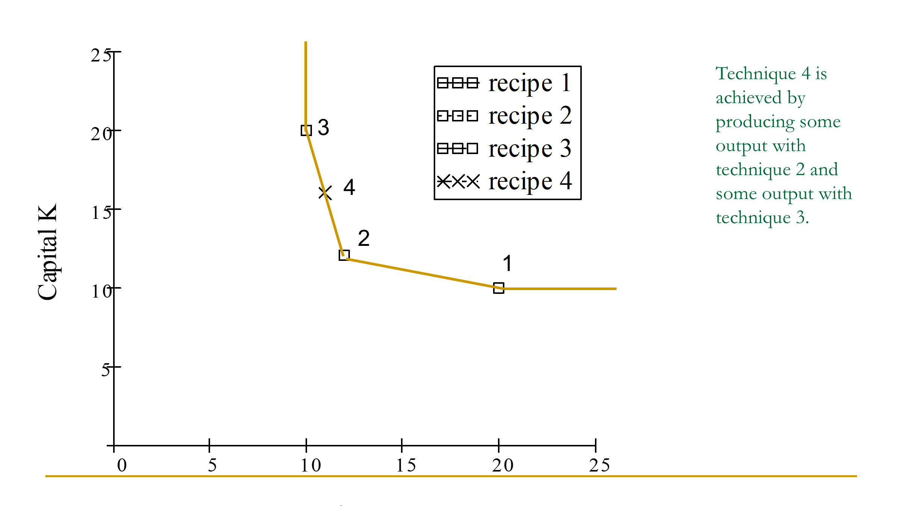

- A firm choosing between discrete techniques (1, 2, 3) can achieve any point *between* them by combining two techniques — e.g. technique 4 blends 2 and 3 — tracing out a convex isoquant

---

## The Smooth-Substitutability Assumption

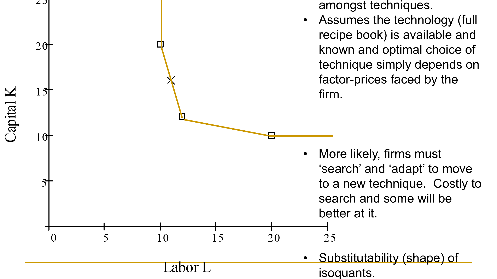

- Economists often assume the full recipe book is known and smoothly substitutable, so the optimal technique depends only on factor prices
- More realistically, firms must *search and adapt* to reach a new technique — costly, and some firms are better at it than others

---

## The Isoquant Map

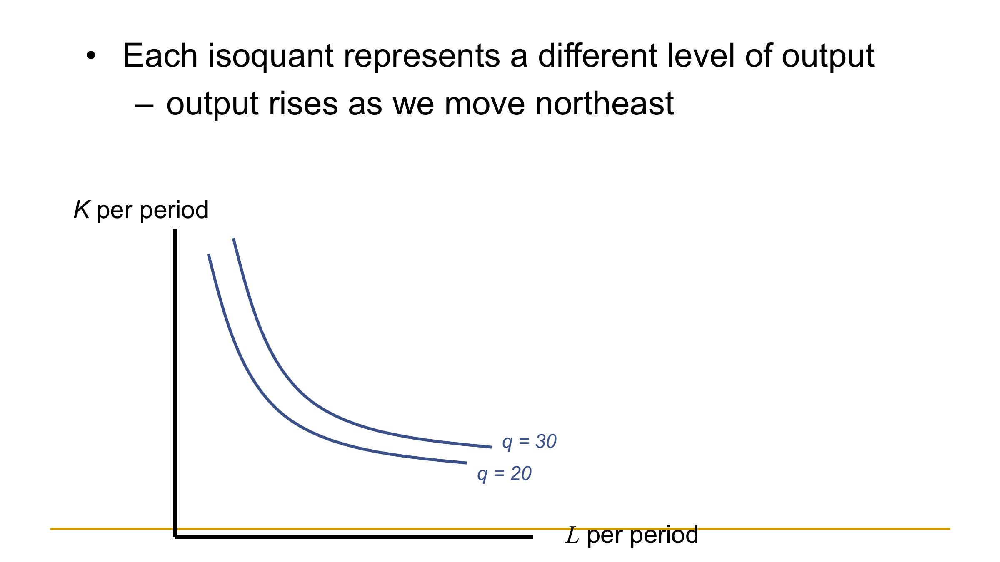

- Each isoquant represents a different output level — output rises moving northeast

---

## The Marginal Rate of Technical Substitution (RTS)

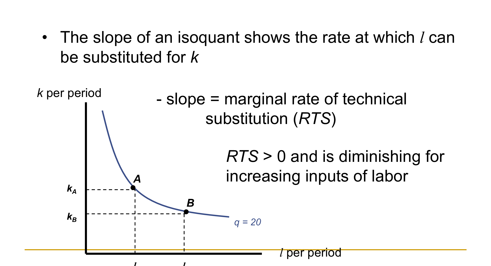

$$F(K,L) = \bar q \qquad\Longrightarrow\qquad F_K\,dK + F_L\,dL = 0 \qquad\Longrightarrow\qquad \frac{dK}{dL} = -\frac{F_L}{F_K}$$

- The slope of an isoquant is the **RTS** — the rate at which $L$ substitutes for $K$ holding output fixed. $RTS>0$ and diminishes as labor input increases

---

## Cost Minimization

Assume the firm has already chosen its output level $q$ and wants to produce it as cheaply as possible:

- Minimizing cost is a prerequisite for maximizing profit — a profit-maximizing firm never overpays for a given output
- Choosing $K$ and $L$ to minimize the cost of producing $q$ leads to a **derived demand** for each input, and from that a cost function $C(q)$

---

## Isocost Lines

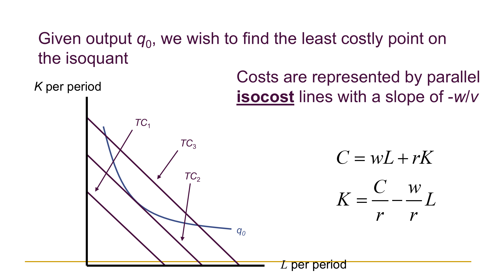

$$C = wL + rK \qquad\Longrightarrow\qquad K = \frac{C}{r} - \frac{w}{r}L$$

- Costs are represented by parallel **isocost lines** with slope $-w/r$ — higher lines mean higher total cost

---

## The Cost-Minimizing Choice

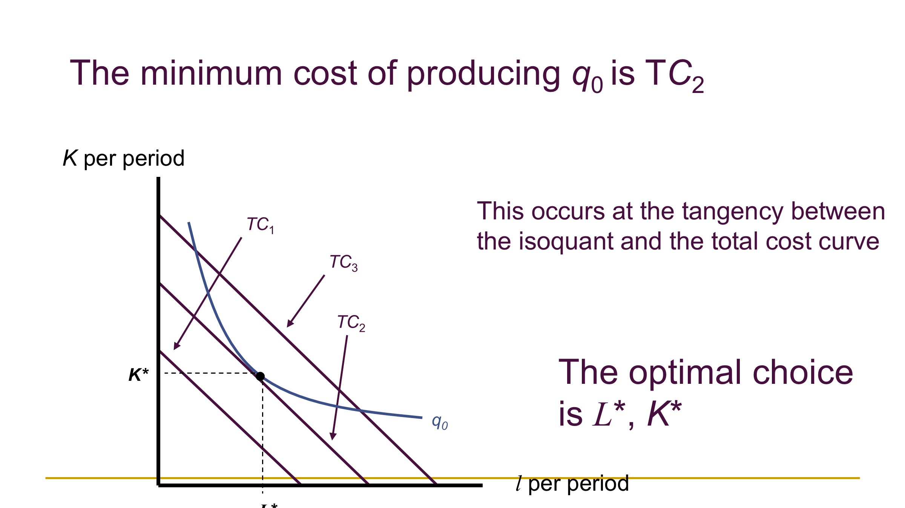

- The minimum cost of producing $q_0$ occurs at the **tangency** between the isoquant and the lowest attainable isocost line — the optimal choice is $(L^*, K^*)$

---

## The Expansion Path

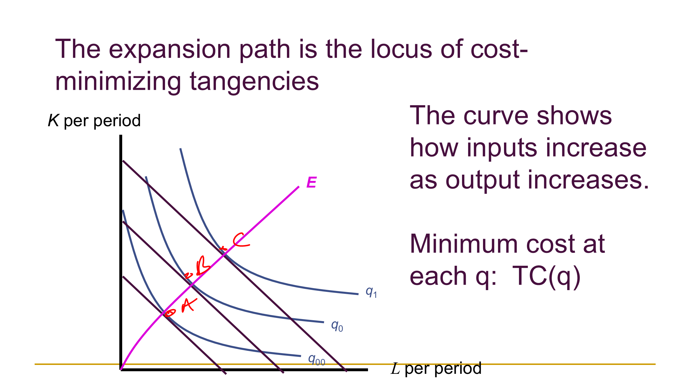

- The **expansion path** is the locus of cost-minimizing tangencies as output rises — it traces out how input use grows with $q$, and the minimum cost at each $q$ is exactly $TC(q)$

---

## Solving It: The Lagrangian

Minimize total cost given $F(K,L) = q_0$:

$$L(K,L,\lambda) = wL + vK + \lambda\big[q_0 - F(K,L)\big]$$

First-order conditions:

$$\frac{\partial L}{\partial L} = w - \lambda F_L = 0 \qquad \frac{\partial L}{\partial K} = v - \lambda F_K = 0 \qquad \frac{\partial L}{\partial \lambda} = q_0 - F(K,L) = 0$$

---

## The Tangency Condition

Dividing the first two FOCs:

$$\frac{w}{v} = \frac{F_L}{F_K} = \frac{MP_L}{MP_K} = RTS(L \text{ for } K)$$

Cross-multiplying instead:

$$\frac{F_K}{v} = \frac{F_L}{w}$$

- The firm equates the RTS to the ratio of factor prices — marginal productivity per dollar spent must be equal across inputs

---

## The Multiplier as Marginal Cost

$$\frac{w}{F_L} = \frac{v}{F_K} = \lambda$$

- Each side is dollars spent per extra unit of output from that input — $\left(\frac{\$/L}{q/L}\right) \to \left(\frac{\$}{L}\right)\cdot\left(\frac{L}{q}\right) \to \left(\frac{\$}{q}\right)$, i.e. dollars **per unit of output**
- $\lambda$ is exactly the **marginal cost** of output: how much extra cost is incurred by relaxing the output constraint slightly

---

## Derived Demand and the Cost Function

Solving the FOCs and the constraint together gives the **derived demand** for each input:

$$L^*(w,v,q_0) \qquad\qquad K^*(w,v,q_0)$$

Substituting back into the objective gives the **cost function**:

$$C(v,w,q) = \min_{K,L} \; vK + wL \quad\text{s.t.}\quad F(K,L) = q$$

$$\Longrightarrow\qquad C(v,w,q) = vK^*(w,v,q) + wL^*(w,v,q)$$

- Exactly analogous to the expenditure function $E(p_1,p_2,U)$ from consumer theory — plug the derived demands back into the objective

---

## Average and Marginal Cost

$$\text{average cost} = AC(v,w,q) = \frac{C(v,w,q)}{q}$$

$$\text{marginal cost} = MC(v,w,q) = \frac{\partial C(v,w,q)}{\partial q}$$

---

## Cobb-Douglas: Derived Demand and Cost Function

For $F(K,L) = K^\alpha L^\beta$, the tangency condition $\frac{w}{v} = \frac{F_L}{F_K} = \frac{\beta}{\alpha}\frac{K}{L}$ gives $K = \frac{\alpha}{\beta}\frac{w}{v}L$. Substituting into $F(K,L)=q$ and solving:

$$L^* = q^{\frac{1}{\alpha+\beta}}\left(\frac{\beta}{\alpha}\right)^{\frac{\alpha}{\alpha+\beta}} v^{\alpha/(\alpha+\beta)} w^{-\alpha/(\alpha+\beta)} \qquad K^* = q^{\frac{1}{\alpha+\beta}}\left(\frac{\alpha}{\beta}\right)^{\frac{\beta}{\alpha+\beta}} v^{-\beta/(\alpha+\beta)} w^{\beta/(\alpha+\beta)}$$

Substituting back:

$$C(v,w,q) = B\, q^{\frac{1}{\alpha+\beta}} v^{\frac{\alpha}{\alpha+\beta}} w^{\frac{\beta}{\alpha+\beta}}, \qquad B = (\alpha+\beta)\,\alpha^{-\alpha/(\alpha+\beta)}\beta^{-\beta/(\alpha+\beta)}$$

- With $\alpha+\beta=1$ (constant returns to scale), cost is exactly **linear** in $q$ — the case examined next

---

<!-- _class: divider -->

# Part II
# Returns to Scale, Cost Curves, and Profit Maximization

Constant vs. decreasing returns to scale, the profit-maximization/cost-minimization duality, short-run vs. long-run costs, and the firm's output choice

---

## Constant Returns to Scale: The Cost Function

With $\alpha=\tfrac12,\ \beta=1-\alpha=\tfrac12$ (so $\alpha+\beta=1$), the Cobb-Douglas cost formula collapses to $B=2$ and $C(v,w,q) = 2\,q\,v^{1/2}w^{1/2}$ — **linear** in $q$:

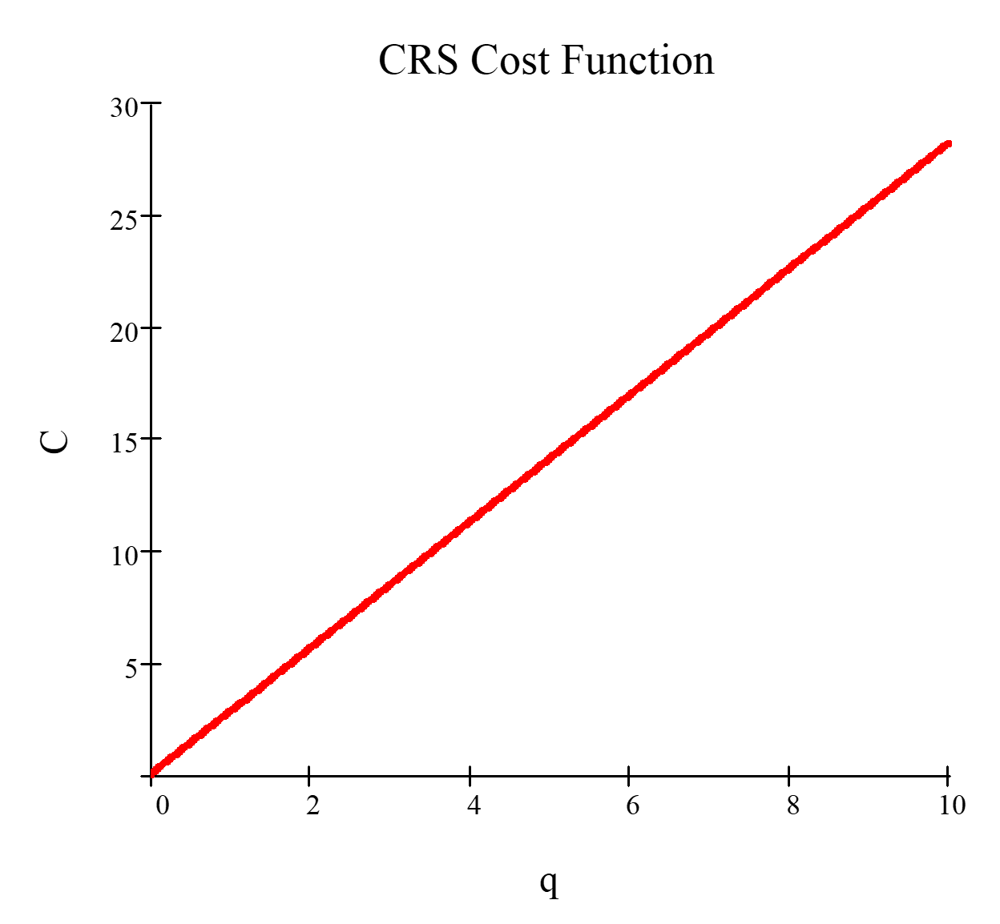

- Doubling output exactly doubles cost — the hallmark of constant returns to scale

---

## Constant Returns to Scale: AC and MC

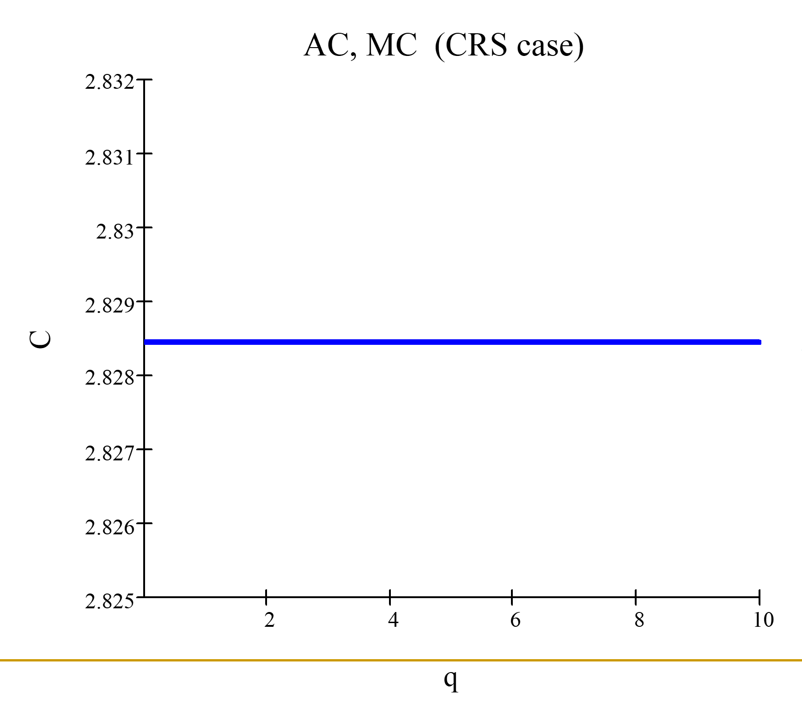

- Since cost is linear in $q$, both average and marginal cost are **constant** — $AC(v,w,q) = MC(v,w,q)$ at every output level

---

## Decreasing Returns to Scale: The Cost Function

With $\alpha=\tfrac18,\ \beta=\tfrac14$ (so $\alpha+\beta=\tfrac38<1$), the same formula gives a cost function that's **convex** in $q$:

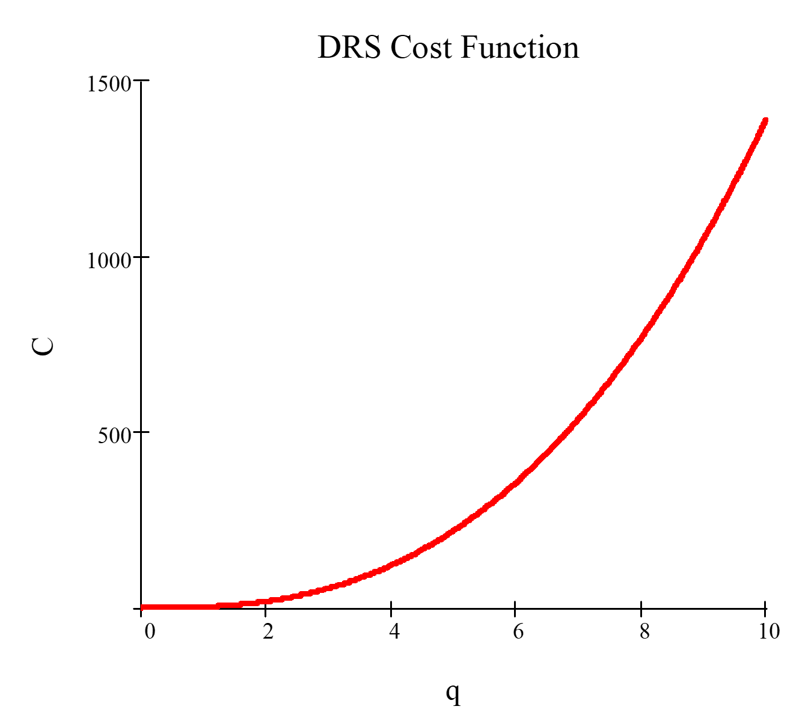

- Costs rise faster than output — marginal cost is increasing

---

## Understanding Decreasing Returns to Scale

$$\hat f(k,l,z) = k^\alpha l^\beta z^{1-\alpha-\beta} \qquad\qquad f(k,l) = \hat f(k,l,\bar z) = A\,k^\alpha l^\beta, \quad A = \bar z^{\,1-\alpha-\beta}$$

- One way to think of DRS: the underlying technology is really **constant** returns to scale in *three* inputs, but one factor (here $z$, e.g. "managerial skill") is fixed and non-traded
- As $q$ rises, the fixed factor is spread more and more thinly — this is exactly why DRS implies rising marginal cost

---

## Average and Marginal Cost, With Fixed Costs

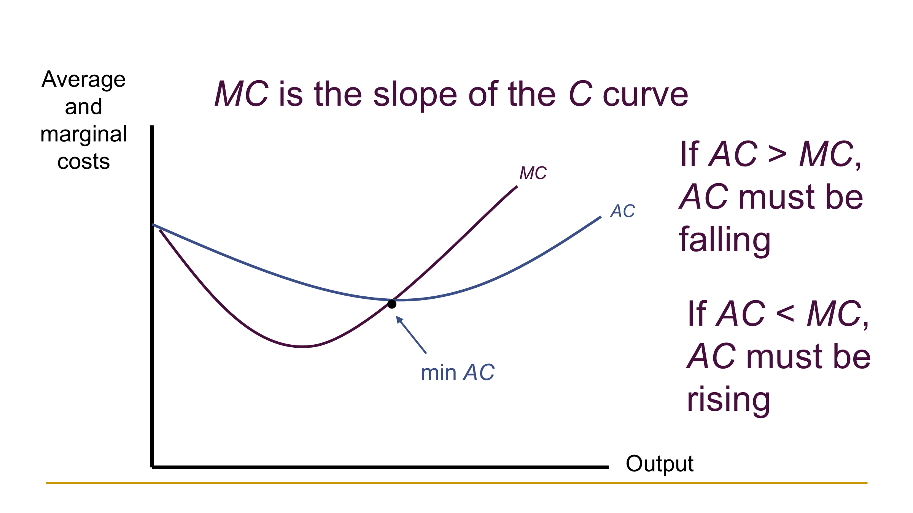

- $MC$ is the slope of the $C$ curve; $AC$ is the slope of a ray from the origin to the $C$ curve
- If $AC > MC$, $AC$ must be falling; if $AC < MC$, $AC$ must be rising — so $MC$ crosses $AC$ exactly at $AC$'s minimum

---

## Profit Maximization and Cost Minimization: The Same Tangency

$$\max_{K,L} \; pF(K,L) - rK - wL - \text{FC} \qquad\Longrightarrow\qquad pF_L(K^*,L^*) = w, \quad pF_K(K^*,L^*) = r$$

$$\min_{K,L} \; rK + wL + \text{FC} \quad\text{s.t.}\quad F(K,L) = \bar q$$

$$\Longrightarrow\qquad \lambda F_L(K^*,L^*) = w, \quad \lambda F_K(K^*,L^*) = r$$

- Both give the same tangency condition $\frac{F_L}{F_K} = \frac{w}{r}$ — a profit-maximizing firm's input choice is automatically cost-minimizing for whatever output it ends up producing

---

## Conditional vs. Unconditional Input Demand

The profit-maximization FOCs can in principle be solved directly for **input demand functions**:

$$\text{Capital demand} = K(p,v,w) \qquad\qquad \text{Labor demand} = L(p,v,w)$$

- These are **unconditional** — they implicitly let the firm adjust its output as prices change
- The cost-minimization problem's derived demands $K^*(w,v,q)$, $L^*(w,v,q)$ are **conditional** on a chosen output $q$

---

## Short-Run Total Costs

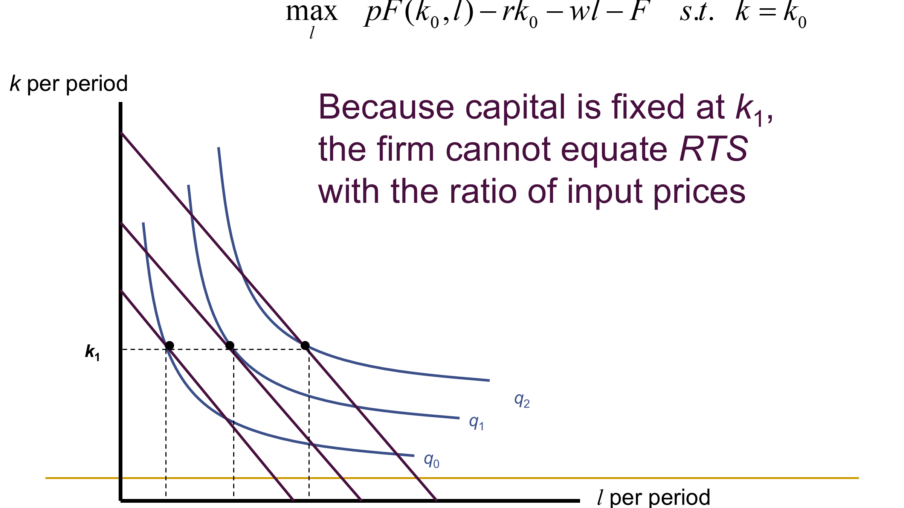

$$\max_{l} \; pF(k_0,l) - rk_0 - wl - \text{FC} \quad\text{s.t.}\quad k = k_0$$

- With capital fixed at $k_0$, the firm can't equate the RTS to the ratio of input prices — it can only adjust $l$, tracing out a *short-run* cost curve for each level of $k$

---

## Short-Run and Long-Run Costs

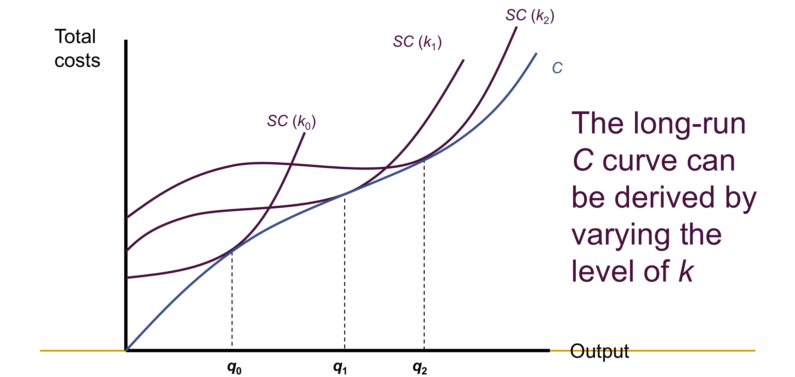

- Each $SC(k_i)$ curve is the short-run cost curve for a fixed capital level $k_i$
- The **long-run** cost curve is the lower envelope of all the short-run curves — derived by letting $k$ vary optimally with $q$

---

## Profit Maximization

Total revenue: $R(q) = p(q)\cdot q$. Economic profit:

$$\pi(q) = R(q) - C(q) = p(q)\cdot q - C(q)$$

---

## Checking It Numerically

$$p(q) = 10-q \qquad R(q) = p(q)\cdot q \qquad c(q) = \tfrac12 q^2$$

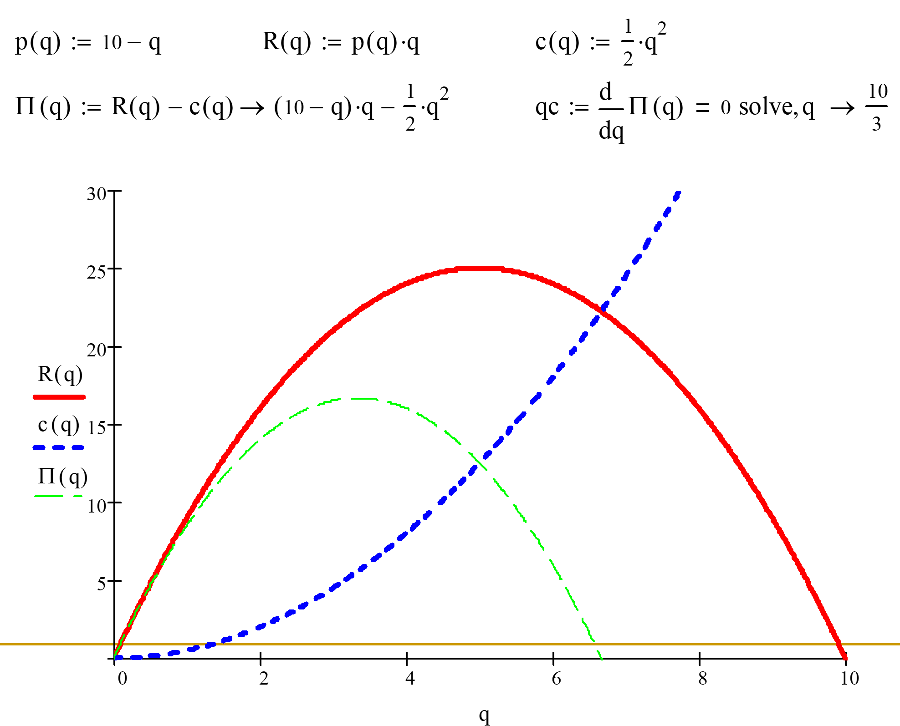

- $\Pi(q) = R(q)-c(q)$; solving $\frac{d}{dq}\Pi(q)=0$ gives $q^*=\frac{10}{3}$ — the graph confirms $\Pi$ peaks exactly where $R$ and $c$ have the same slope

---

## The First-Order Condition: MR = MC

$$\frac{d\pi}{dq} = \pi'(q) = \frac{dR}{dq} - \frac{dC}{dq} = 0 \qquad\Longrightarrow\qquad \frac{dR}{dq} = \frac{dC}{dq} \qquad\Longrightarrow\qquad MR = MC$$

- Profit is maximized where marginal revenue equals marginal cost — the slope of the revenue curve equals the slope of the cost curve

---

## Why the Second-Order Condition Matters

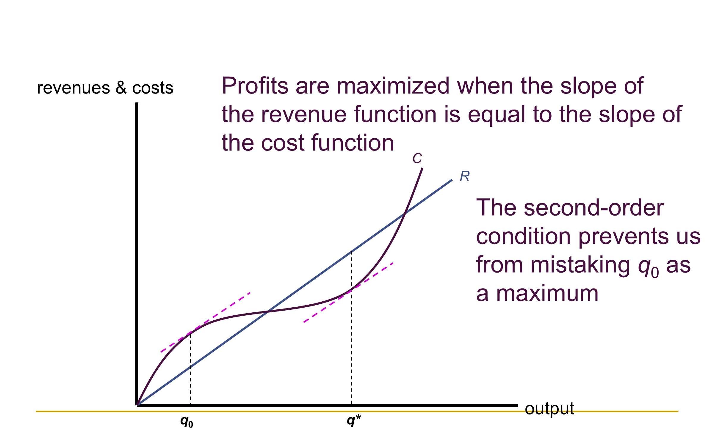

- $R$ and $C$ can have equal slopes at more than one point — here at $q_0$ *and* $q^*$
- Without checking curvature, $q_0$ could wrongly be mistaken for a maximum — it's actually an inflection-like point, not the profit peak

---

## The Second-Order Condition

$$\left.\frac{d^2\pi}{dq^2}\right|_{q=q^*} = \left.\frac{d\pi'(q)}{dq}\right|_{q=q^*} < 0$$

- The SOC is exactly what rules out mistaking a point like $q_0$ on the previous slide for a maximum — it confirms $\pi$ is genuinely peaking, not just momentarily flat

---

## Average and Marginal Revenue

$$AR(q) = \frac{R(q)}{q} = \frac{p(q)\cdot q}{q} = p(q)$$

- Average revenue is always just the price — by definition

**Example:** linear inverse demand $p(q) = A - bq$:

$$R(q) = Aq - bq^2 \qquad\qquad AR(q) = A - bq \qquad\qquad MR(q) = A - 2bq$$

- For linear demand, marginal revenue falls **twice as fast** as price — a standard result worth remembering
