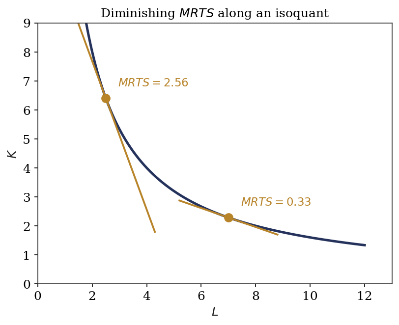
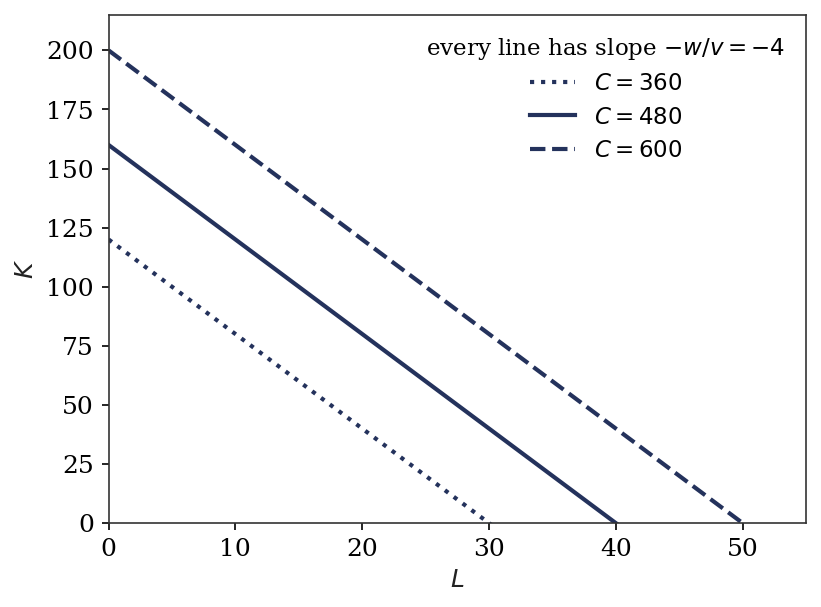
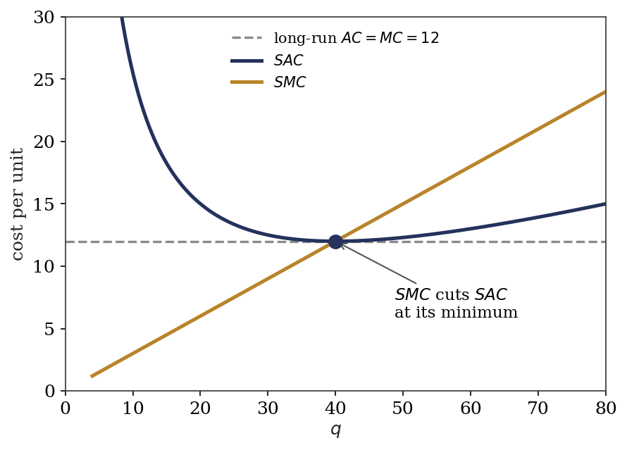
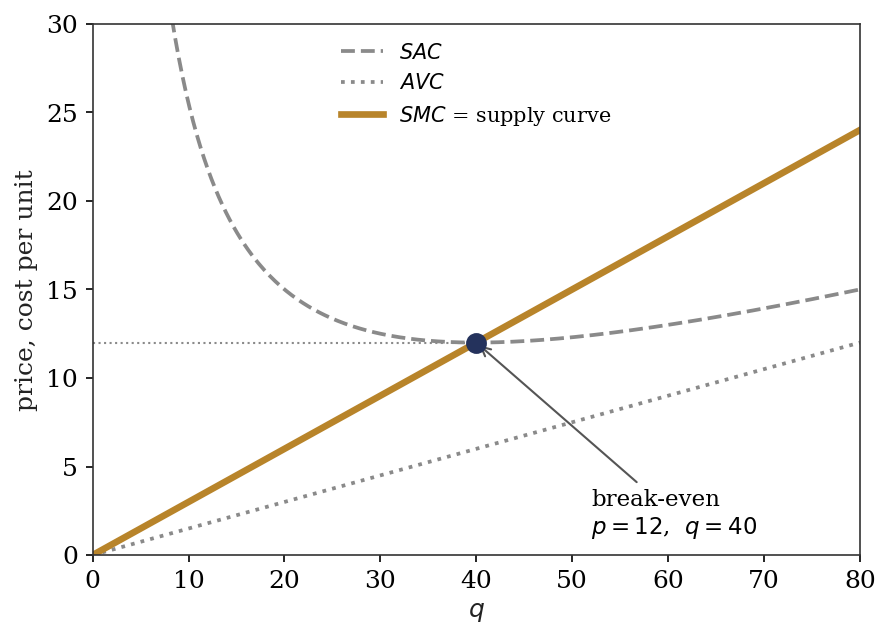
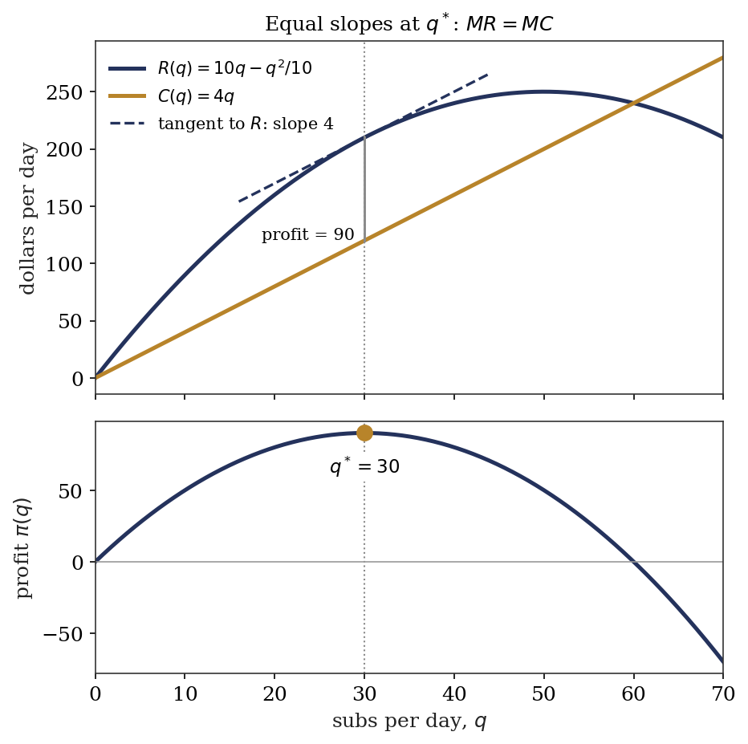

## Same Fence, New Hill {.compact}

Topic 2 built the machinery of constrained optimization. Now we apply it to the firm.

:::: {.columns}
::: {.column width="52%"}
| Topic 2: constrained optimization | Topic 3: the firm |
|---|---|
| climb the hill $\max f(x,y)$ | minimize spending $wL + vK$ |
| stop at the fence $g(x,y) = c$ | reach output target $F(K,L) = q$ |
| contour / level curve | isoquant |
| tangency $\nabla f = \lambda \nabla g$ | tangency $MRTS = w/v$ |
| $\lambda$ = shadow price of fence | $\lambda$ = marginal cost of output |
| value function $V(c)$ | cost function $C(v,w,q)$ |
:::

::: {.column width="48%"}
::: {.callout-tip icon=false}
## The same three steps
1. Where is the tangency?
2. What does the multiplier mean?
3. What happens when parameters move — the envelope theorem.
:::

::: {.fragment}
The calculus is what you already did. 

*(Topic 4 will flip this same logic around for consumer choice.)*
:::
:::
::::

<!-- Ported from the Marp deck (slidesIIb 162-202); see source.yml for the
     extraction history. Figures regenerated from formulas in
     notebooks/topic03_production_figures.ipynb. Notation standardised:
     L = labor, K = capital, w = wage, v = rental rate, \mathcal{L} =
     Lagrangian (the legacy deck used L for both labor and the Lagrangian,
     and alternated between r and v for the rental rate).
     Revised 2026-10-05 to sit alongside Nicholson & Snyder 11e ch. 9-11:
     rental rate is v, cost function is C(v,w,q), contingent demands are
     L^c and K^c, short-run capital is K_1, and the running numbers are the
     text's (w = 12, v = 3, q = 40). Capital letters K, L and MRTS are kept
     for continuity with Topic 2; the "Reading Alongside the Text" slide
     gives students the translation. -->

---

## Three Questions About the Firm {.compact}

::: {.incremental}
- **What can the firm make?** The production function and its isoquants — the firm's *technology*.
- **What is the cheapest way to make $q$?** Cost minimization, takes technology and input prices to derive a minimum **cost function** $C(v,w,q)$.
- **How much should it make?** Profit maximization, given total revenue and cost functions, determines optimum **output choice** and a **supply curve** given market input and output prices.
:::

::: {.fragment}
> Notice the order. The firm's problem splits in two: *first* figure out how toproduce any given output in the most cost efficient way (cost minimization), *then* choose the optimum output quantity (profit maximization).  
:::

---

## Reading Nicholson and Snyder {.compact}

Nicholson & Snyder (NS) chapters 9–11 cover the same ground in the same order: Ch. 9 technology, Ch. 10 cost, Ch. 11 profit.

:::: {.columns}
::: {.column width="50%"}
| | NS | These slides |
|---|:-:|:-:|
| Inputs | $k$, $l$ | $K$, $L$ |
| Production function | $f(k,l)$ | $F(K,L)$ |
| Slope of an isoquant | $RTS$ | $MRTS$ |
| Input demand at fixed $q$ | $l^c$, $k^c$ | $L^c$, $K^c$ |
| Capital fixed in the short run | $k_1$ | $K_1$ |

Same in both: $q$, wage $w$, rental rate of capital $v$, $C(v,w,q)$, $SAC$, $SMC$.
:::

::: {.column width="50%"}
::: {.callout-tip icon=false}
## Same numbers, too
Our running example is the text's: $q = \sqrt{KL}$, $w = 12$, $v = 3$. Grey notes on the slides point to the matching NS figure or example.
:::

::: {.callout-warning icon=false}
## One thing to skip for now
Chapter 10 refers back to Chapters 4–5 (expenditure minimization, compensated demand). We reach those in Topic 4.
:::
:::
::::

---

## Part I: Production Technology {.divider}

**Production Functions:** What the firm is able to do, before any question of what it *should* do — NS Chapter 9

---

## The Production Function

A firm's **production function** gives the maximum output attainable from each combination of inputs — here capital $K$ and labor $L$:

$$q = F(K,L)$$

::: {.incremental}
- For any combination of inputs $(K,L)$ the production function $F(K,L)$ is the *maximum* output producible from those inputs. Anything less is **technically inefficient** — and never optimal to choose.
- Built into the definition: the firm already knows how to get the most out of the inputs it buys. Every question that follows is about *which* combination inputs to buy (given technology and market prices).

:::

---

## Marginal Product

$$MP_K = \frac{\partial q}{\partial K} = F_K(K,L) \qquad\qquad MP_L = \frac{\partial q}{\partial L} = F_L(K,L)$$

::: {.incremental}
- The extra output from one more unit of an input, holding the other fixed — a partial derivative, exactly as in Topic 2.

:::

Text: NS Example 9.1 works through a numerical case.

---

## Diminishing Marginal Productivity {.compact}

$$F_{KK} < 0 \qquad\qquad F_{LL} < 0 \qquad\qquad F_{LK} > 0$$

::: {.incremental}
- **Own effects negative:** piling more labor onto a fixed stock of machines eventually yields less and less. This is what makes factor demand slope downward.
- **Cross effect positive:** capital and labor are **complements** in most technologies — more machines raise the marginal product of workers.
:::

---

## Technology vs. Technique {.compact}

::: {.incremental}
- A **production technology** is a recipe book: the full set of techniques available for producing any output.
- A **production technique** is one recipe: "combine 20 units of $K$ with 10 units of $L$ to make 10 widgets."
- An **isoquant** collects every technique that produces the same output. The **isoquant map** is the whole recipe book.
:::

::: {.fragment}
> The distinction matters for growth and development economics: two countries can face the same technology and still use very different techniques, because factor prices differ.
:::

---

## From Discrete Techniques to a Smooth Isoquant {.compact}

:::: {.columns}
::: {.column width="52%"}
A firm that knows only three recipes is not stuck with three points.

::: {.incremental}
- Run technique B half the time and C the other half, and you produce the same output at the midpoint of the segment joining them.
- Blending known recipes fills in the whole **convex** frontier between them.
- Learn more recipes and the kinked frontier smooths out — which is why we draw smooth, convex-to-the-origin isoquants.
:::
:::

::: {.column width="48%"}

  
  
Blends of A, B and C trace out a convex frontier.

:::
::::

::: {.fragment}
> **Caveat:** real firms must search and experiment to find good recipes. Lasting productivity gaps between similar firms show the recipe book is not free to read.
:::

---

## The Isoquant Map

:::: {.columns}
::: {.column width="50%"}
Each curve collects the input bundles yielding one output level.

::: {.incremental}
- Output rises moving **northeast** — more of both inputs.
- Isoquants cannot cross, for the same reason indifference curves cannot.
- Convex to the origin: balanced input mixes are more productive than extreme ones.
:::
:::

::: {.column width="50%"}

  
  
The isoquant map for $q = K^{1/2}L^{1/2}$. Text: NS Figure 9.1.

:::
::::

---

## The Marginal Rate of Technical Substitution {.compact}

:::: {.columns}
::: {.column width="52%"}
Recall from Topic 2: the slope of an isoquant is $-F_L/F_K$. Its size is the $MRTS$ (NS writes $RTS$).

::: {.incremental}
- $MRTS = F_L/F_K = MP_L/MP_K$: how much capital the firm can release per extra worker, output held fixed.
- It **diminishes** as labor replaces capital — labor gets less productive at the margin, capital more so.
- A *technological* rate of exchange. The market's rate is $w/v$. Cost minimization is about lining the two up.
:::
:::

::: {.column width="48%"}

  
  
Tangents flatten as $L$ rises: diminishing $MRTS$. Text: NS Example 9.2.

:::
::::

---

## Returns to Scale {.compact}

Scale *both* inputs by $t > 1$ and ask what happens to output:

$$F(tK, tL) = t^{\,\varepsilon} F(K,L)$$

::: {.incremental}
- $\varepsilon = 1$: **constant returns** — double everything, double output. Replication logic: build a second identical plant.
- $\varepsilon < 1$: **decreasing returns** — something is being spread thinner. We will name it shortly.
- $\varepsilon > 1$: **increasing returns** — specialization, indivisible equipment, network effects.
- For Cobb-Douglas $F = K^\alpha L^\beta$, $\varepsilon = \alpha + \beta$ — read straight off the exponents.
- Not the same as diminishing $MP_L$: that holds $K$ fixed, this scales both inputs.
:::

::: {.fragment}
>  $\alpha + \beta$ will reappear as the exponent on $q$ in the cost function, and it decides whether cost curves are straight (CRS), convex (DRS), or concave (IRS).
:::

---

## Part II: Cost Minimization {.divider}

From technology and input prices to the cost function $C(v,w,q)$ — NS Chapter 10

---

## The Firm's Cost-Minimization Problem {.compact}

Take the output level $q$ as given for now, and produce it as cheaply as possible. Labor costs $w$ per unit; capital rents for $v$ per unit:

$$\min_{K,L} \; wL + vK \qquad \text{subject to} \qquad F(K,L) = q$$

::: {.incremental}
- **Why this comes first:** a profit-maximizing firm never overpays for the output it ends up making. Whatever $q$ turns out to be optimal, it will be produced at minimum cost.
- The solution gives **contingent input demands** $L^c(v,w,q)$ and $K^c(v,w,q)$ — contingent on a particular $q$. (Many texts say *conditional*.)
- Substituting them back into $wL + vK$ gives the **cost function** $C(v,w,q)$, the object Part III needs.
:::

---

## Walking the Isoquant {.compact}

Our running example, the same one as the text: $q = \sqrt{KL}$, $w = 12$, $v = 3$. The firm must make $q = 40$. Every row below does that. Which is cheapest?

:::: {.columns}
::: {.column width="52%"}
| $L$ | $K$ | labor bill $wL$ | capital bill $vK$ | total cost |
|:-:|:-:|:-:|:-:|:-:|
| 5 | 320 | 60 | 960 | 1020 |
| 10 | 160 | 120 | 480 | 600 |
| **20** | **80** | **240** | **240** | **480** |
| 40 | 40 | 480 | 120 | 600 |
| 80 | 20 | 960 | 60 | 1020 |
:::

::: {.column width="48%"}
::: {.incremental}
- Start at the top: many machines, few workers. Trading machines for workers saves money — until it doesn't.
- The same walk as Topic 2's budget line. This time we walk along the *isoquant* and look for the lowest cost.
- Cost bottoms out at $L = 20$, $K = 80$. The next slides explain why.
:::
:::
::::

Text: NS Example 10.1 uses these numbers.

---

## Isocost Lines

:::: {.columns}
::: {.column width="52%"}
Bundles costing the same total $C$:

$$C = wL + vK \;\Longrightarrow\; K = \frac{C}{v} - \frac{w}{v}\,L$$

::: {.incremental}
- Parallel lines of slope $-w/v$ — the **market** rate of exchange between inputs.
- Lines further out cost more. The firm wants the *lowest* line that still reaches its isoquant.
- Structurally identical to Topic 2's budget line, but the roles are reversed: there the line was the constraint, here it is the objective.
:::
:::

::: {.column width="48%"}

  
  
Isocost lines for $w=12$, $v=3$: slope $-4$.

:::
::::

---

## The Cost-Minimizing Choice {.compact}

:::: {.columns}
::: {.column width="50%"}
::: {.incremental}
- Lines below the isoquant are cheaper but **unattainable** — they never touch the required output.
- Lines cutting the isoquant are attainable but **wasteful** — slide along the isoquant and spend less.
- Minimum cost is the **tangency**: the lowest isocost line that still touches the isoquant.
:::

::: {.fragment}
At $w=12$, $v=3$, $q=40$: $L=20$, $K=80$, $C=480$ — the best row of the table.
:::

Text: NS Figure 10.1.

:::

::: {.column width="50%"}

  
  
Tangency of isoquant and lowest isocost line.

:::
::::

---

## Solving It: The Method of Lagrange {.compact}

$$\mathcal{L}(K,L,\lambda) = wL + vK + \lambda\big[q - F(K,L)\big]$$

First-order conditions:

$$\frac{\partial \mathcal{L}}{\partial L} = w - \lambda F_L = 0 \qquad
\frac{\partial \mathcal{L}}{\partial K} = v - \lambda F_K = 0 \qquad
\frac{\partial \mathcal{L}}{\partial \lambda} = q - F(K,L) = 0$$

::: {.incremental}
- Same three-step recipe as Topic 2: write $\mathcal{L}$, differentiate, solve alongside the constraint.
- Note the sign convention: we are **minimizing**, so the multiplier enters with $[q - F(K,L)]$ and $\lambda$ will come out positive.
:::

Text: NS Example 10.1 sets up the same Lagrangian.

---

## The Tangency Condition {.compact}

Divide the first FOC by the second:

$$\frac{w}{v} = \frac{F_L}{F_K} = \frac{MP_L}{MP_K} = MRTS$$

Or rearrange instead:

$$\frac{MP_L}{w} = \frac{MP_K}{v}$$

::: {.incremental}
- **First form:** the technological rate of substitution equals the market's price ratio — the isoquant is tangent to the isocost line.
- **Second form — the arbitrage reading:** the last dollar spent on labor buys exactly as much extra output as the last dollar spent on capital.
- **In the table:** at $L=10$, $K=160$ a dollar of labor adds $1/6$ of a unit of output, a dollar of capital only $1/24$. Shift dollars toward labor and the same output costs less. At $L=20$, $K=80$ both are $1/12$: no trade left.
:::

---

## The Multiplier Is Marginal Cost {.compact}

From the two FOCs:

$$\lambda = \frac{w}{MP_L} = \frac{v}{MP_K}$$

::: {.incremental}
- Check the units: $\dfrac{\$/\text{worker}}{\text{output}/\text{worker}} = \dfrac{\$}{\text{output}}$ — dollars per unit of output.
- So $\lambda$ is the cost of squeezing out one more unit of output: $\lambda = \partial C/\partial q = MC$. In our example $\lambda = 12$: the 41st unit costs about \$12.
- Exactly the Topic 2 story with new names. There, $\lambda$ was the marginal utility of relaxing the budget; here, the marginal cost of tightening the output quota.
:::

::: {.callout-note icon=false}
## The shadow price, again
A multiplier always answers the same question: *what is one more unit of the constraint worth?*
:::

---

## Where We Are {.compact}

<!-- ===== STOPPING POINT, class 4 (Mon Oct 5) =====
     Everything above is Topic 2's method applied to the firm and is taught
     with the end of Topic 2. Class 5 (Tue Oct 13) restarts on the slide
     below and continues from "Contingent Demands and the Cost Function".
     See schedule.md rows 4-5. -->

:::: {.columns}
::: {.column width="50%"}
::: {.callout-tip icon=false}
## So far: Topic 2's method, pointed at the firm
- **Technology:** production function, isoquants, $MRTS$, returns to scale.
- **Cost minimization:** walk the isoquant to the tangency, $MRTS = w/v$.
- **The multiplier:** $\lambda$ is marginal cost.
:::
:::

::: {.column width="50%"}
::: {.callout-note icon=false}
## Next: what the tangency buys us
- Plug the best choices back in to get the **cost function** $C(v,w,q)$.
- Cost curves, the short run and the long run.
- Choosing output: profit maximization and the supply curve.
:::
:::
::::

Our example so far: to make $q = 40$ at $w = 12$, $v = 3$, the firm hires 20 workers and 80 machines and spends 480. The last unit costs about \$12.

Reading for the second half: NS Chapter 10 from "Cost Functions" on, and Chapter 11.

---

## Contingent Demands and the Cost Function {.compact}

Solving the FOCs together with $F(K,L)=q$ gives the **contingent input demands**:

$$L^c(v,w,q) \qquad\qquad K^c(v,w,q)$$

Substituting them back into the objective gives the **cost function**:

$$C(v,w,q) \;=\; \min_{K,L}\,\{wL + vK : F(K,L) = q\} \;=\; w\,L^c(v,w,q) + v\,K^c(v,w,q)$$

::: {.incremental}
- The recipe: plug the optimal choices back into what you were minimizing. Next week the consumer gets the same treatment.
- $C$ inherits the technology *and* the prices. Change $w$ and the whole cost curve moves.
- Everything in Part III is built from this one object.
:::

---

## Worked Example: Cobb-Douglas {.compact}

Let $F(K,L) = K^{1/2}L^{1/2}$, so $\alpha + \beta = 1$ — constant returns.

::: {.incremental}
- Tangency: $MRTS = K/L = w/v$, so $K = (w/v)\,L$.
- Substitute into $q = K^{1/2}L^{1/2}$: $\;q = (w/v)^{1/2} L$, hence
  $$L^c(v,w,q) = q\sqrt{v/w} \qquad K^c(v,w,q) = q\sqrt{w/v}$$
- Costs: $C = wL^c + vK^c = q\sqrt{vw} + q\sqrt{vw}$, so
  $$\boxed{\;C(v,w,q) = 2q\sqrt{vw}\;}$$
- With $w=12$, $v=3$: $\;L^c = q/2$, $\;K^c = 2q$, $\;C = 12q$. At $q=40$ that is 20 workers, 80 machines and a cost of 480.
- Cost is **linear** in $q$: $MC = AC = 12$. Doubling output doubles cost, the hallmark of constant returns.
:::

Text: NS Examples 10.1 and 10.2.

---

## The General Cobb-Douglas Cost Function {.compact}

For $F(K,L) = K^\alpha L^\beta$ the same steps give

$$C(v,w,q) = B\; q^{\frac{1}{\alpha+\beta}}\; v^{\frac{\alpha}{\alpha+\beta}}\; w^{\frac{\beta}{\alpha+\beta}}
\qquad (B \text{ is a constant})$$

::: {.incremental}
- The exponent on $q$ is $1/(\alpha+\beta)$ — the reciprocal of the returns-to-scale parameter.
- $\alpha+\beta = 1 \Rightarrow$ cost linear in $q$. $\;\alpha+\beta < 1 \Rightarrow$ convex. $\;\alpha+\beta > 1 \Rightarrow$ concave.
- The exponents on $w$ and $v$ are the **cost shares** of labor and capital, and they sum to one: doubling both input prices doubles cost, whatever the technology.
:::

Text: NS Example 10.2.

---

## The Expansion Path

:::: {.columns}
::: {.column width="50%"}
Hold prices fixed and let $q$ rise. Each output level has its own tangency.

::: {.incremental}
- The **expansion path** is the locus of those tangencies — how the firm scales up.
- For Cobb-Douglas at fixed prices it is a **ray**: input proportions never change with scale. Here $K = 4L$.
- Read off the cost at each tangency and you have the cost function $C(q)$.
:::
:::

::: {.column width="50%"}

  
  
Tangencies at $q = 20, 40, 60$ trace the expansion path. Text: NS Figure 10.2.

:::
::::

---

## Average and Marginal Cost

$$AC(v,w,q) = \frac{C(v,w,q)}{q} \qquad\qquad MC(v,w,q) = \frac{\partial C(v,w,q)}{\partial q}$$

::: {.incremental}
- $AC$ is the slope of a ray from the origin to the cost curve; $MC$ is the slope of the curve itself.
- Recall $MC = \lambda$: the marginal cost you compute from $C(q)$ is the same number the Lagrangian handed you.
:::

---

## Returns to Scale and the Shape of Cost {.compact}

:::: {.columns}
::: {.column width="46%"}
::: {.incremental}
- **CRS** $(\alpha+\beta=1)$: cost linear, $AC$ flat, $AC = MC$.
- **DRS** $(\alpha+\beta<1)$: cost convex, $AC$ and $MC$ rising.
- **IRS** $(\alpha+\beta>1)$: cost concave, $AC$ falling — bigger is cheaper per unit.
:::

::: {.fragment}
> Which case holds is an empirical question with real stakes: falling $AC$ over the whole relevant range is the definition of a natural monopoly.
:::
:::

::: {.column width="54%"}

  
  
Same technology family, three returns-to-scale cases. Text: NS Figures 10.4–10.5.

:::
::::

---

## Where Do Decreasing Returns Come From? {.compact}

$$\hat F(K,L,z) = K^\alpha L^\beta z^{\,1-\alpha-\beta}
\qquad\Longrightarrow\qquad
F(K,L) = \hat F(K,L,\bar z) = A\,K^\alpha L^\beta, \quad A = \bar z^{\,1-\alpha-\beta}$$

::: {.incremental}
- One good story: the *true* technology has constant returns in **three** inputs, but one of them — managerial attention, a site, a franchise, the founder — is fixed and not for sale.
- Scale up $K$ and $L$ and that fixed factor is spread thinner. Measured returns to the two variable inputs decrease.
- This is why decreasing returns and rising marginal cost travel together, and why "decreasing returns" is often a statement about **what is being held fixed**, not about physics.
:::

Text: NS tells this story around Figure 10.5 and uses a fixed third input in Example 11.5.

---

## The Short Run: One Input Fixed {.compact}

Fix capital at $K_1$. The firm can only vary labor:

$$SC(q;K_1) = vK_1 + w\,L(q;K_1), \qquad\text{where } F(K_1, L) = q$$

::: {.incremental}
- $vK_1$ is a **fixed cost**: owed whatever the output. $wL$ is the **variable cost**.
- With $K$ stuck, the firm **cannot** equate $MRTS$ to $w/v$ — the tangency condition fails, and cost is higher than it needs to be for every $q$ except one.
- Our example with $K_1 = 80$: $\;L = q^2/80$, so $\;SC = 240 + \tfrac{3}{20}q^2$.
- "Short run" is not a length of time. It is a statement about which choices are still open.
:::

Text: NS Figure 10.7 and Example 10.5.

---

## Short-Run Average and Marginal Cost {.compact}

:::: {.columns}
::: {.column width="46%"}
With $K_1 = 80$:

$$SAC = \frac{240}{q} + \frac{3q}{20} \qquad SMC = \frac{3q}{10}$$

::: {.incremental}
- Spreading the fixed cost over more units pulls $SAC$ down; rising $SMC$ eventually pushes it back up. Hence the U.
- **The averaging rule:** if $SMC < SAC$, $SAC$ falls; if $SMC > SAC$, $SAC$ rises. So $SMC$ cuts $SAC$ exactly at its minimum.
- The minimum is at $q = 40$, where $SAC = SMC = 12$, the long-run cost. A plant of 80 is exactly right for 40 units and wrong for every other output.
:::
:::

::: {.column width="54%"}

  
  
Short-run cost curves for $K_1 = 80$. Text: NS Table 10.2, Figure 10.9.

:::
::::

---

## The Long Run Is the Envelope {.compact}

:::: {.columns}
::: {.column width="52%"}
::: {.incremental}
- Each plant size $K_1$ has its own short-run curve, $SC = 3K_1 + 12q^2/K_1$.
- In the long run the firm picks the plant size that makes $q$ cheapest:
  $$\min_{K_1} \left[3K_1 + \frac{12q^2}{K_1}\right] \;\Longrightarrow\; K_1 = 2q$$
- Substitute back: $C(q) = 6q + 6q = 12q$, the long-run cost we found before.
- The long-run curve is the **lower envelope** of the short-run curves, touching each one where its plant size is the right one.
:::

::: {.fragment}
Topic 2's envelope idea again: at the right plant size, a small change in $K_1$ has no first-order effect on cost.
:::
:::

::: {.column width="48%"}

  
  
Short-run curves and the long-run curve they envelope. Text: NS Example 10.5, Table 10.1, Figure 10.8.

:::
::::

---

## Part III: Profit Maximization {.divider}

Choosing output, deriving supply, and how the firm's two problems fit together — NS Chapter 11

---

## From Cost to Output Choice {.compact}

With $C(q)$ in hand, the firm's remaining choice is one variable:

$$\pi(q) = R(q) - C(q) = p(q)\cdot q - C(q)$$

::: {.incremental}
- $p(q)$ allows for a firm large enough to move the price. A **price-taking** firm treats $p$ as fixed — a special case, not a different model.
- We take the **demand curve as given** today. Topic 4 derives it from preferences — which is also why we cannot close a market until then.
- Cost minimization already did the hard work: the two-variable problem in $(K,L)$ has collapsed into a one-variable problem in $q$.
:::

---

## The Rule: MR = MC

$$\frac{d\pi}{dq} = \frac{dR}{dq} - \frac{dC}{dq} = 0 \qquad\Longrightarrow\qquad MR = MC$$

::: {.incremental}
- Produce one more unit whenever it brings in more than it costs; stop where the two are equal.
- This is Topic 2's single-variable first-order condition, now with economic content in both terms.
- For a price-taking firm every extra unit sells at $p$, so $MR = p$ and the rule becomes $p = MC$.
:::

Text: NS Figure 11.1.

---

## Supply: The Price-Taking Firm {.compact}

:::: {.columns}
::: {.column width="48%"}
Our firm in the short run, with $K_1 = 80$:

$$p = SMC = \tfrac{3}{10}\,q$$

::: {.incremental}
- So it supplies $q = \tfrac{10}{3}p$. The **supply curve** *is* the marginal cost curve.
- At $p = 12$: $q = 40$, revenue 480, cost 480. The firm **breaks even** — zero economic profit.
- At $p = 15$: $q = 50$, profit $= 750 - 615 = 135$.
- Below $p = 12$ it loses money but keeps producing: revenue still covers the wage bill, and the 240 for capital is owed either way.
:::
:::

::: {.column width="52%"}

  
  
Short-run supply for $K_1 = 80$. Text: NS Examples 11.3 and 11.4.

:::
::::

---

## Produce or Shut Down? {.compact}

::: {.callout-note icon=false}
## The short-run rule
The fixed cost is owed either way, so compare price with **average variable cost** ($AVC$, variable cost per unit).

- $p \ge \min AVC$: produce where $p = SMC$.
- $p < \min AVC$: shut down and lose only the fixed cost.
:::

::: {.incremental}
- Our firm has $AVC = \tfrac{3}{20}q$, lowest at zero output, so it never shuts down in the short run.
- When $AVC$ is U-shaped, supply is the rising part of $SMC$ above $\min AVC$, and nothing below it.
- **The habit worth keeping:** solve the first-order condition, check the second-order condition (marginal cost rising faster than marginal revenue), then check the boundary — does producing at all beat stopping?
:::

Text: NS Figure 11.3 draws the U-shaped case.

---

## A Firm With Market Power: The Sub Shop {.compact}

:::: {.columns}
::: {.column width="50%"}
A sandwich shop faces daily demand $q = 100 - 10p$, so $p(q) = 10 - q/10$. Each sub costs \$4 to make.

::: {.incremental}
- Average revenue is $R/q = p(q)$: the demand curve itself.
- $R = 10q - q^2/10$, so $MR = 10 - q/5$. It falls **twice as fast** as price: one more sub sells for less *and* lowers the price on all the others.
- $MR = MC$: $\;10 - q/5 = 4$, so $q^* = 30$ subs, sold at \$7 each.
- Profit: $(7 - 4) \times 30 = \$90$ a day.
:::
:::

::: {.column width="50%"}

  
  
Demand, marginal revenue and marginal cost. Text: NS Example 11.1.

:::
::::

---

## The Sub Shop: Two Views of One Optimum {.compact}

:::: {.columns}
::: {.column width="46%"}
::: {.incremental}
- **Top panel:** profit is the gap between revenue and cost. It is widest where the two curves have **parallel tangents**.
- "Parallel tangents" and "$MR = MC$" are the same statement, one geometric and one algebraic.
- **Bottom panel:** $\pi(q) = 6q - q^2/10$ peaks at $q^* = 30$. Second-order condition: $\pi'' = -1/5 < 0$, a maximum.
- Why not sell more? At 35 subs the price must fall to \$6.50 and profit drops to \$87.50. Marginal revenue, not price, drives the choice.
:::
:::

::: {.column width="54%"}

  
  
Equal slopes above; the profit peak below.

:::
::::

---

## Profit Max and Cost Min: The Same Tangency {.compact}

$$\max_{K,L}\; pF(K,L) - wL - vK
\qquad\Longrightarrow\qquad
p\,F_L = w, \quad p\,F_K = v$$

$$\min_{K,L}\; wL + vK \;\text{ s.t. }\; F(K,L) = \bar q
\qquad\Longrightarrow\qquad
\lambda F_L = w, \quad \lambda F_K = v$$

::: {.incremental}
- Divide either pair and you get the same condition: $F_L/F_K = w/v$.
- One difference: the profit-maximizer also chooses output, which sets $\lambda = p$ — price equals marginal cost.
- **So a profit-maximizing firm is automatically cost-minimizing.** Not the reverse: cost minimization says nothing about how much to make.
:::

---

## A Wage Rise Hits Twice {.compact}

::: {.incremental}
- **Contingent** demand $L^c(v,w,q)$ comes from cost minimization. It answers: *given* that I make $q$, what do I hire?
- **Total** demand $L(p,v,w)$ comes from profit maximization. It lets output adjust too.
- So a wage rise cuts hiring twice. **Substitution effect:** capital replaces labor at the old output. **Output effect:** costs are higher, so the firm makes less.
:::

::: {.fragment}
> Keep this two-part split in mind. Next week a price change will hit the consumer in two ways as well: a substitution effect and an income effect.
:::

Text: NS Example 11.5 and Figure 11.5.

---

## Shephard's Lemma {.compact}

What happens to minimum cost when the wage rises? Topic 2's envelope rule: differentiate the Lagrangian with respect to the parameter, *holding the choices fixed*. Here $\partial \mathcal{L}/\partial w = L$, so

$$\frac{\partial C(v,w,q)}{\partial w} = L^c(v,w,q) \qquad\qquad \frac{\partial C(v,w,q)}{\partial v} = K^c(v,w,q)$$

::: {.incremental}
- **Why the choices can be held fixed:** the firm was already optimizing, so re-adjusting $K$ and $L$ adds nothing at the margin.
- **Check it:** $C = 2q\sqrt{vw}$ gives $\partial C/\partial w = q\sqrt{v/w}$, exactly the $L^c$ we derived — 20 workers at our numbers.
- **Read it as economics:** a one-dollar rise in the wage raises minimum cost by about $L^c$ — one dollar for every worker already on the payroll.
- The same trick on maximized profit gives the supply curve: $\partial \pi^*/\partial p = q^*$ (**Hotelling's lemma**).
:::

::: {.callout-tip icon=false}
## Why this earns its keep
Firms report prices and spending, not technology. Estimate the cost function from those, take one derivative, and you have input demand. Next week: the same lemma for the consumer.
:::

Text: NS Example 10.4 (Shephard) and Example 11.4 (Hotelling).

---

## Vocabulary Checklist {.compact}

You should now be able to define, compute, and interpret:

| Technology (NS 9) | Cost (NS 10) | Output and Supply (NS 11) |
|---|---|---|
| Production function $F(K,L)$ | Isocost line | Marginal revenue ($MR$) |
| Marginal product ($MP_L$, $MP_K$) | Cost-minimizing tangency | $MR = MC$, and $p = MC$ |
| Diminishing marginal productivity | Contingent (conditional) input demand | Average revenue $= p(q)$ |
| Isoquant / isoquant map | Cost function $C(v,w,q)$ | Short-run supply curve |
| $MRTS = MP_L/MP_K$ (NS: $RTS$) | $\lambda = MC$ | Break-even and shut-down prices |
| Returns to scale ($\alpha + \beta$) | Fixed and variable cost; $SAC$, $SMC$ | Substitution and output effects |
| Technique vs. technology | Short run, long run, and the envelope | Shephard's lemma |

---

## The Road Ahead {.compact}

::: {.incremental}
- **This topic:** technology $\to$ cost $\to$ output. Cost minimization first, output choice second, and the envelope theorem doing quiet work at both stages.
- **Next (Topic 4):** the consumer's side of the same duality — utility maximization, expenditure minimization, and where demand curves come from.
- **Later:** these supply and demand curves meet. Topic 7 asks when their intersection is efficient; Topics 9–10 ask what to do when it is not.
:::

::: {.callout-note icon=false}
## Lecture and text
**In NS 9–11 but not in lecture:** elasticity of substitution, technical progress, producer surplus, marginal revenue product. **In lecture but not in the text:** blending techniques into a smooth isoquant, increasing returns and natural monopoly.
:::

::: {.fragment}
> The firm in this lecture is a production function with a bank account. Topic 10 asks a harder question: why does the firm exist at all, and who inside it is choosing?
:::
