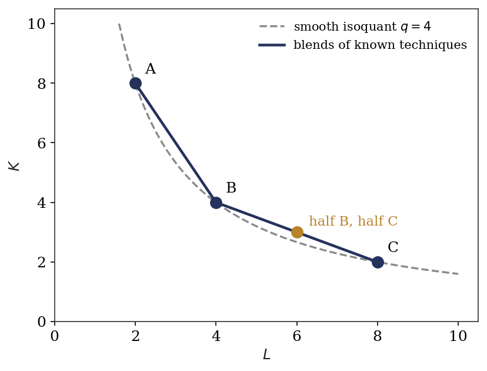
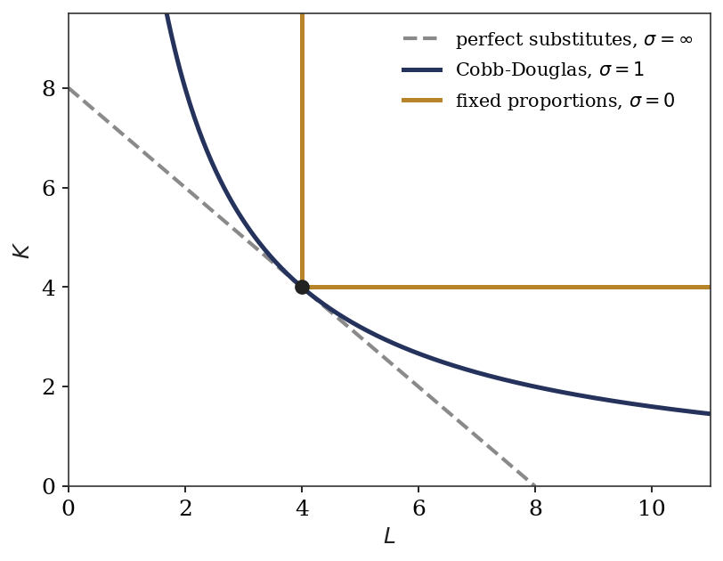
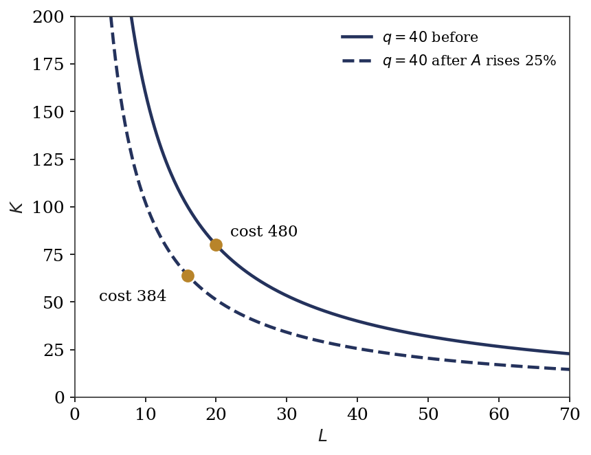
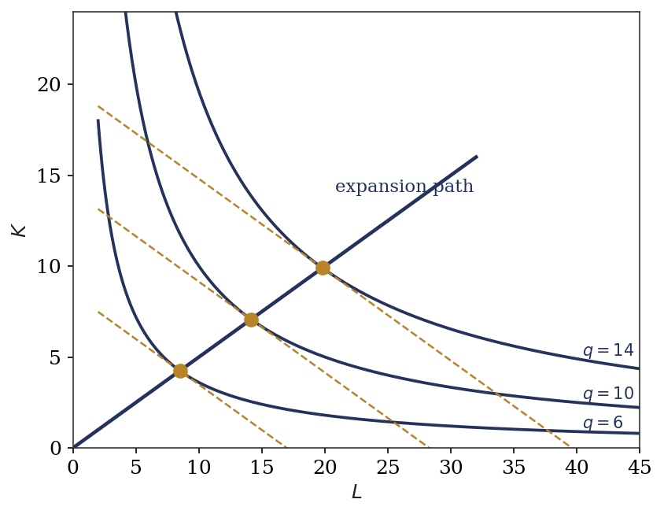
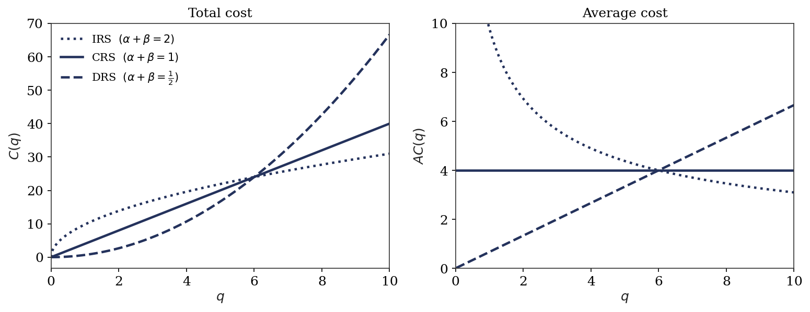
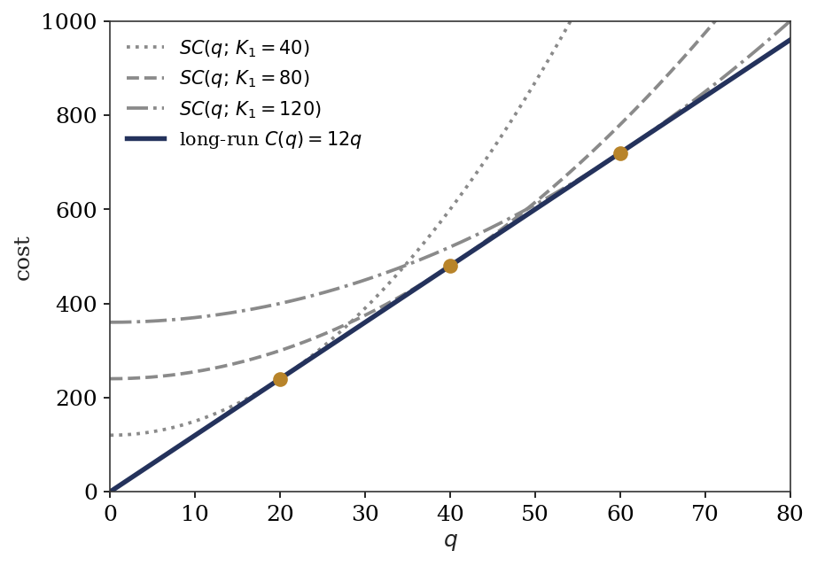
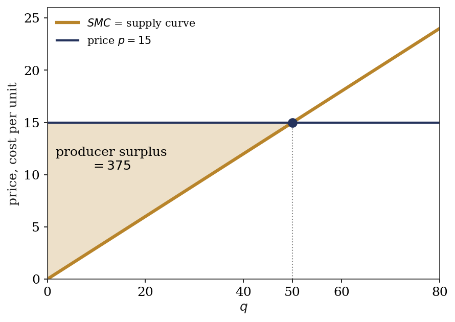
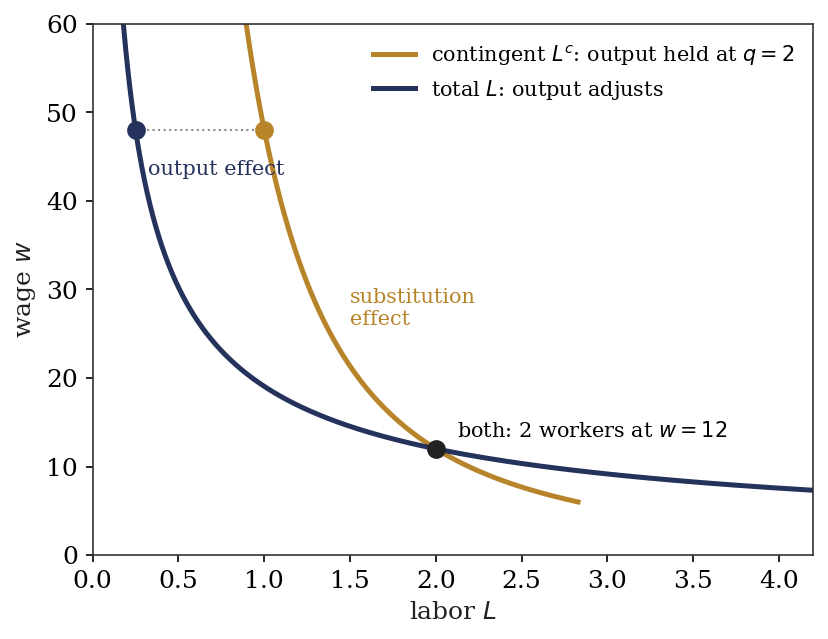
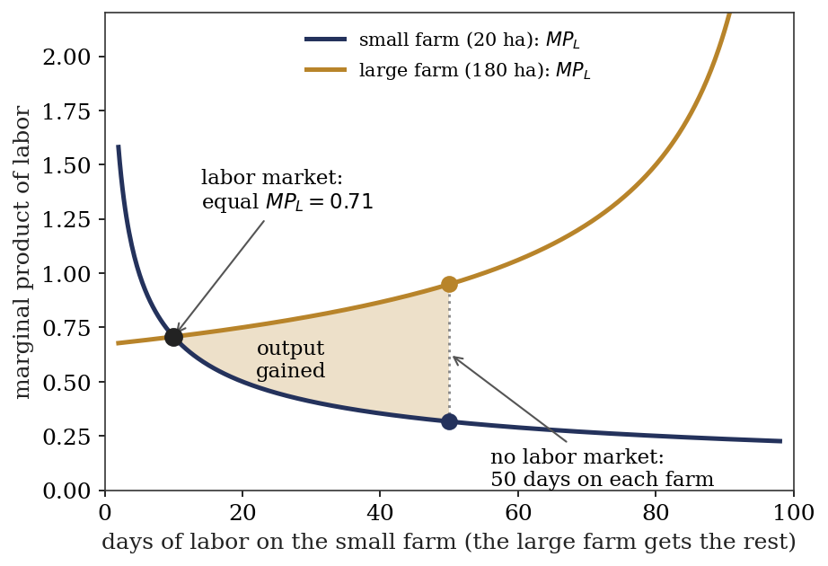

## Production Optimization topics {.compact}

Topic 2 built the machinery of constrained optimization. Now we apply it to the firm.

:::: {.columns}
::: {.column width="52%"}
| Topic 2: constrained optimization | Topic 3: the firm |
|---|---|
| climb the hill $\max f(x,y)$ | minimize spending $wL + vK$ |
| stop at the fence $g(x,y) = c$ | reach output target $F(K,L) = q$ |
| contour / level curve | isoquant |
| tangency $\nabla f = \lambda \nabla g$ | tangency $MRTS = w/v$ |
| $\lambda$ = shadow price of fence | $\lambda$ = marginal cost of output |
| value function $V(c)$ | cost function $C(v,w,q)$ |
:::

::: {.column width="48%"}
::: {.callout-tip icon=false}
## The same four steps
1. Where is the tangency?
2. What does the multiplier mean?
3. What happens when parameters move — the envelope theorem.
4. How to handle kinks and corners: fixed proportions, perfect substitutes, and the shut-down decision.

:::

:::
::::

<!-- Ported from the Marp deck (slidesIIb 162-202); see source.yml for the
     extraction history. Figures regenerated from formulas in
     notebooks/topic03_production_figures.ipynb. Notation standardised:
     L = labor, K = capital, w = wage, v = rental rate, \mathcal{L} =
     Lagrangian (the legacy deck used L for both labor and the Lagrangian,
     and alternated between r and v for the rental rate).
     Revised 2026-10-05 to sit alongside Nicholson & Snyder 11e ch. 9-11:
     rental rate is v, cost function is C(v,w,q), contingent demands are
     L^c and K^c, short-run capital is K_1, and the running numbers are the
     text's (w = 12, v = 3, q = 40). Capital letters K, L and MRTS are kept
     for continuity with Topic 2; the "Reading Alongside the Text" slide
     gives students the translation. -->

---

## Three Questions About the Firm

| | Question | What you will take away |
|---|---|---|
| **NS 9**   class 4 | **What can the firm make?** | Isoquants show how inputs trade off. Their slope is the $MRTS$. |
| **NS 10**   classes 4–5 | **What is the cheapest way to make $q$?** | Spend so the last dollar on each input adds the same output: $MRTS = w/v$. The multiplier is marginal cost. The result is the **cost function** $C(v,w,q)$. |
| **NS 11**   class 5 | **How much should it make?** | Where $MR = MC$. For a price-taking firm this traces out the **supply curve**. |

: {tbl-colwidths="[16,30,54]"}

::: {.fragment}
> Notice the order: *first* the cheapest way to make any output, *then* which output to make.
:::

---

## Nicholson and Snyder textbook {.compact}

NS chapters 9–11: Ch. 9 technology, Ch. 10 cost, Ch. 11 profit.

:::: {.columns}
::: {.column width="50%"}
| | NS | These slides |
|---|:-:|:-:|
| Inputs | $k$, $l$ | $K$, $L$ |
| Production function | $f(k,l)$ | $F(K,L)$ |
| Slope of an isoquant | $RTS$ | $MRTS$ |
| Input demand at fixed $q$ | $l^c$, $k^c$ | $L^c$, $K^c$ |
| Capital fixed in the short run | $k_1$ | $K_1$ |

Same in both: $q$, wage $w$, rental rate of capital $v$, $C(v,w,q)$, $SAC$, $SMC$.
:::

::: {.column width="50%"}
::: {.callout-tip icon=false}
## Same numbers, too
Our running example is the text's: $q = \sqrt{KL}$, $w = 12$, $v = 3$. Grey notes on the slides point to the matching NS figure or example.
:::

::: {.callout-warning icon=false}
## One thing to skip for now
Chapter 10 refers back to Chapters 4–5 (expenditure minimization, compensated demand). We reach those in Topic 4.
:::
:::
::::

---

## Part I: Production Technology {.divider}

**Production Functions:** What the firm is able to do, before any question of what it *should* do — NS Chapter 9

---

## The Production Function

A firm's **production function** gives the maximum output attainable from each combination of inputs — here capital $K$ and labor $L$:

$$q = F(K,L)$$

::: {.incremental}
- For any combination of inputs $(K,L)$ the production function $F(K,L)$ is the *maximum* output producible from those inputs. Anything less is **technically inefficient** — and never optimal to choose.
- Built into the definition: the firm already knows how to get the most out of the inputs it buys. Every question that follows is about *which* combination inputs to buy (given technology and market prices).

:::

---

## Marginal Product

$$MP_K = \frac{\partial q}{\partial K} = F_K(K,L) \qquad\qquad MP_L = \frac{\partial q}{\partial L} = F_L(K,L)$$

::: {.incremental}
- The extra output from one more unit of an input, holding the other fixed — a partial derivative, exactly as in Topic 2.

:::

Text: NS Example 9.1 works through a numerical case.

---

## Diminishing Marginal Productivity {.compact}

$$F_{KK} < 0 \qquad\qquad F_{LL} < 0 \qquad\qquad F_{LK} > 0$$

::: {.incremental}
- **Own effects negative:** piling more labor onto a fixed stock of machines eventually yields less and less. This is what makes factor demand slope downward.
- **Cross effect positive:** capital and labor are **complements** in most technologies — more machines raise the marginal product of workers.
:::

---

## Technology vs. Technique {.compact}

::: {.incremental}
- A **production technology** is a recipe book: the full set of techniques available for producing any output.
- A **production technique** is one recipe: "combine 20 units of $K$ with 10 units of $L$ to make 10 widgets."
- An **isoquant** collects every technique that produces the same output. The **isoquant map** is the whole recipe book.
:::

::: {.fragment}
> The distinction matters for growth and development economics: two countries can face the same technology and still use very different techniques, because factor prices differ.
:::

---

## From Discrete Techniques to a Smooth Isoquant {.compact}

:::: {.columns}
::: {.column width="52%"}
A firm that knows only three recipes is not stuck with three points.

::: {.incremental}
- Run technique B half the time and C the other half, and you produce the same output at the midpoint of the segment joining them.
- Blending known recipes fills in the whole **convex** frontier between them.
- Learn more recipes and the kinked frontier smooths out — which is why we draw smooth, convex-to-the-origin isoquants.
:::
:::

::: {.column width="48%"}

  
  
Blends of A, B and C trace out a convex frontier.

:::
::::

::: {.fragment}
> **Caveat:** real firms must search and experiment to find good recipes. Lasting productivity gaps between similar firms show the recipe book is not free to read.
:::

---

## The Isoquant Map

:::: {.columns}
::: {.column width="50%"}
Each curve collects the input bundles yielding one output level.

::: {.incremental}
- Output rises moving **northeast** — more of both inputs.
- Isoquants cannot cross, for the same reason indifference curves cannot.
- Convex to the origin: balanced input mixes are more productive than extreme ones.
:::
:::

::: {.column width="50%"}

  
  
The isoquant map for $q = K^{1/2}L^{1/2}$. Text: NS Figure 9.1.

:::
::::

---

## From Surface to Isoquants: Animation {.compact}

  <video controls preload="metadata" poster="figs/video-surface-to-isoquants-poster.png" style="height: 500px; border-radius: 6px;">
    <source src="figs/video-surface-to-isoquants.mp4" type="video/mp4">
  </video>
  
The surface $q = \sqrt{KL}$, sliced at fixed output levels and viewed from above. Silent, 1:48. Press play; the controls let you pause and scrub.

---

## The Marginal Rate of Technical Substitution {.compact}

:::: {.columns}
::: {.column width="52%"}
Recall from Topic 2: the slope of an isoquant is $-F_L/F_K$. Its size is the $MRTS$ (NS writes $RTS$).

::: {.incremental}
- $MRTS = F_L/F_K = MP_L/MP_K$: how much capital the firm can release per extra worker, output held fixed.
- It **diminishes** as labor replaces capital — labor gets less productive at the margin, capital more so.
- A *technological* rate of exchange. The market's rate is $w/v$. Cost minimization is about lining the two up.
:::
:::

::: {.column width="48%"}

  
  
Tangents flatten as $L$ rises: diminishing $MRTS$. Text: NS Example 9.2.

:::
::::

---

## The Elasticity of Substitution {.compact}

:::: {.columns}
::: {.column width="52%"}
How easily can the firm replace one input with the other? The **elasticity of substitution** $\sigma$ measures this along an isoquant:

$$\sigma = \frac{\%\ \text{change in } K/L}{\%\ \text{change in } MRTS}$$

::: {.incremental}
- **Large $\sigma$:** the isoquant is nearly straight. A small change in $w/v$ leads to a large change in the input mix.
- **Small $\sigma$:** the isoquant is sharply curved. The input mix changes little.
- **Cobb-Douglas** has $\sigma = 1$.
- **Two limiting cases:** perfect substitutes $q = aK + bL$ with $\sigma = \infty$, and fixed proportions $q = \min(aK, bL)$ with $\sigma = 0$. The tangency condition does not apply to either: the first usually gives a corner solution, the second a kink.
:::
:::

::: {.column width="48%"}

  
  
Three isoquants through the same point. Text: NS Figures 9.3 and 9.4.

:::
::::

---

## Returns to Scale {.compact}

Scale *both* inputs by $t > 1$ and ask what happens to output:

$$F(tK, tL) = t^{\,\varepsilon} F(K,L)$$

::: {.incremental}
- $\varepsilon = 1$: **constant returns** — double everything, double output. Replication logic: build a second identical plant.
- $\varepsilon < 1$: **decreasing returns** — something is being spread thinner. We will name it shortly.
- $\varepsilon > 1$: **increasing returns** — specialization, indivisible equipment, network effects.
- For Cobb-Douglas $F = K^\alpha L^\beta$, $\varepsilon = \alpha + \beta$ — read straight off the exponents.
- Not the same as diminishing $MP_L$: that holds $K$ fixed, this scales both inputs.
:::

::: {.fragment}
>  $\alpha + \beta$ will reappear as the exponent on $q$ in the cost function, and it decides whether cost curves are straight (CRS), convex (DRS), or concave (IRS).
:::

---

## Euler's Theorem {.compact}

::: {.callout-note icon=false}
## Euler's theorem
If $F$ is homogeneous of degree $\varepsilon$, meaning $F(tK, tL) = t^{\,\varepsilon} F(K,L)$ for every $t > 0$, then $\;K F_K + L F_L = \varepsilon\,F$.
:::

**Proof.** Differentiate both sides of $F(tK, tL) = t^{\,\varepsilon} F(K,L)$ with respect to $t$. The left side needs the chain rule:

$$K\,F_K(tK,tL) + L\,F_L(tK,tL) = \varepsilon\,t^{\,\varepsilon-1}\,F(K,L)$$

This holds for every $t$. Set $t = 1$:

$$K F_K + L F_L = \varepsilon F$$

::: {.incremental}
- **Check:** $q = \sqrt{KL}$ has $\varepsilon = 1$, with $F_K = q/2K$ and $F_L = q/2L$. So $K F_K + L F_L = \tfrac12 q + \tfrac12 q = q$.
- **Corollary:** the marginal products are homogeneous of degree $\varepsilon - 1$. Under constant returns they depend only on the ratio $K/L$.
:::

Text: NS Chapter 2, homogeneous functions and Euler's theorem.

---

## Euler's Theorem: Who Gets the Output? {.compact}

Suppose each input is paid its marginal product, measured in units of output: each worker gets $F_L$ and each machine gets $F_K$. By Euler's theorem the payments add up to

$$L F_L + K F_K = \varepsilon\,q \qquad\Longrightarrow\qquad \text{left over} = (1 - \varepsilon)\,q$$

::: {.incremental}
- **Constant returns ($\varepsilon = 1$):** the payments use up exactly the output. Nothing is left over, so profit is zero.
- **Decreasing returns ($\varepsilon < 1$):** something is left over, so profit is positive. The next slide asks who earns it.
- **Increasing returns ($\varepsilon > 1$):** the payments exceed output. A firm that pays marginal products loses money, so increasing returns and price-taking do not fit together.
- **Our firm:** Part II shows it makes 40 units most cheaply with 20 workers and 80 machines. There $F_L = 1$ and $F_K = \tfrac14$. Payments are $20(1) + 80(\tfrac14) = 40 = q$. At an output price of 12 these are $w = 12$ and $v = 3$.
:::

Part III shows that a price-taking firm does pay each input its marginal product.

---

## Where Do Decreasing Returns Come From? {.compact}

$$\hat F(K,L,z) = K^\alpha L^\beta z^{\,1-\alpha-\beta}
\qquad\Longrightarrow\qquad
F(K,L) = \hat F(K,L,\bar z) = B\,K^\alpha L^\beta, \quad B = \bar z^{\,1-\alpha-\beta}$$

::: {.incremental}
- One good story: the *true* technology has constant returns in **three** inputs, but one of them — managerial attention, a site, a franchise, the founder — is fixed and not for sale.
- Scale up $K$ and $L$ and that fixed factor is spread thinner. Measured returns to the two variable inputs decrease.
- So "decreasing returns" is often a statement about **what is being held fixed**, not about physics.
- **Euler again:** $\hat F$ has constant returns in three inputs, so payments to $K$, $L$ and $z$ use up the output. The amount left over on the last slide, $(1-\alpha-\beta)\,q$, is the payment to $z$. Profit is the return to the fixed input.
- $z$ might be non-traded managerial ability or skill.  The size-distribution of this factor is a key determinant of the distribution of output and profits.  Why small firms may co-exist with large ones.

:::

Text: NS tells this story around Figure 10.5 and uses a fixed third input in Example 11.5.

---

## Technical Progress {.compact}

:::: {.columns}
::: {.column width="52%"}
Technology improves over time. Write the production function as

$$q = A\,F(K,L)$$

where $A$ measures the state of technology.

::: {.incremental}
- A rise in $A$ gives more output from the same inputs. Each isoquant moves toward the origin.
- **Example:** $q = A\sqrt{KL}$. With $A = 1$, 20 workers and 80 machines make 40 units. With $A = 1.25$, 16 workers and 64 machines are enough.
- At $w = 12$ and $v = 3$ the input bill falls from 480 to 384. Part II shows each mix is the cheapest one for its technology.
- **Measuring it:** output growth that is not explained by growth in $K$ and $L$ is attributed to growth in $A$.
:::
:::

::: {.column width="48%"}

  
  
The isoquant for $q = 40$ before and after a 25% rise in $A$. Text: NS Figure 9.5, Examples 9.4 and 10.3.

:::
::::

---

## Capital, Technology and Wages {.compact}

Differentiate Euler's equation with respect to $L$, holding $K$ fixed. The product rule on $L F_L$ gives $F_L + L F_{LL}$:

$$K F_{KL} + F_L + L F_{LL} = \varepsilon F_L \qquad\Longrightarrow\qquad K F_{KL} = (\varepsilon - 1)F_L - L F_{LL}$$

Under constant returns $F_{KL} = -(L/K)\,F_{LL} > 0$ whenever $F_{LL} < 0$. If workers are paid their marginal product:

::: {.incremental}
- **Capital accumulation raises wages.** In our example $MP_L = \tfrac12\sqrt{K/L}$. With 20 workers, raising $K$ from 80 to 180 raises it from 1 to 1.5. The return to capital falls, because $F_{KK} < 0$.
- **Technical progress raises wages.** With $q = A\,F(K,L)$, $MP_L = A\,F_L$. A 25% rise in $A$ raises the wage by 25%.
- **Automation:** with two inputs and constant returns, $F_{KL} > 0$ always. More or better machines can only raise the wage, so this model cannot show machines displacing workers.
- **What displacement needs:** three or more inputs, where machines can replace one kind of labor ($F_{KL_1} < 0$), or task-based production, where machines take over workers' tasks (Acemoglu and Restrepo).
- **Decreasing returns:** $(\varepsilon - 1)F_L$ is negative, so $F_{KL}$ can have either sign.
:::

Text: NS Chapter 9, "Importance of cross-productivity effects" and Example 9.2.

---

## Part II: Cost Minimization {.divider}

From technology and input prices to the cost function $C(v,w,q)$ — NS Chapter 10

---

## The Firm's Cost-Minimization Problem {.compact}

Take the output level $q$ as given for now, and produce it as cheaply as possible. Labor costs $w$ per unit; capital rents for $v$ per unit:

$$\min_{K,L} \; wL + vK \qquad \text{subject to} \qquad F(K,L) = q$$

::: {.incremental}
- **Why this comes first:** a profit-maximizing firm never overpays for the output it ends up making. Whatever $q$ turns out to be optimal, it will be produced at minimum cost.
- The solution gives **contingent input demands** $L^c(v,w,q)$ and $K^c(v,w,q)$ — contingent on a particular $q$. (Many texts say *conditional*.)
- Substituting them back into $wL + vK$ gives the **cost function** $C(v,w,q)$, the object Part III needs.
:::

---

## Walking the Isoquant {.compact}

Our running example, the same one as the text: $q = \sqrt{KL}$, $w = 12$, $v = 3$. The firm must make $q = 40$. Every row below does that. Which is cheapest?

:::: {.columns}
::: {.column width="52%"}
| $L$ | $K$ | labor bill $wL$ | capital bill $vK$ | total cost |
|:-:|:-:|:-:|:-:|:-:|
| 5 | 320 | 60 | 960 | 1020 |
| 10 | 160 | 120 | 480 | 600 |
| **20** | **80** | **240** | **240** | **480** |
| 40 | 40 | 480 | 120 | 600 |
| 80 | 20 | 960 | 60 | 1020 |
:::

::: {.column width="48%"}
::: {.incremental}
- Start at the top: many machines, few workers. Trading machines for workers saves money — until it doesn't.
- The same walk as Topic 2's budget line. This time we walk along the *isoquant* and look for the lowest cost.
- Cost bottoms out at $L = 20$, $K = 80$. The next slides explain why.
:::
:::
::::

Text: NS Example 10.1 uses these numbers.

---

## Isocost Lines

:::: {.columns}
::: {.column width="52%"}
Bundles costing the same total $C$:

$$C = wL + vK \;\Longrightarrow\; K = \frac{C}{v} - \frac{w}{v}\,L$$

::: {.incremental}
- Parallel lines of slope $-w/v$ — the **market** rate of exchange between inputs.
- Lines further out cost more. The firm wants the *lowest* line that still reaches its isoquant.
- Structurally identical to Topic 2's budget line, but the roles are reversed: there the line was the constraint, here it is the objective.
:::
:::

::: {.column width="48%"}

  
  
Isocost lines for $w=12$, $v=3$: slope $-4$.

:::
::::

---

## The Cost-Minimizing Choice {.compact}

:::: {.columns}
::: {.column width="50%"}
::: {.incremental}
- Lines below the isoquant are cheaper but **unattainable** — they never touch the required output.
- Lines cutting the isoquant are attainable but **wasteful** — slide along the isoquant and spend less.
- Minimum cost is the **tangency**: the lowest isocost line that still touches the isoquant.
:::

::: {.fragment}
At $w=12$, $v=3$, $q=40$: $L=20$, $K=80$, $C=480$ — the best row of the table.
:::

Text: NS Figure 10.1.

:::

::: {.column width="50%"}

  
  
Tangency of isoquant and lowest isocost line.

:::
::::

---

## Solving It: The Method of Lagrange {.compact}

$$\mathcal{L}(K,L,\lambda) = wL + vK + \lambda\big[q - F(K,L)\big]$$

First-order conditions:

$$\frac{\partial \mathcal{L}}{\partial L} = w - \lambda F_L = 0 \qquad
\frac{\partial \mathcal{L}}{\partial K} = v - \lambda F_K = 0 \qquad
\frac{\partial \mathcal{L}}{\partial \lambda} = q - F(K,L) = 0$$

::: {.incremental}
- Same three-step recipe as Topic 2: write $\mathcal{L}$, differentiate, solve alongside the constraint.
- Note the sign convention: we are **minimizing**, so the multiplier enters with $[q - F(K,L)]$ and $\lambda$ will come out positive.
:::

Text: NS Example 10.1 sets up the same Lagrangian.

---

## The Tangency Condition {.compact}

Divide the first FOC by the second:

$$\frac{w}{v} = \frac{F_L}{F_K} = \frac{MP_L}{MP_K} = MRTS$$

Or rearrange instead:

$$\frac{MP_L}{w} = \frac{MP_K}{v}$$

::: {.incremental}
- **First form:** the technological rate of substitution equals the market's price ratio — the isoquant is tangent to the isocost line.
- **Second form — the arbitrage reading:** the last dollar spent on labor buys exactly as much extra output as the last dollar spent on capital.
- **In the table:** at $L=10$, $K=160$ a dollar of labor adds $1/6$ of a unit of output, a dollar of capital only $1/24$. Shift dollars toward labor and the same output costs less. At $L=20$, $K=80$ both are $1/12$: no trade left.
:::

---

## The Multiplier Is Marginal Cost {.compact}

From the two FOCs:

$$\lambda = \frac{w}{MP_L} = \frac{v}{MP_K}$$

::: {.incremental}
- Check the units: $\dfrac{\$/\text{worker}}{\text{output}/\text{worker}} = \dfrac{\$}{\text{output}}$ — dollars per unit of output.
- So $\lambda$ is the cost of squeezing out one more unit of output: $\lambda = \partial C/\partial q = MC$. In our example $\lambda = 12$: the 41st unit costs about \$12.
- Exactly the Topic 2 story with new names. There, $\lambda$ was the marginal utility of relaxing the budget; here, the marginal cost of tightening the output quota.
:::

::: {.callout-note icon=false}
## The shadow price, again
A multiplier always answers the same question: *what is one more unit of the constraint worth?*
:::

---

## The 2026 Nobel Prize {.compact}

:::: {.columns}
::: {.column width="58%"}

  

:::

::: {.column width="42%"}
- **“For microeconomic foundations of macroeconomic stabilization.”**
- **Optimizing agents:** households and firms solve constrained optimization problems. Hall took the household's Euler equation, a tangency across time, to the data: consumption should be a random walk.
- **Expectations:** forward-looking agents act on beliefs about tomorrow. Woodford: beliefs can be self-fulfilling ("sunspots").
- **New Keynesian models:** the Euler equation plus price-setting firms. Policy works by steering expectations.
:::
::::

---

## Where We Are {.compact}

<!-- ===== STOPPING POINT, class 4 (Mon Oct 5) =====
     Everything above is Topic 2's method applied to the firm and is taught
     with the end of Topic 2. Class 5 (Tue Oct 13) restarts on the slide
     below and continues from "Contingent Demands and the Cost Function".
     See schedule.md rows 4-5. -->

:::: {.columns}
::: {.column width="50%"}
::: {.callout-tip icon=false}
## So far: Topic 2's method, pointed at the firm
- **Technology:** production function, isoquants, $MRTS$, returns to scale.
- **Cost minimization:** walk the isoquant to the tangency, $MRTS = w/v$.
- **The multiplier:** $\lambda$ is marginal cost.
- **Euler's theorem:** under constant returns, paying each input its marginal product uses up all the output.
:::
:::

::: {.column width="50%"}
::: {.callout-note icon=false}
## Next: what the tangency buys us
- Plug the best choices back in to get the **cost function** $C(v,w,q)$.
- Cost curves, the short run and the long run.
- Choosing output: profit maximization and the supply curve.
:::
:::
::::

Our example so far: to make $q = 40$ at $w = 12$, $v = 3$, the firm hires 20 workers and 80 machines and spends 480. The last unit costs about \$12.

Reading for the second half: NS Chapter 10 from "Cost Functions" on, and Chapter 11.

---

## Contingent Demands and the Cost Function {.compact}

Solving the FOCs together with $F(K,L)=q$ gives the **contingent input demands**:

$$L^c(v,w,q) \qquad\qquad K^c(v,w,q)$$

Substituting them back into the objective gives the **cost function**:

$$C(v,w,q) \;=\; \min_{K,L}\,\{wL + vK : F(K,L) = q\} \;=\; w\,L^c(v,w,q) + v\,K^c(v,w,q)$$

::: {.incremental}
- The recipe: plug the optimal choices back into what you were minimizing. Next week the consumer gets the same treatment.
- $C$ inherits the technology *and* the prices. Change $w$ and the whole cost curve moves. Technical progress (a rise in $A$) shifts it down.
- Everything in Part III is built from this one object.
:::

---

## Worked Example: Cobb-Douglas {.compact}

Let $F(K,L) = K^{1/2}L^{1/2}$, so $\alpha + \beta = 1$ — constant returns.

::: {.incremental}
- Tangency: $MRTS = K/L = w/v$, so $K = (w/v)\,L$.
- Substitute into $q = K^{1/2}L^{1/2}$: $\;q = (w/v)^{1/2} L$, hence
  $$L^c(v,w,q) = q\sqrt{v/w} \qquad K^c(v,w,q) = q\sqrt{w/v}$$
- Costs: $C = wL^c + vK^c = q\sqrt{vw} + q\sqrt{vw}$, so
  $$\boxed{\;C(v,w,q) = 2q\sqrt{vw}\;}$$
- With $w=12$, $v=3$: $\;L^c = q/2$, $\;K^c = 2q$, $\;C = 12q$. At $q=40$ that is 20 workers, 80 machines and a cost of 480.
- Cost is **linear** in $q$: $MC = AC = 12$. Doubling output doubles cost, the hallmark of constant returns.
:::

Text: NS Examples 10.1 and 10.2.

---

## The General Cobb-Douglas Cost Function {.compact}

For $F(K,L) = K^\alpha L^\beta$ the same steps give:

$$C(v,w,q) = \kappa\; q^{\frac{1}{\alpha+\beta}}\; v^{\frac{\alpha}{\alpha+\beta}}\; w^{\frac{\beta}{\alpha+\beta}}
\qquad (\kappa \text{ is a constant that depends only on } \alpha \text{ and } \beta)$$

::: {.incremental}
- The exponent on $q$ is $1/(\alpha+\beta)$ — the reciprocal of the returns-to-scale parameter.
- $\alpha+\beta = 1 \Rightarrow$ cost linear in $q$. $\;\alpha+\beta < 1 \Rightarrow$ convex. $\;\alpha+\beta > 1 \Rightarrow$ concave.
- The exponents on $w$ and $v$ are the **cost shares** of labor and capital, and they sum to one: doubling both input prices doubles cost, whatever the technology.
:::

Text: NS Example 10.2.

---

## The Expansion Path

:::: {.columns}
::: {.column width="50%"}
Hold prices fixed and let $q$ rise. Each output level has its own tangency.

::: {.incremental}
- The **expansion path** is the locus of those tangencies — how the firm scales up.
- For Cobb-Douglas at fixed prices it is a **ray**: input proportions never change with scale. Here $K = 4L$. The next slide says why.
- Read off the cost at each tangency and you have the cost function $C(q)$.
:::
:::

::: {.column width="50%"}

  
  
Tangencies at $q = 20, 40, 60$ trace the expansion path. Text: NS Figure 10.2.

:::
::::

---

## Why the Path Is a Ray: Homothetic Technology {.compact}

| Property | What it says | What it governs |
|---|---|---|
| **Homogeneous** of degree $\varepsilon$ | $F(tK,tL) = t^{\,\varepsilon}F(K,L)$ | Returns to scale: how fast cost rises with $q$ |
| **Homothetic** | $MRTS$ depends only on the ratio $K/L$ | The shape of the isoquants: every one is a scaled copy of the others |

: {tbl-colwidths="[24,34,42]"}

::: {.incremental}
- **Homothetic means a straight expansion path.** At fixed prices the tangency $MRTS = w/v$ picks out one ratio $K/L$, the same at every output.
- **Every homogeneous function is homothetic.** Both marginal products are homogeneous of degree $\varepsilon - 1$ (Euler's corollary), so their ratio depends only on $K/L$. Every Cobb-Douglas has a ray, whatever $\alpha + \beta$ is.
- **What it buys:** cost splits into a scale part and a price part, $C(v,w,q) = h(q)\,c(v,w)$. Ours is $q \times 2\sqrt{vw}$.
- **Not homothetic:** $q = K + \sqrt{L}$ has $MRTS = 1/(2\sqrt{L})$, which depends on $L$ alone. At fixed prices labor never changes, and all growth comes from machines.
- **Next week:** utility has no units, so its degree of homogeneity means nothing. Homotheticity does carry over when preferences have it: budget shares then do not change with income.
:::

Text: NS Chapter 2 on homothetic functions; Figures 10.2 and 10.3.

---

## Homothetic Technology: Animation {.compact}

  <video controls preload="metadata" poster="figs/video-homothetic-ray-poster.png" style="height: 500px; border-radius: 6px;">
    <source src="figs/video-homothetic-ray.mp4" type="video/mp4">
  </video>
  
A ray from the origin crosses every isoquant at the same slope, so expansion paths are straight. Silent, 1:13.

---

## Average and Marginal Cost

$$AC(v,w,q) = \frac{C(v,w,q)}{q} \qquad\qquad MC(v,w,q) = \frac{\partial C(v,w,q)}{\partial q}$$

::: {.incremental}
- $AC$ is the slope of a ray from the origin to the cost curve; $MC$ is the slope of the curve itself.
- Recall $MC = \lambda$: the marginal cost you compute from $C(q)$ is the same number the Lagrangian handed you.
:::

---

## Returns to Scale and the Shape of Cost {.compact}

:::: {.columns}
::: {.column width="46%"}
::: {.incremental}
- **CRS** $(\alpha+\beta=1)$: cost linear, $AC$ flat, $AC = MC$.
- **DRS** $(\alpha+\beta<1)$: cost convex, $AC$ and $MC$ rising.
- **IRS** $(\alpha+\beta>1)$: cost concave, $AC$ falling — bigger is cheaper per unit.
:::

::: {.fragment}
> Which case holds is an empirical question with real stakes: falling $AC$ over the whole relevant range is the definition of a natural monopoly.
:::
:::

::: {.column width="54%"}

  
  
Same technology family, three returns-to-scale cases. Text: NS Figures 10.4–10.5.

:::
::::

---

## The Short Run: One Input Fixed {.compact}

Fix capital at $K_1$. The firm can only vary labor:

$$SC(q;K_1) = vK_1 + w\,L(q;K_1), \qquad\text{where } F(K_1, L) = q$$

::: {.incremental}
- $vK_1$ is a **fixed cost**: owed whatever the output. $wL$ is the **variable cost**.
- With $K$ stuck, the firm **cannot** equate $MRTS$ to $w/v$ — the tangency condition fails, and cost is higher than it needs to be for every $q$ except one.
- Our example with $K_1 = 80$: the production function gives $q = \sqrt{80L}$, so $L = q^2/80$. No choice is left to make.
- Cost is then $SC = 3(80) + 12\,(q^2/80) = 240 + \tfrac{3}{20}q^2$.
- Capital here plays the part of the fixed input $z$ from Part I: with it fixed, returns to labor alone decrease.
- "Short run" is not a length of time. It is a statement about which choices are still open.
:::

Text: NS Figure 10.7 and Example 10.5.

---

## The Envelope Theorem: A First Example {.compact}

:::: {.columns}
::: {.column width="52%"}
In the long run the firm picks the plant size $K_1$ that makes $q$ cheapest. How does minimum cost change with $q$?

$$C(q) = \min_{K_1} \left[3K_1 + \frac{12q^2}{K_1}\right]$$

::: {.incremental}
- **The long way:** solve, $K_1^* = 2q$, so $C(q) = 12q$ and $dC/dq = 12$.
- **The envelope way:** hold the plant fixed: $\partial SC/\partial q = 24q/K_1 = 12$ at $q = 40$, $K_1 = 80$. No cost function needed.
- **Check:** at $q = 41$, keeping the old plant costs 492.15 and the best plant (82) costs 492.00. Re-optimizing saves only 15 cents.
- **The picture:** where a short-run curve touches the long-run curve, the two have the same slope. Hence the name.
:::
:::

::: {.column width="48%"}

  
  
Short-run curves and the long-run curve they envelope. Text: NS Example 10.5, Table 10.1, Figure 10.8.

:::
::::

---

## The Envelope Theorem {.compact}

::: {.callout-note icon=false}
## The rule
If $V(a) = \max_x f(x,a)$, then $\dfrac{dV}{da} = \dfrac{\partial f}{\partial a}$ evaluated at the optimal $x^*(a)$. Only the direct effect of the parameter counts. The same holds for a minimum.
:::

**Why.** By the chain rule,
$$\frac{dV}{da} = \underbrace{\frac{\partial f}{\partial x}}_{=\,0}\,\frac{dx^*}{da} + \frac{\partial f}{\partial a}$$
At the optimum $\partial f/\partial x = 0$: the function is flat at its peak, so the change in the choice adds nothing at the margin.

**With a constraint,** apply the rule to the Lagrangian $\mathcal{L} = wL + vK + \lambda\,[q - F(K,L)]$, holding $K$, $L$ and $\lambda$ at their optimal values:

| Parameter | Derivative of $\mathcal{L}$ | Result |
|---|:-:|---|
| Output $q$ | $\lambda$ | $\partial C/\partial q = \lambda$, marginal cost |
| Wage $w$ | $L$ | $\partial C/\partial w = L^c$, Shephard's lemma |
| Rental rate $v$ | $K$ | $\partial C/\partial v = K^c$ |

Text: NS Chapter 2, the envelope theorem. The proof with a constraint is in the appendix.

---

## Shephard's Lemma {.compact}

$$\frac{\partial C(v,w,q)}{\partial w} = L^c(v,w,q) \qquad\qquad \frac{\partial C(v,w,q)}{\partial v} = K^c(v,w,q)$$

The derivative of the cost function with respect to an input's price is the contingent demand for that input. This is the envelope rule from the last slide, applied to $w$ and to $v$.

::: {.incremental}
- **Check:** $C = 2q\sqrt{vw}$ gives $\partial C/\partial w = q\sqrt{v/w}$, which is 20 workers at our numbers.
- **In words:** a one-dollar rise in the wage raises minimum cost by one dollar for every worker already employed.
- **Why it is useful:** estimate the cost function from prices and spending; one derivative gives input demand.
:::

Text: NS Example 10.4. The proof is in the appendix.

---

## Properties of the Cost Function {.compact}

Every cost function that comes from cost minimization has these properties. Check each on ours, $C = 2q\sqrt{vw}$.

| Property | Why | Check |
|---|---|---|
| Rises with $w$, $v$ and $q$ | Dearer inputs or more output cannot lower cost | $w$, $v$ and $q$ all enter positively |
| Doubling both input prices doubles cost | The cheapest mix depends only on $w/v$, so it does not change | $2q\sqrt{(2v)(2w)} = 2C$ |
| Concave in input prices | The firm substitutes away from the dearer input, so cost rises less than in proportion | $C$ is proportional to $\sqrt{w}$ |
| Its derivative is input demand | Shephard's lemma | $\partial C/\partial w = q\sqrt{v/w}$ |

: {tbl-colwidths="[30,42,28]"}

::: {.incremental}
- **What concavity implies:** $\partial L^c/\partial w = \partial^2 C/\partial w^2 \le 0$. When the wage rises and output is held fixed, the firm never hires more labor.
- The text calls the second property "homogeneous of degree 1 in input prices".
:::

Text: NS Chapter 10, "Properties of cost functions" and Figure 10.6.

---

## Cost Minimization: Summary

| Result | In general | Our firm ($w = 12$, $v = 3$) |
|---|---|---|
| Cheapest input mix | $MRTS = w/v$ | $K = 4L$. For $q = 40$: 20 workers, 80 machines |
| The multiplier | $\lambda = \partial C/\partial q = MC$ | $\lambda = 12$ |
| Cost function | $C(v,w,q) = wL^c + vK^c$ | $C = 2q\sqrt{vw} = 12q$ |
| Returns to scale | Set how $C$ rises with $q$ | Constant returns: $AC = MC = 12$ |
| Short run, $K_1 = 80$ | $SC \ge C$, equal at one output | $SC = 240 + \tfrac{3}{20}q^2$, equal to $12q$ at $q = 40$ |
| Shephard's lemma | $\partial C/\partial w = L^c$ | $L^c = q\sqrt{v/w} = q/2$ |

::: {.fragment}
Next: with the cost function in hand, the firm chooses how much to make.
:::

---

## Part III: Profit Maximization {.divider}

Choosing output, deriving supply, and how the firm's two problems fit together — NS Chapter 11

---

## From Cost to Output Choice {.compact}

With $C(q)$ in hand, the firm's remaining choice is one variable:

$$\pi(q) = R(q) - C(q) = p(q)\cdot q - C(q)$$

::: {.incremental}
- $p(q)$ allows for a firm large enough to move the price. A **price-taking** firm treats $p$ as fixed — a special case, not a different model.
- We take the **demand curve as given** today. Topic 4 derives it from preferences — which is also why we cannot close a market until then.
- Cost minimization already did the hard work: the two-variable problem in $(K,L)$ has collapsed into a one-variable problem in $q$.
:::

---

## The Rule: MR = MC

$$\frac{d\pi}{dq} = \frac{dR}{dq} - \frac{dC}{dq} = 0 \qquad\Longrightarrow\qquad MR = MC$$

::: {.incremental}
- Produce one more unit whenever it brings in more than it costs; stop where the two are equal.
- This is Topic 2's single-variable first-order condition, now with economic content in both terms.
- For a price-taking firm every extra unit sells at $p$, so $MR = p$ and the rule becomes $p = MC$.
:::

Text: NS Figure 11.1.

---

## Short-Run Average and Marginal Cost {.compact}

:::: {.columns}
::: {.column width="46%"}
Our firm from Part II's short-run slide: $q = \sqrt{KL}$, $w = 12$, $v = 3$, capital stuck at $K_1 = 80$. Making $q$ takes $L = q^2/80$ workers, so $SC = 240 + 12\,(q^2/80) = 240 + \tfrac{3}{20}q^2$:

$$SAC = \frac{240}{q} + \frac{3q}{20} \qquad SMC = \frac{3q}{10}$$

::: {.incremental}
- The fixed cost spread over more units pulls $SAC$ down; rising $SMC$ pushes it back up. Hence the U.
- **Averaging rule:** $SAC$ falls while $SMC < SAC$ and rises once $SMC > SAC$, so $SMC$ cuts $SAC$ at its minimum.
- At $q = 40$, $SAC = SMC = 12$, the long-run cost: a plant of 80 is right for 40 units only.
:::
:::

::: {.column width="54%"}

  
  
Short-run cost curves for $K_1 = 80$. Text: NS Table 10.2, Figure 10.9.

:::
::::

---

## Supply: The Price-Taking Firm {.compact}

:::: {.columns}
::: {.column width="48%"}
Our firm in the short run, with $K_1 = 80$:

$$p = SMC = \tfrac{3}{10}\,q$$

::: {.incremental}
- So it supplies $q = \tfrac{10}{3}p$. The **supply curve** *is* the marginal cost curve.
- At $p = 12$: $q = 40$, revenue 480, cost 480. The firm **breaks even** — zero economic profit.
- At $p = 15$: $q = 50$, profit $= 750 - 615 = 135$.
- Below $p = 12$ it loses money but keeps producing: revenue still covers the wage bill, and the 240 for capital is owed either way.
:::
:::

::: {.column width="52%"}

  
  
Short-run supply for $K_1 = 80$. Text: NS Examples 11.3 and 11.4.

:::
::::

---

## Produce or Shut Down? {.compact}

::: {.callout-note icon=false}
## The short-run rule
The fixed cost is owed either way, so compare price with **average variable cost** ($AVC$, variable cost per unit).

- $p \ge \min AVC$: produce where $p = SMC$.
- $p < \min AVC$: shut down and lose only the fixed cost.
:::

::: {.incremental}
- Our firm has $AVC = \tfrac{3}{20}q$, lowest at zero output, so it never shuts down in the short run.
- When $AVC$ is U-shaped, supply is the rising part of $SMC$ above $\min AVC$, and nothing below it.
- **The habit worth keeping:** solve the first-order condition, check the second-order condition (marginal cost rising faster than marginal revenue), then check the boundary — does producing at all beat stopping?
:::

Text: NS Figure 11.3 draws the U-shaped case.

---

## Producer Surplus {.compact}

:::: {.columns}
::: {.column width="50%"}
**Producer surplus** is what the firm gains by producing instead of shutting down: revenue minus variable cost.

$$\text{producer surplus} = \pi + \text{fixed cost}$$

::: {.incremental}
- It exceeds profit by the fixed cost, because the fixed cost is paid even if the firm shuts down.
- On the graph it is the area between the price line and the $SMC$ curve.
- **Our firm at $p = 15$:** $q = 50$, revenue 750, variable cost 375. Producer surplus is 375: profit 135 plus fixed cost 240.
- This area measures what sellers gain from trade.
:::
:::

::: {.column width="50%"}

  
  
Producer surplus at $p = 15$. Text: NS Figure 11.4 and Example 11.4.

:::
::::

---

## A Firm With Market Power: The Sub Shop {.compact}

:::: {.columns}
::: {.column width="50%"}
A sandwich shop faces daily demand $q = 100 - 10p$, so $p(q) = 10 - q/10$. Each sub costs \$4 to make.

::: {.incremental}
- Average revenue is $R/q = p(q)$: the demand curve itself.
- $R = 10q - q^2/10$, so $MR = 10 - q/5$. It falls **twice as fast** as price: one more sub sells for less *and* lowers the price on all the others.
- $MR = MC$: $\;10 - q/5 = 4$, so $q^* = 30$ subs, sold at \$7 each.
- Profit: $(7 - 4) \times 30 = \$90$ a day.
:::
:::

::: {.column width="50%"}

  
  
Demand, marginal revenue and marginal cost. Text: NS Example 11.1.

:::
::::

---

## The Sub Shop: Two Views of One Optimum {.compact}

:::: {.columns}
::: {.column width="46%"}
::: {.incremental}
- **Top panel:** profit is the gap between revenue and cost. It is widest where the two curves have **parallel tangents**.
- "Parallel tangents" and "$MR = MC$" are the same statement, one geometric and one algebraic.
- **Bottom panel:** $\pi(q) = 6q - q^2/10$ peaks at $q^* = 30$. Second-order condition: $\pi'' = -1/5 < 0$, a maximum.
- Why not sell more? At 35 subs the price must fall to \$6.50 and profit drops to \$87.50. Marginal revenue, not price, drives the choice.
:::
:::

::: {.column width="54%"}

  
  
Equal slopes above; the profit peak below.

:::
::::

---

## Hiring Inputs: Marginal Revenue Product {.compact}

How many workers should the firm hire? One more worker adds $MP_L$ units of output, and each unit adds $MR$ to revenue. The product is the **marginal revenue product** of labor:

$$MRP_L = MR \times MP_L$$

::: {.incremental}
- **The hiring rule:** hire labor until $MRP_L = w$, and capital until $MRP_K = v$.
- **Price-taking firm:** $MR = p$, so the rule is $p \cdot MP_L = w$.
- **Our firm at $p = 15$:** it makes 50 units with 31.25 workers. There $MP_L = 0.8$, and $15 \times 0.8 = 12 = w$.
- **Firm with market power:** $MR < p$, so the marginal revenue product is lower and the firm hires fewer workers.
- This is the same decision as $MR = MC$, stated for inputs instead of output.
:::

Text: NS Chapter 11, the section on input demand.

---

## Profit Max and Cost Min: The Same Tangency {.compact}

$$\max_{K,L}\; pF(K,L) - wL - vK
\qquad\Longrightarrow\qquad
p\,F_L = w, \quad p\,F_K = v$$

$$\min_{K,L}\; wL + vK \;\text{ s.t. }\; F(K,L) = \bar q
\qquad\Longrightarrow\qquad
\lambda F_L = w, \quad \lambda F_K = v$$

::: {.incremental}
- Divide either pair and you get the same condition: $F_L/F_K = w/v$.
- One difference: the profit-maximizer also chooses output, which sets $\lambda = p$ — price equals marginal cost.
- **So a profit-maximizing firm is automatically cost-minimizing.** Not the reverse: cost minimization says nothing about how much to make.
- **Constant returns are a special case.** Our firm has $MC = 12$ at every output. Above $p = 12$ it would want to grow without limit, below it makes nothing, and at $p = 12$ any output earns zero profit, as Euler's theorem said. A definite output needs rising marginal cost: capital fixed in the short run, or a fixed input $z$.
:::

---

## Unconditional Input Demand: A Worked Example {.compact}

A definite output needs decreasing returns: $F = K^\alpha L^\beta$ with $\alpha + \beta < 1$. The firm chooses both inputs, and so its output:

$$\max_{K,L}\; pK^\alpha L^\beta - wL - vK \quad\Longrightarrow\quad p\beta K^\alpha L^{\beta-1} = w, \qquad p\alpha K^{\alpha-1}L^\beta = v$$

::: {.incremental}
- **Divide:** $K/L = (\alpha/\beta)(w/v)$, the same tangency as cost minimization.
- **Substitute back:** the unconditional (total) demand for labor is
  $$L(p,v,w) = \left[\,p\left(\frac{\beta}{w}\right)^{1-\alpha}\left(\frac{\alpha}{v}\right)^{\alpha}\right]^{\frac{1}{1-\alpha-\beta}}$$
  and similarly for capital. Unlike $L^c$ it depends on $p$: labor demand is **derived** from product demand.
- **The exponent $1/(1-\alpha-\beta)$** is why constant returns fail: as $\alpha + \beta \to 1$, demand goes to zero or without bound.
- **Example,** $\alpha = \beta = \tfrac14$, $p = 48$, $w = 12$, $v = 3$: $K/L = 4$, so $L = 2$, $K = 8$, $q = 2$. Profit is 48, half of revenue 96, as Euler's theorem says.
:::

Text: NS Chapter 11, "Profit Maximization and Input Demand". The full derivation is in the appendix.

---

## A Wage Rise Hits Twice {.compact}

:::: {.columns}
::: {.column width="52%"}
**Contingent** demand $L^c(v,w,q)$ holds output fixed. **Total** demand $L(p,v,w)$ lets output adjust. Same firm, wage up from 12 to 48:

| | $w = 12$ | $w = 48$ |
|---|:-:|:-:|
| Contingent labor ($q = 2$) | 2 | 1 |
| Total labor | 2 | 0.25 |
| Contingent capital ($q = 2$) | 8 | 16 |
| Total capital | 8 | 4 |
| Output | 2 | 1 |

::: {.incremental}
- **Substitution effect** (2 to 1): at the old output, machines replace workers.
- **Output effect** (1 to 0.25): the dearer wage raises marginal cost, so the firm makes less, and making less needs fewer of both inputs. Here marginal cost doubles, output halves, and each input falls to a quarter.
- **Capital** replaces labor at fixed output (8 to 16), but falls once output falls (8 to 4).
:::
:::

::: {.column width="48%"}

  
  
Total demand is flatter than contingent demand. Text: NS Example 11.5 and Figure 11.5.

::: {.fragment}
> Next week the consumer's price effect splits the same way: substitution plus income. One difference: a firm's input demand always slopes down; a consumer's can bend back (Giffen).
:::
:::
::::

---

## The Profit Function and Its Properties {.compact}

The **profit function** $\Pi(p,v,w)$ is the largest profit the firm can earn at given prices. For our firm in the short run, with $K_1$ fixed:

$$\Pi(p,v,w) = \frac{p^2 K_1}{4w} - vK_1 \qquad\qquad \text{at } K_1 = 80,\ w = 12,\ v = 3:\quad \Pi = \tfrac{5}{3}p^2 - 240$$

| Property | Why | Check |
|---|---|---|
| Rises with $p$, falls with $w$ and $v$ | A higher output price helps; dearer inputs hurt | Signs in the formula |
| Doubling all prices doubles profit | Nothing real has changed, so the firm's choices do not change | $(2p)^2/(2w) = 2\,p^2/w$ |
| Convex in $p$ | The firm makes more when the price rises and less when it falls | $\Pi$ is proportional to $p^2$ |
| Its derivatives are supply and input demand | Hotelling's lemma: $\partial\Pi/\partial p = q$, $\;\partial\Pi/\partial w = -L$ | $\partial\Pi/\partial p = \tfrac{10}{3}p$, the supply curve |

: {tbl-colwidths="[30,42,28]"}

::: {.incremental}
- **Hotelling's lemma in words:** a one-dollar rise in the price raises profit by $q$ dollars.
- **The envelope theorem at work:** at $p = 15$, $\Pi = 135$ and $q = 50$. Raise $p$ to 15.1: keeping $q = 50$ adds 5.00 to profit; re-optimizing adds 5.017.
- **What convexity implies:** $\partial q/\partial p = \partial^2\Pi/\partial p^2 \ge 0$. The supply curve slopes up.
:::

Text: NS Chapter 11, "Properties of the profit function" and Example 11.4.

---

## Application: Farms in a Developing Economy {.divider}

The same tools, used on a question development economists argue about

---

## A Farm Is a Firm With Fixed Land {.compact}

A farm grows grain with land $T$ and labor $L$: $\;q = \sqrt{TL}$. Land is fixed, so this is the short run, with land in the role of $K_1$. Grain sells at a price of 1 and labor costs $w$ a day.

$$\max_L \; \sqrt{TL} - wL \qquad\Longrightarrow\qquad MP_L = \tfrac12\sqrt{T/L} = w \qquad\Longrightarrow\qquad L = \frac{T}{4w^2}$$

::: {.incremental}
- **A 100-hectare farm at $w = 1$:** it hires 25 days of labor and harvests 50. Wages take 25 and 25 is left over.
- **The 25 left over is the rent on land.** This is Euler's theorem at work: labor and land each earn half the output.
- **If the wage falls to 0.55,** labor demand rises to about 83 days. That is the farm's labor demand curve.
- Nothing here is new. It is the hiring rule $p \cdot MP_L = w$ from Part III.
:::

---

## A Testable Prediction {.compact}

Divide the hiring rule by the farm's land:

$$\frac{L}{T} = \frac{1}{4w^2} \qquad\qquad \frac{q}{T} = \frac{1}{2w}$$

::: {.incremental}
- Neither depends on $T$. **If every farm faces the same wage, every farm uses the same labor per hectare and gets the same yield per hectare,** whether it has 2 hectares or 2,000.
- **What the data often show:** in many developing countries small farms use far more labor per hectare than large farms, and harvest more per hectare. This is known as the *inverse relationship* between farm size and productivity.
- So the model's prediction fails. That is useful: it tells us where to look. Either the technology differs across farms, or the farms do not all face the same price of labor.
:::

::: {.fragment}
> A theory is still useful when it makes a prediction that could be wrong. Here the 'benchmark' theory is wrong in an informative way.
:::

---

## What a Missing Labor Market Costs {.compact}

:::: {.columns}
::: {.column width="50%"}
Two families, each with 50 days of labor. One owns 20 hectares, the other 180. Same technology.

| | Small farm | Large farm | Total output |
|---|:-:|:-:|:-:|
| **No labor market:** days worked | 50 | 50 | 126.5 |
| $MP_L$ | 0.32 | 0.95 | |
| **Labor market:** days worked | 10 | 90 | 141.4 |
| $MP_L$ | 0.71 | 0.71 | |

::: {.incremental}
- With no labor market, the small farm is crowded and the large farm is short of hands. It also shows the inverse relationship: more labor and more grain per hectare on the small farm.
- Let 40 days of labor move, at a wage of 0.71, and output rises **12%** from the same land and the same people.
:::
:::

::: {.column width="50%"}

  
  
Output is highest where the two marginal products are equal.

:::
::::

---

## Misallocation, and the Question It Raises {.compact}

::: {.incremental}
- **Misallocation:** the same inputs produce less because they are in the wrong places. Economists use this idea to help explain why some countries are much poorer than others.
- **In agriculture:** studies compare marginal products across farms and ask how much output would rise if land and labor moved. A well-known study of Malawi (Restuccia and Santaeulàlia-Llopis) finds very large gains. Gollin and Udry caution that much of the measured gap may be measurement error and luck, such as weather.
- **The condition is the one from Part II:** inputs are well allocated when the last unit adds the same output everywhere.
:::

::: {.callout-note icon=false}
## Why would the labor market be missing?
Most of these farms are run by a family that supplies the labor and also eats the crop. If the family cannot freely hire workers or sell its own time, how much it farms depends on its size and its tastes, not only on prices. That is the **farm-household model**, and it needs the consumer theory we start next week.
:::

---

## Three Questions, Answered

| Question | What to take away |
|---|---|
| **What can the firm make?**   NS 9 | Isoquants show how inputs trade off; their slope is the $MRTS$, and $\sigma$ measures how curved they are.   Diminishing marginal product (one input varies) is not decreasing returns to scale (all inputs vary). |
| **What is the cheapest way to make $q$?**   NS 10 | Equal output per dollar on every input: $MRTS = w/v$, and $\lambda = MC$.   Returns to scale set the shape of $C(v,w,q)$.   The short run never costs less than the long run; the long-run curve is the envelope.   Shephard's lemma: $\partial C/\partial w = L^c$. |
| **How much should it make?**   NS 11 | Where $MR = MC$. A price-taker's supply curve is $SMC$ above $\min AVC$.   Producer surplus is profit plus fixed cost. Labor is hired until $MRP_L = w$.   A wage rise cuts hiring twice: substitution effect and output effect. |

: {tbl-colwidths="[30,70]"}

::: {.fragment}
> Two stages, in order: the cheapest way to make any output, then which output to make.
:::

---

## Vocabulary Checklist {.compact}

You should now be able to define, compute, and interpret:

| Technology (NS 9) | Cost (NS 10) | Output and Supply (NS 11) |
|---|---|---|
| Production function $F(K,L)$ | Isocost line | Marginal revenue ($MR$) |
| Marginal product ($MP_L$, $MP_K$) | Cost-minimizing tangency | $MR = MC$, and $p = MC$ |
| Diminishing marginal productivity | Contingent (conditional) input demand | Average revenue $= p(q)$ |
| Isoquant / isoquant map | Cost function $C(v,w,q)$ and its properties | Short-run supply curve |
| $MRTS = MP_L/MP_K$ (NS: $RTS$) | $\lambda = MC$ | Break-even and shut-down prices |
| Returns to scale ($\alpha + \beta$); Euler's theorem | Fixed and variable cost; $SAC$, $SMC$ | Substitution and output effects |
| Technique vs. technology | Short run, long run, and the envelope | Profit function, Hotelling's lemma |
| Elasticity of substitution ($\sigma$) | Average and marginal cost ($AC$, $MC$) | Producer surplus |
| Technical progress ($A$) | Envelope theorem, Shephard's lemma | Marginal revenue product ($MRP$) |

---

## A Bridge to the Consumer {.compact}

Next week the chooser is a consumer instead of a firm. Much of the work is already done: the problem on the left is the one you solved today.

:::: {.columns}
::: {.column width="56%"}
| Today: the firm | Next week: the consumer |
|---|---|
| Cheapest way to reach output $q$ | Cheapest way to reach utility $\bar u$ |
| Isoquant, $MRTS$ | Indifference curve, $MRS$ |
| Contingent demand $L^c(v,w,q)$ | Compensated demand |
| Cost function $C(v,w,q)$ | Expenditure function |
| Shephard's lemma | The same lemma |
| Substitution and output effects | Substitution and income effects |
:::

::: {.column width="44%"}
::: {.callout-tip icon=false}
## Try it
Two goods cost 12 and 3. What is the cheapest bundle that gives $\sqrt{xy} = 40$?

You have already solved it: 20 of the first good, 80 of the second, spending 480.
:::

::: {.callout-note icon=false}
## What is new next week
The consumer has a **budget** to stay within, and utility, unlike output, has **no units**.
:::
:::
::::

Reading for next week: NS Chapters 4 and 5.

---

## The Map ahead {.compact}

::: {.incremental}
- **This topic:** technology $\to$ cost $\to$ output. Cost minimization first, output choice second, and the envelope theorem doing quiet work at both stages.
- **Next (Topic 4):** the consumer's side of the same duality — utility maximization, expenditure minimization, and where demand curves come from.
- **Later:** these supply and demand curves meet. Topic 7 asks when their intersection is efficient; Topics 9–10 ask what to do when it is not.
:::

::: {.callout-note icon=false}
## Lecture and text
**In lecture but not in the text:** blending fixed coefficient techniques into a smooth isoquant, automation and wages, natural monopoly, and the farm application with misallocation.
:::

::: {.fragment}
> The firm in this lecture is a production function with a bank account. Topic 10 asks a harder question: why does the firm exist at all, and who inside it is choosing?
:::

---

## Appendix: Proof of the Envelope Theorem {.compact}

At the optimal choices the constraint holds, so minimum cost equals the Lagrangian evaluated there:

$$C(v,w,q) = \mathcal{L}\big(K^c, L^c, \lambda;\ v, w, q\big), \qquad \mathcal{L} = wL + vK + \lambda\,[q - F(K,L)]$$

Differentiate with respect to $w$. The wage enters directly, and indirectly through each of the three choices:

$$\frac{\partial C}{\partial w} = \underbrace{\frac{\partial \mathcal{L}}{\partial w}}_{=\,L^c} + \underbrace{\frac{\partial \mathcal{L}}{\partial L}}_{=\,0}\frac{\partial L^c}{\partial w} + \underbrace{\frac{\partial \mathcal{L}}{\partial K}}_{=\,0}\frac{\partial K^c}{\partial w} + \underbrace{\frac{\partial \mathcal{L}}{\partial \lambda}}_{=\,0}\frac{\partial \lambda}{\partial w} = L^c$$

::: {.incremental}
- The three indirect terms vanish because each is multiplied by a first-order condition.
- Nothing here is special to $w$. The same steps give $\partial C/\partial v = K^c$ and $\partial C/\partial q = \lambda$.
- The same argument works for any constrained optimization problem: the derivative of the optimal value with respect to a parameter is the partial derivative of the Lagrangian, evaluated at the optimum.
:::

Text: NS Chapter 2, "Envelope Theorem in Constrained Maximization Problems" and Problem 2.12.

---

## Appendix: Deriving Unconditional Input Demand {.compact}

First-order conditions of $\max_{K,L}\, pK^\alpha L^\beta - wL - vK$: $\;\;\text{(1)}\;\, p\beta K^{\alpha}L^{\beta-1} = w, \quad \text{(2)}\;\, p\alpha K^{\alpha-1}L^{\beta} = v$

:::: {.columns}
::: {.column width="58%"}
1. **Divide (2) by (1):** $\;\dfrac{\alpha L}{\beta K} = \dfrac{v}{w}$, so $\;K = \dfrac{\alpha}{\beta}\dfrac{w}{v}\,L$.
2. **Substitute into (1):** $\;p\beta\left(\dfrac{\alpha}{\beta}\dfrac{w}{v}\right)^{\alpha} L^{\alpha+\beta-1} = w$.
3. **Tidy,** using $\beta(\alpha/\beta)^\alpha = \alpha^\alpha\beta^{1-\alpha}$:
   $$L^{1-\alpha-\beta} = p\left(\frac{\beta}{w}\right)^{1-\alpha}\left(\frac{\alpha}{v}\right)^{\alpha}$$
4. **Raise to $1/(1-\alpha-\beta)$:**
   $$L = \left[\,p\left(\frac{\beta}{w}\right)^{1-\alpha}\left(\frac{\alpha}{v}\right)^{\alpha}\right]^{\frac{1}{1-\alpha-\beta}}$$
:::

::: {.column width="42%"}
**Capital,** swapping $\alpha \leftrightarrow \beta$ and $w \leftrightarrow v$:
$$K = \left[\,p\left(\frac{\alpha}{v}\right)^{1-\beta}\left(\frac{\beta}{w}\right)^{\beta}\right]^{\frac{1}{1-\alpha-\beta}}$$

**Check** with $\alpha = \beta = \tfrac14$, $p = 48$, $w = 12$, $v = 3$, where the outer exponent is 2:
$$L = \left[48 \cdot 48^{-3/4}\cdot 12^{-1/4}\right]^2 = \left[(48/12)^{1/4}\right]^2 = 2$$
and $K = (w/v)\,L = 4 \times 2 = 8$.
:::
::::
