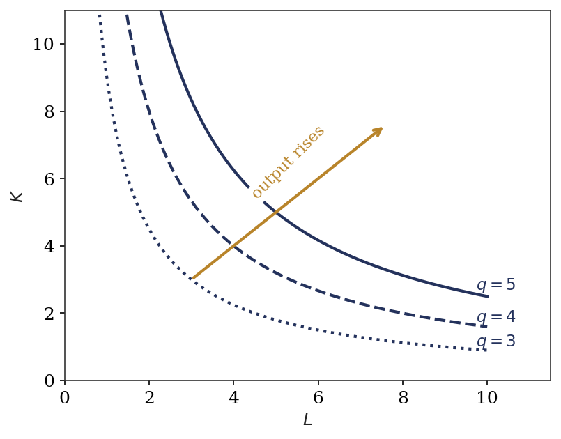
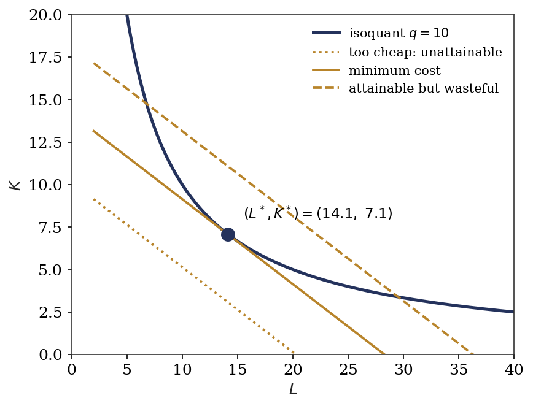
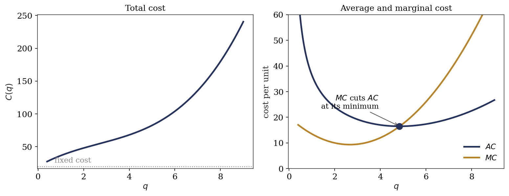
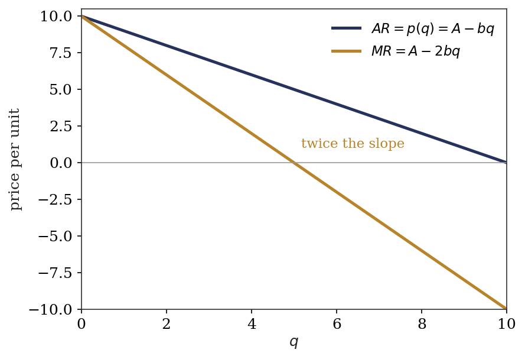
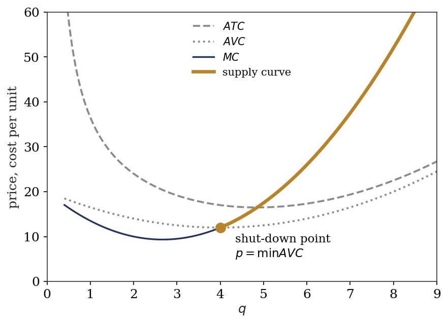

<!-- Ported from the Marp deck (slidesIIb 162-202); see source.yml for the
     extraction history. Figures regenerated from formulas in
     notebooks/topic03_production_figures.ipynb. Notation standardised:
     L = labor, K = capital, w = wage, r = rental rate, \mathcal{L} =
     Lagrangian (the legacy deck used L for both labor and the Lagrangian,
     and alternated between r and v for the rental rate). -->

## Same Fence, New Hill {.compact}

Topic 2 gave you the machinery. Today we point it at the firm — and almost nothing about the *method* changes.

:::: {.columns}
::: {.column width="52%"}
| Topic 2: constrained optimization | Topic 3: the firm |
|---|---|
| climb the hill $\max f(x,y)$ | minimize spending $wL + rK$ |
| stop at the fence $g(x,y) = c$ | reach output target $F(K,L) = q$ |
| contour / level curve | isoquant |
| tangency $\nabla f = \lambda \nabla g$ | tangency $MRTS = w/r$ |
| $\lambda$ = shadow price of fence | $\lambda$ = marginal cost of output |
| value function $V(c)$ | cost function $C(w,r,q)$ |
:::

::: {.column width="48%"}
::: {.callout-tip icon=false}
## The same three questions
1. Where is the tangency?
2. What does the multiplier mean?
3. What happens when parameters move — the envelope theorem.
:::

::: {.fragment}
The economics is new. The calculus is what you already did.

*(Next week, Topic 4 will flip this same logic around for consumer choice.)*
:::
:::
::::

---

## Today's Three Questions {.compact}

::: {.incremental}
- **What can the firm make?** The production function and its isoquants — the firm's *technology*.
- **What is the cheapest way to make $q$?** Cost minimization, which turns technology and factor prices into a **cost function** $C(w,r,q)$.
- **How much should it make?** Profit maximization, which turns the cost function into an **output choice** and a **supply curve**.
:::

::: {.fragment}
> Notice the order. The firm's problem splits in two: *first* produce any given output efficiently, *then* choose the output. The second question cannot be answered until the first one is.
:::

---

## Part I: Production Technology {.divider}

What the firm is able to do, before any question of what it *should* do

---

## The Production Function

A firm's **production function** gives the maximum output attainable from each combination of inputs — here capital $K$ and labor $L$:

$$q = F(K,L)$$

::: {.incremental}
- $F(K,L)$ is the *maximum* output producible from those inputs. Anything less is **technically inefficient** — and never optimal to choose.
- Built into the definition: the firm already knows how to get the most out of what it buys. Every question that follows is about *which* inputs to buy.
:::

---

## Marginal Product

$$MP_K = \frac{\partial q}{\partial K} = F_K(K,L) \qquad\qquad MP_L = \frac{\partial q}{\partial L} = F_L(K,L)$$

::: {.incremental}
- The extra output from one more unit of an input, holding the other fixed — a partial derivative, exactly as in Topic 2.
- These are the firm's analogue of marginal utilities. They will do the same job in the tangency condition.
:::

---

## Diminishing Marginal Productivity {.compact}

$$F_{KK} < 0 \qquad\qquad F_{LL} < 0 \qquad\qquad F_{LK} > 0$$

::: {.incremental}
- **Own effects negative:** piling more labor onto a fixed stock of machines eventually yields less and less. This is what makes factor demand slope downward.
- **Cross effect positive:** capital and labor are **complements** in most technologies — more machines raise the marginal product of workers.
- Diminishing $MP_L$ is *not* the same thing as decreasing returns to scale. The first holds $K$ fixed; the second scales both inputs. Keep them apart.
:::

---

## Technology vs. Technique {.compact}

::: {.incremental}
- A **production technology** is a recipe book: the full set of techniques available for producing any output.
- A **production technique** is one recipe: "combine 20 units of $K$ with 10 units of $L$ to make 10 widgets."
- An **isoquant** collects every technique that produces the same output. The **isoquant map** is the whole recipe book.
:::

::: {.fragment}
> The distinction matters for growth and development economics: two countries can face the same technology and still use very different techniques, because factor prices differ.
:::

---

## From Discrete Techniques to a Smooth Isoquant {.compact}

:::: {.columns}
::: {.column width="52%"}
A firm that knows only three recipes is not stuck with three points.

::: {.incremental}
- Run technique B half the time and C the other half, and you produce the same output at the midpoint of the segment joining them.
- Blending known recipes fills in the whole **convex** frontier between them.
- Learn more recipes and the kinked frontier smooths out — which is why we draw smooth, convex-to-the-origin isoquants.
:::
:::

::: {.column width="48%"}

  
  
Blends of A, B and C trace out a convex frontier.

:::
::::

---

## A Caveat on Smooth Substitution {.compact}

::: {.callout-warning icon=false}
## What the smooth isoquant assumes away
The textbook firm knows the entire recipe book and can move along an isoquant costlessly. Real firms **search, experiment, and adapt** — and some are much better at it than others.
:::

::: {.incremental}
- If the whole book were known and free to use, the technique chosen would depend on nothing but factor prices.
- Persistent productivity gaps between firms in the same industry — and between countries — are evidence that it is not.
- We keep the smooth assumption because it isolates the price logic. Just remember it is an assumption, not a finding.
:::

---

## The Isoquant Map

:::: {.columns}
::: {.column width="50%"}
Each curve collects the input bundles yielding one output level.

::: {.incremental}
- Output rises moving **northeast** — more of both inputs.
- Isoquants cannot cross, for the same reason indifference curves cannot.
- Convex to the origin: balanced input mixes are more productive than extreme ones.
:::
:::

::: {.column width="50%"}

  
  
The isoquant map for $q = K^{1/2}L^{1/2}$.

:::
::::

---

## The Marginal Rate of Technical Substitution {.compact}

:::: {.columns}
::: {.column width="52%"}
Totally differentiate $F(K,L) = \bar q$ — the same implicit-function step as Topic 2's $MRS$:

$$F_K\,dK + F_L\,dL = 0 \;\Longrightarrow\; \left.\frac{dK}{dL}\right|_{\bar q} = -\frac{F_L}{F_K}$$

::: {.incremental}
- $MRTS = F_L/F_K = MP_L/MP_K$: how much capital the firm can release per extra worker, output held fixed.
- It **diminishes** as labor replaces capital — labor gets less productive at the margin, capital more so.
- A *technological* rate of exchange. The market's rate is $w/r$. Cost minimization is about lining the two up.
:::
:::

::: {.column width="48%"}

  
  
Tangents flatten as $L$ rises: diminishing $MRTS$.

:::
::::

---

## Returns to Scale {.compact}

Scale *both* inputs by $t > 1$ and ask what happens to output:

$$F(tK, tL) = t^{\,\varepsilon} F(K,L)$$

::: {.incremental}
- $\varepsilon = 1$: **constant returns** — double everything, double output. Replication logic: build a second identical plant.
- $\varepsilon < 1$: **decreasing returns** — something is being spread thinner. We will name it shortly.
- $\varepsilon > 1$: **increasing returns** — specialization, indivisible equipment, network effects.
- For Cobb-Douglas $F = K^\alpha L^\beta$, $\varepsilon = \alpha + \beta$ — read straight off the exponents.
:::

::: {.fragment}
> Hold on to $\alpha + \beta$. It is about to reappear as the exponent on $q$ in the cost function, and it decides whether cost curves are straight, convex, or concave.
:::

---

## Part II: Cost Minimization {.divider}

From technology and factor prices to the cost function $C(w,r,q)$

---

## The Firm's Cost-Minimization Problem {.compact}

Take the output level $q$ as given for now, and produce it as cheaply as possible:

$$\min_{K,L} \; wL + rK \qquad \text{subject to} \qquad F(K,L) = q$$

::: {.incremental}
- **Why this comes first:** a profit-maximizing firm never overpays for the output it ends up making. Whatever $q$ turns out to be optimal, it will be produced at minimum cost.
- The solution gives **conditional input demands** $L^*(w,r,q)$ and $K^*(w,r,q)$ — conditional because they are tied to a particular $q$.
- Substituting them back into $wL + rK$ gives the **cost function** $C(w,r,q)$, the object Part III needs.
:::

---

## Isocost Lines

:::: {.columns}
::: {.column width="52%"}
Bundles costing the same total $C$:

$$C = wL + rK \;\Longrightarrow\; K = \frac{C}{r} - \frac{w}{r}\,L$$

::: {.incremental}
- Parallel lines of slope $-w/r$ — the **market** rate of exchange between inputs.
- Lines further out cost more. The firm wants the *lowest* line that still reaches its isoquant.
- Structurally identical to Topic 2's budget line, but the roles are reversed: there the line was the constraint, here it is the objective.
:::
:::

::: {.column width="48%"}

  
  
Isocost lines for $w=2$, $r=4$: slope $-1/2$.

:::
::::

---

## The Cost-Minimizing Choice {.compact}

:::: {.columns}
::: {.column width="50%"}
::: {.incremental}
- Lines below the isoquant are cheaper but **unattainable** — they never touch the required output.
- Lines cutting the isoquant are attainable but **wasteful** — slide along the isoquant and spend less.
- Minimum cost is the **tangency**: the lowest isocost line that still touches the isoquant, at $(L^*, K^*)$.
:::

::: {.fragment}
At $w=2$, $r=4$, $q=10$: $L^*=14.1$, $K^*=7.1$, $C^*=56.6$.
:::
:::

::: {.column width="50%"}

  
  
Tangency of isoquant and lowest isocost line.

:::
::::

---

## Solving It: The Method of Lagrange {.compact}

$$\mathcal{L}(K,L,\lambda) = wL + rK + \lambda\big[q - F(K,L)\big]$$

First-order conditions:

$$\frac{\partial \mathcal{L}}{\partial L} = w - \lambda F_L = 0 \qquad
\frac{\partial \mathcal{L}}{\partial K} = r - \lambda F_K = 0 \qquad
\frac{\partial \mathcal{L}}{\partial \lambda} = q - F(K,L) = 0$$

::: {.incremental}
- Same three-step recipe as Topic 2: write $\mathcal{L}$, differentiate, solve alongside the constraint.
- Note the sign convention: we are **minimizing**, so the multiplier enters with $[q - F(K,L)]$ and $\lambda$ will come out positive.
:::

<!-- Legacy slide 176: the professor's typed FOCs, re-keyed from the slide PNG. -->

---

## The Tangency Condition {.compact}

Divide the first FOC by the second:

$$\frac{w}{r} = \frac{F_L}{F_K} = \frac{MP_L}{MP_K} = MRTS$$

Or rearrange instead:

$$\frac{MP_L}{w} = \frac{MP_K}{r}$$

::: {.incremental}
- **First form:** the technological rate of substitution equals the market's price ratio — the isoquant is tangent to the isocost line.
- **Second form — the arbitrage reading:** the last dollar spent on labor buys exactly as much extra output as the last dollar spent on capital.
- If they were unequal — say $MP_L/w > MP_K/r$ — the firm could shift a dollar from capital to labor, produce *more* for the same spending, then cut back to the required $q$ and save money. Equality is what leaves no such trade on the table.
:::

---

## The Multiplier Is Marginal Cost {.compact}

From the two FOCs:

$$\lambda = \frac{w}{MP_L} = \frac{r}{MP_K}$$

::: {.incremental}
- Check the units: $\dfrac{\$/\text{worker}}{\text{output}/\text{worker}} = \dfrac{\$}{\text{output}}$ — dollars per unit of output.
- So $\lambda$ is the cost of squeezing out one more unit of output: $\lambda = \partial C/\partial q = MC$.
- Exactly the Topic 2 story with new names. There, $\lambda$ was the marginal utility of relaxing the budget; here, the marginal cost of tightening the output quota.
:::

::: {.callout-note icon=false}
## The shadow price, again
A multiplier always answers the same question: *what is one more unit of the constraint worth?*
:::

---

## Conditional Demands and the Cost Function {.compact}

Solving the FOCs together with $F(K,L)=q$ gives the **conditional input demands**:

$$L^*(w,r,q) \qquad\qquad K^*(w,r,q)$$

Substituting them back into the objective gives the **cost function**:

$$C(w,r,q) \;=\; \min_{K,L}\,\{wL + rK : F(K,L) = q\} \;=\; w\,L^*(w,r,q) + r\,K^*(w,r,q)$$

::: {.incremental}
- This is the production twin of the **expenditure function** $E(p_1,p_2,\bar u)$ — plug the optimal choices back into what you were minimizing.
- $C$ inherits the technology *and* the prices. Change $w$ and the whole cost curve moves.
- Everything in Part III is built from this one object.
:::

---

## Worked Example: Cobb-Douglas {.compact}

Let $F(K,L) = K^{1/2}L^{1/2}$, so $\alpha + \beta = 1$ — constant returns.

::: {.incremental}
- Tangency: $MRTS = K/L = w/r$, so $K = (w/r)\,L$.
- Substitute into $q = K^{1/2}L^{1/2}$: $\;q = (w/r)^{1/2} L$, hence
  $$L^*(w,r,q) = q\sqrt{r/w} \qquad K^*(w,r,q) = q\sqrt{w/r}$$
- Costs: $C = wL^* + rK^* = q\sqrt{wr} + q\sqrt{wr}$, so
  $$\boxed{\;C(w,r,q) = 2q\sqrt{wr}\;}$$
- Cost is **linear** in $q$: $MC = AC = 2\sqrt{wr}$, constant. Doubling output doubles cost, the hallmark of constant returns.
- If price equals marginal cost ($p = MC = 2\sqrt{wr}$), total revenue $pq$ exactly equals total cost $C$: economic profit is zero. Factor payments exhaust revenue.
:::

---

## The General Cobb-Douglas Cost Function {.compact}

For $F(K,L) = K^\alpha L^\beta$ the same steps give

$$C(w,r,q) = B\; q^{\frac{1}{\alpha+\beta}}\; r^{\frac{\alpha}{\alpha+\beta}}\; w^{\frac{\beta}{\alpha+\beta}},
\qquad B = (\alpha+\beta)\,\alpha^{-\frac{\alpha}{\alpha+\beta}}\beta^{-\frac{\beta}{\alpha+\beta}}$$

::: {.incremental}
- The exponent on $q$ is $1/(\alpha+\beta)$ — the reciprocal of the returns-to-scale parameter.
- $\alpha+\beta = 1 \Rightarrow$ cost linear in $q$. $\;\alpha+\beta < 1 \Rightarrow$ convex. $\;\alpha+\beta > 1 \Rightarrow$ concave.
- The exponents on $w$ and $r$ are the **cost shares** of labor and capital, and they sum to one: doubling both factor prices doubles cost, whatever the technology.
:::

---

## The Expansion Path

:::: {.columns}
::: {.column width="50%"}
Hold prices fixed and let $q$ rise. Each output level has its own tangency.

::: {.incremental}
- The **expansion path** is the locus of those tangencies — how the firm scales up.
- For Cobb-Douglas at fixed prices it is a **ray**: input proportions never change with scale.
- Read off the vertical: minimum cost at each $q$ *is* the cost function $C(q)$.
:::
:::

::: {.column width="50%"}

  
  
Tangencies at $q = 6, 10, 14$ trace the expansion path.

:::
::::

---

## Average and Marginal Cost

$$AC(w,r,q) = \frac{C(w,r,q)}{q} \qquad\qquad MC(w,r,q) = \frac{\partial C(w,r,q)}{\partial q}$$

::: {.incremental}
- $AC$ is the slope of a ray from the origin to the cost curve; $MC$ is the slope of the curve itself.
- Recall $MC = \lambda$: the marginal cost you compute from $C(q)$ is the same number the Lagrangian handed you.
:::

---

## Returns to Scale and the Shape of Cost {.compact}

:::: {.columns}
::: {.column width="46%"}
::: {.incremental}
- **CRS** $(\alpha+\beta=1)$: cost linear, $AC$ flat, $AC = MC$.
- **DRS** $(\alpha+\beta<1)$: cost convex, $AC$ and $MC$ rising.
- **IRS** $(\alpha+\beta>1)$: cost concave, $AC$ falling — bigger is cheaper per unit.
:::

::: {.fragment}
> Which case holds is an empirical question with real stakes: falling $AC$ over the whole relevant range is the definition of a natural monopoly.
:::
:::

::: {.column width="54%"}

  
  
Same technology family, three returns-to-scale cases.

:::
::::

---

## Where Do Decreasing Returns Come From? {.compact}

$$\hat F(K,L,z) = K^\alpha L^\beta z^{\,1-\alpha-\beta}
\qquad\Longrightarrow\qquad
F(K,L) = \hat F(K,L,\bar z) = A\,K^\alpha L^\beta, \quad A = \bar z^{\,1-\alpha-\beta}$$

::: {.incremental}
- One good story: the *true* technology has constant returns in **three** inputs, but one of them — managerial attention, a site, a franchise, the founder — is fixed and not for sale.
- Scale up $K$ and $L$ and that fixed factor is spread thinner. Measured returns to the two variable inputs decrease.
- This is why decreasing returns and rising marginal cost travel together, and why "decreasing returns" is often a statement about **what is being held fixed**, not about physics.
:::

---

## Average and Marginal Cost With Fixed Costs {.compact}

:::: {.columns}
::: {.column width="46%"}
::: {.incremental}
- A fixed cost lifts $C(q)$ at $q=0$ but leaves $MC$ untouched.
- Spreading it over more units pulls $AC$ down; rising $MC$ eventually pushes $AC$ back up. Hence the U.
- **The averaging rule:** if $MC < AC$, $AC$ falls; if $MC > AC$, $AC$ rises. So $MC$ must cut $AC$ exactly at $AC$'s minimum.
:::
:::

::: {.column width="54%"}

  
  
$C(q) = 20 + \tfrac{1}{2}q^3 - 4q^2 + 20q$.

:::
::::

---

## The Short Run: One Input Fixed {.compact}

Fix capital at $\bar k$. The firm can only vary labor:

$$SC(q;\bar k) = r\bar k + w\,L(q;\bar k), \qquad\text{where } F(\bar k, L) = q$$

::: {.incremental}
- With $K$ stuck, the firm **cannot** equate $MRTS$ to $w/r$ — the tangency condition fails, and cost is higher than it needs to be for every $q$ except one.
- For $q = K^{1/2}L^{1/2}$ with $w = r = 1$: $L = q^2/\bar k$, so $\;SC(q;\bar k) = \bar k + q^2/\bar k$.
- "Short run" is not a length of time. It is a statement about which choices are still open.
:::

---

## The Long Run Is the Envelope {.compact}

:::: {.columns}
::: {.column width="52%"}
::: {.incremental}
- Each plant size $\bar k$ has its own short-run curve $SC(q;\bar k) = \bar k + q^2/\bar k$.
- In the long run, the firm chooses plant size to minimize cost:
  $$\min_{\bar k} \; \left[\bar k + \frac{q^2}{\bar k}\right] \;\Longrightarrow\; \frac{\partial SC}{\partial \bar k} = 1 - \frac{q^2}{\bar k^2} = 0 \;\Longrightarrow\; \bar k^* = q$$
- Substitute optimal plant size $\bar k^* = q$ back in:
  $$C(q) = q + \frac{q^2}{q} = 2q$$
- The long-run linear curve is recovered as the **lower envelope** of all short-run curves.
- Tangency means slopes match at $\bar k^*$: $SMC = LMC$.
:::

::: {.fragment}
This is the envelope theorem from Topic 2: at $\bar k^*$, a small shift in plant size has zero first-order effect on cost ($\partial SC/\partial \bar k = 0$).
:::
:::

::: {.column width="48%"}

  
  
Short-run curves and the long-run curve they envelope.

:::
::::

---

## Part III: Profit Maximization and Duality {.divider}

Choosing output, deriving supply, and the map between the firm's two problems

---

## From Cost to Output Choice {.compact}

With $C(q)$ in hand, the firm's remaining choice is one variable:

$$\pi(q) = R(q) - C(q) = p(q)\cdot q - C(q)$$

::: {.incremental}
- $p(q)$ allows for a firm large enough to move the price. A **competitive** firm treats $p$ as fixed — a special case, not a different model.
- We take the **demand curve as given** today. Topic 4 derives it from preferences — which is also why we cannot close a market until then.
- Cost minimization already did the hard work: the two-variable problem in $(K,L)$ has collapsed into a one-variable problem in $q$.
- This is the single-variable optimization from Topic 2, now with economic content in both terms.
:::

---

## Worked Example {.compact}

:::: {.columns}
::: {.column width="46%"}
Let $p(q) = 10 - q$ and $c(q) = \tfrac{1}{2}q^2$:

$$\pi(q) = 10q - q^2 - \tfrac{1}{2}q^2 = 10q - \tfrac{3}{2}q^2$$

::: {.incremental}
- FOC: $\pi'(q) = 10 - 3q = 0 \Rightarrow q^* = 10/3 \approx 3.33$.
- SOC: $\pi''(q) = -3 < 0$. A maximum.
- $\pi^* = 16.67$, at price $p = 6.67$.
- On the graph: profit peaks exactly where the revenue and cost curves have **parallel tangents**.
:::
:::

::: {.column width="54%"}

  
  
Equal slopes above; the profit peak below.

:::
::::

---

## The First-Order Condition: MR = MC

$$\frac{d\pi}{dq} = \frac{dR}{dq} - \frac{dC}{dq} = 0 \qquad\Longrightarrow\qquad MR = MC$$

::: {.incremental}
- Produce one more unit whenever it brings in more than it costs; stop where the two are equal.
- "Parallel tangents" and "$MR = MC$" are the same statement, one geometric and one algebraic.
- In our example: $MR = 10 - 2q$ and $MC = q$, so $10 - 2q = q$ and $q^* = 10/3$ again.
:::

---

## Why the Second-Order Condition Matters {.compact}

$$\left.\frac{d^2\pi}{dq^2}\right|_{q=q^*} < 0$$

::: {.incremental}
- $MR = MC$ can hold at more than one output. Where $\pi$ is at a local *trough*, the same equality holds and marginal reasoning points the wrong way.
- Recall Topic 2's cubic: a flat tangent is **necessary** but never **sufficient**.
- Economically: at a profit minimum, the firm should run *away* from $q$ in either direction — which is exactly what firms near a shut-down threshold do.
:::

::: {.callout-warning icon=false}
## The habit worth keeping
Solve the FOC, then check the SOC, then check the boundary — here, whether producing at all beats shutting down.
:::

---

## Average and Marginal Revenue {.compact}

:::: {.columns}
::: {.column width="48%"}
$$AR(q) = \frac{R(q)}{q} = \frac{p(q)\,q}{q} = p(q)$$

Average revenue **is** the demand curve, by definition.

::: {.incremental}
- With linear inverse demand $p(q) = A - bq$:
  $$R = Aq - bq^2,\quad MR = A - 2bq$$
- $MR$ falls **twice as fast** as price: each extra unit sells at a lower price *and* drags down the price on every unit before it.
- For a competitive firm, $p$ is fixed, so $MR = p$ and the rule collapses to $p = MC$.
:::
:::

::: {.column width="52%"}

  
  
$AR$ and $MR$ for $p(q) = 10 - q$.

:::
::::

---

## Supply and the Shut-Down Decision {.compact}

:::: {.columns}
::: {.column width="48%"}
A price-taking firm sets $p = MC$ — but only if producing beats stopping.

::: {.incremental}
- Fixed costs are sunk in the short run, so the comparison is $p$ against **average variable cost**.
- $p \ge \min AVC$: produce at $p = MC$. $\;p < \min AVC$: shut down and lose only the fixed cost.
- So the firm's **supply curve** is the rising branch of $MC$ above $\min AVC$ — here, above $p = 12$.
- Cost minimization, done first, is what makes this curve meaningful: it is the cheapest cost of every output.
:::
:::

::: {.column width="52%"}

  
  
Supply is $MC$ above minimum $AVC$.

:::
::::

---

## Profit Max and Cost Min: The Same Tangency {.compact}

$$\max_{K,L}\; pF(K,L) - wL - rK
\qquad\Longrightarrow\qquad
p\,F_L = w, \quad p\,F_K = r$$

$$\min_{K,L}\; wL + rK \;\text{ s.t. }\; F(K,L) = \bar q
\qquad\Longrightarrow\qquad
\lambda F_L = w, \quad \lambda F_K = r$$

::: {.incremental}
- Divide either pair and you get the identical condition $F_L/F_K = w/r$.
- The problems differ in one place: profit maximization pins the multiplier down at $\lambda = p$, because the firm may choose its output. Cost minimization leaves $q$ fixed and lets $\lambda$ land where it must.
- **So a profit-maximizing firm is automatically cost-minimizing** for whatever output it chooses. The converse is not true — cost minimization is silent about scale.
:::

---

## Conditional vs. Unconditional Input Demand {.compact}

::: {.incremental}
- **Conditional** demands $L^*(w,r,q)$, $K^*(w,r,q)$ come from cost minimization. They answer: *given* that I make $q$, what do I hire?
- **Unconditional** demands $L(p,w,r)$, $K(p,w,r)$ come from profit maximization. They let output adjust too.
- A wage rise therefore hits a firm twice: it substitutes capital for labor at fixed output (the conditional effect), *and* it produces less (the scale effect).
:::

::: {.fragment}
> Same pairing as consumer theory: Hicksian demand holds utility fixed, Marshallian demand lets it adjust. The substitution/income split there is the substitution/scale split here.
:::

---

## Shephard's Lemma {.compact}

What happens to minimum cost when a factor price rises? Apply the envelope theorem to $C(w,r,q) = \min \mathcal{L}$:

$$\frac{\partial C(w,r,q)}{\partial w} = L^*(w,r,q) \qquad\qquad \frac{\partial C(w,r,q)}{\partial r} = K^*(w,r,q)$$

::: {.incremental}
- Differentiating the *value* of the problem, only the direct effect counts — the re-optimization of $K$ and $L$ contributes nothing at the margin, because the firm was already optimizing.
- **Check it:** $C = 2q\sqrt{wr}$ gives $\partial C/\partial w = q\sqrt{r/w}$, which is exactly the $L^*$ we derived.
- Read it as economics: a one-dollar rise in the wage raises minimum cost by about $L^*$ — the wage bill you are already committed to.
:::

::: {.callout-tip icon=false}
## Same lemma, other side of the street
$\partial E(p,\bar u)/\partial p_i = x_i^h$ is Shephard's lemma wearing a consumer's hat.
:::

---

## Hotelling's Lemma {.compact}

What happens to maximized profit when prices change? Define the profit function:

$$\pi^*(p,w,r) = \max_{q} \; [p\,q - C(w,r,q)]$$

::: {.incremental}
- Apply the envelope theorem to $\pi^*(p,w,r)$:
  $$\frac{\partial \pi^*}{\partial p} = q^*(p,w,r) \qquad\qquad (\text{the firm's supply function})$$
  $$\frac{\partial \pi^*}{\partial w} = -L^*(p,w,r) \qquad\qquad \frac{\partial \pi^*}{\partial r} = -K^*(p,w,r)$$
- **Economic reading:**
  - A \$1 increase in output price raises profit by $q^*$ (the units you are already selling).
  - A \$1 increase in the wage reduces profit by $L^*$ (the workers you already hire).
- Differentiating the value function hands you the firm's supply and input demands directly.
:::

---

## The Duality Map {.compact}

| | **Consumer** | **Producer** |
|---|---|---|
| Primal | $\max u(x)$ s.t. $p\cdot x = m$ | $\max pq - C(q)$ |
| Dual | $\min p\cdot x$ s.t. $u(x) = \bar u$ | $\min wL + rK$ s.t. $F(K,L) = q$ |
| Value function | $V(p,m)$, $E(p,\bar u)$ | $\pi(p,w,r)$, $C(w,r,q)$ |
| Quantity-fixed demand | Hicksian $x^h(p,\bar u)$ | conditional $L^*(w,r,q)$ |
| Free demand | Marshallian $x(p,m)$ | unconditional $L(p,w,r)$ |
| Envelope result | $\partial E/\partial p_i = x_i^h$ | $\partial C/\partial w = L^*, \; \partial \pi^*/\partial p = q^*$ |

::: {.fragment}
Two problems, one skeleton. Learn the skeleton and each new application costs you an afternoon, not a semester.
:::

---

## Why Duality Earns Its Keep {.compact}

::: {.incremental}
- **Estimation:** cost functions are estimable from data firms actually report — prices and expenditures — while production functions need unobserved technology. Duality says the cost function contains the same information.
- **Prediction without re-solving:** one derivative of $C$ gives you input demand; no need to redo the optimization.
- **Policy:** the welfare effect of a tax on an input is $\partial C/\partial w$ — a quantity you already know.
- **Theory:** the properties carry over. $C$ is concave in prices, homogeneous of degree one in $(w,r)$, non-decreasing in $q$ — mirroring $E$ in consumer theory.
:::

---

## Vocabulary Checklist {.compact}

You should now be able to define, compute, and interpret:

| Technology | Cost | Output & Duality |
|---|---|---|
| Production function $F(K,L)$ | Isocost line | Marginal revenue ($MR$) |
| Marginal product ($MP_L$, $MP_K$) | Cost-minimizing tangency | $MR = MC$, and $p = MC$ |
| Diminishing marginal productivity | Conditional input demand | Average revenue $= p(q)$ |
| Isoquant / isoquant map | Cost function $C(w,r,q)$ | Shut-down point ($p = \min AVC$) |
| $MRTS = MP_L/MP_K$ | $\lambda = MC$ | Firm supply curve |
| Returns to scale ($\alpha + \beta$) | $AC$, $MC$, and the averaging rule | Unconditional input demand |
| Technique vs. technology | Short-run vs. long-run cost | Shephard's lemma |

---

## The Road Ahead {.compact}

::: {.incremental}
- **Today:** technology $\to$ cost $\to$ output. Cost minimization first, output choice second, and the envelope theorem doing quiet work at both stages.
- **Next (Topic 4):** the consumer's side of the same duality — utility maximization, expenditure minimization, and where demand curves come from.
- **Later:** these supply and demand curves meet. Topic 7 asks when their intersection is efficient; Topics 9–10 ask what to do when it is not.
:::

::: {.fragment}
> The firm in this lecture is a production function with a bank account. Topic 10 asks a harder question: why does the firm exist at all, and who inside it is choosing?
:::
