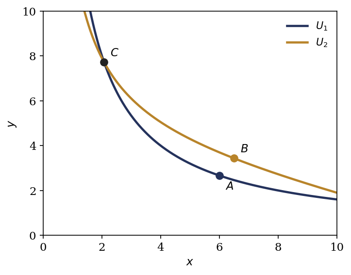
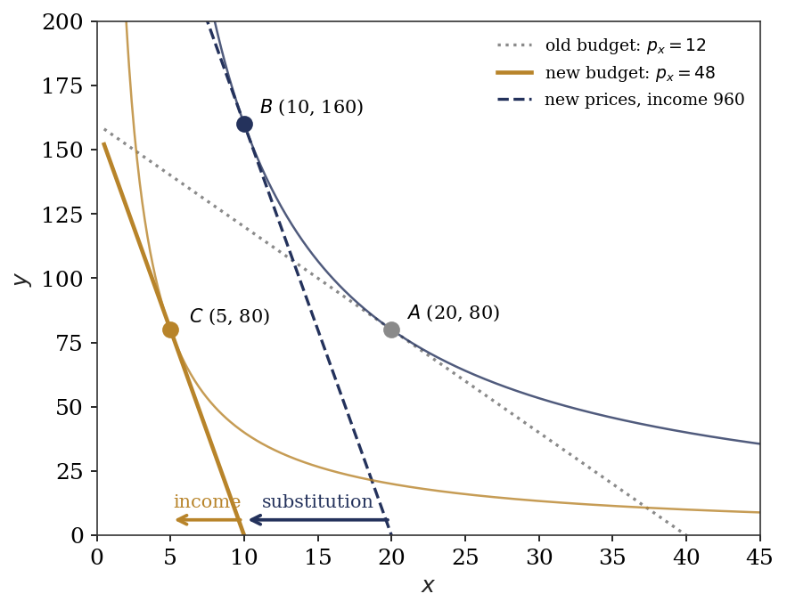
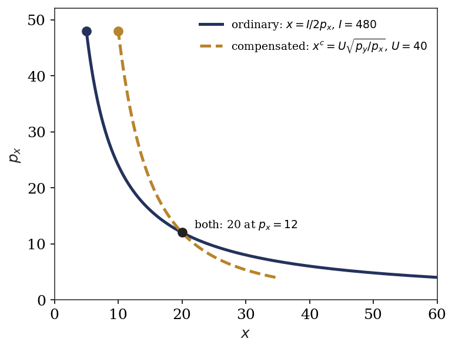
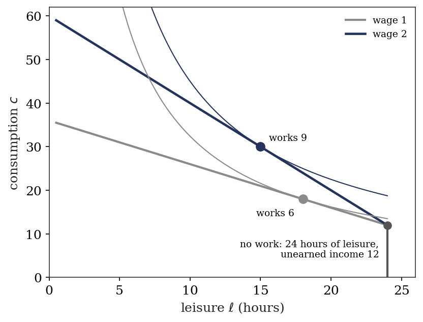

```{python}
#| include: false
# Shared setup for the two interactive figures in Part IV.
import numpy as np
import plotly.graph_objects as go
from plotly.subplots import make_subplots

NAVY, AMBER, GREY, RED = "#24325c", "#b8842a", "#8a8a8a", "#c83232"
I0, PY = 480, 3          # income and price of y in the running example
FONT = dict(family="-apple-system, Arial, Helvetica, sans-serif", size=14)
# Dark axis lines with outside ticks, so both axes stand out on the projector.
AXIS = dict(showline=True, linecolor=NAVY, linewidth=2, ticks="outside", ticklen=6,
            tickcolor=NAVY, tickwidth=1.5, zeroline=False, showgrid=True, gridcolor="#e5e9f0",
            title_font=dict(size=17, color=NAVY), tickfont=dict(size=13, color=NAVY))


def price_slider(fig, prices, start, n_static, frame_traces, prefix):
    """Attach one frame per price and a slider that steps through them."""
    fig.frames = [go.Frame(data=frame_traces(p), name=str(p),
                           traces=list(range(n_static, n_static + len(frame_traces(p)))))
                  for p in prices]
    steps = [dict(method="animate", label=str(p),
                  args=[[str(p)], dict(mode="immediate",
                                       frame=dict(duration=0, redraw=True),
                                       transition=dict(duration=0))])
             for p in prices]
    fig.update_layout(sliders=[dict(
        active=prices.index(start), steps=steps, len=0.9, x=0.05,
        pad=dict(t=58, b=0),
        currentvalue=dict(prefix=prefix, visible=True, xanchor="center",
                          font=dict(size=15, color=NAVY)))])
```

## Optimization: From the Firm to the Consumer {.compact}

Topic 3 solved the firm's problem. The consumer's problem has the same skeleton, with one new feature.

:::: {.columns}
::: {.column width="55%"}
| Topic 3: the firm | Topic 4: the consumer |
|---|---|
| Inputs $K$, $L$ at prices $v$, $w$ | Goods $x$, $y$ at prices $p_x$, $p_y$ |
| Isoquant, $MRTS$ | Indifference curve, $MRS$ |
| Cheapest way to make $q$ | Cheapest way to reach utility $U$ |
| Contingent demand $L^c(v,w,q)$ | Compensated demand $x^c(p_x,p_y,U)$ |
| Cost function $C(v,w,q)$ | Expenditure function $E(p_x,p_y,U)$ |
| Shephard's lemma: $\partial C/\partial w = L^c$ | The same lemma: $\partial E/\partial p_x = x^c$ |
:::

::: {.column width="45%"}
::: {.callout-tip icon=false}
## What is new
The consumer has a **budget**. Income is given, so the main problem is to get the most utility from it. That brings in an **income effect**, which the firm never had.
:::

::: {.callout-note icon=false}
## What is not new
The consumer's Lagrangian, the tangency $MRS = p_x/p_y$, and the multiplier as the marginal utility of income are all from Topic 2.
:::
:::
::::

<!-- Topic 4, built 2026-10-19. Running example chosen to mirror Topic 3's
     firm: u = sqrt(xy), p_x = 12, p_y = 3, I = 480. The consumer buys
     (20, 80) and reaches u = 40; reaching u = 40 at least cost takes 480.
     Notation follows Nicholson & Snyder 11e ch. 3-5: x^c for compensated
     (Hicksian) demand, V for indirect utility, E for the expenditure
     function. Figures come from notebooks/topic04_consumer_figures.ipynb.
     Class 6 (Oct 19) covers Parts I-III; class 7 (Oct 26) covers income
     and substitution effects and labor supply. -->

---

## Three Questions About the Consumer

| | Question | What you will take away |
|---|---|---|
| **NS 3** | **What does the consumer want?** | Preferences, summarized by a utility function. Only its ranking matters. |
| **NS 4** | **What will she buy?** | The bundle where $MRS = p_x/p_y$ on the budget line: **demand functions** and the **indirect utility function**. |
| **NS 4–5** | **What does it cost to be this well off?** | The dual problem: **compensated demand** and the **expenditure function**, the consumer's cost function. |

: {tbl-colwidths="[12,30,58]"}

::: {.fragment}
> Then: what happens when a price changes, and how the answer splits into a substitution effect and an income effect. Finally, labor supply.
:::

<p style="font-size: 0.8em; color: #666;">Running example throughout: $u = \sqrt{xy}$, $p_x = 12$, $p_y = 3$, income $I = 480$. The same numbers as the firm in Topic 3.</p>

---

## Part I: Preferences and Utility {.divider}

What the consumer wants — NS Chapter 3

---

## From Preferences to Utility {.compact}

Start with rankings, not numbers. The consumer can compare any two bundles $A$ and $B$.

::: {.incremental}
- **Complete:** she can always say $A \succeq B$, $B \succeq A$, or both.
- **Transitive:** if $A \succeq B$ and $B \succeq C$, then $A \succeq C$.
- **Continuous:** if $A$ is preferred to $B$, bundles very close to $A$ are too.
- With these three, there is a **utility function** $U(x,y)$ that gives preferred bundles higher numbers.
- Two more assumptions give the usual picture. **More is better**, so indifference curves slope down. **Balanced bundles are preferred to extremes**, so indifference curves are convex: the $MRS$ diminishes.
:::

<p style="font-size: 0.8em; color: #666;">Text: NS Chapter 3, "Axioms of Rational Choice" and Figure 3.5.</p>

---

## Indifference Curves Cannot Cross {.compact}

:::: {.columns}
::: {.column width="50%"}
::: {.incremental}
- Suppose two indifference curves $U_1$ and $U_2$ crossed at bundle $C$.
- Pick $A$ on $U_1$ and $B$ on $U_2$, with $B$ holding more of both goods than $A$.
- $A \sim C$ (same curve) and $C \sim B$ (same curve). By **transitivity**, $A \sim B$.
- But more is better, so $B \succ A$. Contradiction: the curves cannot cross.
- The same argument shows isoquants cannot cross (Topic 3).
:::
:::

::: {.column width="50%"}
<div style="text-align: center;">
  
  <p style="font-size: 0.65em; color: #666;">Text: NS Chapter 3, "Indifference Curve Maps".</p>
</div>
:::
::::

---

## Utility Is Only a Ranking {.compact}

$u = \sqrt{xy}$, $\;u = xy$ and $\;u = \ln x + \ln y$ rank every pair of bundles the same way.

::: {.incremental}
- **Same indifference curves, same $MRS$:** $\;MRS = y/x$ for all three. So the consumer makes the same choices with any of them.
- **What has meaning:** which bundle is preferred, and the $MRS$. **What does not:** the number $u = 40$, or by how much one bundle beats another.
- **Contrast the firm:** output has units, so returns to scale mean something. Utility's *degree* does not: $\sqrt{xy}$, $xy$ and $\ln x + \ln y$ are homogeneous of degree 1, of degree 2, and not at all, yet describe the same person.
- **Homotheticity** (Topic 3) is different: it is a property of the indifference map, so it survives any increasing transformation. Preferences need not be homothetic; quasilinear ones are not.
- Any increasing transformation of a utility function is another utility function for the same person. Use whichever makes the algebra easiest.
:::

<p style="font-size: 0.8em; color: #666;">Text: NS Chapter 3, "Utility", and Example 3.3 on homothetic preferences.</p>

---

## A Warning: Groups Are Not Consumers {.compact}

Every individual here has transitive preferences. Let the group decide by majority vote.

:::: {.columns}
::: {.column width="42%"}
| Voter | Ranking |
|:-:|:-:|
| 1 | $X \succ Y \succ Z$ |
| 2 | $Y \succ Z \succ X$ |
| 3 | $Z \succ X \succ Y$ |

The majority prefers $X$ to $Y$, $Y$ to $Z$, and $Z$ to $X$, each by 2 to 1. The group's ranking goes in a circle (**Condorcet's paradox**).
:::

::: {.column width="58%"}
::: {.incremental}
- **Agenda setting matters:** whoever chooses the order of votes chooses the winner.
- **Arrow's theorem** shows this is not a quirk of majority voting: no rule for combining rankings satisfies a short list of reasonable conditions in every case.
- **For this course:** be careful with a "representative consumer" or "community indifference curves". A group's demand can be added up; a group's *preferences* generally cannot. We return to this in general equilibrium.
:::
:::
::::

<p style="font-size: 0.8em; color: #666;">Not in NS Chapters 3–5. The voting paradox is in NS Chapter 19, "Voting and Resource Allocation".</p>

---

## A Gallery of Preferences {.compact}

:::: {.columns}
::: {.column width="44%"}
The shapes differ in how easily she swaps one good for the other, measured by the **elasticity of substitution**:

$$\sigma = \frac{\%\ \text{change in } y/x}{\%\ \text{change in } MRS}$$

Small $\sigma$: sharply curved. Large $\sigma$: nearly straight.

::: {.incremental}
- **Perfect complements:** L-shapes, $\sigma = 0$.
- **Cobb-Douglas:** smooth curves, $\sigma = 1$.
- **Perfect substitutes:** straight lines, $\sigma = \infty$.
- **CES:** $\sigma = 1/(1-\rho)$ covers all three.
- **Quasilinear:** $\sigma$ not constant; demand for $y$ ignores income.
:::
:::

::: {.column width="56%"}
<div style="text-align: center;">
  
  <p style="font-size: 0.65em; color: #666;">The same four shapes as Topic 3's isoquants. Text: NS Figure 3.8.</p>
</div>
:::
::::

::: {.notes}
Complements: fixed proportions, a kink. Substitutes: buys only the cheaper good, a corner.
Cobb-Douglas: fixed budget shares. CES: U = (x^ρ + y^ρ)^(1/ρ).
:::

---

## Part II: Utility Maximization {.divider}

What the consumer buys — NS Chapter 4

---

## The Consumer's Problem {.compact}

:::: {.columns}
::: {.column width="50%"}
$$\max_{x,y}\; U(x,y) \quad \text{s.t.} \quad p_x x + p_y y = I$$

**Our consumer:** $u = \sqrt{xy}$, with prices $p_x = 12$, $p_y = 3$ and income $I = 480$.

::: {.incremental}
- The tangency from Topic 2: $\;MRS = \dfrac{p_x}{p_y}$. The rate at which she will trade $y$ for $x$ equals the rate the market offers.
- **Here:** $MRS = y/x$ and $p_x/p_y = 12/3$, so $y = 4x$.
- On the budget line: $12x + 3(4x) = 480$, so $x = 20$, $y = 80$, $u = 40$.
- **The arbitrage reading:** the last dollar on each good adds the same utility, $MU_x/p_x = MU_y/p_y$.
:::
:::

::: {.column width="50%"}
<div style="text-align: center;">
  
  <p style="font-size: 0.65em; color: #666;">The highest indifference curve the budget reaches. Text: NS Figure 4.2.</p>
</div>
:::
::::

---

## Marshallian Demand {.compact}

Solve the same problem with $u = \sqrt{xy}$, now for **any** prices $p_x$, $p_y$ and income $I$:

::: {.incremental}
- **Tangency:** $\;MRS = \dfrac{y}{x} = \dfrac{p_x}{p_y}$, so $p_y\, y = p_x\, x$. She spends the same amount on each good.
- **Budget:** substitute into $p_x x + p_y y = I$ to get $2 p_x x = I$. So
  $$x(p_x, p_y, I) = \frac{I}{2p_x} \qquad\qquad y(p_x, p_y, I) = \frac{I}{2p_y}$$
- These are the **demand functions** (Marshallian, or ordinary, demand). At our numbers: 20 and 80.
- **Fixed budget shares:** half of income on each good, whatever the prices. The "half" is particular to this **symmetric** Cobb-Douglas; the next slide gives the general case.
- **No money illusion:** double both prices and income, and nothing changes: $\;x(24, 6, 960) = 960/48 = 20$. Demand is homogeneous of degree 0 in $(p_x, p_y, I)$.
:::

<p style="font-size: 0.8em; color: #666;">Text: NS Example 4.1 (Cobb-Douglas demand) and Example 4.2 (CES demand).</p>

---

## Cobb-Douglas Demand in General {.compact}

Now let $\;U = x^{\alpha} y^{\beta}$, with $\alpha, \beta > 0$. Same two steps.

::: {.incremental}
- **Tangency:** $\;MRS = \dfrac{\alpha x^{\alpha-1} y^{\beta}}{\beta x^{\alpha} y^{\beta-1}} = \dfrac{\alpha}{\beta}\,\dfrac{y}{x} = \dfrac{p_x}{p_y}$, so $\;p_y\, y = \dfrac{\beta}{\alpha}\, p_x\, x$.
- **Budget:** $\;p_x x \left(1 + \dfrac{\beta}{\alpha}\right) = I$. So
  $$x(p_x, p_y, I) = \frac{\alpha}{\alpha+\beta}\,\frac{I}{p_x} \qquad\qquad y(p_x, p_y, I) = \frac{\beta}{\alpha+\beta}\,\frac{I}{p_y}$$
- **Budget shares** are $\alpha/(\alpha+\beta)$ and $\beta/(\alpha+\beta)$, fixed whatever the prices. Only the ratio of the exponents matters, as it should when utility is only a ranking.
- **Our case:** $\sqrt{xy}$ has $\alpha = \beta = \tfrac12$, so the shares are a half each. **Another:** $u = x y^3$ puts a quarter of income on $x$: $\;x = 480/(4 \times 12) = 10$, $\;y = 3 \times 480/(4 \times 3) = 120$.
- This formula is printed on the midterm as a hint. Know where it comes from.
:::

<p style="font-size: 0.8em; color: #666;">Text: NS Example 4.1, "Cobb-Douglas Demand Functions".</p>

---

## The Indirect Utility Function {.compact}

The **indirect utility function** $V(p_x, p_y, I)$ tells us the level of utility she reaches at any prices and income, when she chooses as well as she can. To get it, substitute the Marshallian demands into the utility function:

$$V(p_x, p_y, I) = U\big(x(\cdot), y(\cdot)\big) = \sqrt{\frac{I}{2p_x}\cdot\frac{I}{2p_y}} = \frac{I}{2\sqrt{p_x p_y}} \qquad\qquad V(12, 3, 480) = 40$$

::: {.incremental}
- **The envelope theorem, again:** $\;\partial V/\partial I = \lambda$, the multiplier. Here $\lambda = 1/(2\sqrt{12 \times 3}) = 1/12$: one more dollar of income adds $1/12$ of a util.
- **A caution:** utility is only a ranking, so the number $1/12$ has no meaning by itself. Use $u = xy$ instead and $\lambda$ changes; the choices do not.
- **Prices:** $\;\partial V/\partial p_x = -\lambda\, x$. A one-dollar rise in $p_x$ costs about one dollar for every unit of $x$ she buys, valued at $\lambda$. Check: $-\tfrac{1}{12} \times 20 = -1.67$.
- **Roy's identity** turns this around: $\;x = -\dfrac{\partial V/\partial p_x}{\partial V/\partial I}$. One derivative ratio gives demand.
:::

<p style="font-size: 0.8em; color: #666;">Text: NS Chapter 4, "Indirect Utility Function".</p>

---

## Application: The Lump Sum Principle {.compact}

:::: {.columns}
::: {.column width="50%"}
The government needs to raise 180 from our consumer. Two ways:

::: {.incremental}
- **Excise tax of 36 on $x$** (navy): income stays 480, $x$ costs 48: $\;48x + 3y = 480$. Same $y$-intercept, steeper. She buys (5, 80) and pays $36 \times 5 = 180$. Utility 20.
- **Lump-sum tax of 180** (amber): prices stay 12 and 3, income falls to 300: $\;12x + 3y = 300$.
- **Why amber passes through (5, 80):** at untaxed prices it costs $12 \times 5 + 3 \times 80 = 300$, the 480 she spent minus 180 of tax. She can afford it, but does better at (12.5, 50). Utility 25.
- **Same revenue, higher utility:** only the excise changes the price she trades at.
:::

::: {.notes}
Reversed: a cash transfer beats a food subsidy that costs the same. One reason for the shift toward cash transfers in development policy.
:::
:::

::: {.column width="50%"}
```{python}
#| fig-align: center
# Excise tax t per unit of x against a lump-sum tax raising the same revenue.
taxes = [0, 4, 8, 12, 18, 24, 36]
xs = np.linspace(0.3, 46, 400)
fig = go.Figure()
fig.add_trace(go.Scatter(x=[0, 40], y=[160, 0], mode="lines", line=dict(color=GREY, width=1.5, dash="dot"),
                         hoverinfo="skip"))
n_static = len(fig.data)


def moving(t):
    px = 12 + t
    xe, ye = I0 / (2 * px), I0 / (2 * PY)              # bundle under the excise tax
    R = t * xe                                          # revenue
    m = I0 - R                                          # income left under the lump-sum tax
    xl, yl = m / 24, m / 6                              # choice at the old prices
    ue, ul = I0 / (2 * np.sqrt(px * PY)), m / 12
    return [
        go.Scatter(x=[0, I0 / px], y=[I0 / PY, 0], mode="lines", line=dict(color=NAVY, width=3), hoverinfo="skip"),
        go.Scatter(x=[0, m / 12], y=[m / PY, 0], mode="lines", line=dict(color=AMBER, width=3), hoverinfo="skip"),
        go.Scatter(x=xs, y=ue ** 2 / xs, mode="lines", line=dict(color=NAVY, width=1.3), hoverinfo="skip"),
        go.Scatter(x=xs, y=ul ** 2 / xs, mode="lines", line=dict(color=AMBER, width=1.3), hoverinfo="skip"),
        go.Scatter(x=[xe, xl], y=[ye, yl], mode="markers+text", marker=dict(color=[NAVY, AMBER], size=12),
                   text=[f"({xe:.3g}, {ye:.0f})", f"({xl:.3g}, {yl:.3g})"],
                   textposition=["top right", "top right"], textfont=dict(color=[NAVY, AMBER], size=14),
                   hoverinfo="skip"),
        go.Scatter(x=[45], y=[172], mode="text", textposition="bottom left", hoverinfo="skip",
                   text=[f"revenue {R:.0f}<br><span style='color:{NAVY}'>excise tax: utility {ue:.1f}</span>"
                         f"<br><span style='color:{AMBER}'>lump sum: utility {ul:.1f}</span>"],
                   textfont=dict(size=14)),
    ]


for tr in moving(36):
    fig.add_trace(tr)
price_slider(fig, taxes, 36, n_static, moving, "Tax per unit of x: ")
fig.update_xaxes(range=[0, 46], title_text="x", **AXIS)
fig.update_yaxes(range=[0, 175], title_text="y", **AXIS)
fig.update_layout(width=560, height=500, showlegend=False, font=FONT, margin=dict(l=55, r=15, t=10, b=40),
                  paper_bgcolor="rgba(0,0,0,0)", plot_bgcolor="rgba(0,0,0,0)")
fig
```

<p style="font-size: 0.65em; color: #666; text-align: center;">Grey dotted: no tax ($12x + 3y = 480$). Navy: excise tax, income still 480. Amber: lump-sum tax with the same revenue. Drag the tax. Text: NS Example 4.3 and Figure 4.5.</p>
:::
::::

---

## Part III: Expenditure Minimization and Duality {.divider}

The consumer's cost function — NS Chapters 4 and 5

---

## The Dual Problem {.compact}

:::: {.columns}
::: {.column width="50%"}
Turn the question around: what is the cheapest way to reach utility $U$?

$$\min_{x,y}\; p_x x + p_y y \quad \text{s.t.} \quad U(x,y) = \bar U$$

::: {.incremental}
- **This is Topic 3's cost minimization**, with goods for inputs and utility for output.
- Same tangency, $MRS = p_x/p_y$, so $y = 4x$. To reach $\sqrt{xy} = 40$: $x = 20$, $y = 80$, spending **480**.
- The cheapest way to reach 40 costs exactly the income that buys 40. The two problems give the same bundle.
:::
:::

::: {.column width="50%"}
<div style="text-align: center;">
  
  <p style="font-size: 0.65em; color: #666;">The lowest spending line that reaches $u = 40$. Text: NS Figure 4.6.</p>
</div>
:::
::::

---

## Deriving Compensated Demand {.compact}

Solve the dual for $u = \sqrt{xy}$ at **any** prices and target utility $U$. Same two steps as Marshallian demand, but the constraint is now the indifference curve, not the budget line.

::: {.incremental}
- **Tangency:** $\;MRS = \dfrac{y}{x} = \dfrac{p_x}{p_y}$, so $y = \dfrac{p_x}{p_y}\, x$. Exactly as before.
- **Utility constraint:** substitute into $\sqrt{xy} = U$ to get $\dfrac{p_x}{p_y}\, x^2 = U^2$. So
  $$x^c(p_x, p_y, U) = U\sqrt{\frac{p_y}{p_x}} \qquad\qquad y^c(p_x, p_y, U) = U\sqrt{\frac{p_x}{p_y}}$$
- **Minimum spending:** $\;E = p_x x^c + p_y y^c = U\sqrt{p_x p_y} + U\sqrt{p_x p_y} = 2U\sqrt{p_x p_y}$.
- **Compare** $x = I/2p_x$: compensated demand depends on $U$ instead of $I$, and on **both** prices. A dearer $x$ moves her along the same indifference curve, toward $y$.
- **Check:** at $U = 40$, $p_x = 12$, $p_y = 3$: $\;x^c = 40\sqrt{3/12} = 20$, $\;y^c = 40\sqrt{12/3} = 80$, $\;E = 480$.
:::

<p style="font-size: 0.8em; color: #666;">Text: NS Example 4.4, "Two Expenditure Functions"; Chapter 5, "Compensated Demand Curves".</p>

---

## Compensated Demand and the Expenditure Function {.compact}

The results of the last slide, side by side with the firm:

| | The firm, $q = \sqrt{KL}$ | The consumer, $u = \sqrt{xy}$ |
|---|---|---|
| Demand at fixed target | $L^c = q\sqrt{v/w}$ | $x^c = U\sqrt{p_y/p_x}$ |
| Minimum spending | $C(v,w,q) = 2q\sqrt{vw}$ | $E(p_x,p_y,U) = 2U\sqrt{p_x p_y}$ |
| At our numbers | $q = 40$: 20 workers, cost 480 | $U = 40$: 20 units of $x$, spending 480 |

: {tbl-colwidths="[24,38,38]"}

::: {.incremental}
- $x^c$ is the **compensated** (or Hicksian) demand: what she buys if her income is adjusted to keep her at utility $U$.
- $E$ is the **expenditure function**: the consumer's cost function. Every result about $C$ in Topic 3 carries over.
:::

<p style="font-size: 0.8em; color: #666;">Text: NS Chapter 4, "Expenditure Minimization", and Example 4.4; Chapter 5 on compensated demand.</p>

---

## A Shortcut: Invert Indirect Utility {.compact}

Indirect utility says how much utility an income buys. Read it backward: how much income buys a given utility?

$$U = \frac{I}{2\sqrt{p_x p_y}} \quad\Longrightarrow\quad I = 2U\sqrt{p_x p_y} = E(p_x, p_y, U)$$

::: {.incremental}
- **Same answer** as minimizing spending, with no second problem to solve. Check: $V(12, 3, 480) = 40$ and $E(12, 3, 40) = 480$.
- **Compensated demand the same way:** put $E$ in place of $I$ in ordinary demand $x = I/2p_x$. Then $x^c = 2U\sqrt{p_x p_y}/2p_x = U\sqrt{p_y/p_x}$, which is 20 at $U = 40$.
- **Why it works:** at fixed prices, $V$ rises with income, so it can be run backward. $V$ answers "which indifference curve does this budget line reach?"; $E$ answers "which budget line just reaches this indifference curve?" It is the same tangency.
- On the "Two Problems, One Answer" slide below, the first two identities say $V$ and $E$ are inverses; the fourth is this substitution for $x^c$.
:::

<p style="font-size: 0.8em; color: #666;">Text: NS Example 4.4, "Two Expenditure Functions", which uses this shortcut.</p>

---

## Properties of the Expenditure Function {.compact}

The same table as for the cost function. Check each on ours, $E = 2U\sqrt{p_x p_y}$.

| Property | Why | Check |
|---|---|---|
| Rises with prices and with $U$ | Dearer goods or a higher target cannot cost less | $p_x$, $p_y$, $U$ enter positively |
| Doubling both prices doubles spending | The cheapest bundle depends only on $p_x/p_y$ | $2U\sqrt{(2p_x)(2p_y)} = 2E$ |
| Concave in prices | She substitutes away from the dearer good | $E$ is proportional to $\sqrt{p_x}$ |
| Its derivative is compensated demand | **Shephard's lemma** | $\partial E/\partial p_x = U\sqrt{p_y/p_x} = 20$ |

: {tbl-colwidths="[30,40,30]"}

::: {.incremental}
- **Concavity implies** $\;\partial x^c/\partial p_x \le 0$: when a price rises and utility is held fixed, she never buys more of that good. Compensated demand curves always slope down.
- **The multiplier:** $\;\partial E/\partial U = 2\sqrt{12 \times 3} = 12$, the cost of one more util. It is exactly $1/\lambda$, since $\lambda = 1/12$.
:::

<p style="font-size: 0.8em; color: #666;">Text: NS Chapter 4, "Properties of Expenditure Functions", and Figure 4.7.</p>

---

## Two Problems, One Answer {.compact}

The maximization and the minimization are two views of the same tangency. Four identities connect them:

| Identity | In words | Check at our numbers |
|---|---|---|
| $E\big(p_x, p_y, V(p_x,p_y,I)\big) = I$ | Reaching the best utility $I$ buys costs exactly $I$ | $E(12, 3, 40) = 480$ |
| $V\big(p_x, p_y, E(p_x,p_y,U)\big) = U$ | Spending the minimum for $U$ yields exactly $U$ | $V(12, 3, 480) = 40$ |
| $x(p_x, p_y, I) = x^c\big(p_x, p_y, V(\cdot)\big)$ | Ordinary demand is compensated demand at the utility actually reached | both equal 20 |
| $x^c(p_x, p_y, U) = x\big(p_x, p_y, E(\cdot)\big)$ | Compensated demand is ordinary demand at the income that just reaches $U$ | both equal 20 |

: {tbl-colwidths="[33,42,25]"}

::: {.fragment}
> These identities are the whole of "duality". In Part IV the fourth one, differentiated, gives the Slutsky equation: the split of a price effect into substitution and income.
:::

---

## The Duality Map {.compact}

| | **Consumer** | **Firm** |
|---|---|---|
| Choose at fixed target, minimize spending | $\min p_x x + p_y y$ s.t. $U(x,y) = \bar U$ | $\min wL + vK$ s.t. $F(K,L) = q$ |
| Demand at fixed target | Compensated $x^c(p_x,p_y,U)$ | Contingent $L^c(v,w,q)$ |
| Minimum spending | Expenditure function $E(p_x,p_y,U)$ | Cost function $C(v,w,q)$ |
| Envelope result | $\partial E/\partial p_x = x^c$ | $\partial C/\partial w = L^c$ |
| The other problem | $\max U$ s.t. a **budget**: $x(p_x,p_y,I)$, $V(p_x,p_y,I)$ | $\max$ **profit**, no budget: supply $q(p,v,w)$, profit $\Pi(p,v,w)$ |

::: {.incremental}
- The top four rows are exact twins. Learn one and you have the other.
- **The last row is where they differ.** The consumer's main problem has a budget, so a price change makes her poorer as well as changing relative prices. The firm's profit problem has no budget. That difference is the income effect of Part IV.
:::

---

## Where We Are {.compact}

:::: {.columns}
::: {.column width="50%"}
::: {.callout-tip icon=false}
## So far
- Utility is a ranking: the $MRS$ has meaning, the numbers do not.
- Demand: $x = I/2p_x$. Indirect utility: $V = I/2\sqrt{p_x p_y}$.
- The dual: $x^c$ and $E = 2U\sqrt{p_x p_y}$, the consumer's cost function.
- Four identities tie them together.
:::
:::

::: {.column width="50%"}
::: {.callout-note icon=false}
## Next: a price rise
Suppose $p_x$ rises from 12 to 48, income still 480.

- She buys 5 units of $x$ instead of 20.
- Kept at her old utility (40), she would still buy only 10. That fall, from 20 to 10, is the **substitution effect**.
- The rest, from 10 to 5, is the **income effect**: she is poorer.
- To keep her at utility 40 she would need 960, not 480.
:::
:::
::::

<p style="font-size: 0.8em; color: #666;">Reading: NS Chapter 5 for Part IV; NS Chapter 16, "Allocation of Time", for labor supply.</p>

---

## Part IV: Price Changes {.divider}

Substitution and income effects — NS Chapter 5

---

## Deriving Demand Graphically {.compact}

Hold income (480) and $p_y$ (3) fixed and move $p_x$. Each budget line has a best bundle (left). Plot the $x$ she chooses against its price (right): that is her demand curve. *Drag the slider.*

```{python}
#| fig-align: center
prices = [6, 8, 10, 12, 15, 18, 24, 30, 36, 42, 48]
ghosts = [6, 12, 24, 48]
xs = np.linspace(0.3, 46, 400)

fig = make_subplots(rows=1, cols=2, horizontal_spacing=0.09,
                    subplot_titles=("Budget lines and best bundles",
                                    "Demand curve: x = 240 / p<sub>x</sub>"))

# Fixed background: four budget lines and their tangencies, the
# price-consumption curve, and the demand curve with the same four points.
for p in ghosts:
    fig.add_trace(go.Scatter(x=[0, I0 / p], y=[I0 / PY, 0], mode="lines",
                             line=dict(color=GREY, width=1, dash="dot"), hoverinfo="skip"), 1, 1)
fig.add_trace(go.Scatter(x=[I0 / (2 * p) for p in ghosts], y=[I0 / (2 * PY)] * 4, mode="markers",
                         marker=dict(color=GREY, size=8), hoverinfo="skip"), 1, 1)
fig.add_trace(go.Scatter(x=[0, 46], y=[80, 80], mode="lines", line=dict(color=GREY, width=1),
                         hoverinfo="skip"), 1, 1)
fig.add_annotation(x=26, y=80, text="price-consumption curve", showarrow=False, yshift=11,
                   xanchor="left", font=dict(size=12, color=GREY), row=1, col=1)
pp = np.linspace(5.2, 52, 300)
fig.add_trace(go.Scatter(x=240 / pp, y=pp, mode="lines", line=dict(color=NAVY, width=2.5),
                         hoverinfo="skip"), 1, 2)
fig.add_trace(go.Scatter(x=[240 / p for p in ghosts], y=ghosts, mode="markers",
                         marker=dict(color=GREY, size=8), hoverinfo="skip"), 1, 2)
n_static = len(fig.data)


def moving(p):
    x, y = I0 / (2 * p), I0 / (2 * PY)
    u = I0 / (2 * np.sqrt(p * PY))
    return [
        go.Scatter(x=[0, I0 / p], y=[I0 / PY, 0], mode="lines", line=dict(color=AMBER, width=3),
                   hoverinfo="skip", xaxis="x", yaxis="y"),
        go.Scatter(x=xs, y=u ** 2 / xs, mode="lines", line=dict(color=NAVY, width=2),
                   hoverinfo="skip", xaxis="x", yaxis="y"),
        go.Scatter(x=[x, x], y=[0, y], mode="lines", line=dict(color=RED, width=1.5, dash="dot"),
                   hoverinfo="skip", xaxis="x", yaxis="y"),
        go.Scatter(x=[x], y=[y], mode="markers+text", text=[f"x = {x:g}"], textposition="top right",
                   marker=dict(color=RED, size=12), textfont=dict(color=RED, size=14),
                   hoverinfo="skip", xaxis="x", yaxis="y"),
        go.Scatter(x=[x, x, 0], y=[0, p, p], mode="lines", line=dict(color=RED, width=1.5, dash="dot"),
                   hoverinfo="skip", xaxis="x2", yaxis="y2"),
        go.Scatter(x=[x], y=[p], mode="markers+text", text=[f"({x:g}, {p})"], textposition="top right",
                   marker=dict(color=RED, size=12), textfont=dict(color=RED, size=14),
                   hoverinfo="skip", xaxis="x2", yaxis="y2"),
    ]


for t in moving(12):
    fig.add_trace(t)
price_slider(fig, prices, 12, n_static, moving, "Price of x: ")

fig.update_xaxes(range=[0, 46], title_text="x", **AXIS)
fig.update_yaxes(range=[0, 175], title_text="y", **AXIS, row=1, col=1)
fig.update_yaxes(range=[0, 52], title_text="p<sub>x</sub>", **AXIS, row=1, col=2)
fig.update_layout(width=1150, height=470, showlegend=False, font=FONT,
                  margin=dict(l=50, r=20, t=40, b=40),
                  paper_bgcolor="rgba(0,0,0,0)", plot_bgcolor="rgba(0,0,0,0)")
fig
```

<p style="font-size: 0.8em; color: #666;">She always spends half her income on $y$, so every best bundle has $y = 80$. Text: NS Figure 5.5, "Construction of an Individual's Demand Curve".</p>

---

## Changes in Income {.compact}

Hold prices fixed and raise income. How does demand respond?

::: {.incremental}
- **Normal good:** she buys more as income rises. **Inferior good:** she buys less. Cheap staples, bus rides and rented housing are common examples of inferior goods.
- **The Engel curve** plots demand against income. Ours, $x = I/2p_x = I/24$ at $p_x = 12$, is a straight line through the origin: with homothetic preferences budget shares do not change, so Engel curves are rays.
- **Quasilinear preferences** are the opposite extreme: in the gallery's $u = x + 2\sqrt{y}$, demand for $y$ does not depend on income at all.
- The sign of the income response is what decides the next few slides.
:::

<p style="font-size: 0.8em; color: #666;">Text: NS Chapter 5, "Changes in Income", and Figures 5.1–5.2.</p>

---

## A Price Rise, Split in Two {.compact}

:::: {.columns}
::: {.column width="46%"}
$p_x$ rises from 12 to 48. Income stays 480.

::: {.incremental}
- She moves from $A$ (20 units of $x$) to $C$ (5 units). Utility falls from 40 to 20.
- **Substitution effect, $A \to B$:** give her just enough income to stay at utility 40 (that takes $E(48, 3, 40) = 960$). At the new prices she buys 10. $x$ is relatively dearer, so she substitutes toward $y$.
- **Income effect, $B \to C$:** take the extra income away. She is poorer, and $x$ is a normal good, so she buys 5.
- The substitution effect is a move **along** an indifference curve; the income effect is a move **between** them.
:::
:::

::: {.column width="54%"}
<div style="text-align: center;">
  
  <p style="font-size: 0.65em; color: #666;">Substitution 20 to 10, income 10 to 5. Text: NS Figures 5.3 and 5.4, Example 5.4.</p>
</div>
:::
::::

---

## Two Problems, One Price Change {.compact}

Move the new price of $x$. **Maximizing utility** on the new budget line gives $C$. **Minimizing spending** to stay at the old utility, 40, gives $B$ on the dashed line. $A \to B$ is the substitution effect, $B \to C$ the income effect. *Drag the slider.*

```{python}
#| fig-align: center
prices = [6, 8, 10, 12, 16, 20, 24, 30, 36, 42, 48]
U0 = 40
xs = np.linspace(0.3, 46, 400)

fig = make_subplots(rows=1, cols=2, horizontal_spacing=0.09,
                    subplot_titles=("Choices at the new price",
                                    "Compensated and ordinary demand"))

# Fixed background: the old budget line, the old indifference curve and A;
# both demand curves and A on the right.
fig.add_trace(go.Scatter(x=[0, I0 / 12], y=[I0 / PY, 0], mode="lines",
                         line=dict(color=GREY, width=1.5), hoverinfo="skip"), 1, 1)
fig.add_trace(go.Scatter(x=xs, y=U0 ** 2 / xs, mode="lines", line=dict(color=AMBER, width=1.5),
                         hoverinfo="skip"), 1, 1)
fig.add_trace(go.Scatter(x=[20], y=[80], mode="markers+text", text=["A"], textposition="top right",
                         marker=dict(color=GREY, size=10), textfont=dict(size=15),
                         hoverinfo="skip"), 1, 1)
pp = np.linspace(4, 52, 300)
fig.add_trace(go.Scatter(x=240 / pp, y=pp, mode="lines", line=dict(color=NAVY, width=2.5),
                         hoverinfo="skip"), 1, 2)
fig.add_trace(go.Scatter(x=U0 * np.sqrt(PY / pp), y=pp, mode="lines",
                         line=dict(color=AMBER, width=2.5, dash="dash"), hoverinfo="skip"), 1, 2)
fig.add_trace(go.Scatter(x=[20], y=[12], mode="markers+text", text=["A"], textposition="top right",
                         marker=dict(color=GREY, size=10), textfont=dict(size=15),
                         hoverinfo="skip"), 1, 2)
fig.add_annotation(x=38, y=11, text="ordinary", showarrow=False, font=dict(color=NAVY, size=13),
                   row=1, col=2)
fig.add_annotation(x=14, y=30, text="compensated", showarrow=False, xanchor="left",
                   font=dict(color=AMBER, size=13), row=1, col=2)
n_static = len(fig.data)


def moving(p):
    xc, yc = U0 * np.sqrt(PY / p), U0 * np.sqrt(p / PY)       # B: expenditure minimization
    x, y = I0 / (2 * p), I0 / (2 * PY)                         # C: utility maximization
    u1 = I0 / (2 * np.sqrt(p * PY))
    e = 2 * U0 * np.sqrt(p * PY)                               # income that keeps her at 40
    sub, inc = xc - 20, x - xc
    arrow = lambda a, b, col: go.Scatter(
        x=[a, b], y=[12, 12], mode="lines+markers", line=dict(color=col, width=3),
        marker=dict(symbol=["line-ns", "arrow"], angleref="previous", size=[1, 14], color=col),
        hoverinfo="skip", xaxis="x", yaxis="y")
    return [
        go.Scatter(x=[0, I0 / p], y=[I0 / PY, 0], mode="lines", line=dict(color=NAVY, width=3),
                   hoverinfo="skip", xaxis="x", yaxis="y"),
        go.Scatter(x=[0, e / p], y=[e / PY, 0], mode="lines", line=dict(color=AMBER, width=2.5, dash="dash"),
                   hoverinfo="skip", xaxis="x", yaxis="y"),
        go.Scatter(x=xs, y=u1 ** 2 / xs, mode="lines", line=dict(color=NAVY, width=1.5),
                   hoverinfo="skip", xaxis="x", yaxis="y"),
        go.Scatter(x=[xc, x], y=[yc, y], mode="markers+text", text=["B", "C"],
                   textposition=["top right", "bottom left"],
                   marker=dict(color=[AMBER, NAVY], size=12), textfont=dict(size=15),
                   hoverinfo="skip", xaxis="x", yaxis="y"),
        arrow(20, xc, AMBER),
        arrow(xc, x, NAVY),
        go.Scatter(x=[45], y=[192], mode="text", textposition="bottom left",
                   text=[f"<span style='color:{AMBER}'>substitution (A to B) {sub:+.1f}</span><br>"
                         f"<span style='color:{NAVY}'>income (B to C) {inc:+.1f}</span><br>total {x - 20:+.1f}"],
                   textfont=dict(size=14), hoverinfo="skip", xaxis="x", yaxis="y"),
        go.Scatter(x=[min(x, xc), max(x, xc)], y=[p, p], mode="lines",
                   line=dict(color=RED, width=1.5, dash="dot"), hoverinfo="skip", xaxis="x2", yaxis="y2"),
        go.Scatter(x=[xc, x], y=[p, p], mode="markers+text", text=["B", "C"],
                   textposition=["top right", "bottom left"],
                   marker=dict(color=[AMBER, NAVY], size=12), textfont=dict(size=15),
                   hoverinfo="skip", xaxis="x2", yaxis="y2"),
    ]


for t in moving(48):
    fig.add_trace(t)
price_slider(fig, prices, 48, n_static, moving, "New price of x: ")

fig.update_xaxes(range=[0, 46], title_text="x", **AXIS)
fig.update_yaxes(range=[0, 200], title_text="y", **AXIS, row=1, col=1)
fig.update_yaxes(range=[0, 52], title_text="p<sub>x</sub>", **AXIS, row=1, col=2)
fig.update_layout(width=1150, height=470, showlegend=False, font=FONT,
                  margin=dict(l=50, r=20, t=40, b=40),
                  paper_bgcolor="rgba(0,0,0,0)", plot_bgcolor="rgba(0,0,0,0)")
fig
```

<p style="font-size: 0.8em; color: #666;">The further the price moves from 12, the further $B$ and $C$ pull apart: the compensated curve is steeper. Text: NS Figures 5.3, 5.4 and 5.7.</p>

---

## The Slutsky Equation {.compact}

Start from the duality identity $x^c(p_x,p_y,U) = x\big(p_x,p_y,E(p_x,p_y,U)\big)$ and differentiate with respect to $p_x$:

$$\frac{\partial x^c}{\partial p_x} \;=\; \frac{\partial x}{\partial p_x} \;+\; \frac{\partial x}{\partial I}\,\frac{\partial E}{\partial p_x} \;=\; \frac{\partial x}{\partial p_x} \;+\; \frac{\partial x}{\partial I}\,x^c$$

The second step is Shephard's lemma, $\partial E/\partial p_x = x^c$. At the starting point $x^c = x$. Rearrange:

$$\frac{\partial x}{\partial p_x} \;=\; \underbrace{\frac{\partial x^c}{\partial p_x}}_{\text{substitution effect}\;\le\; 0} \;-\; \underbrace{x\,\frac{\partial x}{\partial I}}_{\text{income effect}}$$

::: {.incremental}
- **Substitution effect:** never positive, because the expenditure function is concave in prices.
- **Income effect:** a one-dollar price rise makes her poorer by about $x$ dollars (Shephard's lemma again), and $\partial x/\partial I$ says how she responds. For a normal good it reinforces the substitution effect; for an inferior good it works against it.
- **Check at $p_x = 12$:** total $-I/2p_x^2 = -1.67$; substitution $-x^c/2p_x = -0.83$; income $-x/2p_x = -0.83$.
- **The firm's version** (Topic 3) was substitution plus an *output* effect. A firm has no budget, so it has no income effect.
:::

<p style="font-size: 0.8em; color: #666;">Text: NS Chapter 5, "A Mathematical Development of Response to Price Changes".</p>

---

## Why Cobb-Douglas Demand Ignores Other Prices {.compact}

With $u = \sqrt{xy}$, demand for $x$ is $I/2p_x$: the price of $y$ does not appear. Why?

::: {.incremental}
- **Fixed budget shares.** The tangency $MRS = y/x = p_x/p_y$ says $p_y\,y = p_x\,x$: she spends the same on each good. So half of income goes to $x$, whatever $p_y$ is.
- **Example:** double $p_y$ from 3 to 6. She cuts $y$ from 80 to 40, still spending 240 on it, and keeps buying 20 units of $x$.
- **In Slutsky terms,** a rise in $p_y$ has two effects on $x$ that pull apart. Substitution: $y$ is dearer, so buy more $x$. Income: she is poorer, so buy less $x$. For Cobb-Douglas they cancel exactly:
  $$\frac{\partial x}{\partial p_y} = \underbrace{\frac{\partial x^c}{\partial p_y}}_{U/2\sqrt{p_x p_y}\,=\,3.33} - \underbrace{y\,\frac{\partial x}{\partial I}}_{80 \,\times\, 1/24\,=\,3.33} = 0$$
- **A special case, not a rule.** With complements (coffee and sugar) a dearer $y$ cuts demand for $x$; with close substitutes (tea and coffee) it raises it. Cobb-Douglas sits exactly between.
:::

<p style="font-size: 0.8em; color: #666;">Text: NS Example 6.1, "Another Slutsky Decomposition for Cross-Price Effects", which makes this point; Figure 6.1, "Differing Directions of Cross-Price Effects".</p>

---

## Compensated and Ordinary Demand Curves {.compact}

:::: {.columns}
::: {.column width="46%"}
::: {.incremental}
- **Ordinary (Marshallian) demand** $x(p_x,p_y,I)$ holds income fixed. It includes both effects.
- **Compensated (Hicksian) demand** $x^c(p_x,p_y,U)$ holds utility fixed. It includes only the substitution effect.
- The two curves cross at the price where income $I$ buys utility $U$: here 20 units at $p_x = 12$.
- **For a normal good the compensated curve is steeper:** it leaves out an income effect that pushes the same way. At $p_x = 48$ she would buy 10 if compensated, 5 if not.
- For an inferior good it is the other way round.
:::
:::

::: {.column width="54%"}
<div style="text-align: center;">
  
  <p style="font-size: 0.65em; color: #666;">Text: NS Figure 5.7 and Example 5.3.</p>
</div>
:::
::::

---

## When Demand Slopes Up: Giffen Goods {.compact}

::: {.incremental}
- Ordinary demand rises with the good's own price only if the good is **inferior** and its income effect is **larger** than the substitution effect.
- That needs a good that takes a large share of the budget and has few substitutes: a staple food for a very poor household.
- **Evidence:** Jensen and Miller (2008) subsidized the price of rice for poor households in Hunan, China. Many of the poorest bought *less* rice when it became cheaper: the extra real income let them shift toward meat and other foods. That is Giffen behavior.
- Compensated demand can never slope up. Only the income effect can reverse the sign, and only for poor consumers spending much of their budget on one good.
:::

<p style="font-size: 0.8em; color: #666;">Text: NS Chapter 5, Giffen's paradox. Jensen and Miller, "Giffen Behavior and Subsistence Consumption", American Economic Review 2008.</p>

---

## How Much Worse Off? {.compact}

The price of $x$ rises from 12 to 48 with income 480. Utility falls from 40 to 20. In dollars, how big is that loss?

::: {.incremental}
- **Compensating variation:** the extra income she needs at the *new* prices to get back to utility 40: $E(48, 3, 40) - 480 = 960 - 480 = 480$.
- **Equivalent variation:** the income she would give up at the *old* prices to be as badly off as now: $480 - E(12, 3, 20) = 480 - 240 = 240$.
- **Consumer surplus:** the area to the left of the ordinary demand curve between 12 and 48: $\int_{12}^{48} \tfrac{240}{p}\,dp = 240\ln 4 \approx 333$, between the two.
- The three differ because of the income effect. With quasilinear preferences there is none, and all three are equal.
:::

<p style="font-size: 0.8em; color: #666;">Text: NS Chapter 5, "Consumer Surplus", Figures 5.8–5.9 and Example 5.6.</p>

---

## Part V: Labor Supply {.divider}

Leisure is a good, and its price is the wage — NS Chapter 16

---

## Labor Supply: Leisure Is a Good {.compact}

A worker has 24 hours, earns wage $w$, has unearned income $y$, and buys consumption at price $p$. She chooses consumption $c$ and leisure $\ell$:

$$\max_{c,\ell}\; U(c, \ell) \quad\text{s.t.}\quad pc + w\ell = 24w + y$$

::: {.incremental}
- **The price of an hour of leisure is the wage** she gives up. The right side is **full income**: the value of all her time plus unearned income.
- Hours worked are $24 - \ell$: labor supply is leisure demand turned around.
- **With $U = c\,\ell$** she spends half of full income on each good: $\;c = \dfrac{24w + y}{2p}$ and $\ell = \dfrac{24w + y}{2w} = 12 + \dfrac{y}{2w}$. The examples set $p = 1$.
- **With no unearned income** she always takes 12 hours of leisure, whatever the wage: the two effects of a wage change cancel exactly. That is Ingmar in the practice midterm.
:::

<p style="font-size: 0.8em; color: #666;">Text: NS Chapter 16, "A Mathematical Analysis of Labor Supply".</p>

---

## A Wage Rise: Two Effects That Pull Apart {.compact}

:::: {.columns}
::: {.column width="46%"}
::: {.incremental}
- **Substitution effect:** leisure is now dearer, so she takes less of it and works more.
- **Income effect:** she is richer, and leisure is a normal good, so she takes more of it and works less.
- **Example,** $y = 12$: at $w = 1$ she takes 18 hours of leisure and works 6; at $w = 2$ she takes 15 and works 9. Here substitution wins.
- If the income effect wins at high wages, the labor supply curve bends backward.
- **Unearned income** has only an income effect: a cash transfer, or profit from a family farm, raises leisure.
:::
:::

::: {.column width="54%"}
<div style="text-align: center;">
  
  <p style="font-size: 0.65em; color: #666;">$U = c\,\ell$ with unearned income 12. Text: NS Chapter 16.</p>
</div>
:::
::::

---

## A Household That Also Farms {.compact}

:::: {.columns}
::: {.column width="46%"}
::: {.incremental}
- Same worker, $U = c\,\ell$, $w = p = 1$, now with land: farm output $F(L) = 6\sqrt{L}$. Family and hired labor are perfect substitutes.
- **Step 1, the firm:** choose $L$ to maximize $pF(L) - wL$. $\;3/\sqrt{L} = 1$, so $L^* = 9$, output 18, profit 9. Preferences play no part.
- **Step 2, the consumer:** full income $24 + 9 = 33$, half on leisure: $\ell = 16.5$, so she works 7.5 hours. The farm needs 9, so she hires 1.5.
- **Separation:** with a working labor market, the farm decides like a firm and the household like a consumer. A taste for more leisure changes who does the farm work, not $L^*$.
:::
:::

::: {.column width="54%"}
```{python}
#| fig-align: center
# U = c*l, p = 1, 24 hours, farm F(L) = 6 sqrt(L), wage w.
# Farm: L* = 9/w^2, profit 9/w. Household: leisure = 12 + 4.5/w^2.
wages = [0.75, 0.85, 1, 1.25, 1.5, 2]
ls = np.linspace(0.3, 24, 400)
Lf = np.linspace(0, 24, 400)
fig = go.Figure()
fig.add_trace(go.Scatter(x=24 - Lf, y=6 * np.sqrt(Lf), mode="lines", line=dict(color=NAVY, width=3),
                         hoverinfo="skip"))
fig.add_trace(go.Scatter(x=[24, 24], y=[0, 56], mode="lines", line=dict(color="#555555", width=1),
                         hoverinfo="skip"))
fig.add_annotation(x=4, y=6 * np.sqrt(20), ax=1, ay=44, axref="x", ayref="y", text="farm output",
                   showarrow=True, arrowhead=0, arrowcolor=NAVY, xanchor="left",
                   font=dict(color=NAVY, size=13))
n_static = len(fig.data)


def moving(w):
    L = 9 / w ** 2
    profit = 9 / w
    lei = 12 + 4.5 / w ** 2
    c = (24 * w + profit) / 2
    work = 24 - lei
    gap = L - work
    trade = f"hires {gap:.1f} hours" if gap > 0.05 else f"sells {-gap:.1f} hours" if gap < -0.05 else "neither hires nor sells"
    return [
        go.Scatter(x=[0, 24], y=[24 * w, 0], mode="lines", line=dict(color=GREY, width=1.5, dash="dot"),
                   hoverinfo="skip"),
        go.Scatter(x=[0, 24], y=[profit + 24 * w, profit], mode="lines", line=dict(color=AMBER, width=3),
                   hoverinfo="skip"),
        go.Scatter(x=ls, y=c * lei / ls, mode="lines", line=dict(color=AMBER, width=1.3), hoverinfo="skip"),
        go.Scatter(x=[24 - L, lei], y=[6 * np.sqrt(L), c], mode="markers", marker=dict(color=[NAVY, AMBER], size=12),
                   hoverinfo="skip"),
        go.Scatter(x=[24, 24], y=[0, profit], mode="lines+markers", line=dict(color=RED, width=3),
                   marker=dict(symbol=["line-ew", "line-ew"], size=12, line=dict(color=RED, width=3)),
                   hoverinfo="skip"),
        go.Scatter(x=[0.5], y=[1], mode="text", textposition="top right", hoverinfo="skip",
                   text=[f"<span style='color:{NAVY}'>farm uses L* = {L:.1f}, profit {profit:.1f}</span><br>"
                         f"<span style='color:{AMBER}'>she works {work:.1f}, {trade}</span>"],
                   textfont=dict(size=14)),
    ]


for tr in moving(1):
    fig.add_trace(tr)
price_slider(fig, wages, 1, n_static, moving, "Wage w: ")
fig.update_xaxes(range=[0, 25], title_text="leisure ℓ (hours)", **AXIS)
fig.update_yaxes(range=[0, 56], title_text="corn c", **AXIS)
fig.update_layout(width=620, height=500, showlegend=False, font=FONT, margin=dict(l=55, r=15, t=10, b=40),
                  paper_bgcolor="rgba(0,0,0,0)", plot_bgcolor="rgba(0,0,0,0)")
fig
```

<p style="font-size: 0.65em; color: #666; text-align: center;">Farm labor is measured leftward from 24 hours; profit (red) is the budget line's height at 24. Drag the wage: $L^*$ depends only on the wage.</p>
:::
::::

---

## From Labor Supply to the Farm Household {.compact}

::: {.incremental}
- **A landless household** solves exactly the problem on the labor supply slides: how much of its time to sell.
- **A household with land** first maximizes farm profit, then treats the profit as unearned income: the separation result on the last slide.
- **Cash transfers and work:** by the lump sum principle a transfer is the cheapest way to help, and by labor supply theory it has only an income effect on hours. Reviews of cash transfer programs in developing countries find little or no fall in work.
- **When separation fails:** if the household cannot hire or sell labor freely, its preferences do shape how much it farms. That is the farm-household model later in the course.
:::

<p style="font-size: 0.8em; color: #666;">Evidence: Banerjee, Hanna, Kreindler and Olken, "Debunking the Stereotype of the Lazy Welfare Recipient", World Bank Research Observer 2017.</p>

---

## Three Questions, Answered {.compact}

| Question | What to take away |
|---|---|
| **What does the consumer want?** <br> NS 3 | A ranking of bundles. Utility numbers have no meaning; the $MRS$ does. |
| **What will she buy?** <br> NS 4 | Where $MRS = p_x/p_y$ on the budget line. Demand $x(p_x,p_y,I)$ and indirect utility $V$. Cash beats an equally costly price distortion. |
| **What does it cost to be this well off?** <br> NS 4–5 | The expenditure function $E$ and compensated demand $x^c$: the consumer's cost function. |
| **What happens when a price changes?** <br> NS 5, 16 | Substitution plus income effect (Slutsky). Compensated demand always slopes down; ordinary demand can bend only through the income effect. Labor supply is leisure demand, with the wage as its price. |

: {tbl-colwidths="[30,70]"}

---

## For the Midterm (Monday, Nov 2) {.compact}

::: {.incremental}
- **Covers Topics 1–4:** games, Nash equilibrium and Pareto efficiency; constrained optimization, Kuhn–Tucker and the envelope theorem; production, cost and profit; consumer choice, duality and price effects.
- **Format:** multiple choice, short answers with some choice, two short problems, and one longer problem. No calculator needed.
- **Practice midterm and solutions** are posted on the schedule. Work the practice exam before looking at the solutions.
- **Problem Set 2 is due tomorrow,** Tuesday Oct 27, by 11:59pm. Its solutions will be posted Wednesday.
- **Questions to expect:** set up and solve a Lagrangian; read a multiplier; find the cheapest way to reach a target; compare a tax with a lump-sum transfer; solve a labor supply problem with a farm; explain a result with a diagram (indifference curves, cost curves, compensated and ordinary demand).
:::
