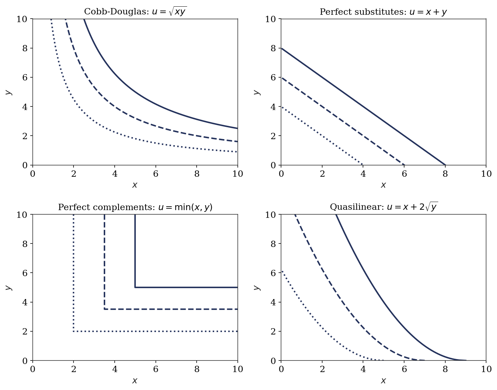
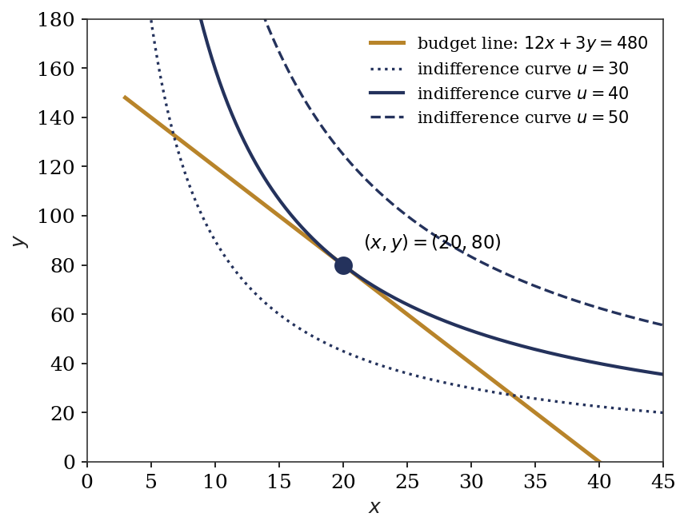
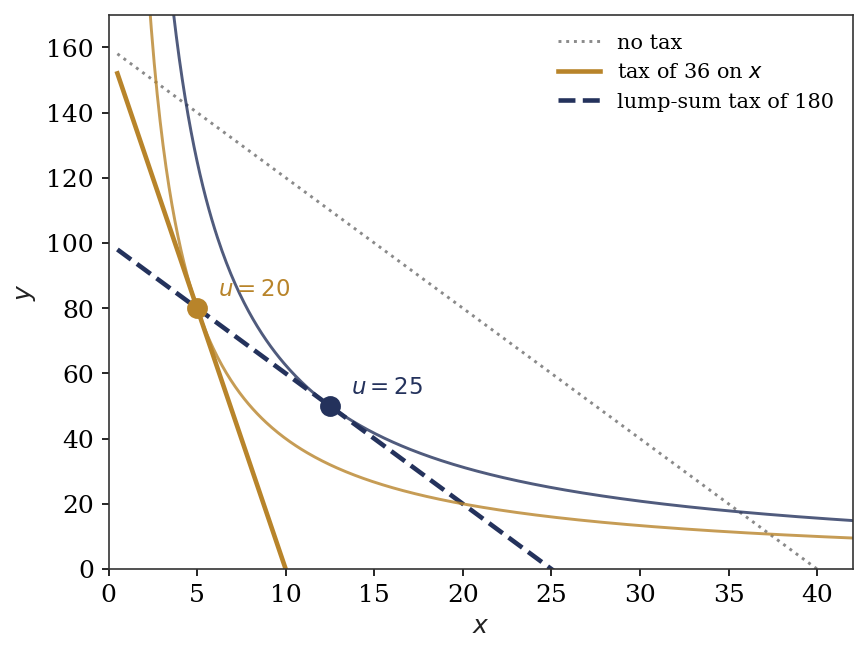
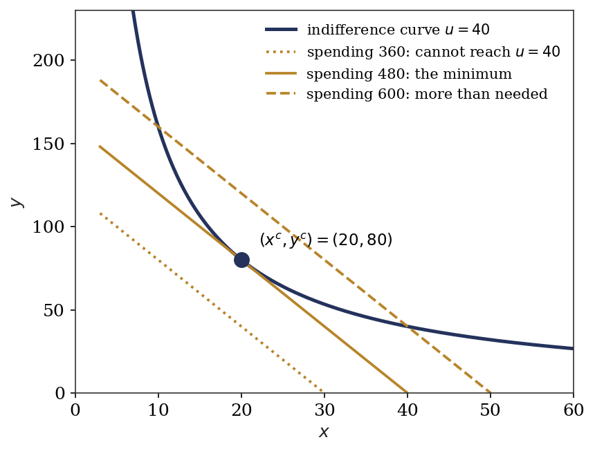

## Optimization: From the Firm to the Consumer {.compact}

Topic 3 solved the firm's problem. The consumer's problem has the same skeleton, with one new feature.

:::: {.columns}
::: {.column width="55%"}
| Topic 3: the firm | Topic 4: the consumer |
|---|---|
| Inputs $K$, $L$ at prices $v$, $w$ | Goods $x$, $y$ at prices $p_x$, $p_y$ |
| Isoquant, $MRTS$ | Indifference curve, $MRS$ |
| Cheapest way to make $q$ | Cheapest way to reach utility $U$ |
| Contingent demand $L^c(v,w,q)$ | Compensated demand $x^c(p_x,p_y,U)$ |
| Cost function $C(v,w,q)$ | Expenditure function $E(p_x,p_y,U)$ |
| Shephard's lemma: $\partial C/\partial w = L^c$ | The same lemma: $\partial E/\partial p_x = x^c$ |
:::

::: {.column width="45%"}
::: {.callout-tip icon=false}
## What is new
The consumer has a **budget**. Income is given, so the main problem is to get the most utility from it. That brings in an **income effect**, which the firm never had.
:::

::: {.callout-note icon=false}
## What is not new
The consumer's Lagrangian, the tangency $MRS = p_x/p_y$, and the multiplier as the marginal utility of income are all from Topic 2.
:::
:::
::::

<!-- Topic 4, built 2026-10-19. Running example chosen to mirror Topic 3's
     firm: u = sqrt(xy), p_x = 12, p_y = 3, I = 480. The consumer buys
     (20, 80) and reaches u = 40; reaching u = 40 at least cost takes 480.
     Notation follows Nicholson & Snyder 11e ch. 3-5: x^c for compensated
     (Hicksian) demand, V for indirect utility, E for the expenditure
     function. Figures come from notebooks/topic04_consumer_figures.ipynb.
     Class 6 (Oct 19) covers Parts I-III; class 7 (Oct 26) covers income
     and substitution effects and labor supply. -->

---

## Three Questions About the Consumer

| | Question | What you will take away |
|---|---|---|
| **NS 3** | **What does the consumer want?** | Preferences, summarized by a utility function. Only its ranking matters. |
| **NS 4** | **What will she buy?** | The bundle where $MRS = p_x/p_y$ on the budget line: **demand functions** and the **indirect utility function**. |
| **NS 4–5** | **What does it cost to be this well off?** | The dual problem: **compensated demand** and the **expenditure function**, the consumer's cost function. |

: {tbl-colwidths="[12,30,58]"}

::: {.fragment}
> Next week: what happens when a price changes, and how the answer splits into a substitution effect and an income effect.
:::

Running example throughout: $u = \sqrt{xy}$, $p_x = 12$, $p_y = 3$, income $I = 480$. The same numbers as the firm in Topic 3.

---

## Part I: Preferences and Utility {.divider}

What the consumer wants — NS Chapter 3

---

## From Preferences to Utility {.compact}

Start with rankings, not numbers. The consumer can compare any two bundles $A$ and $B$.

::: {.incremental}
- **Complete:** she can always say $A \succeq B$, $B \succeq A$, or both.
- **Transitive:** if $A \succeq B$ and $B \succeq C$, then $A \succeq C$.
- **Continuous:** if $A$ is preferred to $B$, bundles very close to $A$ are too.
- With these three, there is a **utility function** $U(x,y)$ that gives preferred bundles higher numbers.
- Two more assumptions give the usual picture. **More is better**, so indifference curves slope down. **Balanced bundles are preferred to extremes**, so indifference curves are convex: the $MRS$ diminishes.
:::

Text: NS Chapter 3, "Axioms of Rational Choice" and Figure 3.5.

---

## Utility Is Only a Ranking {.compact}

$u = \sqrt{xy}$, $\;u = xy$ and $\;u = \ln x + \ln y$ rank every pair of bundles the same way.

::: {.incremental}
- **Same indifference curves, same $MRS$:** $\;MRS = y/x$ for all three. So the consumer makes the same choices with any of them.
- **What has meaning:** which bundle is preferred, and the $MRS$. **What does not:** the number $u = 40$, or by how much one bundle beats another.
- **Contrast the firm:** output has units, so returns to scale mean something. Utility's *degree* does not: $\sqrt{xy}$, $xy$ and $\ln x + \ln y$ are homogeneous of degree 1, of degree 2, and not at all, yet describe the same person.
- **Homotheticity** (Topic 3) is different: it is a property of the indifference map, so it survives any increasing transformation. Preferences need not be homothetic; quasilinear ones are not.
- Any increasing transformation of a utility function is another utility function for the same person. Use whichever makes the algebra easiest.
:::

Text: NS Chapter 3, "Utility", and Example 3.3 on homothetic preferences.

---

## A Warning: Groups Are Not Consumers {.compact}

Every individual here has transitive preferences. Let the group decide by majority vote.

:::: {.columns}
::: {.column width="42%"}
| Voter | Ranking |
|:-:|:-:|
| 1 | $X \succ Y \succ Z$ |
| 2 | $Y \succ Z \succ X$ |
| 3 | $Z \succ X \succ Y$ |

The majority prefers $X$ to $Y$, $Y$ to $Z$, and $Z$ to $X$, each by 2 to 1. The group's ranking goes in a circle (**Condorcet's paradox**).
:::

::: {.column width="58%"}
::: {.incremental}
- **Agenda setting matters:** whoever chooses the order of votes chooses the winner.
- **Arrow's theorem** shows this is not a quirk of majority voting: no rule for combining rankings satisfies a short list of reasonable conditions in every case.
- **For this course:** be careful with a "representative consumer" or "community indifference curves". A group's demand can be added up; a group's *preferences* generally cannot. We return to this in general equilibrium.
:::
:::
::::

Not in NS Chapters 3–5. The voting paradox is in NS Chapter 19, "Voting and Resource Allocation".

---

## A Gallery of Preferences {.compact}

:::: {.columns}
::: {.column width="44%"}
::: {.incremental}
- **Cobb-Douglas:** smooth and convex. Spends a fixed share of income on each good.
- **Perfect substitutes:** straight lines, $\sigma = \infty$. Buys only the cheaper good: a corner.
- **Perfect complements:** L-shapes, $\sigma = 0$. Buys in fixed proportions: a kink.
- **Quasilinear:** every curve is a sideways shift of the others. Demand for $y$ does not depend on income.
- **CES** covers all of these: $\;U = (x^\rho + y^\rho)^{1/\rho}$, with elasticity of substitution $\sigma = 1/(1-\rho)$, as in Topic 3.
:::
:::

::: {.column width="56%"}

  
  
The same four shapes as Topic 3's isoquants. Text: NS Figure 3.8.

:::
::::

---

## Part II: Utility Maximization {.divider}

What the consumer buys — NS Chapter 4

---

## The Consumer's Problem {.compact}

:::: {.columns}
::: {.column width="50%"}
$$\max_{x,y}\; U(x,y) \quad \text{s.t.} \quad p_x x + p_y y = I$$

::: {.incremental}
- The tangency from Topic 2: $\;MRS = \dfrac{p_x}{p_y}$. The rate at which she will trade $y$ for $x$ equals the rate the market offers.
- **Our consumer:** $u = \sqrt{xy}$, so $MRS = y/x = 12/3$, and $y = 4x$.
- On the budget line: $12x + 3(4x) = 480$, so $x = 20$, $y = 80$, $u = 40$.
- **The arbitrage reading:** the last dollar on each good adds the same utility, $MU_x/p_x = MU_y/p_y$.
:::
:::

::: {.column width="50%"}

  
  
The highest indifference curve the budget reaches. Text: NS Figure 4.2.

:::
::::

---

## Marshallian Demand {.compact}

Solve the same problem for any prices and income:

$$x(p_x, p_y, I) = \frac{I}{2p_x} \qquad\qquad y(p_x, p_y, I) = \frac{I}{2p_y}$$

::: {.incremental}
- These are the **demand functions** (Marshallian, or ordinary, demand). At our numbers: 20 and 80.
- **Fixed budget shares:** half of income goes to each good, whatever the prices. That is the Cobb-Douglas signature, the same as fixed cost shares in Topic 3.
- **No money illusion:** double both prices and income, and nothing changes: $\;x(24, 6, 960) = 960/48 = 20$. Demand is homogeneous of degree 0 in $(p_x, p_y, I)$.
- **The budget is spent:** with more always better, nothing is left over.
:::

Text: NS Example 4.1 (Cobb-Douglas demand) and Example 4.2 (CES demand).

---

## The Indirect Utility Function {.compact}

Substitute demand back into utility. The best the consumer can do at given prices and income:

$$V(p_x, p_y, I) = U\big(x(\cdot), y(\cdot)\big) = \sqrt{\frac{I}{2p_x}\cdot\frac{I}{2p_y}} = \frac{I}{2\sqrt{p_x p_y}} \qquad\qquad V(12, 3, 480) = 40$$

::: {.incremental}
- **The envelope theorem, again:** $\;\partial V/\partial I = \lambda$, the multiplier. Here $\lambda = 1/(2\sqrt{36}) = 1/12$: one more dollar of income adds $1/12$ of a util.
- **A caution:** utility is only a ranking, so the number $1/12$ has no meaning by itself. Use $u = xy$ instead and $\lambda$ changes; the choices do not.
- **Prices:** $\;\partial V/\partial p_x = -\lambda\, x$. A one-dollar rise in $p_x$ costs about one dollar for every unit of $x$ she buys, valued at $\lambda$. Check: $-\tfrac{1}{12} \times 20 = -1.67$.
- **Roy's identity** turns this around: $\;x = -\dfrac{\partial V/\partial p_x}{\partial V/\partial I}$. One derivative ratio gives demand.
:::

Text: NS Chapter 4, "Indirect Utility Function".

---

## Application: The Lump Sum Principle {.compact}

:::: {.columns}
::: {.column width="50%"}
The government needs to raise 180 from our consumer. Two ways:

::: {.incremental}
- **A tax of 36 on each unit of $x$:** $p_x$ rises to 48. She buys 5 units, so the tax raises $36 \times 5 = 180$. Utility falls to $V(48, 3, 480) = 20$.
- **Take 180 as a lump sum:** income is 300 at the old prices. Utility is $V(12, 3, 300) = 25$.
- **Same revenue, higher utility.** The lump-sum line passes through the taxed bundle (5, 80), so she could buy it, but she chooses better. Only the tax changes the price she trades at.
- **The same logic, reversed:** a cash transfer leaves the recipient better off than a food subsidy that costs the same. That is one reason for the shift toward cash transfers in development policy.
:::
:::

::: {.column width="50%"}

  
  
Excise tax against an equal lump-sum tax. Text: NS Example 4.3 and Figure 4.5.

:::
::::

---

## Part III: Expenditure Minimization and Duality {.divider}

The consumer's cost function — NS Chapters 4 and 5

---

## The Dual Problem {.compact}

:::: {.columns}
::: {.column width="50%"}
Turn the question around: what is the cheapest way to reach utility $U$?

$$\min_{x,y}\; p_x x + p_y y \quad \text{s.t.} \quad U(x,y) = \bar U$$

::: {.incremental}
- **This is Topic 3's cost minimization**, with goods for inputs and utility for output.
- Same tangency, $MRS = p_x/p_y$, so $y = 4x$. To reach $\sqrt{xy} = 40$: $x = 20$, $y = 80$, spending **480**.
- The cheapest way to reach 40 costs exactly the income that buys 40. The two problems give the same bundle.
:::
:::

::: {.column width="50%"}

  
  
The lowest spending line that reaches $u = 40$. Text: NS Figure 4.6.

:::
::::

---

## Compensated Demand and the Expenditure Function {.compact}

Solving for any prices and target utility, side by side with the firm:

| | The firm, $q = \sqrt{KL}$ | The consumer, $u = \sqrt{xy}$ |
|---|---|---|
| Demand at fixed target | $L^c = q\sqrt{v/w}$ | $x^c = U\sqrt{p_y/p_x}$ |
| Minimum spending | $C(v,w,q) = 2q\sqrt{vw}$ | $E(p_x,p_y,U) = 2U\sqrt{p_x p_y}$ |
| At our numbers | $q = 40$: 20 workers, cost 480 | $U = 40$: 20 units of $x$, spending 480 |

: {tbl-colwidths="[24,38,38]"}

::: {.incremental}
- $x^c$ is the **compensated** (or Hicksian) demand: what she buys if her income is adjusted to keep her at utility $U$.
- $E$ is the **expenditure function**: the consumer's cost function. Every result about $C$ in Topic 3 carries over.
:::

Text: NS Chapter 4, "Expenditure Minimization", and Example 4.4; Chapter 5 on compensated demand.

---

## Properties of the Expenditure Function {.compact}

The same table as for the cost function. Check each on ours, $E = 2U\sqrt{p_x p_y}$.

| Property | Why | Check |
|---|---|---|
| Rises with prices and with $U$ | Dearer goods or a higher target cannot cost less | $p_x$, $p_y$, $U$ enter positively |
| Doubling both prices doubles spending | The cheapest bundle depends only on $p_x/p_y$ | $2U\sqrt{(2p_x)(2p_y)} = 2E$ |
| Concave in prices | She substitutes away from the dearer good | $E$ is proportional to $\sqrt{p_x}$ |
| Its derivative is compensated demand | **Shephard's lemma** | $\partial E/\partial p_x = U\sqrt{p_y/p_x} = 20$ |

: {tbl-colwidths="[30,40,30]"}

::: {.incremental}
- **Concavity implies** $\;\partial x^c/\partial p_x \le 0$: when a price rises and utility is held fixed, she never buys more of that good. Compensated demand curves always slope down.
- **The multiplier:** $\;\partial E/\partial U = 2\sqrt{36} = 12$, the cost of one more util. It is exactly $1/\lambda$, since $\lambda = 1/12$.
:::

Text: NS Chapter 4, "Properties of Expenditure Functions", and Figure 4.7.

---

## Two Problems, One Answer {.compact}

The maximization and the minimization are two views of the same tangency. Four identities connect them:

| Identity | In words | Check at our numbers |
|---|---|---|
| $E\big(p_x, p_y, V(p_x,p_y,I)\big) = I$ | Reaching the best utility $I$ buys costs exactly $I$ | $E(12, 3, 40) = 480$ |
| $V\big(p_x, p_y, E(p_x,p_y,U)\big) = U$ | Spending the minimum for $U$ yields exactly $U$ | $V(12, 3, 480) = 40$ |
| $x(p_x, p_y, I) = x^c\big(p_x, p_y, V(\cdot)\big)$ | Ordinary demand is compensated demand at the utility actually reached | both equal 20 |
| $x^c(p_x, p_y, U) = x\big(p_x, p_y, E(\cdot)\big)$ | Compensated demand is ordinary demand at the income that just reaches $U$ | both equal 20 |

: {tbl-colwidths="[33,42,25]"}

::: {.fragment}
> These identities are the whole of "duality". Next week the third one, differentiated, gives the Slutsky equation: the split of a price effect into substitution and income.
:::

---

## The Duality Map {.compact}

| | **Consumer** | **Firm** |
|---|---|---|
| Choose at fixed target, minimize spending | $\min p_x x + p_y y$ s.t. $U(x,y) = \bar U$ | $\min wL + vK$ s.t. $F(K,L) = q$ |
| Demand at fixed target | Compensated $x^c(p_x,p_y,U)$ | Contingent $L^c(v,w,q)$ |
| Minimum spending | Expenditure function $E(p_x,p_y,U)$ | Cost function $C(v,w,q)$ |
| Envelope result | $\partial E/\partial p_x = x^c$ | $\partial C/\partial w = L^c$ |
| The other problem | $\max U$ s.t. a **budget**: $x(p_x,p_y,I)$, $V(p_x,p_y,I)$ | $\max$ **profit**, no budget: supply $q(p,v,w)$, profit $\Pi(p,v,w)$ |

::: {.incremental}
- The top four rows are exact twins. Learn one and you have the other.
- **The last row is where they differ.** The consumer's main problem has a budget, so a price change makes her poorer as well as changing relative prices. The firm's profit problem has no budget. That difference is next week's income effect.
:::

---

## Where We Are {.compact}

:::: {.columns}
::: {.column width="50%"}
::: {.callout-tip icon=false}
## Today
- Utility is a ranking: the $MRS$ has meaning, the numbers do not.
- Demand: $x = I/2p_x$. Indirect utility: $V = I/2\sqrt{p_x p_y}$.
- The dual: $x^c$ and $E = 2U\sqrt{p_x p_y}$, the consumer's cost function.
- Four identities tie them together.
:::
:::

::: {.column width="50%"}
::: {.callout-note icon=false}
## Next week: a price rise
Suppose $p_x$ rises from 12 to 48, income still 480.

- She buys 5 units of $x$ instead of 20.
- Kept at her old utility (40), she would still buy only 10. That fall, from 20 to 10, is the **substitution effect**.
- The rest, from 10 to 5, is the **income effect**: she is poorer.
- To keep her at utility 40 she would need 960, not 480.
:::
:::
::::

Reading for next week: NS Chapter 5. Then labor supply: the same tools applied to the choice between consumption and leisure.

