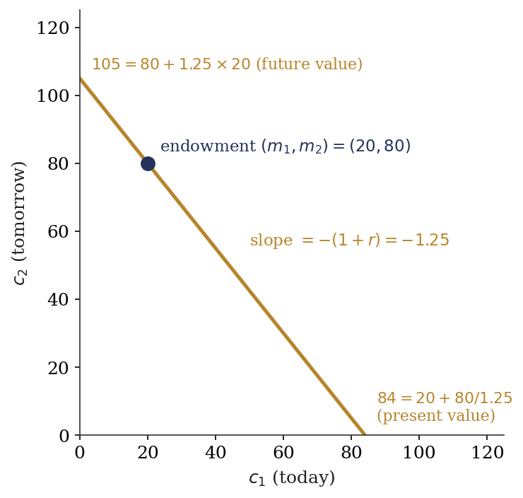
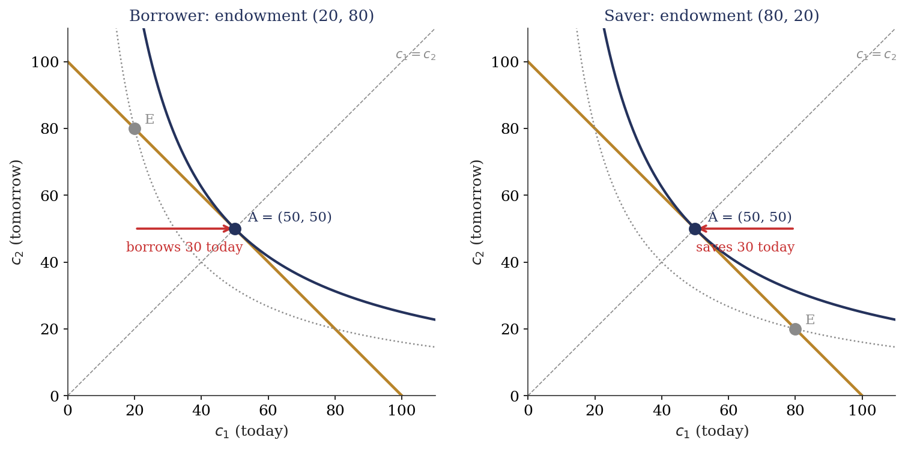
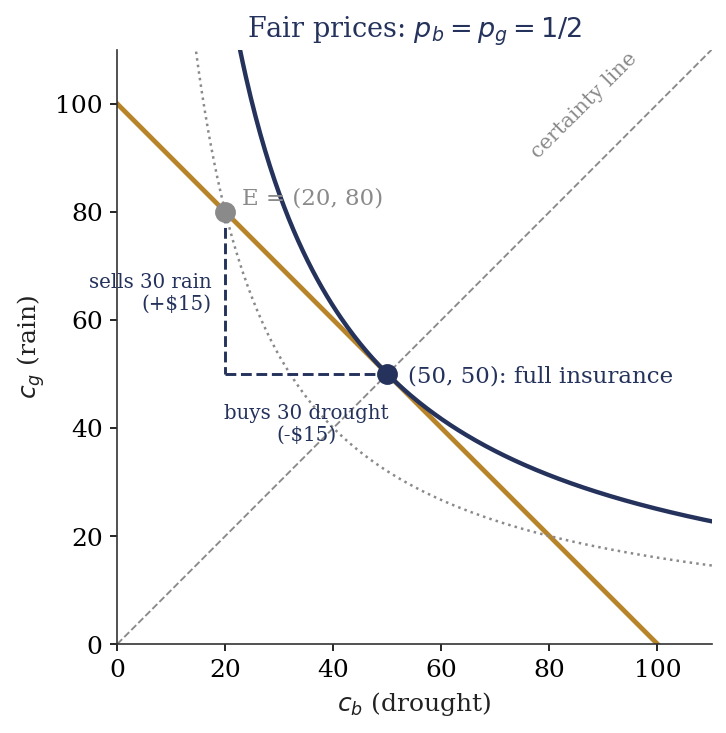
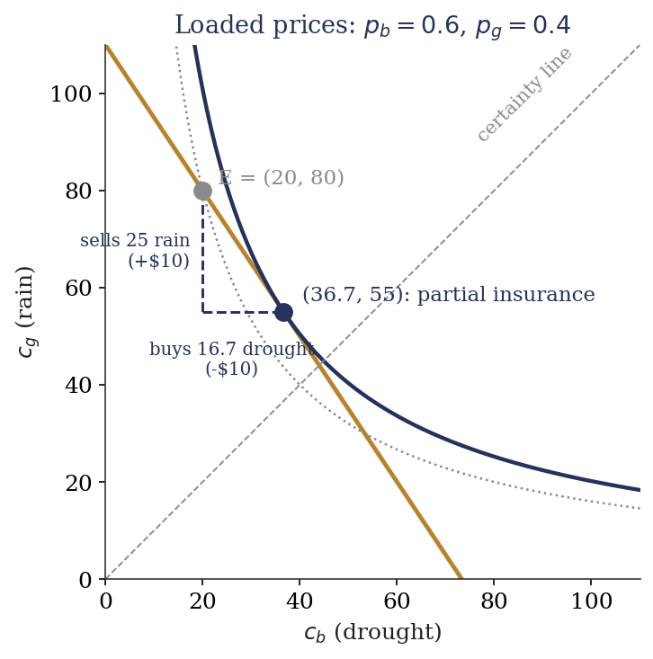
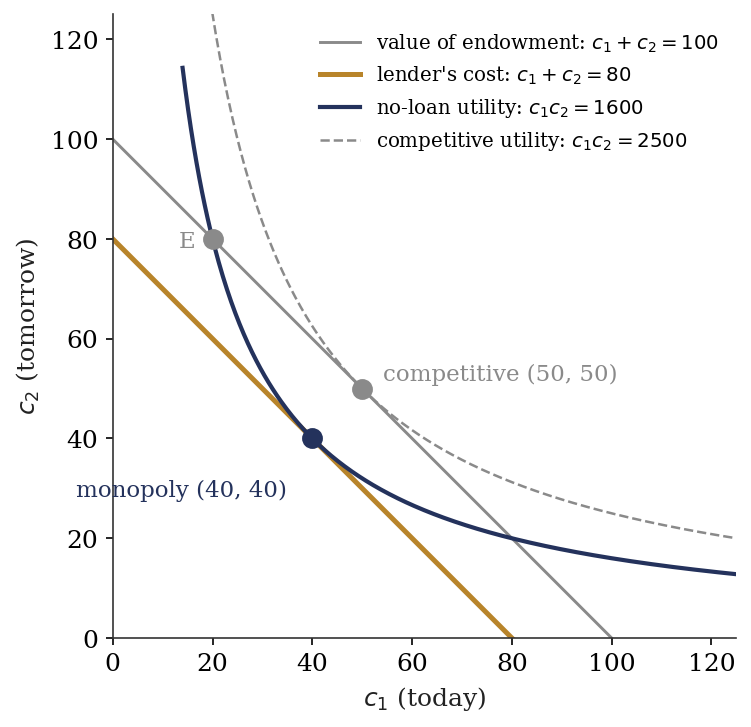
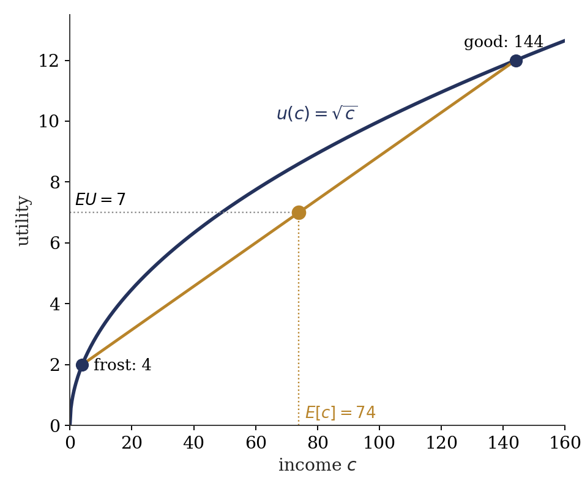
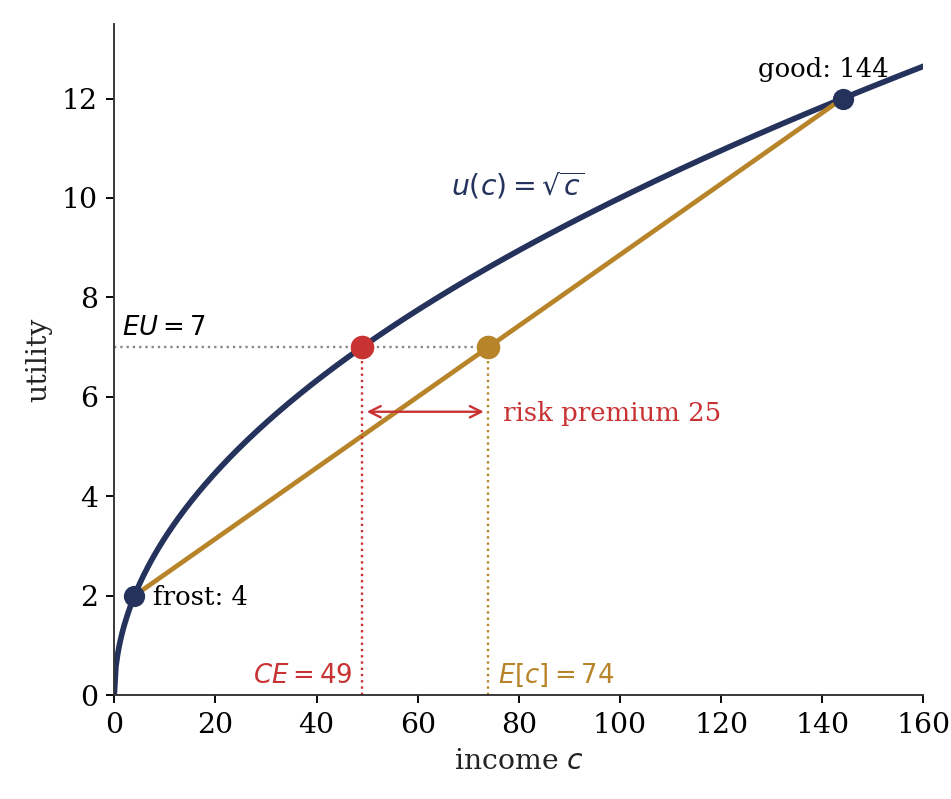
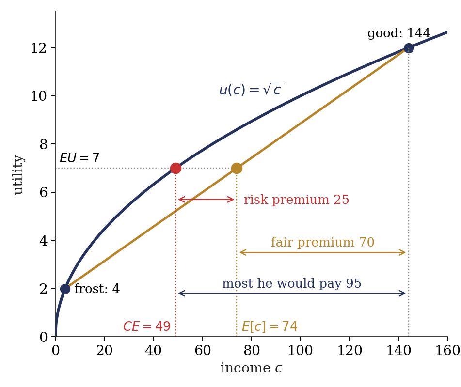
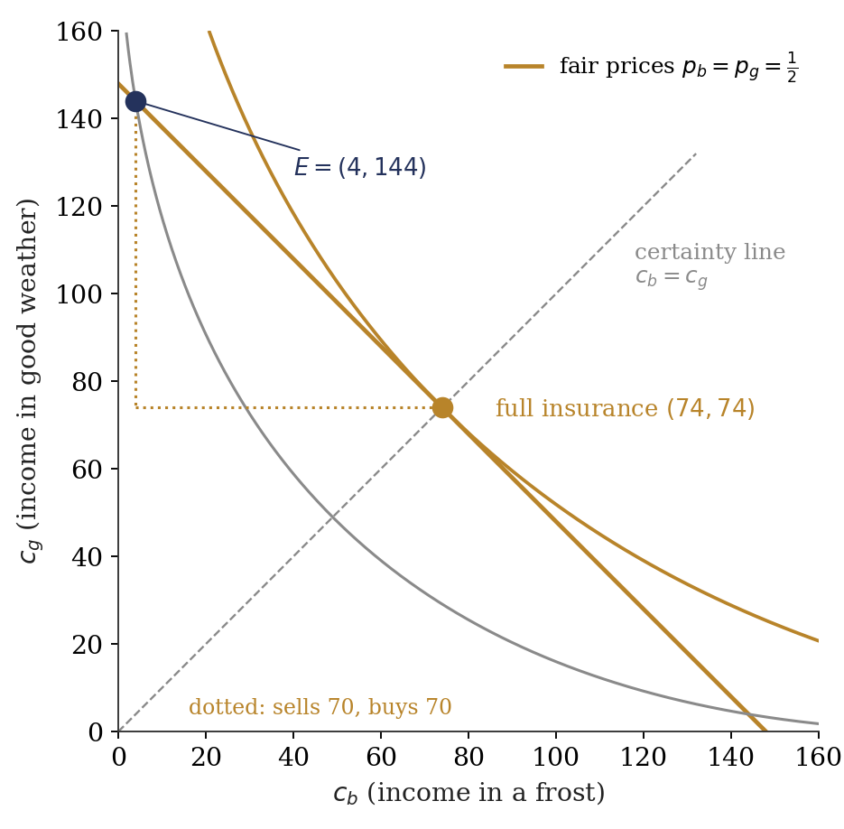
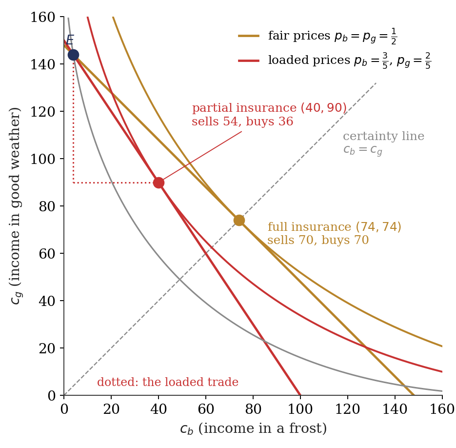

## From Topic 4 & the Midterm to Topic 5: A Dictionary {.compact}

<!-- Topic 5, built 2026-11-08 from slides/05_time-and-uncertainty/PLAN.md.
     One set of numbers throughout: log utility, delta = 1, pi = 1/2.
     Borrower endowment (20, 80), saver (80, 20). r = 0: both consume (50, 50).
     r = 25%: borrower (42, 52.5), saver (48, 60). No borrowing: mu = 0.0375.
     Uncertainty: harvest 20 in drought, 80 in rain; CE 40, premium 10.
     Monopoly lender / insurer at the end: (40, 40), profit 20 / 10.
     Figures: notebooks/topic05_time_uncertainty_figures.ipynb. -->

In Topic 4 (and Question 13 on the midterm), you maximized $U(c, \ell)$ starting from an **endowment** of 24 hours. Topic 5 solves that **exact same two-good problem**, changing only the labels:

| Topic 4: labor supply and the farm | Topic 5: choice over time |
|---|---|
| Leisure $\ell$ and consumption $c$ | Consumption today $c_1$ and tomorrow $c_2$ |
| Wage $w$: the price of an hour of leisure | $1 + r$: the price of $c_1$ in units of $c_2$ (or $p_2 = \tfrac{1}{1+r}$) |
| Endowment: 24 hours (and unearned income $Y$) | Endowment: income $m_1$ today and $m_2$ tomorrow |
| Full income $24w + Y$ | Wealth $W = m_1 + m_2/(1+r)$ |
| **Net seller** (works $24 - \ell > 0$) vs. **net buyer** | **Saver** (lends $m_1 - c_1 > 0$) vs. **Borrower** (borrows $c_1 - m_1 > 0$) |
| A wage rise makes a worker **richer** | An interest rate rise makes a saver **richer**, a borrower **poorer** |
| Farm maximizes profit first, then family consumes | Invest until $f'(k) = 1 + r$ first, then borrow or lend (Fisher) |

: {tbl-colwidths="[48,52]"}

::: {.fragment}
> **Same model, new labels.** Every time a price moves, the budget line rotates around the endowment. Ask two questions: what is the **substitution effect**, and **which side of the market (buyer or seller) is she on?**
:::

---

## Optimization: From Goods to Dates and States {.compact}

Topic 4 solved the consumer's problem for two goods. Here we call them $c_1$ and $c_2$ instead of $x$ and $y$. Topic 5 solves **the same problem** twice more, changing only what the goods are.

| | Topic 4: two goods | Part I: two dates | Part II: two states |
|---|---|---|---|
| Goods | $c_1$, $c_2$ | <span style="color:#bbb">?</span> | <span style="color:#bbb">?</span> |
| Utility | $u(c_1, c_2)$ | <span style="color:#bbb">?</span> | <span style="color:#bbb">?</span> |
| Prices | $p_1$, $p_2$ | <span style="color:#bbb">?</span> | <span style="color:#bbb">?</span> |
| Budget | $p_1 c_1 + p_2 c_2 = I$ | <span style="color:#bbb">?</span> | <span style="color:#bbb">?</span> |
| Tangency | $MRS = p_1/p_2$ | <span style="color:#bbb">?</span> | <span style="color:#bbb">?</span> |

: {tbl-colwidths="[16,28,28,28]"}

::: {.fragment}
> We will fill in the empty columns step by step. The method does not change: a Lagrangian, a tangency, a budget line. What changes is **what the goods are** and **what the prices mean**. In Topic 5 the goods we trade are **promises**: claims on consumption at another date or in another state of the world.
:::

---

## Three Questions {.compact}

| | Question | What you will take away |
|---|---|---|
| **NS 17** | **How does a household spread consumption over time?** | It borrows or saves to **smooth** consumption. The interest rate is a relative price. |
| **NS 7** | **How does it deal with risk?** | Expected utility. With fair insurance it **smooths across states of the world**, exactly as it smooths over time. |
| **NS 7, 13** | **What can markets and neighbors do?** | Credit markets, insurance markets and risk-sharing networks all move consumption from where it is plentiful to where it is scarce. |

: {tbl-colwidths="[12,38,50]"}

::: {.fragment}
Consumption smoothing is a **financial contracting** problem: the household buys and sells claims on future income. First with **competitive** lenders and insurers; later we **turn it around** (Topic 4's dual) and a **monopoly** intermediary designs the contract.
:::

---

## Finance: Pricing and Trading Promises {.compact}

**Finance is the market for promises.** Every financial contract is a promise to deliver consumption at particular date(s), and/or in different states of the world (e.g. when it rains, or when there is a drought).

| Contract | The promise | Its price today |
|---|---|---|
| **Bond** (a loan, seen from the lender) | pay \$1 tomorrow, whatever the weather | $p_2 = \dfrac{1}{1+r}$ |
| **Contingent claim** (insurance) | pay \$1 tomorrow **if** there is a drought | $p_{2b}$ |
| **A risky asset** (a farm, a share) | a bundle: 20 if drought, 80 if rain | $20\,p_{2b} + 80\,p_{2g}$ |

: {tbl-colwidths="[30,42,28]"}

<p style="font-size: 0.75em; color: #666;">$p_{ts}$: today's price of \$1 at date $t$ in state $s$, with $s = b$ (bad: drought) or $g$ (good: rain). Part I has no risk, so we drop $s$; Part II has one future date, so we drop $t$.</p>

::: {.incremental}
- **Borrowing is selling a promise; saving is buying one.**<br> Buying insurance is buying a promise that pays when times are bad.
- **Optimal consumption smoothing:** Equate marginal utility per dollar across time and/or states of nature. From a tangency between today and tomorrow, or between drought and rain.
- **Two key questions:** what is a promise worth (its **price**)? Will it be kept (**enforcement**)? The standard model assumes perfect, costless enforcement. Credit constraints and village risk sharing show what happens without it.
:::

---

## Part I: Choice over Time {.divider}

Trading promises across time — NS Chapter 17

---

## Goods Dated by Time {.compact}

::: {.incremental}
- **An apple today and an apple tomorrow are different goods.** Call them $c_1$ and $c_2$. Everything from Topic 4 applies: indifference curves, an $MRS$, a budget line.
- **Two different reasons the future counts for less:**
  - **Impatience (a preference).** The household weighs tomorrow's utility by a **discount factor** $\delta \le 1$: $\;U = u(c_1) + \delta\, u(c_2)$. This is **exponential discounting**: in a third period the weight would be $\delta^2$, and so on.
  - **The time value of money (a price).** A dollar tomorrow costs less than a dollar today (next slide).
- Keep the two apart: $\delta$ belongs in the **utility function**, $r$ belongs in the **budget**. The optimum compares them.
- **$u$ itself is concave** (diminishing marginal utility within each period). That is what makes the household want to smooth.
:::

<p style="font-size: 0.8em; color: #666;">Text: NS Chapter 17, "Capital and Time".</p>

---

## The Time Value of Money {.compact}

::: {.incremental}
- **A dollar saved today grows** to $\$1 \times (1+r)$ next year.
- **How much would you pay today for \$1 next year?** Call it $x$. Saved, $x$ must grow to exactly \$1:
  $$x\,(1+r) = 1 \quad\Longrightarrow\quad x = \frac{1}{1+r}$$
- **Example, $r = 0.10$:** \$1 next year is worth $\frac{1}{1.1} \approx \$0.91$ today. \$110 next year is worth \$100 today.
- **That $x$ is a price:** the price today of a promise to pay \$1 tomorrow, $\;p_2 = \frac{1}{1+r}$. **Discounting** converts future dollars into today's dollars.
:::

---

## The Intertemporal Budget Constraint {.compact}

:::: {.columns}
::: {.column width="52%"}
Income $m_1$ today and $m_2$ tomorrow. She can save $s$ at interest rate $r$ (or borrow, $s < 0$). **Period-by-period budget constraints**, one for each date:

$$c_1 + s = m_1 \qquad\qquad c_2 = m_2 + (1+r)\,s$$

Eliminate $s$: the **intertemporal budget constraint**:
$$c_1 + \frac{c_2}{1+r} = m_1 + \frac{m_2}{1+r}$$

::: {.incremental}
- **In Topic 4's form,** with prices $p_1 = 1$ and $p_2 = \tfrac{1}{1+r}$:
  $$p_1 c_1 + p_2 c_2 = p_1 m_1 + p_2 m_2$$
- $p_2$ is the price of a **bond**, a promise to pay \$1 tomorrow. Saving buys promises; borrowing sells them.
- The right side is her wealth $W$: the **present value** of her endowment, as in labor supply.
:::
:::

::: {.column width="48%"}
<div style="text-align: center;">
  
  <p style="font-size: 0.65em; color: #666;">Income (20, 80) at $r = 25\%$. The line always passes through the endowment. Text: NS Chapter 17.</p>
</div>
:::
::::

---

## Move the Intertemporal Budget Constraint {.compact}

:::: {.columns}
::: {.column width="38%"}
In Topic 4's form, with $p_1 = 1$ and $p_2 = \frac{1}{1+r}$:

$$c_1 + \frac{c_2}{1+r} = m_1 + \frac{m_2}{1+r} = W$$

- **Slope:** $-\dfrac{p_1}{p_2} = -(1+r)$
- **Horizontal intercept:** $c_1^{\max} = W$
- **Vertical intercept:** $c_2^{\max} = (1+r)\,W$

```{=html}
<div id="ibc-controls" style="font-size: 0.68em; margin-top: 0.6em;">
  <label style="display:flex;align-items:center;gap:0.6em;margin:0.4em 0;"><span style="width:2.2em;"><i>r</i></span><input type="range" id="ibc-r" min="0" max="1" step="0.05" value="0" style="flex:1;"><span id="ibc-r-v" style="width:3.2em;text-align:right;"></span></label>
  <label style="display:flex;align-items:center;gap:0.6em;margin:0.4em 0;"><span style="width:2.2em;"><i>m</i><sub>1</sub></span><input type="range" id="ibc-m1" min="0" max="100" step="5" value="20" style="flex:1;"><span id="ibc-m1-v" style="width:3.2em;text-align:right;"></span></label>
  <label style="display:flex;align-items:center;gap:0.6em;margin:0.4em 0;"><span style="width:2.2em;"><i>m</i><sub>2</sub></span><input type="range" id="ibc-m2" min="0" max="100" step="5" value="80" style="flex:1;"><span id="ibc-m2-v" style="width:3.2em;text-align:right;"></span></label>
</div>
```

<p style="font-size: 0.72em; color: #666; margin-top: 0.6em;">Dashed grey: the starting line, income $(20, 80)$ and $r = 0$.<br><i>Note on inflation:</i> If good prices rise at inflation rate $\pi_{\text{inf}}$ and the nominal rate is $i$, simply use the real interest rate $1 + r = \frac{1+i}{1+\pi_{\text{inf}}}$ (Fisher equation: $r \approx i - \pi_{\text{inf}}$).</p>
:::

::: {.column width="62%"}
```{=html}
<svg id="ibc-svg" viewBox="0 0 560 440" style="width: 100%; max-height: 440px; font-family: Arial, Helvetica, sans-serif;"></svg>
<div id="ibc-readout" style="font-size: 0.62em; color: #24325c; margin-top: 0.2em;"></div>
<script>
(function () {
  // Intertemporal budget line c1 + c2/(1+r) = m1 + m2/(1+r), drawn on [0,200]^2.
  var NS = "http://www.w3.org/2000/svg", svg = document.getElementById("ibc-svg");
  var L = 55, T = 12, S = 360 / 200;             // left margin, top margin, pixels per unit
  function X(v) { return L + v * S; }
  function Y(v) { return T + 360 - v * S; }
  function el(tag, attrs, parent) {
    var e = document.createElementNS(NS, tag);
    for (var k in attrs) e.setAttribute(k, attrs[k]);
    (parent || svg).appendChild(e);
    return e;
  }
  var clip = el("clipPath", {id: "ibc-clip"});
  el("rect", {x: L, y: T, width: 360, height: 360}, clip);
  for (var g = 0; g <= 200; g += 40) {
    el("line", {x1: X(g), y1: Y(0), x2: X(g), y2: Y(200), stroke: "#e5e9f0"});
    el("line", {x1: X(0), y1: Y(g), x2: X(200), y2: Y(g), stroke: "#e5e9f0"});
    el("text", {x: X(g), y: Y(0) + 20, "text-anchor": "middle", "font-size": 14, fill: "#24325c"}).textContent = g;
    el("text", {x: X(0) - 8, y: Y(g) + 5, "text-anchor": "end", "font-size": 14, fill: "#24325c"}).textContent = g;
  }
  el("line", {x1: X(0), y1: Y(0), x2: X(200), y2: Y(0), stroke: "#24325c", "stroke-width": 2});
  el("line", {x1: X(0), y1: Y(0), x2: X(0), y2: Y(200), stroke: "#24325c", "stroke-width": 2});
  el("text", {x: X(100), y: Y(0) + 44, "text-anchor": "middle", "font-size": 16, fill: "#24325c"}).textContent = "c\u2081 (today)";
  el("text", {x: 16, y: Y(100), "text-anchor": "middle", "font-size": 16, fill: "#24325c",
              transform: "rotate(-90 16 " + Y(100) + ")"}).textContent = "c\u2082 (tomorrow)";
  el("line", {x1: X(0), y1: Y(100), x2: X(100), y2: Y(0), stroke: "#8a8a8a", "stroke-width": 1.5, "stroke-dasharray": "6,5"});
  var line = el("line", {stroke: "#b8842a", "stroke-width": 4, "clip-path": "url(#ibc-clip)"});
  var dot = el("circle", {r: 7, fill: "#24325c"});
  var lab = el("text", {"font-size": 15, fill: "#24325c"});
  lab.textContent = "endowment";
  var ids = ["r", "m1", "m2"];
  function val(id) { return parseFloat(document.getElementById("ibc-" + id).value); }
  function draw() {
    var r = val("r"), m1 = val("m1"), m2 = val("m2");
    var W = m1 + m2 / (1 + r), c1max = W, c2max = W * (1 + r);
    line.setAttribute("x1", X(0)); line.setAttribute("y1", Y(c2max));
    line.setAttribute("x2", X(c1max)); line.setAttribute("y2", Y(0));
    dot.setAttribute("cx", X(m1)); dot.setAttribute("cy", Y(m2));
    lab.setAttribute("x", X(m1) + 12); lab.setAttribute("y", Y(m2) - 8);
    ids.forEach(function (id) {
      var v = val(id);
      document.getElementById("ibc-" + id + "-v").textContent = id === "r" ? Math.round(v * 100) + "%" : v;
    });
    document.getElementById("ibc-readout").innerHTML =
      "<b>Wealth (<i>W</i>):</b> " + W.toFixed(1) + " today. <b>Intercepts:</b> " + c1max.toFixed(1) +
      " today, " + c2max.toFixed(1) + " tomorrow. <b>Slope:</b> \u2212" + (1 + r).toFixed(2) + " (<i>p</i>\u2082 = " + (1 / (1 + r)).toFixed(2) + ").";
  }
  ids.forEach(function (id) { document.getElementById("ibc-" + id).addEventListener("input", draw); });
  draw();
})();
</script>
```
:::
::::

<p style="font-size: 0.75em; color: #666;">Changing income $(m_1, m_2)$ shifts the line in parallel; changing the interest rate $r$ rotates the line around the endowment point $(m_1, m_2)$.</p>

---

## Using Financial Markets to Smooth Consumption {.compact}

:::: {.columns}
::: {.column width="38%"}
With log utility $\ln c_1 + \delta \ln c_2$ and wealth $W = m_1 + \frac{m_2}{1+r}$:

$$c_1^* = \frac{W}{1+\delta} \qquad c_2^* = \frac{\delta(1+r)\,W}{1+\delta}$$

```{=html}
<div style="font-size: 0.62em; margin-top: 0.4em;">
  <label style="display:flex;align-items:center;gap:0.6em;margin:0.25em 0;"><span style="width:2.2em;"><i>m</i><sub>1</sub></span><input type="range" id="bs-m1" min="0" max="100" step="5" value="20" style="flex:1;"><span id="bs-m1-v" style="width:3em;text-align:right;"></span></label>
  <label style="display:flex;align-items:center;gap:0.6em;margin:0.25em 0;"><span style="width:2.2em;"><i>m</i><sub>2</sub></span><input type="range" id="bs-m2" min="0" max="100" step="5" value="80" style="flex:1;"><span id="bs-m2-v" style="width:3em;text-align:right;"></span></label>
  <label style="display:flex;align-items:center;gap:0.6em;margin:0.25em 0;"><span style="width:2.2em;"><i>r</i></span><input type="range" id="bs-r" min="0" max="1" step="0.05" value="0" style="flex:1;"><span id="bs-r-v" style="width:3em;text-align:right;"></span></label>
  <label style="display:flex;align-items:center;gap:0.6em;margin:0.25em 0;"><span style="width:2.2em;">&delta;</span><input type="range" id="bs-d" min="0.5" max="1.5" step="0.05" value="1" style="flex:1;"><span id="bs-d-v" style="width:3em;text-align:right;"></span></label>
  <div style="margin-top:0.5em;display:flex;gap:0.6em;">
    <button id="bs-borrower" style="font-size:1em;padding:0.15em 0.6em;">Borrower (20, 80)</button>
    <button id="bs-saver" style="font-size:1em;padding:0.15em 0.6em;">Saver (80, 20)</button>
  </div>
</div>
```

<p style="font-size: 0.72em; color: #666; margin-top: 0.5em;">Dashed legs show how much she <b>borrows or saves today</b> ($|c_1^* - m_1|$) and <b>repays or collects tomorrow</b> ($|c_2^* - m_2|$). Dotted curve: autarky utility at the endowment.</p>
:::

::: {.column width="62%"}
```{=html}
<svg id="bs-svg" viewBox="0 0 560 440" style="width: 100%; max-height: 440px; font-family: Arial, Helvetica, sans-serif;"></svg>
<div id="bs-readout" style="font-size: 0.62em; color: #24325c; margin-top: 0.2em;"></div>
<script>
(function () {
  // Log utility ln c1 + delta ln c2 with budget c1 + c2/(1+r) = m1 + m2/(1+r), drawn on [0,200]^2.
  var NS = "http://www.w3.org/2000/svg", svg = document.getElementById("bs-svg");
  var L = 55, T = 12, S = 360 / 200;
  function X(v) { return L + v * S; }
  function Y(v) { return T + 360 - v * S; }
  function el(tag, attrs, parent) {
    var e = document.createElementNS(NS, tag);
    for (var k in attrs) e.setAttribute(k, attrs[k]);
    (parent || svg).appendChild(e);
    return e;
  }
  var clip = el("clipPath", {id: "bs-clip"});
  el("rect", {x: L, y: T, width: 360, height: 360}, clip);
  for (var g = 0; g <= 200; g += 40) {
    el("line", {x1: X(g), y1: Y(0), x2: X(g), y2: Y(200), stroke: "#e5e9f0"});
    el("line", {x1: X(0), y1: Y(g), x2: X(200), y2: Y(g), stroke: "#e5e9f0"});
    el("text", {x: X(g), y: Y(0) + 20, "text-anchor": "middle", "font-size": 14, fill: "#24325c"}).textContent = g;
    el("text", {x: X(0) - 8, y: Y(g) + 5, "text-anchor": "end", "font-size": 14, fill: "#24325c"}).textContent = g;
  }
  el("line", {x1: X(0), y1: Y(0), x2: X(200), y2: Y(0), stroke: "#24325c", "stroke-width": 2});
  el("line", {x1: X(0), y1: Y(0), x2: X(0), y2: Y(200), stroke: "#24325c", "stroke-width": 2});
  el("text", {x: X(100), y: Y(0) + 44, "text-anchor": "middle", "font-size": 16, fill: "#24325c"}).textContent = "c₁ (today)";
  el("text", {x: 16, y: Y(100), "text-anchor": "middle", "font-size": 16, fill: "#24325c",
              transform: "rotate(-90 16 " + Y(100) + ")"}).textContent = "c₂ (tomorrow)";
  el("line", {x1: X(0), y1: Y(0), x2: X(200), y2: Y(200), stroke: "#c9cfdb", "stroke-width": 1.5, "stroke-dasharray": "4,4"});
  var line = el("line", {stroke: "#b8842a", "stroke-width": 4, "clip-path": "url(#bs-clip)"});
  var icEndow = el("path", {fill: "none", stroke: "#8a99ad", "stroke-width": 1.8, "stroke-dasharray": "4,4", "clip-path": "url(#bs-clip)"});
  var ic = el("path", {fill: "none", stroke: "#3b6ea5", "stroke-width": 2.5, "clip-path": "url(#bs-clip)"});
  var hLeg = el("line", {stroke: "#24325c", "stroke-width": 2, "stroke-dasharray": "5,4"});
  var vLeg = el("line", {stroke: "#24325c", "stroke-width": 2, "stroke-dasharray": "5,4"});
  var hLab = el("text", {"font-size": 13, fill: "#24325c", "font-weight": "bold"});
  var vLab = el("text", {"font-size": 13, fill: "#24325c", "font-weight": "bold"});
  var endow = el("circle", {r: 7, fill: "#24325c"});
  var opt = el("circle", {r: 7, fill: "#3b6ea5"});
  var elab = el("text", {"font-size": 15, fill: "#24325c"}); elab.textContent = "endowment";
  var olab = el("text", {"font-size": 15, fill: "#3b6ea5"}); olab.textContent = "optimum";
  var ids = ["m1", "m2", "r", "d"];
  function val(id) { return parseFloat(document.getElementById("bs-" + id).value); }
  function draw() {
    var m1 = val("m1"), m2 = val("m2"), r = val("r"), d = val("d");
    var W = m1 + m2 / (1 + r), c1 = W / (1 + d), c2 = d * (1 + r) * W / (1 + d);
    line.setAttribute("x1", X(0)); line.setAttribute("y1", Y(W * (1 + r)));
    line.setAttribute("x2", X(W)); line.setAttribute("y2", Y(0));
    var pts = [], ptsE = [];
    for (var x = 2; x <= 200; x += 2) {
      var y = c2 * Math.pow(c1 / x, 1 / d);
      if (y <= 260) pts.push((pts.length ? "L" : "M") + X(x).toFixed(1) + "," + Y(y).toFixed(1));
      if (m1 > 0 && m2 > 0) {
        var yE = m2 * Math.pow(m1 / x, 1 / d);
        if (yE <= 260) ptsE.push((ptsE.length ? "L" : "M") + X(x).toFixed(1) + "," + Y(yE).toFixed(1));
      }
    }
    ic.setAttribute("d", pts.join(""));
    icEndow.setAttribute("d", ptsE.join(""));
    endow.setAttribute("cx", X(m1)); endow.setAttribute("cy", Y(m2));
    opt.setAttribute("cx", X(c1)); opt.setAttribute("cy", Y(c2));
    // Horizontal leg: (m1, m2) -> (c1, m2); Vertical leg: (c1, m2) -> (c1, c2)
    hLeg.setAttribute("x1", X(m1)); hLeg.setAttribute("y1", Y(m2));
    hLeg.setAttribute("x2", X(c1)); hLeg.setAttribute("y2", Y(m2));
    vLeg.setAttribute("x1", X(c1)); vLeg.setAttribute("y1", Y(m2));
    vLeg.setAttribute("x2", X(c1)); vLeg.setAttribute("y2", Y(c2));
    elab.setAttribute("x", X(m1) + (c1 >= m1 ? -10 : 12)); elab.setAttribute("y", Y(m2) - 10);
    elab.setAttribute("text-anchor", c1 >= m1 ? "end" : "start");
    olab.setAttribute("x", X(c1) + (c1 >= m1 ? 10 : -10)); olab.setAttribute("y", Y(c2) + 18);
    olab.setAttribute("text-anchor", c1 >= m1 ? "start" : "end");
    var b = c1 - m1, diff2 = Math.abs(c2 - m2);
    if (Math.abs(b) > 0.5) {
      hLab.setAttribute("x", X((m1 + c1) / 2));
      hLab.setAttribute("y", Y(m2) - 6);
      hLab.setAttribute("text-anchor", "middle");
      hLab.textContent = (b > 0 ? "borrows " : "saves ") + Math.abs(b).toFixed(0);
      vLab.setAttribute("x", X(c1) + (b > 0 ? 8 : -8));
      vLab.setAttribute("y", Y((m2 + c2) / 2) + 4);
      vLab.setAttribute("text-anchor", b > 0 ? "start" : "end");
      vLab.textContent = (b > 0 ? "repays " : "collects ") + diff2.toFixed(0);
    } else {
      hLab.textContent = ""; vLab.textContent = "";
    }
    ids.forEach(function (id) {
      var v = val(id);
      document.getElementById("bs-" + id + "-v").textContent = id === "r" ? Math.round(v * 100) + "%" : v;
    });
    var msg;
    if (b > 0.05) msg = "<b>Borrows</b> " + b.toFixed(1) + " today: sells a promise to repay " + (b * (1 + r)).toFixed(1) + " tomorrow.";
    else if (b < -0.05) msg = "<b>Saves</b> " + (-b).toFixed(1) + " today: buys a promise to collect " + (-b * (1 + r)).toFixed(1) + " tomorrow.";
    else msg = "Neither borrows nor saves.";
    document.getElementById("bs-readout").innerHTML =
      "<b>Wealth</b> " + W.toFixed(1) + ". <b>Optimum</b> (" + c1.toFixed(1) + ", " + c2.toFixed(1) + "). " + msg;
  }
  function preset(a, b) {
    document.getElementById("bs-m1").value = a; document.getElementById("bs-m2").value = b;
    document.getElementById("bs-r").value = 0; document.getElementById("bs-d").value = 1;
    draw();
  }
  ids.forEach(function (id) { document.getElementById("bs-" + id).addEventListener("input", draw); });
  document.getElementById("bs-borrower").addEventListener("click", function () { preset(20, 80); });
  document.getElementById("bs-saver").addEventListener("click", function () { preset(80, 20); });
  draw();
})();
</script>
```
:::
::::

<p style="font-size: 0.75em; color: #666;">Moving income along the budget line changes only <b>whether</b> she borrows or saves, never what she consumes. The optimum depends on wealth, patience ($\delta$) and the interest rate ($r$).</p>

---

## The Euler Equation {.compact}

$$\mathcal{L} = u(c_1) + \delta\, u(c_2) + \lambda\,\big[\,p_1 m_1 + p_2 m_2 - p_1 c_1 - p_2 c_2\,\big]$$

::: {.incremental}
- **First-order conditions:** $\;u'(c_1) = \lambda\, p_1 = \lambda \qquad \delta\, u'(c_2) = \lambda\, p_2 = \dfrac{\lambda}{1+r}$
- **Divide:** $\;MRS = \dfrac{u'(c_1)}{\delta\, u'(c_2)} = \dfrac{p_1}{p_2} = 1 + r$. The tangency from Topic 4, nothing more.
:::

::: {.fragment}
<div style="border: 2px solid #24325c; background: #f5f7fb; border-radius: 8px; padding: 0.45em 1em; margin: 0.4em auto; width: 88%; text-align: center;">
<span style="font-size: 0.85em; font-weight: 700; color: #24325c; letter-spacing: 0.02em;">THE EULER EQUATION</span>
$$u'(c_1) = \delta\,(1+r)\,u'(c_2)$$
<span style="font-size: 0.8em;">Giving up \$1 today costs $u'(c_1)$; saved, it buys $1+r$ dollars tomorrow, worth $\delta(1+r)u'(c_2)$ today.<br> At the optimum, the two are equal.</span>
</div>
:::

::: {.incremental}
- **The multiplier:** $\lambda = u'(c_1)$, the marginal utility of a dollar of wealth (Topic 2's shadow price).
- **Benchmark:** if $\delta(1+r) = 1$, then $u'(c_1) = u'(c_2)$, so $c_1 = c_2$.<br> **Perfect smoothing**, whatever the timing of income.
:::

---

## Log Utility Is Cobb-Douglas {.compact}

:::: {.columns}
::: {.column width="54%"}
Take $u(c) = \ln c$. Then
$$U = \ln c_1 + \delta \ln c_2 = \ln\big(c_1\, c_2^{\,\delta}\big)$$
is a monotone transformation of Cobb-Douglas $c_1^{\alpha} c_2^{\beta}$ with $\alpha = 1, \beta = \delta$. Using **CD Formula** ($c_1 = \frac{\alpha}{\alpha+\beta}\frac{W}{p_1}$):

::: {.incremental}
$$c_1 = \dfrac{1}{1+\delta}\cdot\dfrac{W}{p_1} \qquad c_2 = \dfrac{\delta}{1+\delta}\cdot\dfrac{W}{p_2} = \dfrac{\delta}{1+\delta}\,(1+r)\,W$$
- With $\delta = 1$, she always spends **half her wealth $W$ on each period**.
- **Consumption growth:** $\;\dfrac{c_2}{c_1} = \delta(1+r)$. Depends on patience and $r$, **never** on when income arrives.
:::
:::

::: {.column width="46%"}
::: {.callout-note icon=false}
### Step-by-Step with Our Numbers ($\delta = 1$, borrower $(20, 80)$)
1. **At $r = 0$ ($p_1 = 1,\; p_2 = 1$):**
   - Wealth: $W = 20 + 80 = 100$
   - Spend $\tfrac12 W$ on each: $c_1^* = \frac{50}{1} = \mathbf{50}$, $\;c_2^* = \frac{50}{1} = \mathbf{50}$
2. **At $r = 25\%$ ($p_1 = 1,\; p_2 = \frac{1}{1.25} = 0.8$):**
   - Wealth: $W = 1(20) + 0.8(80) = 20 + 64 = \mathbf{84}$
   - Spend $\tfrac12 W = 42$ on each good:
     $$c_1^* = \frac{42}{1} = \mathbf{42}, \qquad c_2^* = \frac{42}{0.8} = \mathbf{52.5}$$
:::
:::
::::

---

## A Borrower and a Saver {.compact}

Same preferences, same interest rate ($r = 0$), same wealth (100). Different **timing** of income.

:::: {.columns}
::: {.column width="64%"}
<div style="text-align: center;">
  
</div>
:::

::: {.column width="36%"}
::: {.incremental}
- **Borrower,** income (20, 80): a student, or a farmer before harvest. Borrows 30 today: she **sells a promise** to repay 30 tomorrow.
- **Saver,** income (80, 20): a worker before retirement. Saves 30 today: she **buys that promise** and collects tomorrow.
- **Both end at (50, 50).** Without a credit market each would be stuck at its endowment, on the dotted indifference curve.
:::
:::
::::

---

## Borrower Meets Saver {.compact}

:::: {.columns}
::: {.column width="50%"}
Put the two households in one market. For each interest rate, ask how much the borrower wants to borrow and how much the saver wants to lend.

::: {.incremental}
- **Demand for loans** (borrower): $c_1 - 20$. It falls as $r$ rises.
- **Supply of loans** (saver): $80 - c_1$. It rises a little with $r$ (her two effects nearly cancel).
- **At $r = 0$** the borrower wants 30 and the saver offers 30. **The credit market clears.**
- **At $r = 25\%$** (next slide) the borrower wants only 22 and the saver offers 32. Too much saving: the interest rate falls.
- **The interest rate is a price:** the price of a promise of \$1 tomorrow is $p_2 = 1/(1+r)$. It adjusts until the promises the borrower sells equal the promises the saver buys. Here, with equal patience and the same total income (100) in both periods, $r = 0$ and $p_2 = 1$.
:::
:::

::: {.column width="50%"}
<div style="text-align: center;">
  
  <p style="font-size: 0.65em; color: #666;">Each curve comes from the household's own utility maximization. Topic 7 draws the same market as an Edgeworth box.</p>
</div>
:::
::::

---

## The Interest Rate Rises: Borrower vs Saver {.compact}

:::: {.columns}
::: {.column width="40%"}
$r$ rises from 0 to 25%. Each budget line **rotates around its own endowment**.

::: {.incremental}
- **Substitution effect:** consumption today is dearer for both. Both cut $c_1$.
- **Income effect, borrower:** she buys $c_1$ (borrows 30), and its price rose: the same loan now costs 37.5 tomorrow, not 30. Poorer, so she cuts $c_1$ further: **50 → 42**. Worse off.
- **Income effect, saver:** she sells $c_1$ (lends 30): the same loan now pays 37.5 tomorrow, not 30. Richer, which pulls against substitution: **50 → 48**. Better off.
- **Just like a wage rise** in labor supply: who gains depends on which side of the market you are on.
:::
:::

::: {.column width="60%"}
<div style="text-align: center;">
  
  <p style="font-size: 0.65em; color: #666;">Grey: $r = 0$. Amber: $r = 25\%$. Borrower to (42, 52.5); saver to (48, 60). Text: NS Chapter 17.</p>
</div>
:::
::::

---

## Temporary vs Permanent Income {.compact}

The borrower again, $r = 0$, income (20, 80), consuming (50, 50). She gets 10 more income. How much more does she consume today? It depends on **when the rise comes and how long it lasts**:

| Change | Income | Wealth $W$ | $(c_1, c_2)$ | Rise in $c_1$ |
|---|---|---|---|---|
| **Temporary:** +10 today only | (30, 80) | 110 | (55, 55) | +5: spends **half** |
| **Permanent:** +10 every period | (30, 90) | 120 | (60, 60) | +10: spends **all** |
| **News:** +10 tomorrow only | (20, 90) | 110 | (55, 55) | +5, with no change today: she **borrows** |

: {tbl-colwidths="[30,13,13,13,31]"}

::: {.incremental}
- Consumption depends on **wealth**, the present value of income. A change in today's income matters only through what it adds to wealth, and a lasting change adds more.
- So the share of extra income spent today is small for a temporary change and large for a permanent one: Friedman's **permanent income hypothesis**. A one-time tax rebate should raise spending less than a permanent tax cut.
- The news row needs a **credit market**: to spend future income today, she must borrow against it. Without one, today's income matters directly (next slide).
:::

---

## When She Cannot Borrow: A Kuhn-Tucker Corner {.compact}

:::: {.columns}
::: {.column width="52%"}
Add a **borrowing constraint** $c_1 \le m_1 = 20$ (Topic 2's inequality constraints):

$$\mathcal{L} = \ln c_1 + \ln c_2 + \lambda\,[100 - c_1 - c_2] + \mu\,[20 - c_1]$$

::: {.incremental}
- **The constraint binds:** she is stuck at the corner $E = (20, 80)$, so $\mu > 0$.
- **The Euler condition fails (Euler inequality):**
  $$u'(c_1) > \delta\,(1+r)\,u'(c_2) \quad\Longleftrightarrow\quad MRS = \frac{u'(c_1)}{\delta\,u'(c_2)} > 1+r$$
  At $E$, $MRS = \tfrac{1/20}{1/80} = 4 > 1$: she would repay up to \$4 tomorrow for \$1 today, so she wants to borrow but cannot.
- **Why can't she borrow?** Her **promise** to repay is not believed or cannot be enforced: no collateral, no credit history, weak courts. A credit constraint is a limit on the promises she can sell.
:::
:::

::: {.column width="48%"}
<div style="text-align: center;">
  
  <p style="font-size: 0.65em; color: #666;">The feasible set is shaded. The saver is unaffected: the constraint never binds for her.</p>
</div>
:::
::::

---

## Investment, and Separation Once More {.compact}

Suppose the household can also **invest** $k$ today in a project (a well, fertilizer, schooling) that pays $f(k)$ tomorrow.

::: {.incremental}
- **With a credit market (Fisher separation):** Any increase in wealth $W$ shifts the budget line out, so she chooses $k$ to **maximize wealth (NPV)**:
  $$\max_k\; W(k) = (m_1 - k) + \frac{m_2 + f(k)}{1+r} \quad\xrightarrow{\text{FOC: } W'(k)=0}\quad -1 + \frac{f'(k)}{1+r} = 0 \;\implies\; \mathbf{f'(k^*) = 1+r}$$
  Invest until the marginal return $f'(k)$ equals the market rate $1+r$. **Preferences do not enter**—then borrow or save to smooth consumption. (Same two-step logic as the farm in Topic 4.)
- **Without a credit market (autarky):** Investment must come out of today's consumption: $c_1 = m_1 - k$ and $c_2 = m_2 + f(k)$. Maximizing $u(m_1 - k) + \delta\,u(m_2 + f(k))$ gives FOC:
  $$-u'(c_1) + \delta\,u'(c_2)\,f'(k) = 0 \quad\implies\quad \mathbf{f'(k) = \frac{u'(c_1)}{\delta\,u'(c_2)} = MRS}$$
- **Separation fails when markets fail:** A poor or impatient household (high $MRS > 1+r$) **invests less**, not because it is worse at farming, but because it cannot borrow. *(Topic 6 next week.)*
:::

<p style="font-size: 0.8em; color: #666;">Text: NS Chapter 17 (investment and the rate of return).</p>

---

## Part I in the Table {.compact}

| | Topic 4: two goods | Part I: two dates | Part II: two states |
|---|---|---|---|
| Goods | $c_1$, $c_2$ | $c_1$ today, $c_2$ tomorrow | <span style="color:#bbb">?</span> |
| Utility | $u(c_1, c_2)$ | $u(c_1) + \delta\, u(c_2)$ | <span style="color:#bbb">?</span> |
| Prices | $p_1$, $p_2$ | $p_1 = 1$, $\;p_2 = \tfrac{1}{1+r}$ | <span style="color:#bbb">?</span> |
| Budget | $p_1 c_1 + p_2 c_2 = I$ | $p_1 c_1 + p_2 c_2 = p_1 m_1 + p_2 m_2$ | <span style="color:#bbb">?</span> |
| Tangency | $MRS = p_1/p_2$ | $\dfrac{u'(c_1)}{\delta\, u'(c_2)} = 1 + r$ | <span style="color:#bbb">?</span> |
| Benchmark | | $\delta(1+r) = 1 \Rightarrow c_1 = c_2$ | <span style="color:#bbb">?</span> |

: {tbl-colwidths="[16,24,32,28]"}

::: {.fragment}
> Two discount factors, in two rows: $\delta$ is a **preference** (utility row), $\tfrac{1}{1+r}$ is a **price**, the price of a promise to pay \$1 tomorrow (prices row).
:::

---

## Part II: Choice under Risk {.divider}

Trading promises across states of the world — NS Chapter 7, "Uncertainty"

---

## Risk: Same Average, Different Spread {.compact}

::: {.incremental}
- **A coin toss.** Gamble 1 pays \$490 or \$510. Gamble 2 pays \$0 or \$1,000. Each has an **expected value** of \$500: $\;EV = \pi\, x_1 + (1-\pi)\, x_2$.
- Most people prefer gamble 1. They are **risk averse**: they care about the spread, not only the average.
- A **fair game** is one that costs its expected value. Paying \$500 to play gamble 2 is fair, and most people refuse.
- **Our farmer:** the harvest is worth 20 in a drought and 80 if it rains, each with probability $\tfrac12$. Expected value 50.
- The question for this part: what is that risky harvest worth to her, and what will she pay to get rid of the risk?
- **Risk or uncertainty?** Knight (1921): **risk** has known odds (a coin); **uncertainty** has unknown odds (a changing climate). Strictly, this part is about risk. Read the probabilities as the farmer's own **beliefs** and it covers more.
:::

<p style="font-size: 0.8em; color: #666;">Text: NS Chapter 7, "Expected Value" and "Fair Games". Knight, <i>Risk, Uncertainty and Profit</i>, 1921.</p>

---

## Expected Utility {.compact}

:::: {.columns}
::: {.column width="48%"}
She cares about the **utility** each outcome brings, weighted by its probability:

$$EU = \pi_b\, u(c_b) + \pi_g\, u(c_g)$$

($b$ = bad state, drought; $g$ = good state, rain).

::: {.incremental}
- **Concave $u$ means risk aversion:** the utility of the average exceeds the average of the utilities, $\;u(50) > EU$.
- **Our farmer,** $u = \ln c$: $\;EU = \tfrac12 \ln 20 + \tfrac12 \ln 80 = \ln 40$.
- **Certainty equivalent:** a sure 40 gives the same utility. So the risky harvest, with $EV = 50$, is worth only 40 to her.
- **Risk premium** $= 50 - 40 = 10$: the most she would pay, above the fair price, to remove the risk.
:::
:::

::: {.column width="52%"}
<div style="text-align: center;">
  
  <p style="font-size: 0.65em; color: #666;">The chord lies below the curve: averaging outcomes is worth more than averaging utilities. Text: NS Chapter 7, "Expected Utility" and "Risk Aversion".</p>
</div>
:::
::::

---

## Compare: Discounting and Probabilities {.compact}

| | Over time | Across states |
|---|---|---|
| Objective | $u(c_1) + \delta\, u(c_2)$ | $\pi_b\, u(c_b) + \pi_g\, u(c_g)$ |
| Weights on each period or state | $1$ and $\delta$ (patience) | $\pi_b$ and $\pi_g$ (beliefs) |
| Same $u$ in each period or state | yes: **time separable** | yes: **expected utility** |
| What concavity of $u$ makes her want | the same consumption each period | the same consumption in each state |

: {tbl-colwidths="[34,33,33]"}

::: {.incremental}
- **Both objectives are weighted sums of the same concave function.** The algebra is identical; only the meaning of the weights differs.
- With $\delta = 1$ and $\pi = \tfrac12$, the two objectives rank bundles identically: $\;\ln c_1 + \ln c_2$ and $\tfrac12 \ln c_b + \tfrac12 \ln c_g$.
- So **the farmer whose harvest is 20 or 80 faces the same problem as the borrower whose income is 20 today and 80 tomorrow.**
:::

---

## States of the World and Contingent Claims {.compact}

::: {.incremental}
- **A contingent claim** is a **conditional promise**: it pays \$1 only if a given state occurs, "\$1 if drought" or "\$1 if rain" (Arrow's idea).
- **Any risky asset is a bundle of claims.** The farmer's harvest is 20 drought claims plus 80 rain claims: the endowment $(m_b, m_g) = (20, 80)$. A bond is one of each, so $p_2 = p_{2b} + p_{2g}$.
- **Insurance is trade in promises:** she sells some of her rain claims and buys drought claims. The premium is what she gives up when it rains; the payout is what she gets in a drought.
- **Prices** $p_b$ and $p_g$ (short for $p_{2b}$, $p_{2g}$). Her budget is Topic 4's, with an endowment:
  $$p_b\, c_b + p_g\, c_g = p_b\, m_b + p_g\, m_g$$
- **Fair prices.** If insurers compete and agree on the odds, a claim costs its probability: $p_b = \pi_b$, $p_g = \pi_g$ (with $r = 0$; in general $\pi_s/(1+r)$, which sum to the bond price). Then the right side is the expected value of the harvest, 50.
:::

<p style="font-size: 0.8em; color: #666;">Text: NS Chapter 7, "The State-Preference Approach to Choice under Uncertainty".</p>

---

## The Three Lagrangians, Side by Side {.compact}

Now that we have both objectives and budgets, notice that Topic 5 adds **no new mathematics**—it simply re-labels the two goods in Topic 4's problem:

$$\begin{aligned}
\text{Topic 4 (Goods):} \quad \mathcal{L} &= u(x,y) + \lambda\,\big[\,I - p_x x - p_y y\,\big] \\
\text{Part I (Dates):} \quad \mathcal{L} &= u(c_1) + \delta\,u(c_2) + \lambda\,\big[\,p_1 m_1 + p_2 m_2 - p_1 c_1 - p_2 c_2\,\big] \\
\text{Part II (States):} \quad \mathcal{L} &= \pi_b\,u(c_b) + \pi_g\,u(c_g) + \lambda\,\big[\,p_b m_b + p_g m_g - p_b c_b - p_g c_g\,\big]
\end{aligned}$$

::: {.incremental}
- **First-Order Conditions (Marginal Utility = Shadow Price $\times$ Price):**
  - Goods: $u_x = \lambda p_x \quad\text{and}\quad u_y = \lambda p_y$
  - Dates: $u'(c_1) = \lambda p_1 \quad\text{and}\quad \delta u'(c_2) = \lambda p_2 = \dfrac{\lambda}{1+r}$
  - States: $\pi_b u'(c_b) = \lambda p_b \quad\text{and}\quad \pi_g u'(c_g) = \lambda p_g$
- **Ratios eliminate $\lambda$ to yield the tangency condition ($MRS = \text{Price Ratio}$):**
  $$\frac{u_x}{u_y} = \frac{p_x}{p_y} \qquad\qquad \frac{u'(c_1)}{\delta u'(c_2)} = \frac{p_1}{p_2} = 1+r \qquad\qquad \frac{\pi_b u'(c_b)}{\pi_g u'(c_g)} = \frac{p_b}{p_g}$$
- In each problem, $\lambda$ is Topic 2's shadow price: **the marginal utility of a dollar of wealth**.
:::

---

## State-Space Indifference Curves and Tangency {.compact}

::: {.incremental}
- **Probabilities shape the indifference curves:** Along an indifference curve $EU = \pi_b\, u(c_b) + \pi_g\, u(c_g) = \bar{U}$, totally differentiating $d(EU) = 0$ gives:
  $$\pi_b\, u'(c_b)\,dc_b + \pi_g\, u'(c_g)\,dc_g = 0 \quad\Longrightarrow\quad MRS_{c_b, c_g} = -\left.\frac{dc_g}{dc_b}\right|_{EU=\bar{U}} = \frac{\pi_b\, u'(c_b)}{\pi_g\, u'(c_g)}$$
- **On the $45^\circ$ certainty line ($c_b = c_g$):** $u'(c_b) = u'(c_g)$, so every indifference curve has slope $-\pi_b/\pi_g$.
- **Tangency ($MRS = p_b / p_g$):**
  $$\frac{\pi_b\, u'(c_b)}{\pi_g\, u'(c_g)} = \frac{p_b}{p_g}$$
- **Fair prices ($p_s = \pi_s$):** Probabilities cancel, leaving $u'(c_b) = u'(c_g) \implies c_b = c_g$ (**full insurance**, just like $\delta(1+r)=1$ in Part I).
- **Log utility ($\pi_b = \pi_g = \tfrac12$):** Cobb-Douglas with equal shares $\tfrac12$:
  - Fair prices ($p_b = p_g = 0.5$): $W = 50 \implies (c_b^*, c_g^*) = (50, 50)$.
  - Loaded prices ($p_b = 0.6, p_g = 0.4$): $W = 0.6(20) + 0.4(80) = 44 \implies (c_b^*, c_g^*) = (36.7, 55)$ (**partial insurance**).
:::

---

## Full Insurance: Trading Claims at Fair Prices {.compact}

:::: {.columns}
::: {.column width="46%"}
Start from the budget constraint in Topic 4's form:
$$p_b\, c_b + p_g\, c_g = p_b\, m_b + p_g\, m_g$$

Rearrange to see the **net trade** from $E = (20, 80)$:
$$\underbrace{p_b\,(c_b - m_b)}_{\text{buys drought claims}} = \underbrace{p_g\,(m_g - c_g)}_{\text{sells rain claims}}$$

::: {.incremental}
- **Fair prices ($p_b = p_g = 0.5$):** $W = 50 \implies (c_b^*, c_g^*) = (50, 50)$ (**full insurance**).
- **Sells 30 rain claims** ($80 - 50$) at $p_g = \$0.50 \implies$ raises **$\$15$**.
- **Buys 30 drought claims** ($50 - 20$) at $p_b = \$0.50 \implies$ costs **$\$15$**.
- *(Standard policy: pay a **30** premium in rain; receive **30** net payout in drought.)*
- **Or as a bond:** Sell the entire harvest $(20, 80)$ for $W = \$50$ and buy **50 risk-free bonds** (each costing $p_b + p_g = \$1$ and paying $\$1$ in either state) for $(50, 50)$.
:::
:::

::: {.column width="54%"}
<div style="text-align: center;">
  
  <p style="font-size: 0.65em; color: #666;"><b>Watch the axes:</b> we are back in Topic 4's two-good space $(c_b, c_g)$. On the $45^\circ$ certainty line, every indifference curve has slope $-\pi_b/\pi_g$.</p>
</div>
:::
::::

---

## Partial Insurance: Trading Claims at Loaded Prices {.compact}

:::: {.columns}
::: {.column width="46%"}
Now suppose the insurer charges **loaded prices** ($p_b = 0.6$, $p_g = 0.4$), so drought claims cost $1.5\times$ rain claims:

$$p_b\,(c_b - m_b) = p_g\,(m_g - c_g)$$

::: {.incremental}
- **Wealth:** $W = 0.6(20) + 0.4(80) = 44$.
- **Optimum:** $(c_b^*, c_g^*) = (36.7, 55)$—**partial insurance**.
- **Sells 25 rain claims** ($80 - 55$) at $p_g = \$0.40 \implies$ raises **$\$10$**.
- **Buys 16.7 drought claims** ($36.7 - 20$) at $p_b = \$0.60 \implies$ costs **$\$10$**.
- Same geometry as a borrower facing a higher interest rate in Part I.
:::
:::

::: {.column width="54%"}
<div style="text-align: center;">
  
  <p style="font-size: 0.65em; color: #666;">Because drought claims are dearer ($p_b/p_g = 1.5$), she stops short of the $45^\circ$ certainty line. Text: NS Chapter 7.</p>
</div>
:::
::::

---

## Part III: Sharing Risk without an Insurer {.divider}

Risk sharing in villages

---

## Two Farmers, Opposite Luck {.compact}

:::: {.columns}
::: {.column width="54%"}
Farmer A's harvest is (20, 80); farmer B's is (80, 20). Total income is $Y_s = 100$ in each state. **The planner's Lagrangian** has a **separate resource constraint $\lambda_s$ for each state $s \in \{b, g\}$**:

$$\mathcal{L} = \theta\, EU_A + (1-\theta)\, EU_B + \sum_{s \in \{b,g\}} \lambda_s\,\big[Y_s - c_{As} - c_{Bs}\big]$$

::: {.incremental}
- **FOCs in state $s$:** $\;\theta\,\pi_s\, u'(c_{As}) = \lambda_s = (1-\theta)\,\pi_s\, u'(c_{Bs})$. Both $\lambda_s$ and $\pi_s$ cancel:
  $$\frac{u'(c_{As})}{u'(c_{Bs})} = \frac{1-\theta}{\theta} \quad\text{(same ratio in every state)}$$
- **Log utility:** $c_{As} = \theta\, Y_s$. Each eats a fixed **share of the village total**, never her own harvest. With equal weights, 50 each in both states.
:::
:::

::: {.column width="46%"}
|  | Drought | Rain |
|---|---|---|
| Farmer A's harvest | 20 | 80 |
| Farmer B's harvest | 80 | 20 |
| **Village total ($Y_s$)** | **100** | **100** |
| Transfer from B to A | +30 | −30 |
| **Each eats** ($\theta = \tfrac12$) | **50** | **50** |

: {tbl-colwidths="[46,27,27]"}

<p style="font-size: 0.75em; color: #666;">In a drought B gives A 30; when it rains A gives B 30. Full insurance with no insurance company. Topic 7 draws this as an Edgeworth box.</p>
:::
::::

---

## What Sharing Can and Cannot Do {.compact}

::: {.incremental}
- **Idiosyncratic risk** (my bad luck, not yours) can be pooled away: consumption should not move with **own** income, once village income is held fixed.
- **Aggregate risk** (a drought that hits everyone) cannot: if village income is 60 in the bad state and 140 in the good, $c_{As} = \theta Y_s$ still moves with it.
- **A testable prediction.** Townsend (1994), using ICRISAT panel data from Indian villages, finds that household consumption moves closely with village consumption, but not perfectly. Full insurance is rejected, partial insurance is substantial.
:::

<p style="font-size: 0.75em; color: #666;">Townsend, "Risk and Insurance in Village India", <i>Econometrica</i> 1994.</p>

---

## Simulated Village: Idiosyncratic vs. Aggregate Shocks {.compact}

20 households with log utility and equal Pareto weights ($\theta_i = \tfrac{1}{20}$) over 16 seasons.<br> Each eats the village average $c_{it} = \bar{Y}_t$.

```{python}
#| fig-align: center
import numpy as np
import matplotlib.pyplot as plt

rng = np.random.default_rng(701)
N, T = 20, 16
t = np.arange(1, T + 1)

# Idiosyncratic shocks around mean 50 (each household faces independent harvest shocks)
idio = rng.normal(0, 14, size=(N, T))
idio = idio - idio.mean(axis=0, keepdims=True)  # pure idiosyncratic around 50
y_idio = np.clip(50 + idio, 10, 95)
c_idio = y_idio.mean(axis=0)

# Add an aggregate village-wide drought in seasons 7-9 (-20 for everyone)
agg = np.zeros(T)
agg[6:9] = -20
y_agg = np.clip(y_idio + agg, 10, 95)
c_agg = y_agg.mean(axis=0)

fig, axes = plt.subplots(1, 2, figsize=(11.2, 4.1), sharey=True)
colors = ["#9aa7b8", "#b5c0cf", "#c7cfd9"]

for ax, y, c, title in [
    (axes[0], y_idio, c_idio, "Idiosyncratic shocks only (pooling smooths completely)"),
    (axes[1], y_agg, c_agg, "With an aggregate drought in seasons 7–9"),
]:
    for i in range(3):
        ax.plot(t, y[i], linestyle="--", linewidth=1.5, color=colors[i],
                label="Sample household incomes" if i == 0 else None)
    ax.plot(t, c, color="#24325c", linewidth=3.2, marker="o", markersize=4.5,
            label="Pooled consumption (village avg)")
    if title.startswith("With"):
        ax.axvspan(6.6, 9.4, color="#b8842a", alpha=0.14, label="Village drought")
    ax.set_title(title, fontsize=12, fontweight="bold", color="#24325c", pad=8)
    ax.set_xlabel("Season", fontsize=11, color="#24325c")
    ax.set_xticks(range(2, T + 1, 2))
    ax.set_ylim(5, 95)
    ax.grid(axis="y", color="#e5e9f0", linewidth=0.8)
    ax.spines["top"].set_visible(False)
    ax.spines["right"].set_visible(False)
    ax.legend(frameon=False, fontsize=9.5, loc="upper right")

axes[0].set_ylabel("Income / Consumption", fontsize=11, color="#24325c")
fig.patch.set_alpha(0.0)
for ax in axes:
    ax.patch.set_alpha(0.0)
plt.tight_layout()
plt.show()
```

<p style="font-size: 0.72em; color: #666;">Dashed lines show 3 of the 20 households' volatile harvests; the solid navy line is everyone's pooled consumption $c_{it} = \bar{Y}_t$. Pooling eliminates individual noise but moves with the village drought.</p>

---

## Informal Promises and Their Limits {.compact}

::: {.incremental}
- **How villages do it:** with **informal promises**, "I help you when your crop fails, you help me when mine does": gifts, transfers, and loans whose repayment depends on both sides' luck (Udry 1994, northern Nigeria). Credit and insurance are hard to tell apart.
- **No court enforces these promises.** They are kept because the farmers deal with each other again and again, like the repeated interactions that sustain cooperation on the commons in Topic 1. That is why sharing is partial: a farmer with a very good harvest is tempted to walk away.
- **Formal insurance is harder than it looks.** Rainfall insurance in India had low take-up, sensitive to price and trust (Cole et al. 2013); in Ghana, insured farmers invested more in risky crops (Karlan et al. 2014).
:::

<p style="font-size: 0.75em; color: #666;">Udry, <i>REStud</i> 1994. Cole et al., <i>AEJ: Applied</i> 2013. Karlan, Osei, Osei-Akoto and Udry, <i>QJE</i> 2014.</p>

---

## The Table, Complete {.compact}

| | Topic 4: two goods | Part I: two dates | Part II: two states |
|---|---|---|---|
| Goods | $c_1$, $c_2$ | $c_1$ today, $c_2$ tomorrow | $c_b$ drought, $c_g$ rain |
| Utility | $u(c_1, c_2)$ | $u(c_1) + \delta\, u(c_2)$ | $\pi_b\, u(c_b) + \pi_g\, u(c_g)$ |
| Prices | $p_1$, $p_2$ | $p_1 = 1$, $\;p_2 = \tfrac{1}{1+r}$ | $p_b$, $p_g$; fair: $p_s = \pi_s$ |
| Budget | $p_1 c_1 + p_2 c_2 = I$ | $p_1 c_1 + p_2 c_2 = p_1 m_1 + p_2 m_2$ | $p_b c_b + p_g c_g = p_b m_b + p_g m_g$ |
| Tangency | $MRS = p_1/p_2$ | $\dfrac{u'(c_1)}{\delta\, u'(c_2)} = 1 + r$ | $\dfrac{\pi_b\, u'(c_b)}{\pi_g\, u'(c_g)} = \dfrac{p_b}{p_g}$ |
| Benchmark | | $\delta(1+r) = 1 \Rightarrow c_1 = c_2$ | fair prices $\Rightarrow c_b = c_g$ |
| Promise traded | | bond: \$1 tomorrow | claim: \$1 if drought |
| Our numbers | | (20, 80) → (50, 50) | (20, 80) → (50, 50) |

: {tbl-colwidths="[14,22,32,32]"}

::: {.fragment}
> **Smoothing over time and insurance across states are one result.** Both come from a concave $u$ and a price for each good that matches its weight in utility.
:::

---

## Part IV: Turning the Problem Around {.divider}

Objective and constraint swap places

---

## The Dual, Again {.compact}

In Topic 4 the consumer's problem had two forms with the same tangency:

| Primal | Dual |
|---|---|
| **Maximize utility** subject to spending $\le I$ | **Minimize spending** subject to utility $\ge u_0$ |
| gives demand $c_1(p, I)$ and $V(p, I)$ | gives compensated demand $c_1^c(p, u_0)$ and $E(p, u_0)$ |

: {tbl-colwidths="[50,50]"}

::: {.incremental}
- So far the household has maximized utility facing **competitive** lenders and insurers. A competitive intermediary signs only if it breaks even: the household can consume no more than the discounted market value of its income. That participation constraint *is* the intertemporal budget constraint.
- Now suppose the household faces **a single lender**, a village moneylender. The lender designs the contract.
- The lender's problem: **maximize profit subject to the client being willing to sign.** Now the participation constraint is the client's: $u(c_1) + \delta u(c_2) \ge u_0$, her utility with no loan.
- Maximizing profit from a client = **minimizing the cost of giving her utility $u_0$**. That is the expenditure-minimization problem, with the lender doing the minimizing.
:::

---

## The Monopoly Lender {.compact}

:::: {.columns}
::: {.column width="52%"}
The borrower, income (20, 80). The lender's own cost of funds is $r = 0$. Without a loan she gets $\ln 20 + \ln 80 = \ln 1600$.

$$\begin{aligned} &\max_{c_1, c_2}\; \underbrace{(20 + 80) - (c_1 + c_2)}_{\text{profit}} \\ &\text{s.t.}\quad \ln c_1 + \ln c_2 \ge \ln 1600 \end{aligned}$$

::: {.incremental}
- **Tangency:** $c_2 / c_1 = 1$. **The contract smooths consumption**: "when in doubt, smooth it out."
- **Participation binds:** $c^2 = 1600$, so $c_1 = c_2 = 40$. The lender's cost is $E = 80$; **profit 20**.
- **The contract:** lend 20 today, collect 40 tomorrow. As the only buyer of her promises, the lender pays half price for them: an interest rate of **100%**, against 0% in the competitive market.
:::
:::

::: {.column width="48%"}
<div style="text-align: center;">
  
  <p style="font-size: 0.65em; color: #666;">The lender finds the cheapest point on the client's no-loan indifference curve: Topic 4's expenditure minimization.</p>
</div>
:::
::::

---

## The Monopoly Insurer, and What It Teaches {.compact}

::: {.incremental}
- **The same flip under uncertainty.** A single insurer takes the farmer's harvest (20 or 80) and pays her a sure amount $c$ instead. She signs if $\ln c \ge \tfrac12 \ln 20 + \tfrac12 \ln 80 = \ln 40$.
- So the insurer pays **40 in both states**: full insurance again. Its expected profit is $50 - 40 = 10$: exactly the **risk premium**.
- **Same allocation shape, different split.** Competitive and monopoly contracts both smooth fully: both are **Pareto efficient**. They differ only in who gets the surplus:

| | Client consumes | Lender or insurer earns |
|---|---|---|
| Competitive credit (r = 0) | (50, 50) | 0 |
| Monopoly lender | (40, 40) | 20 |
| Competitive insurance (fair prices) | 50 in each state | 0 |
| Monopoly insurer | 40 in each state | 10 expected |

: {tbl-colwidths="[40,30,30]"}

- Topic 1's distinction: **efficiency and distribution are separate questions.** Market power here changes who gains, not whether consumption is smoothed. (With hidden information, Topic 10, it can do both.)
:::

---

## Part V: Applications {.divider}

Worked examples: cover contracts and credit-market equilibrium

---

## Application 1: Crop Insurance, the Certainty Equivalent {.compact}

A coffee farmer earns $m_g = 144$ in good weather and $m_b = 4$ in a frost, each with probability $\tfrac12$. Utility is $u(c) = \sqrt{c}$.

:::: {.columns}
::: {.column width="50%"}
- **Step 1. Expected income and utility:**<br>
  $E[c] = \tfrac12(144) + \tfrac12(4) = \mathbf{74}$ (\$)<br>
  $EU = \tfrac12\sqrt{144} + \tfrac12\sqrt{4} = \mathbf{7}$ (utils)

::: {.fragment fragment-index=1}
- **Step 2. Certainty equivalent:**<br>
  $\sqrt{CE} = 7 \implies CE = \mathbf{49}$<br>
  Risk premium $= 74 - 49 = \mathbf{25}$
:::

::: {.fragment fragment-index=2}
- **Step 3. Full cover:** pay $P$ in both states; in a frost the insurer pays the loss, $140$. He has $144 - P$ either way.<br>
  **Fair premium** (insurer breaks even): $P = \tfrac12 \times 140 = \mathbf{70}$. He keeps $144 - 70 = 74 = E[c]$ for sure.<br>
  **Most he would pay:** $144 - P \ge CE$, so $P \le \mathbf{95}$.<br>
  The gap, $95 - 70 = 25$, is the risk premium.
:::
:::

::: {.column width="50%"}
::: {.r-stack}
{width="100%"}

{.fragment fragment-index=1 width="100%"}

{.fragment fragment-index=2 width="100%"}
:::
:::
::::

---

## Application 1: State Space, Fair Prices {.compact}

The same farmer, now trading **contingent claims** as in Part II. A frost claim pays \$1 in a frost and costs $p_b$; a good-weather claim costs $p_g$, with $p_b + p_g = 1$. His endowment is $E = (m_b, m_g) = (4, 144)$.

:::: {.columns}
::: {.column width="50%"}
::: {.incremental}
- **Step 1. Budget line** (slope $-p_b/p_g$):
  $$p_b\,c_b + p_g\,c_g = p_b(4) + p_g(144) = W$$
- **Step 2. Tangency** ($MRS$ = price ratio):
  $$\frac{\pi_b}{\pi_g}\sqrt{\frac{c_g}{c_b}} = \frac{p_b}{p_g}$$
- **Step 3. Fair prices equal the probabilities:** $p_b = \pi_b = \tfrac12$ and $p_g = \pi_g = \tfrac12$. They cancel in the tangency, leaving $c_b^* = c_g^*$: **full insurance**, at $W = \mathbf{74}$ in both states.
- **The trade:** he sells $70$ good-weather claims and buys $70$ frost claims, \$35 each way. It is the last slide's contract: pay \$70, collect \$140 in a frost.
:::
:::

::: {.column width="50%"}
<div style="text-align: center;">
  
</div>
:::
::::

---

## Application 1: State Space, Loaded Prices {.compact}

Now frost claims cost more than their odds: $p_b = \tfrac35$, $p_g = \tfrac25$, so $p_b/p_g = \tfrac32$. The budget line through $E$ is steeper.

:::: {.columns}
::: {.column width="50%"}
::: {.incremental}
- **Budget line:** $\tfrac35 c_b + \tfrac25 c_g = \tfrac35(4) + \tfrac25(144) = 60$
- **Tangency:** now $\tfrac{p_b}{p_g} = \tfrac32$ but $\tfrac{\pi_b}{\pi_g} = 1$, so $\sqrt{c_g/c_b} = \tfrac32$ and $c_g = \tfrac94 c_b$. Together: $\mathbf{c_b^* = 40,\; c_g^* = 90}$. **Partial insurance.**
- **The trade:** he sells $54$ good-weather claims and buys $36$ frost claims, \$21.60 each way.
- **Check ($EU$):** no trade $7$; full insurance $(60, 60)$ gives $7.75$; the optimum gives $\mathbf{7.91}$.
- **In insurance language** (see Problem Set 3, Question 1.3c): cover $K$ at premium rate $q = p_b$ means pay $qK$ in both states, collect $K$ in a frost. So claims sold $= qK$, bought $= (1-q)K$. Here $K = 90$ (premium $54$); at fair prices $K = 140$ (premium $70$).
:::
:::

::: {.column width="50%"}
<div style="text-align: center;">
  
</div>
:::
::::

---

## Application 2: Equilibrium Interest Rate {.compact}

**Clara** has endowment $(16, 100)$ and **David** has $(84, 25)$. Both have $U = \ln c_1 + \ln c_2$ ($\delta = 1$). Totals: $M_1 = 100$ today, $M_2 = 125$ tomorrow.

::: {.incremental}
- **Step 1. Individual demand** (Cobb-Douglas: spend half of wealth $W^i$ today):
  $$c_1^i = \frac{1}{2}\left(m_1^i + \frac{m_2^i}{1+r}\right) \qquad\Longrightarrow\qquad c_1^C = 8 + \frac{50}{1+r}, \qquad c_1^D = 42 + \frac{12.5}{1+r}$$
- **Step 2. Test a rate, $r = 0$:** Clara wants to borrow $58 - 16 = 42$; David wants to lend $84 - 54.5 = 29.5$. **Excess demand for loans of $12.5$**, so $r$ must rise.
- **Step 3. Clear the loan market** (Clara's borrowing $=$ David's lending):
  $$\frac{50}{1+r} - 8 = 42 - \frac{12.5}{1+r} \implies \frac{62.5}{1+r} = 50 \implies 1 + r^* = 1.25, \qquad \mathbf{r^* = 25\%} \;\; (p_2 = 0.8)$$
- **Shortcut:** total demand today is $\tfrac12\left(M_1 + \tfrac{M_2}{1+r}\right) = M_1$, so $1 + r^* = \dfrac{M_2}{M_1}$. With impatience, $1 + r^* = \dfrac{M_2}{\delta M_1}$.
:::

---

## Application 2: The Equilibrium Allocation {.compact}

| | Clara (Borrower) | David (Saver) | Total |
|---|---|---|---|
| Endowment $(m_1, m_2)$ | $(16, 100)$ | $(84, 25)$ | $(100, 125)$ |
| Wealth $W = m_1 + 0.8\,m_2$ | $96$ | $104$ | $200$ |
| Consumption $(c_1^*, c_2^*)$ | **$(48, 60)$** | **$(52, 65)$** | **$(100, 125)$** |
| Saving ($m_1 - c_1^*$) | **$-32$** (borrows $32$) | **$+32$** (lends $32$) | $0$ |
| Tomorrow ($m_2 - c_2^*$) | repays $40$ | collects $40$ | $0$ |
| $c_1 c_2$: no credit market $\to$ equilibrium | $1600 \to 2880$ | $2100 \to 3380$ | |

: {tbl-colwidths="[37,21,21,21]"}

::: {.incremental}
- **Walras's law:** we cleared only today's market, yet tomorrow's clears too ($60 + 65 = 125$). Each budget constraint holds, so with two goods one market-clearing condition is enough.
- **Both gain** from the credit market: each ends on a higher indifference curve than at their endowment.
- **Why $r^* > 0$:** income grows from $100$ to $125$, so the rate must be high enough that both households want consumption to grow by $25\%$ ($c_2 = (1+r)\,c_1$).
:::

---

## Three Questions, Answered {.compact}

| Question | What to take away |
|---|---|
| **How does a household spread consumption over time?** <br> NS 17 | It maximizes $u(c_1) + \delta u(c_2)$ subject to the present value of income. Euler equation: $u'(c_1) = \delta(1+r)u'(c_2)$. Borrowers and savers both smooth; a rise in $r$ hurts borrowers and helps savers. Without credit, smoothing and investment both suffer. |
| **How does it deal with risk?** <br> NS 7 | Expected utility with a concave $u$: certainty equivalent below expected value. At fair prices it insures fully, by the same algebra as smoothing over time. |
| **What can markets and neighbors do?** <br> NS 7, 13 | Credit and insurance markets, and village risk sharing, move consumption to where it is scarce. Sharing pools individual risk, not shared risk. |
| **And the flip side?** | A monopoly lender or insurer solves the dual: minimize the cost of the client's utility. Same smoothing, surplus to the lender. |
| **So what is finance?** | Pricing and trading **promises**: claims on consumption at other dates and in other states. Prices come from tangencies; trade smooths consumption; markets work only as well as promises can be enforced. |

: {tbl-colwidths="[28,72]"}

<p style="font-size: 0.8em; color: #666;">Next: the farm household (Topic 6). What happens to separation when labor, credit or insurance markets are missing.</p>
