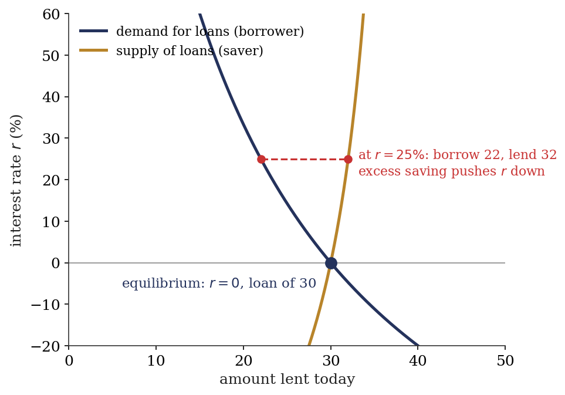
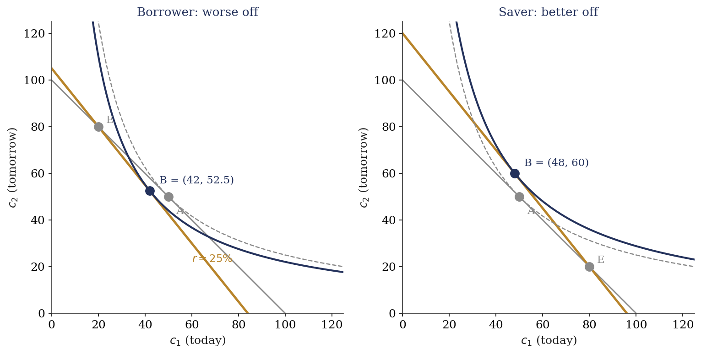
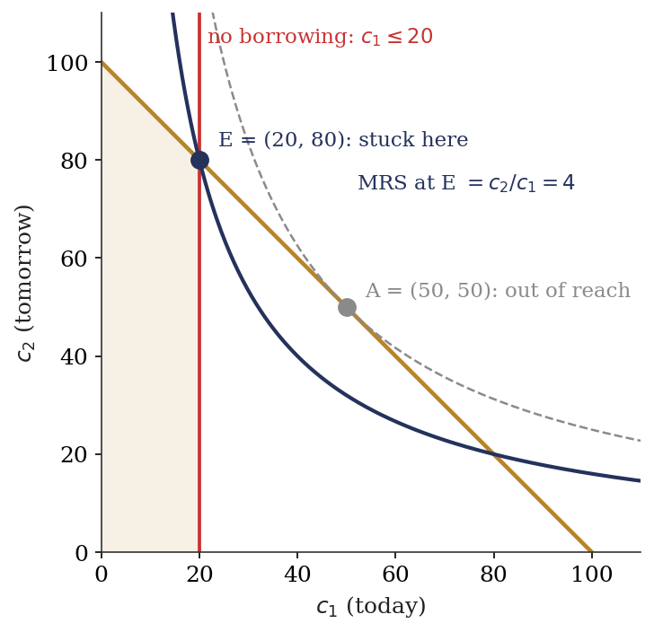
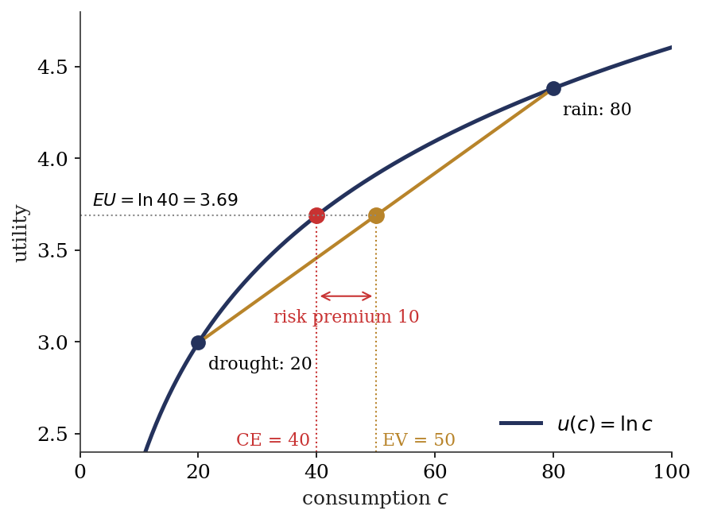
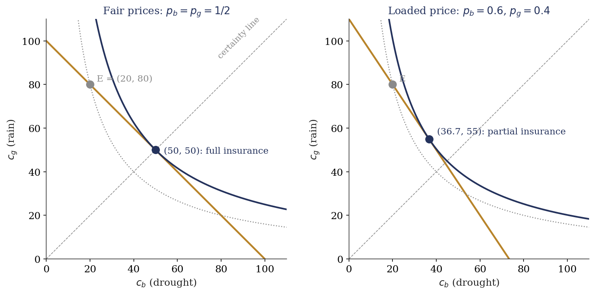

<!-- Topic 5, built 2026-11-08 from slides/05_time-and-uncertainty/PLAN.md.
     One set of numbers throughout: log utility, delta = 1, pi = 1/2.
     Borrower endowment (20, 80), saver (80, 20). r = 0: both consume (50, 50).
     r = 25%: borrower (42, 52.5), saver (48, 60). No borrowing: mu = 0.0375.
     Uncertainty: harvest 20 in drought, 80 in rain; CE 40, premium 10.
     Monopoly lender / insurer at the end: (40, 40), profit 20 / 10.
     Figures: notebooks/topic05_time_uncertainty_figures.ipynb. -->

## Review: When a Price Moves, So Does What You Own {.divider}

Labor supply and the farm household from Topic 4, Part V

---

## Labor Supply: A Wage Rise Revalues Your Time {.compact}

:::: {.columns}
::: {.column width="38%"}
$U = c\,\ell$, 24 hours, unearned income $y$, $p = 1$:

$$c + w\ell = \underbrace{24w}_{\text{value of her time}} + \;y$$

```{=html}
<div style="font-size: 0.62em; margin-top: 0.4em;">
  <label style="display:flex;align-items:center;gap:0.6em;margin:0.25em 0;"><span style="width:2.2em;"><i>w</i></span><input type="range" id="ls-w" min="0.5" max="3" step="0.25" value="2" style="flex:1;"><span id="ls-w-v" style="width:3em;text-align:right;"></span></label>
  <label style="display:flex;align-items:center;gap:0.6em;margin:0.25em 0;"><span style="width:2.2em;"><i>y</i></span><input type="range" id="ls-y" min="0" max="24" step="2" value="12" style="flex:1;"><span id="ls-y-v" style="width:3em;text-align:right;"></span></label>
  <div style="margin-top:0.5em;display:flex;gap:0.6em;">
    <button id="ls-y12" style="font-size:1em;padding:0.15em 0.6em;">y = 12</button>
    <button id="ls-y0" style="font-size:1em;padding:0.15em 0.6em;">y = 0 (Ingmar)</button>
  </div>
  <div id="ls-readout" style="color: #24325c; margin-top: 0.7em; line-height: 1.45;"></div>
</div>
```
:::

::: {.column width="62%"}
```{=html}
<svg id="ls-svg" viewBox="0 0 560 440" style="width: 100%; max-height: 440px; font-family: Arial, Helvetica, sans-serif;"></svg>
<script>
(function () {
  // U = c*l, p = 1, 24 hours. The wage moves from w0 = 1 to the slider value w.
  // A: old choice. B: compensated (same utility, new wage). C: new wage, old full income.
  // D: new choice. A->B substitution, B->C ordinary income, C->D endowment income.
  var NS = "http://www.w3.org/2000/svg", svg = document.getElementById("ls-svg");
  var L = 55, T = 12, W0 = 1, SX = 450 / 30, SY = 360 / 100;
  function X(v) { return L + v * SX; }
  function Y(v) { return T + 360 - v * SY; }
  function el(tag, attrs, parent) {
    var e = document.createElementNS(NS, tag);
    for (var k in attrs) e.setAttribute(k, attrs[k]);
    (parent || svg).appendChild(e);
    return e;
  }
  var clip = el("clipPath", {id: "ls-clip"});
  el("rect", {x: L, y: T, width: 450, height: 360}, clip);
  for (var g = 0; g <= 30; g += 6) {
    el("line", {x1: X(g), y1: Y(0), x2: X(g), y2: Y(100), stroke: "#e5e9f0"});
    el("text", {x: X(g), y: Y(0) + 20, "text-anchor": "middle", "font-size": 14, fill: "#24325c"}).textContent = g;
  }
  for (g = 0; g <= 100; g += 20) {
    el("line", {x1: X(0), y1: Y(g), x2: X(30), y2: Y(g), stroke: "#e5e9f0"});
    el("text", {x: X(0) - 8, y: Y(g) + 5, "text-anchor": "end", "font-size": 14, fill: "#24325c"}).textContent = g;
  }
  el("line", {x1: X(0), y1: Y(0), x2: X(30), y2: Y(0), stroke: "#24325c", "stroke-width": 2});
  el("line", {x1: X(0), y1: Y(0), x2: X(0), y2: Y(100), stroke: "#24325c", "stroke-width": 2});
  el("line", {x1: X(24), y1: Y(0), x2: X(24), y2: Y(100), stroke: "#8a93a6", "stroke-width": 1.5});
  el("text", {x: X(24) + 6, y: Y(96), "font-size": 14, fill: "#8a93a6"}).textContent = "24 hours";
  el("text", {x: X(15), y: Y(0) + 44, "text-anchor": "middle", "font-size": 16, fill: "#24325c"}).textContent = "leisure ℓ (hours)";
  el("text", {x: 16, y: Y(50), "text-anchor": "middle", "font-size": 16, fill: "#24325c",
              transform: "rotate(-90 16 " + Y(50) + ")"}).textContent = "consumption c";
  var old = el("line", {stroke: "#9aa3b5", "stroke-width": 2.5, "stroke-dasharray": "7,5"});
  var fixed = el("line", {stroke: "#9aa3b5", "stroke-width": 1.5, "stroke-dasharray": "2,4", "clip-path": "url(#ls-clip)"});
  var comp = el("line", {stroke: "#3b6ea5", "stroke-width": 1.5, "stroke-dasharray": "5,4", "clip-path": "url(#ls-clip)"});
  var bnew = el("line", {stroke: "#b8842a", "stroke-width": 4});
  var ic0 = el("path", {fill: "none", stroke: "#9aa3b5", "stroke-width": 2, "clip-path": "url(#ls-clip)"});
  var ic1 = el("path", {fill: "none", stroke: "#b8842a", "stroke-width": 2, "clip-path": "url(#ls-clip)"});
  var endow = el("circle", {r: 7, fill: "#24325c"});
  var elab = el("text", {"font-size": 14, fill: "#24325c"}); elab.textContent = "endowment";
  var pts = {}, labs = {};
  [["A", "#9aa3b5"], ["B", "#3b6ea5"], ["C", "#9aa3b5"], ["D", "#b8842a"]].forEach(function (p) {
    pts[p[0]] = el("circle", {r: p[0] === "C" ? 5 : 7, fill: p[1]});
    labs[p[0]] = el("text", {"font-size": 16, "font-weight": "bold", fill: p[1]});
    labs[p[0]].textContent = p[0];
  });
  function setLine(e, a, b, l0, l1) {  // c = a - b*l from l0 to l1
    e.setAttribute("x1", X(l0)); e.setAttribute("y1", Y(a - b * l0));
    e.setAttribute("x2", X(l1)); e.setAttribute("y2", Y(a - b * l1));
  }
  function curve(u) {
    var d = [];
    for (var l = 0.6; l <= 30; l += 0.3) d.push((d.length ? "L" : "M") + X(l).toFixed(1) + "," + Y(Math.min(u / l, 140)).toFixed(1));
    return d.join("");
  }
  function place(k, l, c, dx, dy) {
    pts[k].setAttribute("cx", X(l)); pts[k].setAttribute("cy", Y(c));
    labs[k].setAttribute("x", X(l) + dx); labs[k].setAttribute("y", Y(c) + dy);
  }
  function f(v) { return (v >= 0 ? "+" : "−") + Math.abs(v).toFixed(1); }
  function val(id) { return parseFloat(document.getElementById("ls-" + id).value); }
  function draw() {
    var w = val("w"), y = val("y");
    var M0 = 24 * W0 + y, M1 = 24 * w + y;
    var lA = M0 / (2 * W0), cA = M0 / 2, U0 = cA * lA;
    var lB = Math.sqrt(U0 / w), cB = Math.sqrt(U0 * w);
    var lC = M0 / (2 * w), cC = M0 / 2;
    var lD = M1 / (2 * w), cD = M1 / 2;
    setLine(old, M0, W0, 0, 24);
    setLine(fixed, M0, w, 0, 30);
    setLine(comp, 2 * cB, w, 0, 30);
    setLine(bnew, M1, w, 0, 24);
    ic0.setAttribute("d", curve(U0));
    ic1.setAttribute("d", curve(cD * lD));
    endow.setAttribute("cx", X(24)); endow.setAttribute("cy", Y(y));
    elab.setAttribute("x", X(24) + 10); elab.setAttribute("y", Y(y) + (y > 4 ? -8 : -14));
    place("A", lA, cA, -18, -10);
    place("B", lB, cB, -18, -10);
    place("C", lC, cC, -18, 20);
    place("D", lD, cD, 10, -10);
    document.getElementById("ls-w-v").textContent = w.toFixed(2);
    document.getElementById("ls-y-v").textContent = y;
    document.getElementById("ls-readout").innerHTML =
      "Wage moves from <b>1</b> to <b>" + w.toFixed(2) + "</b>. Leisure:<br>" +
      "<span style='color:#3b6ea5'>A→B substitution</span> " + f(lB - lA) + " h<br>" +
      "B→C ordinary income " + f(lC - lB) + " h<br>" +
      "<span style='color:#b8842a'>C→D value of her time</span> " + f(lD - lC) + " h<br>" +
      "<b>Total</b> " + f(lD - lA) + " h: she works <b>" + (24 - lD).toFixed(1) + "</b> h (was " + (24 - lA).toFixed(1) + ").";
  }
  ["w", "y"].forEach(function (id) { document.getElementById("ls-" + id).addEventListener("input", draw); });
  document.getElementById("ls-y12").addEventListener("click", function () { document.getElementById("ls-y").value = 12; draw(); });
  document.getElementById("ls-y0").addEventListener("click", function () { document.getElementById("ls-y").value = 0; draw(); });
  draw();
})();
</script>
```
:::
::::

<p style="font-size: 0.75em; color: #666;">Grey: wage 1. Amber: the new wage; both lines pivot around the endowment (24, <i>y</i>). Dotted grey: the new wage with full income held at its old value, as if she did not own her time. In Topic 4 money income was fixed; here a wage rise also makes her 24 hours worth more.</p>

---

## The Slutsky Equation with an Endowment {.compact}

Topic 4 held money income fixed. When income comes from selling what you own, $I = p\,\omega + \dots$, a price rise also raises income by $\omega$:

$$\frac{\partial x}{\partial p} \;=\; \underbrace{\frac{\partial x^c}{\partial p}}_{\text{substitution} \,<\, 0} \;+\; \underbrace{(\omega - x)\,\frac{\partial x}{\partial I}}_{\text{income effect, sign set by your net position}}$$

::: {.incremental}
- **Net seller** ($\omega > x$): a higher price makes you **richer**. **Net buyer** ($\omega < x$): poorer. By the envelope theorem (Topic 2), $dV/dp = \lambda\,(\omega - x)$.
- **Ask before you look:** in each row, is the household richer or poorer when the price rises?
:::

::: {.fragment}
| Who | Good and its price | Endowment $\omega$ | Net position | Price rises |
|---|---|---|---|---|
| Worker | leisure, wage $w$ | 24 hours | sells $24 - \ell$ hours | **richer**: may work less |
| Farm household | food, price $p$ | its harvest $Q$ | sells $Q - c$, or buys | net seller **richer**, net buyer **poorer** |
| Saver | today's consumption, $1+r$ | $m_1$ | lends $m_1 - c_1$ | **richer** |
| Borrower | today's consumption, $1+r$ | $m_1$ | borrows $c_1 - m_1$ | **poorer** |

: {tbl-colwidths="[15,25,15,23,22]"}
:::

<p style="font-size: 0.8em; color: #666;">Text: NS Chapter 16 (labor supply) and Chapter 17 (interest rates). Food prices and welfare: Deaton, "Rice Prices and Income Distribution in Thailand", Economic Journal 1989.</p>

---

## The Farm Household: Separation, and When It Fails {.compact}

:::: {.columns}
::: {.column width="38%"}
$U = c\,\ell^{a}$, 24 hours, farm $F(L) = 6\sqrt{L}$, food price $p$, wage $w$. Family and hired labor are perfect substitutes.

```{=html}
<div style="font-size: 0.62em; margin-top: 0.4em;">
  <label style="display:flex;align-items:center;gap:0.6em;margin:0.25em 0;"><span style="width:6.5em;">wage <i>w</i></span><input type="range" id="fh-w" min="0.8" max="1.6" step="0.05" value="1" style="flex:1;"><span id="fh-w-v" style="width:3em;text-align:right;"></span></label>
  <label style="display:flex;align-items:center;gap:0.6em;margin:0.25em 0;"><span style="width:6.5em;">food price <i>p</i></span><input type="range" id="fh-p" min="0.7" max="1.2" step="0.05" value="1" style="flex:1;"><span id="fh-p-v" style="width:3em;text-align:right;"></span></label>
  <label style="display:flex;align-items:center;gap:0.6em;margin:0.25em 0;"><span style="width:6.5em;">taste for leisure <i>a</i></span><input type="range" id="fh-a" min="0.5" max="2" step="0.1" value="1" style="flex:1;"><span id="fh-a-v" style="width:3em;text-align:right;"></span></label>
  <div style="margin-top:0.5em;display:flex;gap:0.6em;">
    <button id="fh-mkt" style="font-size:1em;padding:0.15em 0.6em;">Close the labor market</button>
    <button id="fh-reset" style="font-size:1em;padding:0.15em 0.6em;">Reset</button>
  </div>
  <div id="fh-readout" style="color: #24325c; margin-top: 0.7em; line-height: 1.45;"></div>
</div>
```
:::

::: {.column width="62%"}
```{=html}
<svg id="fh-svg" viewBox="0 0 560 440" style="width: 100%; max-height: 440px; font-family: Arial, Helvetica, sans-serif;"></svg>
<script>
(function () {
  // U = c * l^a, 24 hours, F(L) = 6 sqrt(L), food price p, wage w.
  // Markets open: L* = 9p^2/w^2, Q = 18p/w, profit 9p^2/w; full income M = 24w + profit;
  //   l = a M / ((1+a) w), c = M / ((1+a) p), capped at l = 24 (works nothing, eats profit/p).
  // Labor market closed (Chayanov): max 6 sqrt(L) (24-L)^a, so L = 24/(1+2a), c = F(L);
  //   shadow wage (food per hour) = F'(L) = 3/sqrt(L).
  var NS = "http://www.w3.org/2000/svg", svg = document.getElementById("fh-svg");
  var L = 55, T = 12, SX = 450 / 26, SY = 360 / 45, open = true;
  function X(v) { return L + v * SX; }
  function Y(v) { return T + 360 - v * SY; }
  function el(tag, attrs, parent) {
    var e = document.createElementNS(NS, tag);
    for (var k in attrs) e.setAttribute(k, attrs[k]);
    (parent || svg).appendChild(e);
    return e;
  }
  var clip = el("clipPath", {id: "fh-clip"});
  el("rect", {x: L, y: T, width: 450, height: 360}, clip);
  for (var g = 0; g <= 24; g += 6) {
    el("line", {x1: X(g), y1: Y(0), x2: X(g), y2: Y(45), stroke: "#e5e9f0"});
    el("text", {x: X(g), y: Y(0) + 20, "text-anchor": "middle", "font-size": 14, fill: "#24325c"}).textContent = g;
  }
  for (g = 0; g <= 45; g += 5) {
    el("line", {x1: X(0), y1: Y(g), x2: X(26), y2: Y(g), stroke: "#e5e9f0"});
    el("text", {x: X(0) - 8, y: Y(g) + 5, "text-anchor": "end", "font-size": 14, fill: "#24325c"}).textContent = g;
  }
  el("line", {x1: X(0), y1: Y(0), x2: X(26), y2: Y(0), stroke: "#24325c", "stroke-width": 2});
  el("line", {x1: X(0), y1: Y(0), x2: X(0), y2: Y(45), stroke: "#24325c", "stroke-width": 2});
  el("line", {x1: X(24), y1: Y(0), x2: X(24), y2: Y(45), stroke: "#8a93a6", "stroke-width": 1.5});
  el("text", {x: X(13), y: Y(0) + 44, "text-anchor": "middle", "font-size": 16, fill: "#24325c"}).textContent = "leisure ℓ (hours); farm work measured left from 24";
  el("text", {x: 16, y: Y(22.5), "text-anchor": "middle", "font-size": 16, fill: "#24325c",
              transform: "rotate(-90 16 " + Y(22.5) + ")"}).textContent = "food c";
  var d = [];
  for (var l = 0; l <= 24; l += 0.2) d.push((d.length ? "L" : "M") + X(l).toFixed(1) + "," + Y(6 * Math.sqrt(24 - l)).toFixed(1));
  el("path", {d: d.join(""), fill: "none", stroke: "#24325c", "stroke-width": 3});
  el("text", {x: X(0.5), y: Y(22), "font-size": 14, fill: "#24325c"}).textContent = "farm output F(24 − ℓ)";
  var budget = el("line", {stroke: "#b8842a", "stroke-width": 3.5, "clip-path": "url(#fh-clip)"});
  var shadow = el("line", {stroke: "#24325c", "stroke-width": 1.5, "stroke-dasharray": "4,4", "clip-path": "url(#fh-clip)"});
  var ic = el("path", {fill: "none", stroke: "#3b6ea5", "stroke-width": 2.5, "clip-path": "url(#fh-clip)"});
  var profit = el("line", {stroke: "#b03a2e", "stroke-width": 4});
  var prod = el("circle", {r: 7, fill: "#24325c"});
  var cons = el("circle", {r: 7, fill: "#3b6ea5"});
  var plab = el("text", {"font-size": 14, fill: "#24325c"}); plab.textContent = "farm";
  var clab = el("text", {"font-size": 14, fill: "#3b6ea5"}); clab.textContent = "household";
  function val(id) { return parseFloat(document.getElementById("fh-" + id).value); }
  function draw() {
    var w = val("w"), p = val("p"), a = val("a"), msg, Lf, Q, lei, c;
    document.getElementById("fh-w-v").textContent = w.toFixed(2);
    document.getElementById("fh-p-v").textContent = p.toFixed(2);
    document.getElementById("fh-a-v").textContent = a.toFixed(1);
    ["w", "p"].forEach(function (id) { document.getElementById("fh-" + id).disabled = !open; });
    if (open) {
      Lf = 9 * p * p / (w * w); Q = 6 * Math.sqrt(Lf);
      var pi = 9 * p * p / w, M = 24 * w + pi;
      lei = a * M / ((1 + a) * w); c = M / ((1 + a) * p);
      if (lei > 24) { lei = 24; c = pi / p; }
      // Budget in food units: c = (M - w l)/p, from l = 0 to 24.
      budget.setAttribute("x1", X(0)); budget.setAttribute("y1", Y(M / p));
      budget.setAttribute("x2", X(24)); budget.setAttribute("y2", Y(pi / p));
      budget.style.display = ""; shadow.style.display = "none"; profit.style.display = "";
      profit.setAttribute("x1", X(24)); profit.setAttribute("y1", Y(0));
      profit.setAttribute("x2", X(24)); profit.setAttribute("y2", Y(pi / p));
      var work = 24 - lei, gap = Lf - work, sale = Q - c;
      var trade = gap > 0.05 ? "hires <b>" + gap.toFixed(1) + "</b> h" : gap < -0.05 ? "sells <b>" + (-gap).toFixed(1) + "</b> h of labor" : "neither hires nor sells labor";
      var food = sale > 0.05 ? "<b>net seller</b> of food (" + sale.toFixed(1) + "): a higher <i>p</i> makes it richer"
               : sale < -0.05 ? "<b>net buyer</b> of food (" + (-sale).toFixed(1) + "): a higher <i>p</i> makes it poorer" : "self-sufficient in food";
      msg = "<b>Farm</b> (firm): <i>L</i>* = " + Lf.toFixed(1) + " h, output " + Q.toFixed(1) + ", profit " + (pi / p).toFixed(1) + " food.<br>" +
            "<b>Household</b> (consumer): leisure " + lei.toFixed(1) + " h, works " + work.toFixed(1) + " h, " + trade + ".<br>" +
            "Eats " + c.toFixed(1) + ": " + food + ".<br>" +
            "<span style='color:#666'>Move <i>a</i>: hiring changes, <i>L</i>* does not.</span>";
    } else {
      Lf = 24 / (1 + 2 * a); Q = 6 * Math.sqrt(Lf); lei = 24 - Lf; c = Q;
      var sw = 3 / Math.sqrt(Lf);
      budget.style.display = "none"; profit.style.display = "none"; shadow.style.display = "";
      shadow.setAttribute("x1", X(0)); shadow.setAttribute("y1", Y(c + sw * lei));
      shadow.setAttribute("x2", X(26)); shadow.setAttribute("y2", Y(c - sw * (26 - lei)));
      msg = "<b>No labor market:</b> the family farms its own land with its own time.<br>" +
            "Farm work <i>L</i> = " + Lf.toFixed(1) + " h, set by <b>tastes</b> (<i>a</i>), not by a wage.<br>" +
            "Eats its harvest, " + c.toFixed(1) + ". Shadow wage " + sw.toFixed(2) + " food per hour (dashed).<br>" +
            "<span style='color:#666'>Move <i>a</i>: now <i>L</i> moves too. Separation fails.</span>";
    }
    var u = c * Math.pow(lei, a), pts = [];
    for (var x = 0.5; x <= 26; x += 0.25) pts.push((pts.length ? "L" : "M") + X(x).toFixed(1) + "," + Y(Math.min(u / Math.pow(x, a), 90)).toFixed(1));
    ic.setAttribute("d", pts.join(""));
    prod.setAttribute("cx", X(24 - Lf)); prod.setAttribute("cy", Y(Q));
    cons.setAttribute("cx", X(lei)); cons.setAttribute("cy", Y(c));
    plab.setAttribute("x", X(24 - Lf) - 14); plab.setAttribute("y", Y(Q) + 26);
    clab.setAttribute("x", X(lei) + 8); clab.setAttribute("y", Y(c) - 14);
    plab.style.display = open ? "" : "none";
    clab.textContent = open ? "household" : "farm = household";
    document.getElementById("fh-mkt").textContent = open ? "Close the labor market" : "Open the labor market";
    document.getElementById("fh-readout").innerHTML = msg;
  }
  ["w", "p", "a"].forEach(function (id) { document.getElementById("fh-" + id).addEventListener("input", draw); });
  document.getElementById("fh-mkt").addEventListener("click", function () { open = !open; draw(); });
  document.getElementById("fh-reset").addEventListener("click", function () {
    open = true;
    document.getElementById("fh-w").value = 1; document.getElementById("fh-p").value = 1; document.getElementById("fh-a").value = 1;
    draw();
  });
  draw();
})();
</script>
```
:::
::::

<p style="font-size: 0.75em; color: #666;">Open markets: the farm picks <i>L</i>* where the wage line touches the output curve, then the household chooses along that line. Profit (red) is the line's height at 24. Closed labor market (Chayanov): the household picks its point on the output curve itself. Topic 6 builds this model; the notebook <code>farm_household.ipynb</code> has the general case.</p>

---

## From Topic 4 to Topic 5: A Dictionary {.compact}

| Topic 4: labor supply and the farm | Topic 5: choice over time |
|---|---|
| Leisure $\ell$ and consumption $c$ | Consumption today $c_1$ and tomorrow $c_2$ |
| Wage $w$: the price of an hour of leisure | $1 + r$: the price of $c_1$ in units of $c_2$ |
| Endowment: 24 hours (and unearned income $y$) | Endowment: income $m_1$ today and $m_2$ tomorrow |
| Full income $24w + y$ | Wealth $m_1 + m_2/(1+r)$ |
| Sells labor, or hires it in | Lends (saver), or borrows (borrower) |
| A wage rise: richer if she sells time | A rate rise: richer if she lends |
| The farm maximizes profit, then the family consumes | Invest until the return equals $1 + r$, then borrow or lend (Fisher) |
| No labor market: farm work depends on tastes | No credit market: consumption, and investment, depend on tastes |

: {tbl-colwidths="[50,50]"}

::: {.fragment}
> **Same model, new labels.** Every time a price moves, ask two questions: what is the substitution effect, and **which side of the market is she on?**
:::

---


## Optimization: From Goods to Dates and States {.compact}

Topic 4 solved the consumer's problem for two goods. Here we call them $c_1$ and $c_2$ instead of $x$ and $y$. Topic 5 solves **the same problem** twice more, changing only what the goods are.

| | Topic 4: two goods | Part I: two dates | Part II: two states |
|---|---|---|---|
| Goods | $c_1$, $c_2$ | <span style="color:#bbb">?</span> | <span style="color:#bbb">?</span> |
| Utility | $u(c_1, c_2)$ | <span style="color:#bbb">?</span> | <span style="color:#bbb">?</span> |
| Prices | $p_1$, $p_2$ | <span style="color:#bbb">?</span> | <span style="color:#bbb">?</span> |
| Budget | $p_1 c_1 + p_2 c_2 = I$ | <span style="color:#bbb">?</span> | <span style="color:#bbb">?</span> |
| Tangency | $MRS = p_1/p_2$ | <span style="color:#bbb">?</span> | <span style="color:#bbb">?</span> |

: {tbl-colwidths="[16,28,28,28]"}

::: {.fragment}
> We will fill in the empty columns. The method does not change: a Lagrangian, a tangency, a budget line. What changes is **what the goods are** and **what the prices mean**. In Topic 5 the goods we trade are **promises**: claims on consumption at another date or in another state of the world.
:::

---

## Three Questions {.compact}

| | Question | What you will take away |
|---|---|---|
| **NS 17** | **How does a household spread consumption over time?** | It borrows or saves to **smooth** consumption. The interest rate is a relative price. |
| **NS 7** | **How does it deal with risk?** | Expected utility. With fair insurance it **smooths across states of the world**, exactly as it smooths over time. |
| **NS 7, 13** | **What can markets and neighbors do?** | Credit markets, insurance markets and risk-sharing networks all move consumption from where it is plentiful to where it is scarce. |

: {tbl-colwidths="[12,38,50]"}

::: {.fragment}
Consumption smoothing is a **financial contracting** problem: the household buys and sells claims on future income. First with **competitive** lenders and insurers; later we **turn it around** (Topic 4's dual) and a **monopoly** intermediary designs the contract.
:::

---

## Finance: Pricing and Trading Promises {.compact}

**Finance is the market for promises.** Every financial contract is a promise to deliver consumption at particular date(s), and/or in different states of the world (e.g. when it rains, or when there is a drought).

| Contract | The promise | Its price today |
|---|---|---|
| **Bond** (a loan, seen from the lender) | pay \$1 tomorrow, whatever the weather | $p_2 = \dfrac{1}{1+r}$ |
| **Contingent claim** (insurance) | pay \$1 tomorrow **if** there is a drought | $p_{2b}$ |
| **A risky asset** (a farm, a share) | a bundle: 20 if drought, 80 if rain | $20\,p_{2b} + 80\,p_{2g}$ |

: {tbl-colwidths="[30,42,28]"}

<p style="font-size: 0.75em; color: #666;">$p_{ts}$: today's price of \$1 at date $t$ in state $s$, with $s = b$ (bad: drought) or $g$ (good: rain). Part I has no risk, so we drop $s$; Part II has one future date, so we drop $t$.</p>

::: {.incremental}
- **Borrowing is selling a promise; saving is buying one.**<br> Buying insurance is buying a promise that pays when times are bad.
- **Optimal consumption smoothing:** Equate marginal utility per dollar across time and/or states of nature. From a tangency between today and tomorrow, or between drought and rain.
- **Two key questions:** what is a promise worth (its **price**)? Will it be kept (**enforcement**)? The standard model assumes perfect, costless enforcement. Credit constraints and village risk sharing show what happens without it.
:::

---

## Part I: Choice over Time {.divider}

Trading promises across time — NS Chapter 17

---

## Goods Dated by Time {.compact}

::: {.incremental}
- **An apple today and an apple tomorrow are different goods.** Call them $c_1$ and $c_2$. Everything from Topic 4 applies: indifference curves, an $MRS$, a budget line.
- **Two different reasons the future counts for less:**
  - **Impatience (a preference).** The household weighs tomorrow's utility by a **discount factor** $\delta \le 1$: $\;U = u(c_1) + \delta\, u(c_2)$. This is **exponential discounting**: in a third period the weight would be $\delta^2$, and so on.
  - **The time value of money (a price).** A dollar tomorrow costs less than a dollar today (next slide).
- Keep the two apart: $\delta$ belongs in the **utility function**, $r$ belongs in the **budget**. The optimum compares them.
- **$u$ itself is concave** (diminishing marginal utility within each period). That is what makes the household want to smooth.
:::

<p style="font-size: 0.8em; color: #666;">Text: NS Chapter 17, "Capital and Time".</p>

---

## The Time Value of Money {.compact}

::: {.incremental}
- **A dollar saved today grows** to $\$1 \times (1+r)$ next year.
- **How much would you pay today for \$1 next year?** Call it $x$. Saved, $x$ must grow to exactly \$1:
  $$x\,(1+r) = 1 \quad\Longrightarrow\quad x = \frac{1}{1+r}$$
- **Example, $r = 0.10$:** \$1 next year is worth $\frac{1}{1.1} \approx \$0.91$ today. \$110 next year is worth \$100 today.
- **That $x$ is a price:** the price today of a promise to pay \$1 tomorrow, $\;p_2 = \frac{1}{1+r}$. **Discounting** converts future dollars into today's dollars.
:::

---

## The Intertemporal Budget Constraint {.compact}

:::: {.columns}
::: {.column width="52%"}
Income $m_1$ today and $m_2$ tomorrow. She can save $s$ at interest rate $r$ (or borrow, $s < 0$). **Period-by-period budget constraints**, one for each date:

$$c_1 + s = m_1 \qquad\qquad c_2 = m_2 + (1+r)\,s$$

Eliminate $s$: the **intertemporal budget constraint**:
$$c_1 + \frac{c_2}{1+r} = m_1 + \frac{m_2}{1+r}$$

::: {.incremental}
- **In Topic 4's form,** with prices $p_1 = 1$ and $p_2 = \tfrac{1}{1+r}$:
  $$p_1 c_1 + p_2 c_2 = p_1 m_1 + p_2 m_2$$
- $p_2$ is the price of a **bond**, a promise to pay \$1 tomorrow. Saving buys promises; borrowing sells them.
- The right side is her wealth $W$: the **present value** of her endowment, as in labor supply.
:::
:::

::: {.column width="48%"}
<div style="text-align: center;">
  
  <p style="font-size: 0.65em; color: #666;">Income (20, 80) at $r = 25\%$. The line always passes through the endowment. Text: NS Chapter 17.</p>
</div>
:::
::::

---

## Move the Intertemporal Budget Constraint {.compact}

:::: {.columns}
::: {.column width="38%"}
Now let the good have a dollar price in each period, $P_1$ today and $P_2$ tomorrow (inflation if $P_2 > P_1$):

$$P_1 c_1 + \frac{P_2\, c_2}{1+r} = P_1 m_1 + \frac{P_2\, m_2}{1+r}$$

```{=html}
<div id="ibc-controls" style="font-size: 0.62em; margin-top: 0.4em;">
  <label style="display:flex;align-items:center;gap:0.6em;margin:0.25em 0;"><span style="width:2.2em;"><i>P</i><sub>1</sub></span><input type="range" id="ibc-P1" min="0.5" max="2" step="0.05" value="1" style="flex:1;"><span id="ibc-P1-v" style="width:3em;text-align:right;"></span></label>
  <label style="display:flex;align-items:center;gap:0.6em;margin:0.25em 0;"><span style="width:2.2em;"><i>P</i><sub>2</sub></span><input type="range" id="ibc-P2" min="0.5" max="2" step="0.05" value="1" style="flex:1;"><span id="ibc-P2-v" style="width:3em;text-align:right;"></span></label>
  <label style="display:flex;align-items:center;gap:0.6em;margin:0.25em 0;"><span style="width:2.2em;"><i>r</i></span><input type="range" id="ibc-r" min="0" max="1" step="0.05" value="0" style="flex:1;"><span id="ibc-r-v" style="width:3em;text-align:right;"></span></label>
  <label style="display:flex;align-items:center;gap:0.6em;margin:0.25em 0;"><span style="width:2.2em;"><i>m</i><sub>1</sub></span><input type="range" id="ibc-m1" min="0" max="100" step="5" value="20" style="flex:1;"><span id="ibc-m1-v" style="width:3em;text-align:right;"></span></label>
  <label style="display:flex;align-items:center;gap:0.6em;margin:0.25em 0;"><span style="width:2.2em;"><i>m</i><sub>2</sub></span><input type="range" id="ibc-m2" min="0" max="100" step="5" value="80" style="flex:1;"><span id="ibc-m2-v" style="width:3em;text-align:right;"></span></label>
</div>
```

<p style="font-size: 0.75em; color: #666;">With $P_1 = P_2 = 1$ this is the previous slide. Dashed grey: the starting line, income (20, 80) and $r = 0$.</p>
:::

::: {.column width="62%"}
```{=html}
<svg id="ibc-svg" viewBox="0 0 560 440" style="width: 100%; max-height: 440px; font-family: Arial, Helvetica, sans-serif;"></svg>
<div id="ibc-readout" style="font-size: 0.62em; color: #24325c; margin-top: 0.2em;"></div>
<script>
(function () {
  // Intertemporal budget line P1 c1 + P2 c2/(1+r) = P1 m1 + P2 m2/(1+r), drawn on [0,200]^2.
  var NS = "http://www.w3.org/2000/svg", svg = document.getElementById("ibc-svg");
  var L = 55, T = 12, S = 360 / 200;             // left margin, top margin, pixels per unit
  function X(v) { return L + v * S; }
  function Y(v) { return T + 360 - v * S; }
  function el(tag, attrs, parent) {
    var e = document.createElementNS(NS, tag);
    for (var k in attrs) e.setAttribute(k, attrs[k]);
    (parent || svg).appendChild(e);
    return e;
  }
  var clip = el("clipPath", {id: "ibc-clip"});
  el("rect", {x: L, y: T, width: 360, height: 360}, clip);
  for (var g = 0; g <= 200; g += 40) {
    el("line", {x1: X(g), y1: Y(0), x2: X(g), y2: Y(200), stroke: "#e5e9f0"});
    el("line", {x1: X(0), y1: Y(g), x2: X(200), y2: Y(g), stroke: "#e5e9f0"});
    el("text", {x: X(g), y: Y(0) + 20, "text-anchor": "middle", "font-size": 14, fill: "#24325c"}).textContent = g;
    el("text", {x: X(0) - 8, y: Y(g) + 5, "text-anchor": "end", "font-size": 14, fill: "#24325c"}).textContent = g;
  }
  el("line", {x1: X(0), y1: Y(0), x2: X(200), y2: Y(0), stroke: "#24325c", "stroke-width": 2});
  el("line", {x1: X(0), y1: Y(0), x2: X(0), y2: Y(200), stroke: "#24325c", "stroke-width": 2});
  el("text", {x: X(100), y: Y(0) + 44, "text-anchor": "middle", "font-size": 16, fill: "#24325c"}).textContent = "c\u2081 (today)";
  el("text", {x: 16, y: Y(100), "text-anchor": "middle", "font-size": 16, fill: "#24325c",
              transform: "rotate(-90 16 " + Y(100) + ")"}).textContent = "c\u2082 (tomorrow)";
  el("line", {x1: X(0), y1: Y(100), x2: X(100), y2: Y(0), stroke: "#8a8a8a", "stroke-width": 1.5, "stroke-dasharray": "6,5"});
  var line = el("line", {stroke: "#b8842a", "stroke-width": 4, "clip-path": "url(#ibc-clip)"});
  var dot = el("circle", {r: 7, fill: "#24325c"});
  var lab = el("text", {"font-size": 15, fill: "#24325c"});
  lab.textContent = "endowment";
  var ids = ["P1", "P2", "r", "m1", "m2"];
  function val(id) { return parseFloat(document.getElementById("ibc-" + id).value); }
  function draw() {
    var P1 = val("P1"), P2 = val("P2"), r = val("r"), m1 = val("m1"), m2 = val("m2");
    var W = P1 * m1 + P2 * m2 / (1 + r), c1max = W / P1, c2max = W * (1 + r) / P2;
    line.setAttribute("x1", X(0)); line.setAttribute("y1", Y(c2max));
    line.setAttribute("x2", X(c1max)); line.setAttribute("y2", Y(0));
    dot.setAttribute("cx", X(m1)); dot.setAttribute("cy", Y(m2));
    lab.setAttribute("x", X(m1) + 12); lab.setAttribute("y", Y(m2) - 8);
    ids.forEach(function (id) {
      var v = val(id);
      document.getElementById("ibc-" + id + "-v").textContent = id === "r" ? Math.round(v * 100) + "%" : v;
    });
    document.getElementById("ibc-readout").innerHTML =
      "<b>Wealth:</b> " + W.toFixed(1) + " dollars today. <b>Intercepts:</b> " + c1max.toFixed(1) +
      " today, " + c2max.toFixed(1) + " tomorrow. <b>Slope:</b> \u2212" + (P1 * (1 + r) / P2).toFixed(2) + ".";
  }
  ids.forEach(function (id) { document.getElementById("ibc-" + id).addEventListener("input", draw); });
  draw();
})();
</script>
```
:::
::::

<p style="font-size: 0.75em; color: #666;">Income moves the line in parallel; prices and the interest rate rotate it around the endowment. What matters for the slope is $(1+r)P_1/P_2$, one plus the <b>real</b> interest rate.</p>

---

## The Euler Equation {.compact}

$$\mathcal{L} = u(c_1) + \delta\, u(c_2) + \lambda\,\big[\,p_1 m_1 + p_2 m_2 - p_1 c_1 - p_2 c_2\,\big]$$

::: {.incremental}
- **First-order conditions:** $\;u'(c_1) = \lambda\, p_1 = \lambda \qquad \delta\, u'(c_2) = \lambda\, p_2 = \dfrac{\lambda}{1+r}$
- **Divide:** $\;MRS = \dfrac{u'(c_1)}{\delta\, u'(c_2)} = \dfrac{p_1}{p_2} = 1 + r$. The tangency from Topic 4, nothing more.
- Written as the **Euler equation**: $\;u'(c_1) = \delta\,(1+r)\,u'(c_2)$. Giving up a dollar today costs $u'(c_1)$; saved, it buys $1+r$ dollars tomorrow, worth $\delta(1+r)u'(c_2)$ today. At the optimum the two are equal.
- **The multiplier:** $\lambda = u'(c_1)$, the marginal utility of a dollar of wealth (Topic 2's shadow price).
- **Benchmark:** if $\delta(1+r) = 1$, then $u'(c_1) = u'(c_2)$, so $c_1 = c_2$. **Perfect smoothing**, whatever the timing of income.
:::

---

## Log Utility Is Cobb-Douglas {.compact}

Take $u(c) = \ln c$. Then
$$U = \ln c_1 + \delta \ln c_2 = \ln\big(c_1\, c_2^{\,\delta}\big)$$
a monotone transformation of the Cobb-Douglas $c_1 c_2^{\,\delta}$. Utility is only a ranking (Topic 4), so **the demands are Topic 4's Cobb-Douglas demands**:

::: {.incremental}
- $c_1 = \dfrac{1}{1+\delta}\cdot\dfrac{W}{p_1} \qquad c_2 = \dfrac{\delta}{1+\delta}\cdot\dfrac{W}{p_2} = \dfrac{\delta}{1+\delta}\,(1+r)\,W$
- She spends a fixed share of her wealth on each period. With $\delta = 1$, half of it.
- **Our numbers:** $\delta = 1$, $r = 0$, so $p_1 = p_2 = 1$. This is Topic 4 with equal prices. Both households below have wealth $W = 100$, so both consume $c_1 = c_2 = 50$.
- **Consumption growth:** $\;\dfrac{c_2}{c_1} = \delta(1+r)$. It depends on patience and the interest rate, **not** on when the income arrives.
:::

<p style="font-size: 0.8em; color: #666;">Compare Topic 4 (where $c_1$ was called $x$): $c_1 = \frac{\alpha}{\alpha+\beta}\frac{I}{p_1}$ for $u = c_1^{\alpha} c_2^{\beta}$. Here $\alpha = 1$, $\beta = \delta$.</p>

---

## A Borrower and a Saver {.compact}

Same preferences, same interest rate ($r = 0$), same wealth (100). Different **timing** of income.

:::: {.columns}
::: {.column width="64%"}
<div style="text-align: center;">
  
</div>
:::

::: {.column width="36%"}
::: {.incremental}
- **Borrower,** income (20, 80): a student, or a farmer before harvest. Borrows 30 today: she **sells a promise** to repay 30 tomorrow.
- **Saver,** income (80, 20): a worker before retirement. Saves 30 today: she **buys that promise** and collects tomorrow.
- **Both end at (50, 50).** Without a credit market each would be stuck at its endowment, on the dotted indifference curve.
:::
:::
::::

---

## Move the Income: Borrow or Save? {.compact}

:::: {.columns}
::: {.column width="38%"}
Log utility, wealth $W = m_1 + \frac{m_2}{1+r}$:

$$c_1 = \frac{W}{1+\delta} \qquad c_2 = \frac{\delta(1+r)\,W}{1+\delta}$$

```{=html}
<div style="font-size: 0.62em; margin-top: 0.4em;">
  <label style="display:flex;align-items:center;gap:0.6em;margin:0.25em 0;"><span style="width:2.2em;"><i>m</i><sub>1</sub></span><input type="range" id="bs-m1" min="0" max="100" step="5" value="20" style="flex:1;"><span id="bs-m1-v" style="width:3em;text-align:right;"></span></label>
  <label style="display:flex;align-items:center;gap:0.6em;margin:0.25em 0;"><span style="width:2.2em;"><i>m</i><sub>2</sub></span><input type="range" id="bs-m2" min="0" max="100" step="5" value="80" style="flex:1;"><span id="bs-m2-v" style="width:3em;text-align:right;"></span></label>
  <label style="display:flex;align-items:center;gap:0.6em;margin:0.25em 0;"><span style="width:2.2em;"><i>r</i></span><input type="range" id="bs-r" min="0" max="1" step="0.05" value="0" style="flex:1;"><span id="bs-r-v" style="width:3em;text-align:right;"></span></label>
  <label style="display:flex;align-items:center;gap:0.6em;margin:0.25em 0;"><span style="width:2.2em;">&delta;</span><input type="range" id="bs-d" min="0.5" max="1.5" step="0.05" value="1" style="flex:1;"><span id="bs-d-v" style="width:3em;text-align:right;"></span></label>
  <div style="margin-top:0.5em;display:flex;gap:0.6em;">
    <button id="bs-borrower" style="font-size:1em;padding:0.15em 0.6em;">Borrower (20, 80)</button>
    <button id="bs-saver" style="font-size:1em;padding:0.15em 0.6em;">Saver (80, 20)</button>
  </div>
</div>
```
:::

::: {.column width="62%"}
```{=html}
<svg id="bs-svg" viewBox="0 0 560 440" style="width: 100%; max-height: 440px; font-family: Arial, Helvetica, sans-serif;"></svg>
<div id="bs-readout" style="font-size: 0.62em; color: #24325c; margin-top: 0.2em;"></div>
<script>
(function () {
  // Log utility ln c1 + delta ln c2 with budget c1 + c2/(1+r) = m1 + m2/(1+r), drawn on [0,200]^2.
  var NS = "http://www.w3.org/2000/svg", svg = document.getElementById("bs-svg");
  var L = 55, T = 12, S = 360 / 200;
  function X(v) { return L + v * S; }
  function Y(v) { return T + 360 - v * S; }
  function el(tag, attrs, parent) {
    var e = document.createElementNS(NS, tag);
    for (var k in attrs) e.setAttribute(k, attrs[k]);
    (parent || svg).appendChild(e);
    return e;
  }
  var clip = el("clipPath", {id: "bs-clip"});
  el("rect", {x: L, y: T, width: 360, height: 360}, clip);
  for (var g = 0; g <= 200; g += 40) {
    el("line", {x1: X(g), y1: Y(0), x2: X(g), y2: Y(200), stroke: "#e5e9f0"});
    el("line", {x1: X(0), y1: Y(g), x2: X(200), y2: Y(g), stroke: "#e5e9f0"});
    el("text", {x: X(g), y: Y(0) + 20, "text-anchor": "middle", "font-size": 14, fill: "#24325c"}).textContent = g;
    el("text", {x: X(0) - 8, y: Y(g) + 5, "text-anchor": "end", "font-size": 14, fill: "#24325c"}).textContent = g;
  }
  el("line", {x1: X(0), y1: Y(0), x2: X(200), y2: Y(0), stroke: "#24325c", "stroke-width": 2});
  el("line", {x1: X(0), y1: Y(0), x2: X(0), y2: Y(200), stroke: "#24325c", "stroke-width": 2});
  el("text", {x: X(100), y: Y(0) + 44, "text-anchor": "middle", "font-size": 16, fill: "#24325c"}).textContent = "c₁ (today)";
  el("text", {x: 16, y: Y(100), "text-anchor": "middle", "font-size": 16, fill: "#24325c",
              transform: "rotate(-90 16 " + Y(100) + ")"}).textContent = "c₂ (tomorrow)";
  el("line", {x1: X(0), y1: Y(0), x2: X(200), y2: Y(200), stroke: "#c9cfdb", "stroke-width": 1.5, "stroke-dasharray": "4,4"});
  var line = el("line", {stroke: "#b8842a", "stroke-width": 4, "clip-path": "url(#bs-clip)"});
  var ic = el("path", {fill: "none", stroke: "#3b6ea5", "stroke-width": 2.5, "clip-path": "url(#bs-clip)"});
  var arrow = el("line", {stroke: "#24325c", "stroke-width": 1.5, "stroke-dasharray": "5,4"});
  var endow = el("circle", {r: 7, fill: "#24325c"});
  var opt = el("circle", {r: 7, fill: "#3b6ea5"});
  var elab = el("text", {"font-size": 15, fill: "#24325c"}); elab.textContent = "endowment";
  var olab = el("text", {"font-size": 15, fill: "#3b6ea5"}); olab.textContent = "choice";
  var ids = ["m1", "m2", "r", "d"];
  function val(id) { return parseFloat(document.getElementById("bs-" + id).value); }
  function draw() {
    var m1 = val("m1"), m2 = val("m2"), r = val("r"), d = val("d");
    var W = m1 + m2 / (1 + r), c1 = W / (1 + d), c2 = d * (1 + r) * W / (1 + d);
    line.setAttribute("x1", X(0)); line.setAttribute("y1", Y(W * (1 + r)));
    line.setAttribute("x2", X(W)); line.setAttribute("y2", Y(0));
    // Indifference curve through the choice: c2 = c2* (c1*/c1)^(1/delta)
    var pts = [];
    for (var x = 2; x <= 200; x += 2) {
      var y = c2 * Math.pow(c1 / x, 1 / d);
      if (y <= 260) pts.push((pts.length ? "L" : "M") + X(x).toFixed(1) + "," + Y(y).toFixed(1));
    }
    ic.setAttribute("d", pts.join(""));
    endow.setAttribute("cx", X(m1)); endow.setAttribute("cy", Y(m2));
    opt.setAttribute("cx", X(c1)); opt.setAttribute("cy", Y(c2));
    arrow.setAttribute("x1", X(m1)); arrow.setAttribute("y1", Y(m2));
    arrow.setAttribute("x2", X(c1)); arrow.setAttribute("y2", Y(c2));
    elab.setAttribute("x", X(m1) + 12); elab.setAttribute("y", Y(m2) - 8);
    olab.setAttribute("x", X(c1) + 12); olab.setAttribute("y", Y(c2) + 20);
    ids.forEach(function (id) {
      var v = val(id);
      document.getElementById("bs-" + id + "-v").textContent = id === "r" ? Math.round(v * 100) + "%" : v;
    });
    var b = c1 - m1, msg;
    if (b > 0.05) msg = "<b>Borrows</b> " + b.toFixed(1) + " today: sells a promise to repay " + (b * (1 + r)).toFixed(1) + " tomorrow.";
    else if (b < -0.05) msg = "<b>Saves</b> " + (-b).toFixed(1) + " today: buys a promise to collect " + (-b * (1 + r)).toFixed(1) + " tomorrow.";
    else msg = "Neither borrows nor saves.";
    document.getElementById("bs-readout").innerHTML =
      "<b>Wealth</b> " + W.toFixed(1) + ". <b>Choice</b> (" + c1.toFixed(1) + ", " + c2.toFixed(1) + "). " + msg;
  }
  function preset(a, b) {
    document.getElementById("bs-m1").value = a; document.getElementById("bs-m2").value = b;
    document.getElementById("bs-r").value = 0; document.getElementById("bs-d").value = 1;
    draw();
  }
  ids.forEach(function (id) { document.getElementById("bs-" + id).addEventListener("input", draw); });
  document.getElementById("bs-borrower").addEventListener("click", function () { preset(20, 80); });
  document.getElementById("bs-saver").addEventListener("click", function () { preset(80, 20); });
  draw();
})();
</script>
```
:::
::::

<p style="font-size: 0.75em; color: #666;">Moving income along the budget line changes only <b>whether</b> she borrows or saves, never what she consumes. The choice depends on wealth, patience and the interest rate.</p>

---

## Borrower Meets Saver {.compact}

:::: {.columns}
::: {.column width="50%"}
Put the two households in one market. For each interest rate, ask how much the borrower wants to borrow and how much the saver wants to lend.

::: {.incremental}
- **Demand for loans** (borrower): $c_1 - 20$. It falls as $r$ rises.
- **Supply of loans** (saver): $80 - c_1$. It rises a little with $r$ (her two effects nearly cancel).
- **At $r = 0$** the borrower wants 30 and the saver offers 30. **The credit market clears.**
- **At $r = 25\%$** (next slide) the borrower wants only 22 and the saver offers 32. Too much saving: the interest rate falls.
- **The interest rate is a price:** the price of a promise of \$1 tomorrow is $p_2 = 1/(1+r)$. It adjusts until the promises the borrower sells equal the promises the saver buys. Here, with equal patience and the same total income (100) in both periods, $r = 0$ and $p_2 = 1$.
:::
:::

::: {.column width="50%"}
<div style="text-align: center;">
  
  <p style="font-size: 0.65em; color: #666;">Each curve comes from the household's own utility maximization. Topic 7 draws the same market as an Edgeworth box.</p>
</div>
:::
::::

---

## The Interest Rate Rises: Borrower vs Saver {.compact}

:::: {.columns}
::: {.column width="40%"}
$r$ rises from 0 to 25%. Each budget line **rotates around its own endowment**.

::: {.incremental}
- **Substitution effect:** consumption today is dearer for both. Both cut $c_1$.
- **Income effect, borrower:** she buys $c_1$ (borrows 30), and its price rose: the same loan now costs 37.5 tomorrow, not 30. Poorer, so she cuts $c_1$ further: **50 → 42**. Worse off.
- **Income effect, saver:** she sells $c_1$ (lends 30): the same loan now pays 37.5 tomorrow, not 30. Richer, which pulls against substitution: **50 → 48**. Better off.
- **Just like a wage rise** in labor supply: who gains depends on which side of the market you are on.
:::
:::

::: {.column width="60%"}
<div style="text-align: center;">
  
  <p style="font-size: 0.65em; color: #666;">Grey: $r = 0$. Amber: $r = 25\%$. Borrower to (42, 52.5); saver to (48, 60). Text: NS Chapter 17.</p>
</div>
:::
::::

---

## Temporary vs Permanent Income {.compact}

The borrower again, $r = 0$, income (20, 80), consuming (50, 50). She gets 10 more income. How much more does she consume today? It depends on **when the rise comes and how long it lasts**:

| Change | Income | Wealth $W$ | $(c_1, c_2)$ | Rise in $c_1$ |
|---|---|---|---|---|
| **Temporary:** +10 today only | (30, 80) | 110 | (55, 55) | +5: spends **half** |
| **Permanent:** +10 every period | (30, 90) | 120 | (60, 60) | +10: spends **all** |
| **News:** +10 tomorrow only | (20, 90) | 110 | (55, 55) | +5, with no change today: she **borrows** |

: {tbl-colwidths="[30,13,13,13,31]"}

::: {.incremental}
- Consumption depends on **wealth**, the present value of income. A change in today's income matters only through what it adds to wealth, and a lasting change adds more.
- So the share of extra income spent today is small for a temporary change and large for a permanent one: Friedman's **permanent income hypothesis**. A one-time tax rebate should raise spending less than a permanent tax cut.
- The news row needs a **credit market**: to spend future income today, she must borrow against it. Without one, today's income matters directly (next slide).
:::

---

## When She Cannot Borrow: A Kuhn-Tucker Corner {.compact}

:::: {.columns}
::: {.column width="52%"}
Add a **borrowing constraint** $c_1 \le m_1 = 20$ (Topic 2's inequality constraints):

$$\mathcal{L} = \ln c_1 + \ln c_2 + \lambda\,[100 - c_1 - c_2] + \mu\,[20 - c_1]$$

::: {.incremental}
- The constraint binds: she is stuck at $E = (20, 80)$.
- **FOCs:** $\;\tfrac{1}{c_2} = \lambda$, so $\lambda = \tfrac{1}{80}$; $\;\tfrac{1}{c_1} = \lambda + \mu$, so $\mu = \tfrac{1}{20} - \tfrac{1}{80} = 0.0375 > 0$.
- **The Euler equation fails:** $u'(c_1) > u'(c_2)$. She would like to move consumption forward but cannot.
- **Reading $\mu$:** in dollars, $\mu/\lambda = 3$. At $E$ her $MRS$ is 4: she would repay up to \$4 tomorrow for one more dollar today, an interest rate of **300%** on the first dollar. That is why moneylenders and payday loans find customers.
- **Why can't she borrow?** Her **promise** to repay is not believed or cannot be enforced: no collateral, no credit history, weak courts. A credit constraint is a limit on the promises she can sell.
:::
:::

::: {.column width="48%"}
<div style="text-align: center;">
  
  <p style="font-size: 0.65em; color: #666;">The feasible set is shaded. The saver is unaffected: the constraint never binds for her.</p>
</div>
:::
::::

---

## Investment, and Separation Once More {.compact}

Suppose the household can also **invest** $k$ today in a project (a well, fertilizer, schooling) that returns $f(k)$ tomorrow.

::: {.incremental}
- **With a credit market:** choose $k$ to maximize the present value of income, $\;m_1 - k + \dfrac{m_2 + f(k)}{1+r}$. So $f'(k) = 1 + r$. **Preferences do not enter.** Then borrow or save to smooth consumption out of that wealth.
- This is **Fisher separation**: production first, consumption second. It is the same result as the farm household at the end of Topic 4: maximize farm profit, then treat it as income.
- **Without a credit market:** investment must come out of today's consumption, so $f'(k) = MRS = \dfrac{u'(c_1)}{\delta u'(c_2)}$. A poor or impatient household, with a high $MRS$, **invests less**, even in a project with a high return.
- So **separation fails when markets fail.** Poor households invest less not because they are worse at farming but because they cannot borrow. This is the farm-household model next week.
:::

<p style="font-size: 0.8em; color: #666;">Text: NS Chapter 17 (investment and the rate of return).</p>

---

## Part I in the Table {.compact}

| | Topic 4: two goods | Part I: two dates | Part II: two states |
|---|---|---|---|
| Goods | $c_1$, $c_2$ | $c_1$ today, $c_2$ tomorrow | <span style="color:#bbb">?</span> |
| Utility | $u(c_1, c_2)$ | $u(c_1) + \delta\, u(c_2)$ | <span style="color:#bbb">?</span> |
| Prices | $p_1$, $p_2$ | $p_1 = 1$, $\;p_2 = \tfrac{1}{1+r}$ | <span style="color:#bbb">?</span> |
| Budget | $p_1 c_1 + p_2 c_2 = I$ | $p_1 c_1 + p_2 c_2 = p_1 m_1 + p_2 m_2$ | <span style="color:#bbb">?</span> |
| Tangency | $MRS = p_1/p_2$ | $\dfrac{u'(c_1)}{\delta\, u'(c_2)} = 1 + r$ | <span style="color:#bbb">?</span> |
| Benchmark | | $\delta(1+r) = 1 \Rightarrow c_1 = c_2$ | <span style="color:#bbb">?</span> |

: {tbl-colwidths="[16,24,32,28]"}

::: {.fragment}
> Two discount factors, in two rows: $\delta$ is a **preference** (utility row), $\tfrac{1}{1+r}$ is a **price**, the price of a promise to pay \$1 tomorrow (prices row).
:::

---

## Part II: Choice under Risk {.divider}

Trading promises across states of the world — NS Chapter 7, "Uncertainty"

---

## Risk: Same Average, Different Spread {.compact}

::: {.incremental}
- **A coin toss.** Gamble 1 pays \$490 or \$510. Gamble 2 pays \$0 or \$1,000. Each has an **expected value** of \$500: $\;EV = \pi\, x_1 + (1-\pi)\, x_2$.
- Most people prefer gamble 1. They are **risk averse**: they care about the spread, not only the average.
- A **fair game** is one that costs its expected value. Paying \$500 to play gamble 2 is fair, and most people refuse.
- **Our farmer:** the harvest is worth 20 in a drought and 80 if it rains, each with probability $\tfrac12$. Expected value 50.
- The question for this part: what is that risky harvest worth to her, and what will she pay to get rid of the risk?
- **Risk or uncertainty?** Knight (1921): **risk** has known odds (a coin); **uncertainty** has unknown odds (a changing climate). Strictly, this part is about risk. Read the probabilities as the farmer's own **beliefs** and it covers more.
:::

<p style="font-size: 0.8em; color: #666;">Text: NS Chapter 7, "Expected Value" and "Fair Games". Knight, <i>Risk, Uncertainty and Profit</i>, 1921.</p>

---

## Expected Utility {.compact}

:::: {.columns}
::: {.column width="48%"}
She cares about the **utility** each outcome brings, weighted by its probability:

$$EU = \pi_b\, u(c_b) + \pi_g\, u(c_g)$$

($b$ = bad state, drought; $g$ = good state, rain).

::: {.incremental}
- **Concave $u$ means risk aversion:** the utility of the average exceeds the average of the utilities, $\;u(50) > EU$.
- **Our farmer,** $u = \ln c$: $\;EU = \tfrac12 \ln 20 + \tfrac12 \ln 80 = \ln 40$.
- **Certainty equivalent:** a sure 40 gives the same utility. So the risky harvest, with $EV = 50$, is worth only 40 to her.
- **Risk premium** $= 50 - 40 = 10$: the most she would pay, above the fair price, to remove the risk.
:::
:::

::: {.column width="52%"}
<div style="text-align: center;">
  
  <p style="font-size: 0.65em; color: #666;">The chord lies below the curve: averaging outcomes is worth more than averaging utilities. Text: NS Chapter 7, "Expected Utility" and "Risk Aversion".</p>
</div>
:::
::::

---

## Compare: Discounting and Probabilities {.compact}

| | Over time | Across states |
|---|---|---|
| Objective | $u(c_1) + \delta\, u(c_2)$ | $\pi_b\, u(c_b) + \pi_g\, u(c_g)$ |
| Weights on each period or state | $1$ and $\delta$ (patience) | $\pi_b$ and $\pi_g$ (beliefs) |
| Same $u$ in each period or state | yes: **time separable** | yes: **expected utility** |
| What concavity of $u$ makes her want | the same consumption each period | the same consumption in each state |

: {tbl-colwidths="[34,33,33]"}

::: {.incremental}
- **Both objectives are weighted sums of the same concave function.** The algebra is identical; only the meaning of the weights differs.
- With $\delta = 1$ and $\pi = \tfrac12$, the two objectives rank bundles identically: $\;\ln c_1 + \ln c_2$ and $\tfrac12 \ln c_b + \tfrac12 \ln c_g$.
- So **the farmer whose harvest is 20 or 80 faces the same problem as the borrower whose income is 20 today and 80 tomorrow.**
:::

---

## States of the World and Contingent Claims {.compact}

::: {.incremental}
- **A contingent claim** is a **conditional promise**: it pays \$1 only if a given state occurs, "\$1 if drought" or "\$1 if rain" (Arrow's idea).
- **Any risky asset is a bundle of claims.** The farmer's harvest is 20 drought claims plus 80 rain claims: the endowment $(m_b, m_g) = (20, 80)$. A bond is one of each, so $p_2 = p_{2b} + p_{2g}$.
- **Insurance is trade in promises:** she sells some of her rain claims and buys drought claims. The premium is what she gives up when it rains; the payout is what she gets in a drought.
- **Prices** $p_b$ and $p_g$ (short for $p_{2b}$, $p_{2g}$). Her budget is Topic 4's, with an endowment:
  $$p_b\, c_b + p_g\, c_g = p_b\, m_b + p_g\, m_g$$
- **Fair prices.** If insurers compete and agree on the odds, a claim costs its probability: $p_b = \pi_b$, $p_g = \pi_g$ (with $r = 0$; in general $\pi_s/(1+r)$, which sum to the bond price). Then the right side is the expected value of the harvest, 50.
:::

<p style="font-size: 0.8em; color: #666;">Text: NS Chapter 7, "The State-Preference Approach to Choice under Uncertainty".</p>

---

## Full Insurance: Smoothing Across States {.compact}

:::: {.columns}
::: {.column width="40%"}
::: {.incremental}
- **Tangency:** $\;\dfrac{\pi_b\, u'(c_b)}{\pi_g\, u'(c_g)} = \dfrac{p_b}{p_g}$
- **Fair prices** cancel the probabilities: $u'(c_b) = u'(c_g)$, so $c_b = c_g$. **Full insurance.** Compare $\delta(1+r) = 1$ in Part I.
- **Log utility:** Cobb-Douglas with shares $\pi_b$, $\pi_g$. Fair prices: $c_b = c_g = 50$, the same numbers as the borrower.
- **Loaded prices** (the insurer charges extra): drought claims cost 0.6, rain claims 0.4. Wealth $= 0.6(20) + 0.4(80) = 44$; she buys $c_b = 36.7$, $c_g = 55$. **Partial insurance**, like a borrower facing a higher interest rate.
:::
:::

::: {.column width="60%"}
<div style="text-align: center;">
  
  <p style="font-size: 0.65em; color: #666;">On the 45° certainty line consumption is the same in both states; there the slope of every indifference curve is $\pi_b/\pi_g$. Text: NS Chapter 7.</p>
</div>
:::
::::

---

## Part III: Sharing Risk without an Insurer {.divider}

Risk sharing in villages

---

## Two Farmers, Opposite Luck {.compact}

:::: {.columns}
::: {.column width="52%"}
Farmer A's harvest is (20, 80); farmer B's, on different land, is (80, 20). Total income is 100 in each state.

**Which allocations are Pareto efficient?** Maximize a weighted sum of their expected utilities:
$$\begin{aligned} &\max\; \theta\, EU_A + (1-\theta)\, EU_B \\ &\text{s.t.}\quad c_{As} + c_{Bs} = Y_s \;\text{ in each state } s \end{aligned}$$

::: {.incremental}
- **FOC in each state:** $\;\dfrac{u'(c_{As})}{u'(c_{Bs})} = \dfrac{1-\theta}{\theta}$, **the same ratio in every state**.
- **Log utility:** $c_{As} = \theta\, Y_s$. Each farmer eats a fixed **share of the village total**, whatever her own harvest. With equal weights, 50 each in both states.
- **Full insurance with no insurance company.** Like Part I's borrower and saver, each gives where she has plenty and receives where she is short.
:::
:::

::: {.column width="48%"}
|  | Drought | Rain |
|---|---|---|
| Farmer A's harvest | 20 | 80 |
| Farmer B's harvest | 80 | 20 |
| **Village total** | **100** | **100** |
| Transfer from B to A | +30 | −30 |
| **Each eats** (equal weights) | **50** | **50** |

: {tbl-colwidths="[46,27,27]"}

<p style="font-size: 0.75em; color: #666;">In a drought B gives A 30; when it rains A gives B 30. Neither one's consumption depends on her own harvest. Topic 7 draws this as an Edgeworth box.</p>
:::
::::

---

## What Sharing Can and Cannot Do {.compact}

::: {.incremental}
- **Idiosyncratic risk** (my bad luck, not yours) can be pooled away: consumption should not move with **own** income, once village income is held fixed.
- **Aggregate risk** (a drought that hits everyone) cannot: if village income is 60 in the bad state and 140 in the good, $c_{As} = \theta Y_s$ still moves with it.
- **A testable prediction.** Townsend (1994), using ICRISAT panel data from Indian villages, finds that household consumption moves closely with village consumption, but not perfectly. Full insurance is rejected, partial insurance is substantial.
:::

<p style="font-size: 0.75em; color: #666;">Townsend, "Risk and Insurance in Village India", <i>Econometrica</i> 1994.</p>

---

## Informal Promises and Their Limits {.compact}

::: {.incremental}
- **How villages do it:** with **informal promises**, "I help you when your crop fails, you help me when mine does": gifts, transfers, and loans whose repayment depends on both sides' luck (Udry 1994, northern Nigeria). Credit and insurance are hard to tell apart.
- **No court enforces these promises.** They are kept because the farmers deal with each other again and again, like the repeated interactions that sustain cooperation on the commons in Topic 1. That is why sharing is partial: a farmer with a very good harvest is tempted to walk away.
- **Formal insurance is harder than it looks.** Rainfall insurance in India had low take-up, sensitive to price and trust (Cole et al. 2013); in Ghana, insured farmers invested more in risky crops (Karlan et al. 2014).
:::

<p style="font-size: 0.75em; color: #666;">Udry, <i>REStud</i> 1994. Cole et al., <i>AEJ: Applied</i> 2013. Karlan, Osei, Osei-Akoto and Udry, <i>QJE</i> 2014.</p>

---

## The Table, Complete {.compact}

| | Topic 4: two goods | Part I: two dates | Part II: two states |
|---|---|---|---|
| Goods | $c_1$, $c_2$ | $c_1$ today, $c_2$ tomorrow | $c_b$ drought, $c_g$ rain |
| Utility | $u(c_1, c_2)$ | $u(c_1) + \delta\, u(c_2)$ | $\pi_b\, u(c_b) + \pi_g\, u(c_g)$ |
| Prices | $p_1$, $p_2$ | $p_1 = 1$, $\;p_2 = \tfrac{1}{1+r}$ | $p_b$, $p_g$; fair: $p_s = \pi_s$ |
| Budget | $p_1 c_1 + p_2 c_2 = I$ | $p_1 c_1 + p_2 c_2 = p_1 m_1 + p_2 m_2$ | $p_b c_b + p_g c_g = p_b m_b + p_g m_g$ |
| Tangency | $MRS = p_1/p_2$ | $\dfrac{u'(c_1)}{\delta\, u'(c_2)} = 1 + r$ | $\dfrac{\pi_b\, u'(c_b)}{\pi_g\, u'(c_g)} = \dfrac{p_b}{p_g}$ |
| Benchmark | | $\delta(1+r) = 1 \Rightarrow c_1 = c_2$ | fair prices $\Rightarrow c_b = c_g$ |
| Promise traded | | bond: \$1 tomorrow | claim: \$1 if drought |
| Our numbers | | (20, 80) → (50, 50) | (20, 80) → (50, 50) |

: {tbl-colwidths="[14,22,32,32]"}

::: {.fragment}
> **Smoothing over time and insurance across states are one result.** Both come from a concave $u$ and a price for each good that matches its weight in utility.
:::

---

## Part IV: Turning the Problem Around {.divider}

Objective and constraint swap places

---

## The Dual, Again {.compact}

In Topic 4 the consumer's problem had two forms with the same tangency:

| Primal | Dual |
|---|---|
| **Maximize utility** subject to spending $\le I$ | **Minimize spending** subject to utility $\ge u_0$ |
| gives demand $c_1(p, I)$ and $V(p, I)$ | gives compensated demand $c_1^c(p, u_0)$ and $E(p, u_0)$ |

: {tbl-colwidths="[50,50]"}

::: {.incremental}
- So far the household has maximized utility facing **competitive** lenders and insurers. A competitive intermediary signs only if it breaks even: the household can consume no more than the discounted market value of its income. That participation constraint *is* the intertemporal budget constraint.
- Now suppose the household faces **a single lender**, a village moneylender. The lender designs the contract.
- The lender's problem: **maximize profit subject to the client being willing to sign.** Now the participation constraint is the client's: $u(c_1) + \delta u(c_2) \ge u_0$, her utility with no loan.
- Maximizing profit from a client = **minimizing the cost of giving her utility $u_0$**. That is the expenditure-minimization problem, with the lender doing the minimizing.
:::

---

## The Monopoly Lender {.compact}

:::: {.columns}
::: {.column width="52%"}
The borrower, income (20, 80). The lender's own cost of funds is $r = 0$. Without a loan she gets $\ln 20 + \ln 80 = \ln 1600$.

$$\begin{aligned} &\max_{c_1, c_2}\; \underbrace{(20 + 80) - (c_1 + c_2)}_{\text{profit}} \\ &\text{s.t.}\quad \ln c_1 + \ln c_2 \ge \ln 1600 \end{aligned}$$

::: {.incremental}
- **Tangency:** $c_2 / c_1 = 1$. **The contract smooths consumption**: "when in doubt, smooth it out."
- **Participation binds:** $c^2 = 1600$, so $c_1 = c_2 = 40$. The lender's cost is $E = 80$; **profit 20**.
- **The contract:** lend 20 today, collect 40 tomorrow. As the only buyer of her promises, the lender pays half price for them: an interest rate of **100%**, against 0% in the competitive market.
:::
:::

::: {.column width="48%"}
<div style="text-align: center;">
  
  <p style="font-size: 0.65em; color: #666;">The lender finds the cheapest point on the client's no-loan indifference curve: Topic 4's expenditure minimization.</p>
</div>
:::
::::

---

## The Monopoly Insurer, and What It Teaches {.compact}

::: {.incremental}
- **The same flip under uncertainty.** A single insurer takes the farmer's harvest (20 or 80) and pays her a sure amount $c$ instead. She signs if $\ln c \ge \tfrac12 \ln 20 + \tfrac12 \ln 80 = \ln 40$.
- So the insurer pays **40 in both states**: full insurance again. Its expected profit is $50 - 40 = 10$: exactly the **risk premium**.
- **Same allocation shape, different split.** Competitive and monopoly contracts both smooth fully: both are **Pareto efficient**. They differ only in who gets the surplus:

| | Client consumes | Lender or insurer earns |
|---|---|---|
| Competitive credit (r = 0) | (50, 50) | 0 |
| Monopoly lender | (40, 40) | 20 |
| Competitive insurance (fair prices) | 50 in each state | 0 |
| Monopoly insurer | 40 in each state | 10 expected |

: {tbl-colwidths="[40,30,30]"}

- Topic 1's distinction: **efficiency and distribution are separate questions.** Market power here changes who gains, not whether consumption is smoothed. (With hidden information, Topic 10, it can do both.)
:::

---

## Three Questions, Answered {.compact}

| Question | What to take away |
|---|---|
| **How does a household spread consumption over time?** <br> NS 17 | It maximizes $u(c_1) + \delta u(c_2)$ subject to the present value of income. Euler equation: $u'(c_1) = \delta(1+r)u'(c_2)$. Borrowers and savers both smooth; a rise in $r$ hurts borrowers and helps savers. Without credit, smoothing and investment both suffer. |
| **How does it deal with risk?** <br> NS 7 | Expected utility with a concave $u$: certainty equivalent below expected value. At fair prices it insures fully, by the same algebra as smoothing over time. |
| **What can markets and neighbors do?** <br> NS 7, 13 | Credit and insurance markets, and village risk sharing, move consumption to where it is scarce. Sharing pools individual risk, not shared risk. |
| **And the flip side?** | A monopoly lender or insurer solves the dual: minimize the cost of the client's utility. Same smoothing, surplus to the lender. |
| **So what is finance?** | Pricing and trading **promises**: claims on consumption at other dates and in other states. Prices come from tangencies; trade smooths consumption; markets work only as well as promises can be enforced. |

: {tbl-colwidths="[28,72]"}

<p style="font-size: 0.8em; color: #666;">Next: the farm household (Topic 6). What happens to separation when labor, credit or insurance markets are missing.</p>
