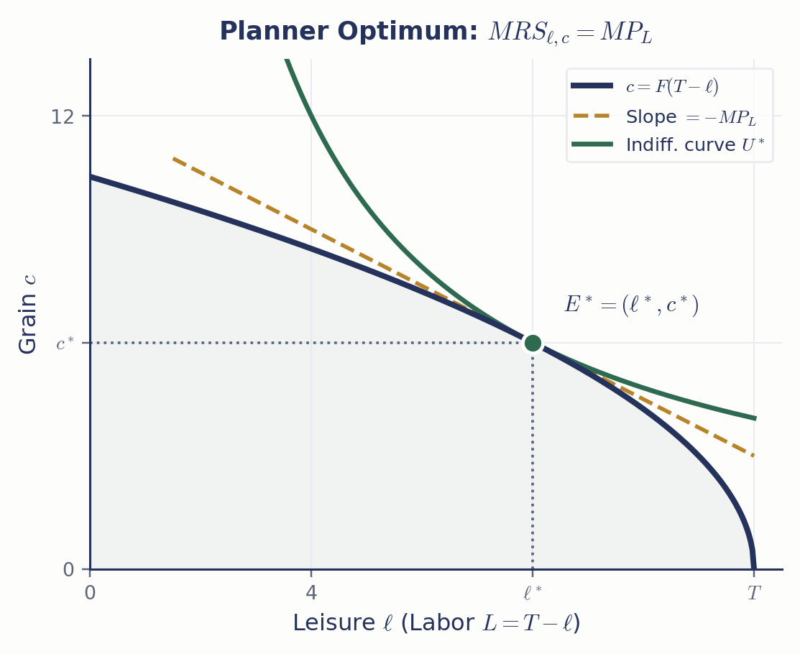
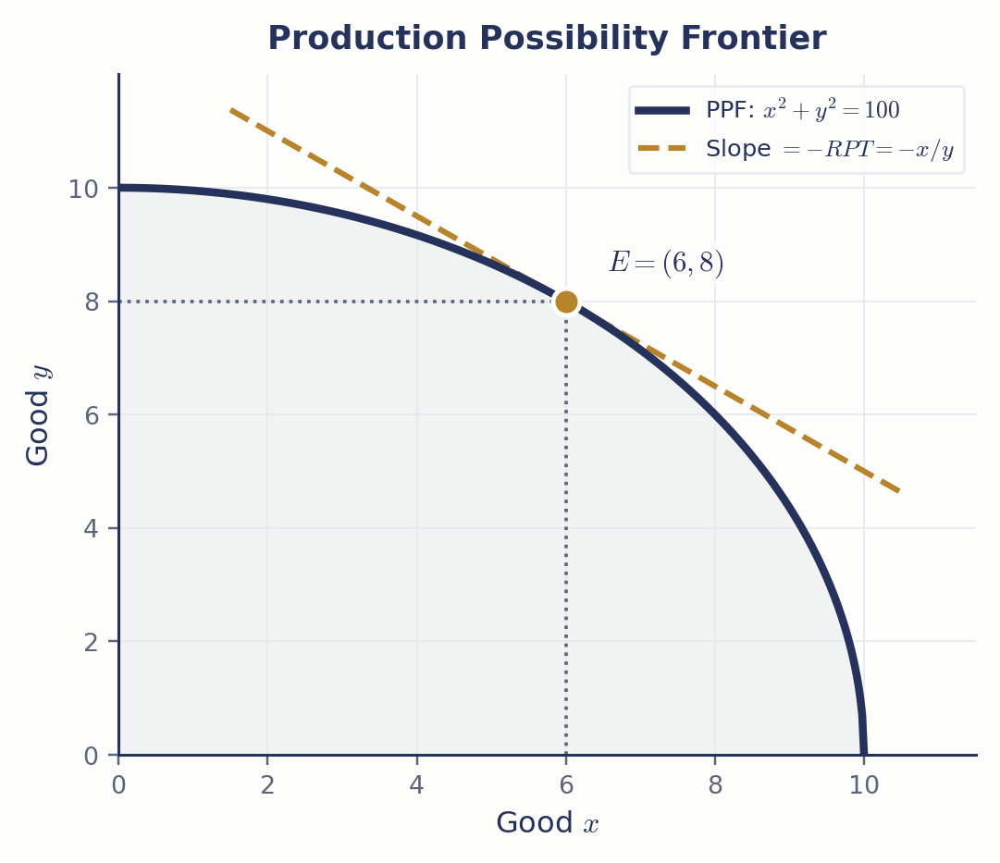
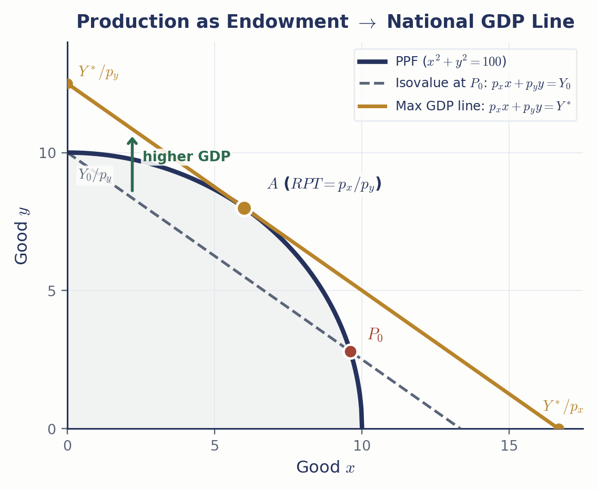
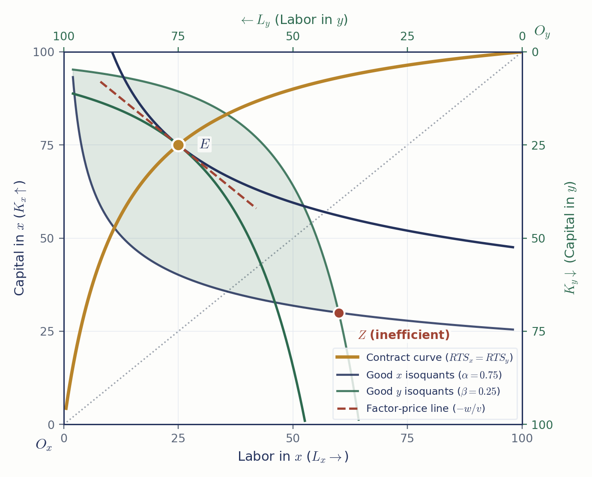
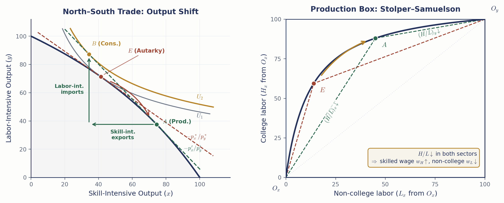
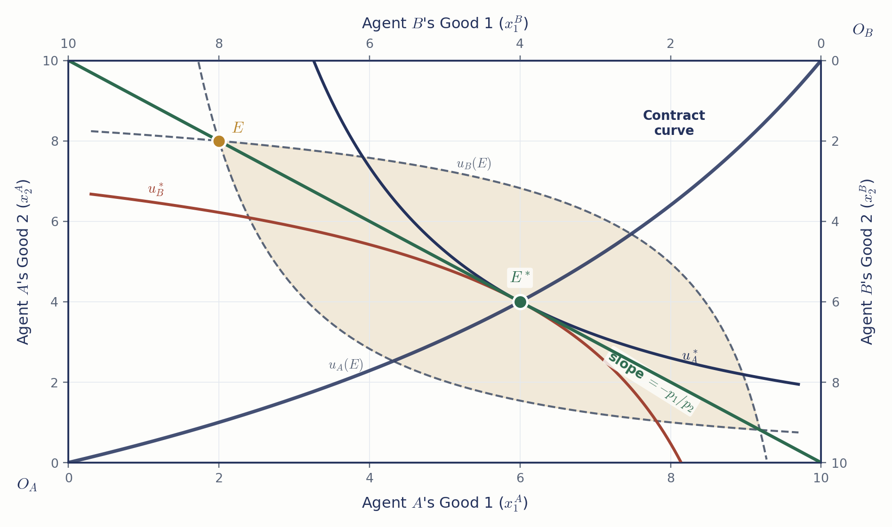
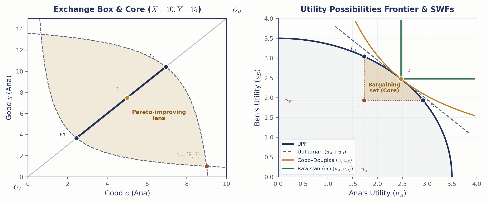
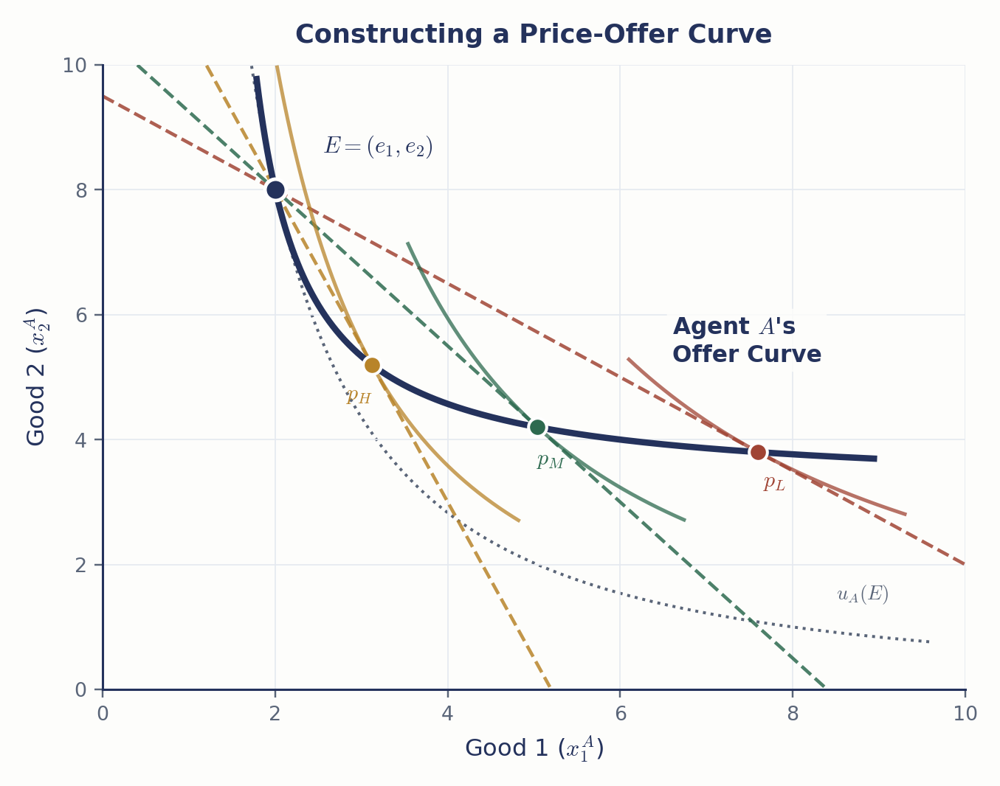
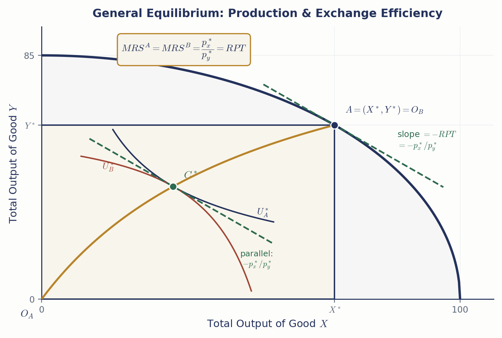

## From Partial to General Equilibrium

Partial equilibrium holds all other prices and incomes fixed. That breaks down when a shock moves factor prices or shifts purchasing power across groups.

- **All prices and incomes are endogenous:** 
   - **prices:** output prices, wages, capital and land rents, interest rates adjust together.
   - **incomes:** households own labor, land, capital, and profit shares in firms.
- **Two lectures, one framework:**
  1. **Part I (Today):** Production, the PPF, gains from trade, and how output prices drive factor returns (Corn Laws, Stolper–Samuelson).
  2. **Part II (Next week):** Pure exchange, property rights, the Core, bargaining vs. price-setting power, the Welfare Theorems, and full GE integration.

> Relevant Readings: Nicholson & Snyder Ch. 13; Bowles & Halliday Ch. 4 and Ch. 14.

---

## Part I:<br> Production, the PPF, <br>Trade, and Factor Prices {.divider}

How technology and endowments pin down opportunity costs, trade gains, and factor returns

---

## A One-Farm Economy: The Planner's Problem {.compact}

:::: {.columns}
::: {.column width="54%"}
Simple general equilibrium: **one household, one farm, two goods** (grain $c$ and leisure $\ell$) under autarky. *(PS 3, Q4.)*

- Time endowment $T$: $L + \ell = T$.
- Farm technology: $c = F(L) = F(T - \ell)$.
- Preferences: $U(c, \ell)$.

A planner (or isolated household) solves:
$$\max_{L}\; U\bigl(F(L),\, T - L\bigr)$$

::: {.fragment}
By the chain rule, the first-order condition is:
$$\frac{dU}{dL} = U_c\,F'(L) - U_\ell = 0 \implies MRS_{\ell,c} \equiv \frac{U_\ell}{U_c} = F'(L) \equiv MP_L.$$
:::
:::

::: {.column width="46%"}
{fig-align="center" width="100%"}
:::
::::

::: {.fragment}
> *Chayanovian household (1925):* without a labor market, production and consumption cannot separate—household size $T$ and preferences directly govern farm labor $L^*$, output, and implicit farm surplus.
:::

---

## Worked Example  {.compact}

Take $T = 12$ hours, farm technology $c = F(L) = 3\sqrt{L}$, and preferences $U(c, \ell) = \ln c + \ln \ell$.

::: {.incremental}
- The planner maximizes $\ln\bigl(3\sqrt{L}\bigr) + \ln(12 - L)$:
  $$\frac{dU}{dL} = \frac{1}{2L} - \frac{1}{12 - L} = 0 \implies 12 - L = 2L \implies L^* = 4.$$
- Therefore $\ell^* = 12 - 4 = 8$ hours and $c^* = 3\sqrt{4} = 6$ units of grain.
- **Verify the tangency condition:**
  $$MRS_{\ell, c} = \frac{U_\ell}{U_c} = \frac{c^*}{\ell^*} = \frac{6}{8} = \frac{3}{4} = \frac{3}{2\sqrt{4}} = MP_L.$$
:::

::: {.fragment}
> *Implied shadow wage:* at $E^*$, one extra hour of leisure costs $\tfrac{3}{4}$ unit of grain.
:::

---

## Decentralizing the One-Farm Economy {.compact}

Now imagine a village of heterogeneous farms with competitive **grain and labor markets** at prices $(p, w)$. The household of the last slide makes two separate decisions:

:::: {.columns}
::: {.column width="49%"}
**1. As a farm (maximize profit):**

$$\pi = \max_L \; p F(L) - wL \implies p\,MP_L = w$$

With $p = 1$ (numeraire) and $w/p = \tfrac{3}{4}$:

- $L^d = 4$, output $F(4) = 6$, profit $\pi = 6 - \tfrac{3}{4}(4) = 3$.
:::

::: {.column width="51%"}
**2. As a household (maximize utility):**

$$\max_{c,\ell} \; \ln c + \ln \ell \quad \text{s.t.} \quad p c + w\ell = 12w + \pi$$

With $p = 1$, $w/p = \tfrac{3}{4}$, and $\pi = 3$:

- Full income $M = 12(\tfrac{3}{4}) + 3 = 12$.
- Demands: $c = 6$, $\ell = 8 \implies L^s = 4$.
:::
::::

::: {.fragment}
::: {.callout-note}
## Separability Property (Singh, Squire & Strauss, 1986)
With a complete labor market, the farm maximizes profit independently of household preferences ($T$ or $U$), and the household optimizes subject to full income. The equilibrium real wage enforces $MRS_{\ell, c} = w^*/p = MP_L$.
:::
:::

---

## Gains from Trade in a Two-Farm Village {.compact}

With one isolated farm, $w^*/p = \tfrac{3}{4}$ merely replicates autarky. Markets create **gains from trade** when households differ in land or labor endowments:

- **Land-rich Farm $A$** ($F_A = 3\sqrt{L}$, $T_A = 12$): autarky $L_A = 4$, $c_A = 6$, shadow wage $w_A^{\text{aut}} = 0.75$.
- **Land-poor Farm $B$** ($F_B = \sqrt{L}$, $T_B = 18$): autarky $L_B = 6$, $c_B = \sqrt{6} \approx 2.45$, shadow wage $w_B^{\text{aut}} \approx 0.20$.

Open a village labor market ($p=1$): $w^* = 0.50$ clears labor ($L_A^d - L_A^s = 7.5 = L_B^s - L_B^d$):

| Regime | $L_A^d,\; L_B^d$ | Total Labor | Total Grain ($Q_A + Q_B$) | Utility ($c_A\ell_A,\; c_B\ell_B$) |
|---|---|---|---|---|
| **Autarky** ($MP_L^A > MP_L^B$) | $4.0,\; 6.0$ | $10.0$ | $6.00 + 2.45 = \mathbf{8.45}$ | $48.0,\; 29.4$ |
| **Market** ($w^* = 0.50$) | $9.0,\; 1.0$ | $10.0$ | $9.00 + 1.00 = \mathbf{10.00}$ | $\mathbf{55.1},\; \mathbf{45.1}$ |

::: {.fragment}
- **Two named gains from trade:**
  1. **Production (reallocation) gain:** equalizing $MP_L^A = w^* = MP_L^B$ yields **$+18\%$ more grain** from the same $10$ hours of village labor.
  2. **Exchange (consumption) gain:** $A$ hires labor and enjoys more leisure ($\ell_A: 8 \to 10.5$); $B$ sells labor and nearly doubles grain ($c_B: 2.45 \to 4.75$). *(Click `Try w = 0.50` next to see Farm $A$'s side.)*
:::

---

## Interactive: One-Farm Economy — Planner vs. Market Wage {.compact}

Depending on $w/p$, the household is a **net hirer** ($L^d > L^s$), **net seller** ($L^d < L^s$), or **self-sufficient** ($L^d = L^s$).

```{=html}
<div id="rc-root">
  <style>
    #rc-root {
      font-family: -apple-system, BlinkMacSystemFont, "Segoe UI", Roboto, Arial, sans-serif;
      font-size: 13.5px;
      line-height: 1.35;
      color: #1c2430;
      background: #fdfdfb;
      width: 100%;
      max-width: 1180px;
      margin: 0 auto;
      box-sizing: border-box;
      display: flex;
      gap: 16px;
      align-items: stretch;
    }
    #rc-root * { box-sizing: border-box; }
    #rc-left {
      flex: 0 0 34%;
      min-width: 300px;
      display: flex;
      flex-direction: column;
      gap: 10px;
    }
    #rc-right {
      flex: 1 1 66%;
      display: flex;
      align-items: center;
      justify-content: center;
    }
    .rc-card {
      background: #f7f6f2;
      border: 1px solid #e5e9f0;
      border-radius: 8px;
      padding: 11px 13px;
    }
    .rc-card-white {
      background: #ffffff;
      border: 1px solid #e5e9f0;
      border-radius: 8px;
      padding: 10px 13px;
      flex: 1;
    }
    .rc-slider-row {
      display: flex;
      justify-content: space-between;
      align-items: baseline;
      margin-bottom: 4px;
    }
    .rc-label {
      font-weight: 600;
      color: #24325c;
      font-size: 13.5px;
    }
    .rc-val-badge {
      font-family: "SFMono-Regular", Consolas, "Liberation Mono", Menlo, monospace;
      font-weight: 700;
      font-size: 15px;
      color: #b8842a;
      background: #fdfdfb;
      border: 1px solid #e5e9f0;
      border-radius: 4px;
      padding: 1px 7px;
    }
    #rc-w-slider {
      width: 100%;
      accent-color: #b8842a;
      cursor: pointer;
      margin: 4px 0;
    }
    .rc-ticks {
      display: flex;
      justify-content: space-between;
      font-size: 11px;
      color: #5a6578;
      margin-bottom: 8px;
    }
    .rc-btns {
      display: flex;
      gap: 8px;
    }
    .rc-btn {
      flex: 1;
      padding: 6px 8px;
      font-size: 12px;
      font-weight: 600;
      border-radius: 5px;
      border: 1px solid #24325c;
      background: #ffffff;
      color: #24325c;
      cursor: pointer;
      transition: background 0.15s, color 0.15s;
    }
    .rc-btn:hover {
      background: #24325c;
      color: #fdfdfb;
    }
    .rc-btn-accent {
      border-color: #a04434;
      color: #a04434;
    }
    .rc-btn-accent:hover {
      background: #a04434;
      color: #fdfdfb;
    }
    .rc-table {
      width: 100%;
      border-collapse: collapse;
      font-size: 13px;
    }
    .rc-table td {
      padding: 4.5px 2px;
      border-bottom: 1px solid #eef1f6;
      vertical-align: middle;
    }
    .rc-table tr:last-child td {
      border-bottom: none;
    }
    .rc-table .rc-metric {
      color: #5a6578;
    }
    .rc-table .rc-num {
      text-align: right;
      font-family: "SFMono-Regular", Consolas, "Liberation Mono", Menlo, monospace;
      font-weight: 600;
      color: #24325c;
    }
    .rc-status-pill {
      display: inline-block;
      font-size: 11px;
      font-weight: 700;
      padding: 2px 7px;
      border-radius: 999px;
      margin-top: 6px;
    }
    .rc-eq { background: rgba(45, 106, 79, 0.12); color: #2d6a4f; }
    .rc-diseq { background: rgba(160, 68, 52, 0.12); color: #a04434; }
    #rc-svg {
      width: 100%;
      height: auto;
      max-height: 460px;
      display: block;
      background: #fdfdfb;
      border: 1px solid #e5e9f0;
      border-radius: 8px;
    }
  </style>

  <div id="rc-left">
    <div class="rc-card">
      <div class="rc-slider-row">
        <span class="rc-label">Market wage <em>w</em></span>
        <span class="rc-val-badge" id="rc-w-val">0.75</span>
      </div>
      <input id="rc-w-slider" type="range" min="0.35" max="1.50" step="0.05" value="0.75" />
      <div class="rc-ticks">
        <span>0.35</span>
        <span>w* = 0.75</span>
        <span>1.50</span>
      </div>
      <div class="rc-btns">
        <button type="button" class="rc-btn" id="rc-btn-eq">Snap to w* = 0.75</button>
        <button type="button" class="rc-btn rc-btn-accent" id="rc-btn-low">Try w = 0.50</button>
      </div>
    </div>

    <div class="rc-card-white">
      <table class="rc-table">
        <tr>
          <td class="rc-metric">Market wage <em>w</em></td>
          <td class="rc-num" id="rc-out-w">0.75</td>
        </tr>
        <tr>
          <td class="rc-metric">Farm labor demand <em>L<sup>d</sup></em>(<em>w</em>)</td>
          <td class="rc-num" id="rc-out-ld" style="color:#b8842a;">4.00</td>
        </tr>
        <tr>
          <td class="rc-metric">Household labor supply <em>L<sup>s</sup></em>(<em>w</em>)</td>
          <td class="rc-num" id="rc-out-ls" style="color:#2d6a4f;">4.00</td>
        </tr>
        <tr>
          <td class="rc-metric">Excess labor demand <em>L<sup>d</sup> &minus; L<sup>s</sup></em></td>
          <td class="rc-num" id="rc-out-ed">0.00</td>
        </tr>
        <tr>
          <td class="rc-metric">Farm profit <em>&pi;</em>(<em>w</em>)</td>
          <td class="rc-num" id="rc-out-pi">3.00</td>
        </tr>
        <tr>
          <td class="rc-metric">Household bundle (<em>&ell;<sup>h</sup></em>, <em>c<sup>h</sup></em>)</td>
          <td class="rc-num" id="rc-out-ch">(8.00, 6.00)</td>
        </tr>
      </table>
      <div style="display:flex; justify-content:space-between; align-items:center; margin-top:4px;">
        <span style="font-size:11px; color:#5a6578;">T = 12, c = 3&radic;L, U = ln c + ln &ell;</span>
        <span id="rc-status" class="rc-status-pill rc-eq">Market Clears</span>
      </div>
    </div>
  </div>

  <div id="rc-right">
    <svg id="rc-svg" viewBox="0 0 560 410" xmlns="http://www.w3.org/2000/svg">
      <defs>
        <clipPath id="rc-plot-clip">
          <rect x="54" y="22" width="482" height="338" />
        </clipPath>
      </defs>

      <!-- Grid & axes -->
      <g id="rc-grid"></g>
      <line x1="54" y1="360" x2="536" y2="360" stroke="#24325c" stroke-width="1.6" />
      <line x1="54" y1="22" x2="54" y2="360" stroke="#24325c" stroke-width="1.6" />
      <g id="rc-axes-labels"></g>

      <!-- Clipped curves -->
      <g clip-path="url(#rc-plot-clip)">
        <path id="rc-ppf-fill" fill="rgba(36, 50, 92, 0.045)" stroke="none" />
        <path id="rc-ppf" fill="none" stroke="#24325c" stroke-width="3" stroke-linecap="round" />
        <line id="rc-budget" stroke="#b8842a" stroke-width="2.3" />
        <path id="rc-ic" fill="none" stroke="#2d6a4f" stroke-width="2.3" />

        <!-- Drop lines & excess demand indicator -->
        <line id="rc-drop-farm" stroke="#b8842a" stroke-width="1.2" stroke-dasharray="4 3" opacity="0.7" />
        <line id="rc-drop-hh" stroke="#2d6a4f" stroke-width="1.2" stroke-dasharray="4 3" opacity="0.7" />
        <g id="rc-ed-bar"></g>
      </g>

      <!-- Planner optimum marker at (8, 6) -->
      <g id="rc-planner-mark"></g>

      <!-- Active points -->
      <circle id="rc-pt-farm" r="5.5" fill="#b8842a" stroke="#fdfdfb" stroke-width="1.8" />
      <circle id="rc-pt-hh" r="5.5" fill="#2d6a4f" stroke="#fdfdfb" stroke-width="1.8" />
      <text id="rc-lbl-farm" font-size="12" font-weight="700" fill="#b8842a"></text>
      <text id="rc-lbl-hh" font-size="12" font-weight="700" fill="#2d6a4f"></text>

      <!-- Legend -->
      <g transform="translate(342, 30)">
        <rect x="0" y="0" width="186" height="80" rx="6" fill="#fdfdfb" fill-opacity="0.93" stroke="#e5e9f0" />
        <line x1="10" y1="17" x2="28" y2="17" stroke="#24325c" stroke-width="3" />
        <text x="34" y="21" font-size="11.5" fill="#24325c">PPF: c = 3&radic;(12 &minus; &ell;)</text>
        <line x1="10" y1="36" x2="28" y2="36" stroke="#b8842a" stroke-width="2.3" />
        <text x="34" y="40" font-size="11.5" fill="#1c2430">Budget / Isoprofit (F)</text>
        <line x1="10" y1="55" x2="28" y2="55" stroke="#2d6a4f" stroke-width="2.3" />
        <text x="34" y="59" font-size="11.5" fill="#1c2430">Indifference curve (H)</text>
        <circle cx="19" cy="70" r="4.5" fill="none" stroke="#5a6578" stroke-width="1.4" />
        <text x="34" y="74" font-size="11" fill="#5a6578">Planner E* = (8, 6)</text>
      </g>
    </svg>
  </div>
</div>

<script>
(function () {
  var X0 = 54, Y0 = 360, PW = 482, PH = 338;
  var LMAX = 12, CMAX = 14;
  var NS = "http://www.w3.org/2000/svg";

  function sx(l) { return X0 + (l / LMAX) * PW; }
  function sy(c) { return Y0 - (c / CMAX) * PH; }

  function el(tag, attrs, parent) {
    var node = document.createElementNS(NS, tag);
    for (var k in attrs) node.setAttribute(k, attrs[k]);
    if (parent) parent.appendChild(node);
    return node;
  }

  // Draw static grid & axes labels
  var gridG = document.getElementById("rc-grid");
  var lblG = document.getElementById("rc-axes-labels");

  for (var l = 0; l <= 12; l += 2) {
    var gx = sx(l);
    if (l > 0) el("line", { x1: gx, y1: 22, x2: gx, y2: 360, stroke: "#e5e9f0", "stroke-width": 1 }, gridG);
    el("line", { x1: gx, y1: 360, x2: gx, y2: 365, stroke: "#24325c", "stroke-width": 1.2 }, lblG);
    var tx = el("text", { x: gx, y: 379, "text-anchor": "middle", "font-size": 11.5, fill: "#5a6578" }, lblG);
    tx.textContent = l;
  }
  for (var c = 0; c <= 14; c += 2) {
    var gy = sy(c);
    if (c > 0) el("line", { x1: 54, y1: gy, x2: 536, y2: gy, stroke: "#e5e9f0", "stroke-width": 1 }, gridG);
    el("line", { x1: 49, y1: gy, x2: 54, y2: gy, stroke: "#24325c", "stroke-width": 1.2 }, lblG);
    var ty = el("text", { x: 44, y: gy + 4, "text-anchor": "end", "font-size": 11.5, fill: "#5a6578" }, lblG);
    ty.textContent = c;
  }

  var xTitle = el("text", { x: X0 + PW / 2, y: 400, "text-anchor": "middle", "font-size": 13, "font-weight": 600, fill: "#24325c" }, lblG);
  xTitle.textContent = "Leisure \u2113 (hours)   [Labor L = 12 \u2212 \u2113]";

  var yTitle = el("text", { x: 16, y: 22 + PH / 2, "text-anchor": "middle", "font-size": 13, "font-weight": 600, fill: "#24325c", transform: "rotate(-90 16 " + (22 + PH / 2) + ")" }, lblG);
  yTitle.textContent = "Consumption c";

  // Static PPF curve c = 3 * sqrt(12 - l)
  var ppfPts = [];
  for (var i = 0; i <= 180; i++) {
    var lv = (i / 180) * 12;
    var cv = 3 * Math.sqrt(Math.max(0, 12 - lv));
    ppfPts.push((i === 0 ? "M" : "L") + sx(lv).toFixed(2) + "," + sy(cv).toFixed(2));
  }
  document.getElementById("rc-ppf").setAttribute("d", ppfPts.join(" "));
  document.getElementById("rc-ppf-fill").setAttribute("d", ppfPts.join(" ") + " L" + sx(12).toFixed(2) + "," + sy(0).toFixed(2) + " L" + sx(0).toFixed(2) + "," + sy(0).toFixed(2) + " Z");

  // Planner optimum (8, 6)
  var pG = document.getElementById("rc-planner-mark");
  var px = sx(8), py = sy(6);
  el("circle", { cx: px, cy: py, r: 9.5, fill: "none", stroke: "#5a6578", "stroke-width": 1.5, "stroke-dasharray": "3 2" }, pG);
  el("line", { x1: px - 13, y1: py, x2: px + 13, y2: py, stroke: "#5a6578", "stroke-width": 1, opacity: 0.6 }, pG);
  el("line", { x1: px, y1: py - 13, x2: px, y2: py + 13, stroke: "#5a6578", "stroke-width": 1, opacity: 0.6 }, pG);

  var slider = document.getElementById("rc-w-slider");
  var wVal = document.getElementById("rc-w-val");
  var outW = document.getElementById("rc-out-w");
  var outLd = document.getElementById("rc-out-ld");
  var outLs = document.getElementById("rc-out-ls");
  var outEd = document.getElementById("rc-out-ed");
  var outPi = document.getElementById("rc-out-pi");
  var outCh = document.getElementById("rc-out-ch");
  var statusEl = document.getElementById("rc-status");

  var budgetLine = document.getElementById("rc-budget");
  var icPath = document.getElementById("rc-ic");
  var dropFarm = document.getElementById("rc-drop-farm");
  var dropHh = document.getElementById("rc-drop-hh");
  var edBarG = document.getElementById("rc-ed-bar");
  var ptFarm = document.getElementById("rc-pt-farm");
  var ptHh = document.getElementById("rc-pt-hh");
  var lblFarm = document.getElementById("rc-lbl-farm");
  var lblHh = document.getElementById("rc-lbl-hh");

  function update() {
    var w = parseFloat(slider.value);
    var Ld = Math.min(12, Math.max(0, Math.pow(1.5 / w, 2)));
    var lFarm = 12 - Ld;
    var cFarm = 3 * Math.sqrt(Ld);
    var pi = cFarm - w * Ld;

    var M = 12 * w + pi;
    var lH = M / (2 * w);
    var cH;
    if (lH >= 12) {
      lH = 12;
      cH = pi;
    } else {
      cH = M / 2;
    }
    var Ls = 12 - lH;
    var ed = Ld - Ls;

    // Update readouts
    wVal.textContent = w.toFixed(2);
    outW.textContent = w.toFixed(2);
    outLd.textContent = Ld.toFixed(2);
    outLs.textContent = Ls.toFixed(2);
    outPi.textContent = pi.toFixed(2);
    outCh.textContent = "(" + lH.toFixed(2) + ", " + cH.toFixed(2) + ")";

    var isEq = Math.abs(ed) < 0.01;
    outEd.textContent = isEq ? "0.00" : (ed > 0 ? "+" : "") + ed.toFixed(2);
    outEd.style.color = isEq ? "#2d6a4f" : "#a04434";

    if (isEq) {
      statusEl.textContent = "Market Clears (GE)";
      statusEl.className = "rc-status-pill rc-eq";
    } else if (ed > 0) {
      statusEl.textContent = "Excess Labor Demand";
      statusEl.className = "rc-status-pill rc-diseq";
    } else {
      statusEl.textContent = "Excess Labor Supply";
      statusEl.className = "rc-status-pill rc-diseq";
    }

    // Budget line: c(l) = pi + w*(12 - l), from l=0 to l=12
    budgetLine.setAttribute("x1", sx(0).toFixed(2));
    budgetLine.setAttribute("y1", sy(pi + 12 * w).toFixed(2));
    budgetLine.setAttribute("x2", sx(12).toFixed(2));
    budgetLine.setAttribute("y2", sy(pi).toFixed(2));

    // Indifference curve: c = (cH * lH) / l
    var Uval = cH * lH;
    var icPts = [];
    for (var i = 1; i <= 200; i++) {
      var lv = 0.08 + (i / 200) * (12 - 0.08);
      var cv = Uval / lv;
      if (cv <= CMAX + 2) {
        icPts.push((icPts.length === 0 ? "M" : "L") + sx(lv).toFixed(2) + "," + sy(cv).toFixed(2));
      }
    }
    icPath.setAttribute("d", icPts.join(" "));

    // Points & drop lines
    var fx = sx(lFarm), fy = sy(cFarm);
    var hx = sx(lH), hy = sy(cH);
    ptFarm.setAttribute("cx", fx.toFixed(2));
    ptFarm.setAttribute("cy", fy.toFixed(2));
    ptHh.setAttribute("cx", hx.toFixed(2));
    ptHh.setAttribute("cy", hy.toFixed(2));

    dropFarm.setAttribute("x1", fx.toFixed(2));
    dropFarm.setAttribute("y1", fy.toFixed(2));
    dropFarm.setAttribute("x2", fx.toFixed(2));
    dropFarm.setAttribute("y2", Y0);

    dropHh.setAttribute("x1", hx.toFixed(2));
    dropHh.setAttribute("y1", hy.toFixed(2));
    dropHh.setAttribute("x2", hx.toFixed(2));
    dropHh.setAttribute("y2", Y0);

    // Excess demand bracket along bottom inside plot
    while (edBarG.firstChild) edBarG.removeChild(edBarG.firstChild);
    if (!isEq) {
      var barY = Y0 - 14;
      var xMin = Math.min(fx, hx), xMax = Math.max(fx, hx);
      el("line", { x1: xMin, y1: barY, x2: xMax, y2: barY, stroke: "#a04434", "stroke-width": 2.4 }, edBarG);
      el("line", { x1: xMin, y1: barY - 4, x2: xMin, y2: barY + 4, stroke: "#a04434", "stroke-width": 1.8 }, edBarG);
      el("line", { x1: xMax, y1: barY - 4, x2: xMax, y2: barY + 4, stroke: "#a04434", "stroke-width": 1.8 }, edBarG);
      var edLbl = el("text", { x: (xMin + xMax) / 2, y: barY - 6, "text-anchor": "middle", "font-size": 11, "font-weight": 700, fill: "#a04434" }, edBarG);
      edLbl.textContent = (ed > 0 ? "L\u1d48 \u2212 L\u02e2 = +" : "L\u1d48 \u2212 L\u02e2 = ") + ed.toFixed(2);
    }

    // Labels for F and H
    if (isEq) {
      lblFarm.textContent = "F = H = E* (8, 6)";
      lblFarm.setAttribute("x", (fx + 12).toFixed(2));
      lblFarm.setAttribute("y", (fy - 10).toFixed(2));
      lblFarm.setAttribute("text-anchor", "start");
      lblFarm.setAttribute("fill", "#24325c");
      lblHh.textContent = "";
    } else {
      lblFarm.setAttribute("fill", "#b8842a");
      lblFarm.textContent = "F (" + lFarm.toFixed(1) + ", " + cFarm.toFixed(1) + ")";
      lblFarm.setAttribute("x", (lFarm < 1.5 ? fx + 9 : fx - 8).toFixed(2));
      lblFarm.setAttribute("y", (fy - 10).toFixed(2));
      lblFarm.setAttribute("text-anchor", lFarm < 1.5 ? "start" : "end");

      lblHh.textContent = "H (" + lH.toFixed(1) + ", " + cH.toFixed(1) + ")";
      lblHh.setAttribute("x", (lH > 10.2 ? hx - 9 : hx + 9).toFixed(2));
      lblHh.setAttribute("y", (hy - 10).toFixed(2));
      lblHh.setAttribute("text-anchor", lH > 10.2 ? "end" : "start");
    }
  }

  slider.addEventListener("input", update);
  document.getElementById("rc-btn-eq").addEventListener("click", function () {
    slider.value = "0.75";
    update();
  });
  document.getElementById("rc-btn-low").addEventListener("click", function () {
    slider.value = "0.50";
    update();
  });

  update();
})();
</script>
```

---

## From One Farm to Two Sectors: Building a PPF {.compact}

:::: {.columns}
::: {.column width="54%"}
Allocate a fixed stock of labor $\bar{L} = 100$ across two sectors with diminishing returns (NS Example 13.1):

$$x = \sqrt{l_x}, \qquad y = \sqrt{l_y}, \qquad l_x + l_y = 100.$$

Substituting $l_x = x^2$ and $l_y = y^2$ gives the **PPF**:

$$x^2 + y^2 = 100 \qquad (x, y \ge 0).$$

- The **Rate of Product Transformation (RPT)** is the opportunity cost of $x$ in terms of forgone $y$:
  $$RPT_{x,y} = -\left.\frac{dy}{dx}\right|_{\text{PPF}} = \frac{x}{y}.$$
  *(Intuition: $1$ more $x$ takes $1/MP_{Lx} = 2x$ labor, each costing $MP_{Ly} = 1/(2y)$ of $y$, so $2x/(2y) = x/y$.)*
- Moving clockwise along the PPF raises $x/y$: the frontier is **concave** (increasing opportunity cost).
:::

::: {.column width="46%"}
{fig-align="center" width="100%"}
:::
::::

---

## Interactive: Tracing the PPF in Four Quadrants {.compact}

```{=html}
<div id="fq-root">
  <style>
    #fq-root {
      font-family: -apple-system, BlinkMacSystemFont, "Segoe UI", Roboto, Arial, sans-serif;
      font-size: 13.5px;
      line-height: 1.35;
      color: #1c2430;
      background: #fdfdfb;
      width: 100%;
      max-width: 1180px;
      margin: 0 auto;
      box-sizing: border-box;
      display: flex;
      gap: 16px;
      align-items: stretch;
    }
    #fq-root * { box-sizing: border-box; }
    #fq-left {
      flex: 0 0 34%;
      min-width: 295px;
      display: flex;
      flex-direction: column;
      gap: 10px;
    }
    #fq-right {
      flex: 1 1 66%;
      display: flex;
      align-items: center;
      justify-content: center;
    }
    .fq-card {
      background: #f7f6f2;
      border: 1px solid #e5e9f0;
      border-radius: 8px;
      padding: 9px 12px;
    }
    .fq-card-white {
      background: #ffffff;
      border: 1px solid #e5e9f0;
      border-radius: 8px;
      padding: 8px 12px;
      flex: 1;
    }
    .fq-slider-row {
      display: flex;
      justify-content: space-between;
      align-items: baseline;
      margin-bottom: 2px;
    }
    .fq-label {
      font-weight: 600;
      color: #24325c;
      font-size: 13px;
    }
    .fq-val-badge {
      font-family: "SFMono-Regular", Consolas, "Liberation Mono", Menlo, monospace;
      font-weight: 700;
      font-size: 14px;
      color: #b8842a;
      background: #fdfdfb;
      border: 1px solid #e5e9f0;
      border-radius: 4px;
      padding: 1px 7px;
    }
    #fq-lx-slider, #fq-L-slider {
      width: 100%;
      accent-color: #b8842a;
      cursor: pointer;
      margin: 3px 0;
    }
    .fq-ticks {
      display: flex;
      justify-content: space-between;
      font-size: 11px;
      color: #5a6578;
      margin-bottom: 6px;
    }
    .fq-btns {
      display: flex;
      gap: 8px;
    }
    .fq-btn {
      flex: 1;
      padding: 6px 8px;
      font-size: 12.5px;
      font-weight: 600;
      border-radius: 5px;
      cursor: pointer;
      border: 1px solid #24325c;
      background: #ffffff;
      color: #24325c;
      transition: background 0.15s, color 0.15s;
    }
    .fq-btn:hover { background: #eef1f7; }
    .fq-btn-play {
      background: #24325c;
      color: #ffffff;
    }
    .fq-btn-play:hover { background: #1a2547; }
    .fq-table {
      width: 100%;
      border-collapse: collapse;
      font-size: 13px;
    }
    .fq-table td {
      padding: 4px 4px;
      border-bottom: 1px solid #eef1f6;
      text-align: left;
    }
    .fq-table td:last-child {
      text-align: right;
      font-family: "SFMono-Regular", Consolas, "Liberation Mono", Menlo, monospace;
      font-weight: 600;
    }
    .fq-table tr:last-child td { border-bottom: none; }
    .fq-note {
      margin-top: 8px;
      font-size: 12px;
      color: #5a6578;
      line-height: 1.35;
    }
  </style>

  <div id="fq-left">
    <div class="fq-card">
      <div class="fq-slider-row">
        <span class="fq-label">Labor endowment (<i>L</i>&#772;)</span>
        <span class="fq-val-badge" id="fq-L-val">100</span>
      </div>
      <input type="range" id="fq-L-slider" min="50" max="150" step="5" value="100" />
      <div class="fq-ticks">
        <span>50</span>
        <span>100</span>
        <span>150</span>
      </div>

      <div class="fq-slider-row">
        <span class="fq-label">Labor in good <i>x</i> (<i>l</i><sub>x</sub>)</span>
        <span class="fq-val-badge" id="fq-lx-val">36</span>
      </div>
      <input type="range" id="fq-lx-slider" min="0" max="100" step="1" value="36" />
      <div class="fq-ticks">
        <span>0 (all <i>y</i>)</span>
        <span id="fq-lx-mid">50</span>
        <span id="fq-lx-max">100 (all <i>x</i>)</span>
      </div>
      <div class="fq-btns">
        <button type="button" class="fq-btn fq-btn-play" id="fq-btn-play">&#9654; Animate</button>
        <button type="button" class="fq-btn" id="fq-btn-e">E = (6, 8)</button>
      </div>
    </div>

    <div class="fq-card-white">
      <table class="fq-table">
        <tr><td>Labor in <i>x</i> (<i>l</i><sub>x</sub>)</td><td id="fq-r-lx" style="color:#a04434;">36</td></tr>
        <tr><td>Labor in <i>y</i> (<i>l</i><sub>y</sub> = <span id="fq-r-L-expr">100</span> &minus; <i>l</i><sub>x</sub>)</td><td id="fq-r-ly" style="color:#2d6a4f;">64</td></tr>
        <tr><td>Output <i>x</i> = &radic;<i>l</i><sub>x</sub></td><td id="fq-r-x" style="color:#a04434;">6.00</td></tr>
        <tr><td>Output <i>y</i> = &radic;<i>l</i><sub>y</sub></td><td id="fq-r-y" style="color:#2d6a4f;">8.00</td></tr>
        <tr><td><i>RPT</i> = <i>x</i> / <i>y</i></td><td id="fq-r-rpt" style="color:#b8842a;">0.75</td></tr>
      </table>
      <div class="fq-note">
        <b>Q1:</b> PPF <i>x</i>&sup2;+<i>y</i>&sup2;=<span id="fq-n-L1">100</span> &nbsp;|&nbsp; <b>Q2:</b> <i>y</i>=&radic;<i>l</i><sub>y</sub><br>
        <b>Q3:</b> <i>l</i><sub>x</sub>+<i>l</i><sub>y</sub>=<span id="fq-n-L3">100</span> &nbsp;|&nbsp; <b>Q4:</b> <i>x</i>=&radic;<i>l</i><sub>x</sub>
      </div>
    </div>
  </div>

  <div id="fq-right">
    <svg id="fq-svg" viewBox="0 0 540 430" style="width:100%; max-height:455px; background:#ffffff; border:1px solid #e5e9f0; border-radius:8px;">
      <!-- Gridlines will be added by JS -->
      <g id="fq-grid"></g>

      <!-- Main cross axes -->
      <line x1="50" y1="215" x2="495" y2="215" stroke="#24325c" stroke-width="1.8" />
      <line x1="270" y1="25" x2="270" y2="405" stroke="#24325c" stroke-width="1.8" />

      <!-- Axis labels -->
      <text x="502" y="219" font-size="13" font-weight="700" fill="#24325c">x</text>
      <text x="270" y="18" font-size="13" font-weight="700" fill="#24325c" text-anchor="middle">y</text>
      <text x="42" y="219" font-size="12.5" font-weight="700" fill="#2d6a4f" text-anchor="end">l<tspan dy="3" font-size="9.5">y</tspan></text>
      <text x="270" y="421" font-size="12.5" font-weight="700" fill="#a04434" text-anchor="middle">l<tspan dy="3" font-size="9.5">x</tspan></text>

      <!-- Quadrant titles -->
      <text id="fq-title-q1" x="478" y="40" font-size="11.5" font-weight="700" fill="#24325c" text-anchor="end">Q1: PPF (x² + y² = 100)</text>
      <text x="64" y="40" font-size="11.5" font-weight="700" fill="#2d6a4f">Q2: y = √l<tspan dy="2.5" font-size="8.5">y</tspan></text>
      <text id="fq-title-q3" x="64" y="395" font-size="11.5" font-weight="700" fill="#5a6578">Q3: l<tspan dy="2.5" font-size="8.5">x</tspan><tspan dy="-2.5"> + l</tspan><tspan dy="2.5" font-size="8.5">y</tspan><tspan dy="-2.5"> = 100</tspan></text>
      <text x="478" y="395" font-size="11.5" font-weight="700" fill="#a04434" text-anchor="end">Q4: x = √l<tspan dy="2.5" font-size="8.5">x</tspan></text>

      <!-- Curves -->
      <path id="fq-curve-q1" fill="none" stroke="#24325c" stroke-width="2.8" />
      <path id="fq-curve-q2" fill="none" stroke="#2d6a4f" stroke-width="2.5" />
      <line id="fq-line-q3" stroke="#5a6578" stroke-width="2.2" />
      <path id="fq-curve-q4" fill="none" stroke="#a04434" stroke-width="2.5" />

      <!-- Projection rectangle -->
      <polygon id="fq-proj-rect" fill="none" stroke="#b8842a" stroke-width="1.8" stroke-dasharray="5,4" />

      <!-- Tangent line at (x, y) in Q1 -->
      <line id="fq-tan-q1" stroke="#b8842a" stroke-width="2" stroke-dasharray="4,3" />

      <!-- Active points -->
      <circle id="fq-pt-q1" r="6" fill="#b8842a" stroke="#ffffff" stroke-width="1.6" />
      <circle id="fq-pt-q2" r="5" fill="#2d6a4f" stroke="#ffffff" stroke-width="1.5" />
      <circle id="fq-pt-q3" r="5" fill="#5a6578" stroke="#ffffff" stroke-width="1.5" />
      <circle id="fq-pt-q4" r="5" fill="#a04434" stroke="#ffffff" stroke-width="1.5" />

      <!-- Point label in Q1 -->
      <text id="fq-lbl-q1" font-size="11.5" font-weight="700" fill="#24325c"></text>
    </svg>
  </div>

  <script>
  (function () {
    const cx = 270, cy = 215;
    // Scale: x, y in [0, 13] -> ~180px (supports L up to 150, max sqrt(150) ≈ 12.25)
    // lx, ly in [0, 150] -> ~170px
    const sOut = 13.8;
    const sLab = 1.13;

    function pxX(x) { return cx + x * sOut; }
    function pxY(y) { return cy - y * sOut; }
    function pxLy(ly) { return cx - ly * sLab; }
    function pxLx(lx) { return cy + lx * sLab; }

    // Draw subtle tick marks & grid
    const gridG = document.getElementById("fq-grid");
    const ns = "http://www.w3.org/2000/svg";
    function addLine(x1, y1, x2, y2, col, w) {
      const el = document.createElementNS(ns, "line");
      el.setAttribute("x1", x1); el.setAttribute("y1", y1);
      el.setAttribute("x2", x2); el.setAttribute("y2", y2);
      el.setAttribute("stroke", col); el.setAttribute("stroke-width", w || 1);
      gridG.appendChild(el);
    }
    function addText(x, y, txt, anchor) {
      const el = document.createElementNS(ns, "text");
      el.setAttribute("x", x); el.setAttribute("y", y);
      el.setAttribute("font-size", "9.5"); el.setAttribute("fill", "#5a6578");
      el.setAttribute("text-anchor", anchor || "middle");
      el.textContent = txt;
      gridG.appendChild(el);
    }

    for (let v = 5; v <= 10; v += 5) {
      addLine(pxX(v), cy - 185, pxX(v), cy + 175, "#eef1f6", 1);
      addLine(cx - 175, pxY(v), cx + 185, pxY(v), "#eef1f6", 1);
      addText(pxX(v), cy + 13, v, "middle");
      addText(cx - 7, pxY(v) + 3, v, "end");
    }
    for (let l = 50; l <= 150; l += 50) {
      addLine(pxLy(l), cy - 185, pxLy(l), cy + 175, "#eef1f6", 1);
      addLine(cx - 175, pxLx(l), cx + 185, pxLx(l), "#eef1f6", 1);
      addText(pxLy(l), cy + 13, l, "middle");
      addText(cx - 7, pxLx(l) + 3, l, "end");
    }

    const sliderL = document.getElementById("fq-L-slider");
    const slider = document.getElementById("fq-lx-slider");
    const btnPlay = document.getElementById("fq-btn-play");
    const btnE = document.getElementById("fq-btn-e");
    let animId = null;
    let dir = 1;

    function drawCurves(L) {
      let d1 = "", d2 = "", d4 = "";
      const steps = 100;
      for (let i = 0; i <= steps; i++) {
        const lx = (L * i) / steps;
        const ly = L - lx;
        const x = Math.sqrt(lx);
        const y = Math.sqrt(ly);
        d1 += (i === 0 ? "M" : "L") + pxX(x).toFixed(1) + "," + pxY(y).toFixed(1) + " ";
        d2 += (i === 0 ? "M" : "L") + pxLy(lx).toFixed(1) + "," + pxY(Math.sqrt(lx)).toFixed(1) + " ";
        d4 += (i === 0 ? "M" : "L") + pxX(Math.sqrt(lx)).toFixed(1) + "," + pxLx(lx).toFixed(1) + " ";
      }
      document.getElementById("fq-curve-q1").setAttribute("d", d1);
      document.getElementById("fq-curve-q2").setAttribute("d", d2);
      document.getElementById("fq-curve-q4").setAttribute("d", d4);

      const l3 = document.getElementById("fq-line-q3");
      l3.setAttribute("x1", pxLy(L)); l3.setAttribute("y1", pxLx(0));
      l3.setAttribute("x2", pxLy(0)); l3.setAttribute("y2", pxLx(L));

      document.getElementById("fq-title-q1").textContent = `Q1: PPF (x² + y² = ${L})`;
      document.getElementById("fq-title-q3").innerHTML =
        `Q3: l<tspan dy="2.5" font-size="8.5">x</tspan><tspan dy="-2.5"> + l</tspan><tspan dy="2.5" font-size="8.5">y</tspan><tspan dy="-2.5"> = ${L}</tspan>`;
    }

    function update() {
      const L = parseFloat(sliderL.value);
      slider.max = L;
      let lx = parseFloat(slider.value);
      if (lx > L) {
        lx = L;
        slider.value = L;
      }
      const ly = L - lx;
      const x = Math.sqrt(lx);
      const y = Math.sqrt(ly);

      drawCurves(L);

      document.getElementById("fq-L-val").textContent = L.toFixed(0);
      document.getElementById("fq-lx-mid").textContent = (L / 2).toFixed(0);
      document.getElementById("fq-lx-max").innerHTML = `${L.toFixed(0)} (all <i>x</i>)`;
      document.getElementById("fq-r-L-expr").textContent = L.toFixed(0);
      document.getElementById("fq-n-L1").textContent = L.toFixed(0);
      document.getElementById("fq-n-L3").textContent = L.toFixed(0);

      document.getElementById("fq-lx-val").textContent = lx.toFixed(0);
      document.getElementById("fq-r-lx").textContent = lx.toFixed(0);
      document.getElementById("fq-r-ly").textContent = ly.toFixed(0);
      document.getElementById("fq-r-x").textContent = x.toFixed(2);
      document.getElementById("fq-r-y").textContent = y.toFixed(2);
      document.getElementById("fq-r-rpt").textContent = y > 0.05 ? (x / y).toFixed(2) : "∞";

      const X1 = pxX(x), Y1 = pxY(y);
      const X2 = pxLy(ly), Y3 = pxLx(lx);

      document.getElementById("fq-proj-rect").setAttribute(
        "points",
        `${X1.toFixed(1)},${Y1.toFixed(1)} ${X2.toFixed(1)},${Y1.toFixed(1)} ${X2.toFixed(1)},${Y3.toFixed(1)} ${X1.toFixed(1)},${Y3.toFixed(1)}`
      );

      document.getElementById("fq-pt-q1").setAttribute("cx", X1.toFixed(1));
      document.getElementById("fq-pt-q1").setAttribute("cy", Y1.toFixed(1));
      document.getElementById("fq-pt-q2").setAttribute("cx", X2.toFixed(1));
      document.getElementById("fq-pt-q2").setAttribute("cy", Y1.toFixed(1));
      document.getElementById("fq-pt-q3").setAttribute("cx", X2.toFixed(1));
      document.getElementById("fq-pt-q3").setAttribute("cy", Y3.toFixed(1));
      document.getElementById("fq-pt-q4").setAttribute("cx", X1.toFixed(1));
      document.getElementById("fq-pt-q4").setAttribute("cy", Y3.toFixed(1));

      // Tangent segment in Q1
      const tan = document.getElementById("fq-tan-q1");
      if (y > 0.4 && x > 0.4) {
        const slope = -x / y;
        const dx = 1.8 / Math.sqrt(1 + slope * slope);
        const dy = slope * dx;
        tan.setAttribute("x1", pxX(x - dx).toFixed(1));
        tan.setAttribute("y1", pxY(y - dy).toFixed(1));
        tan.setAttribute("x2", pxX(x + dx).toFixed(1));
        tan.setAttribute("y2", pxY(y + dy).toFixed(1));
        tan.setAttribute("visibility", "visible");
      } else {
        tan.setAttribute("visibility", "hidden");
      }

      const lbl = document.getElementById("fq-lbl-q1");
      lbl.textContent = `(${x.toFixed(1)}, ${y.toFixed(1)})`;
      lbl.setAttribute("x", (X1 + 8).toFixed(1));
      lbl.setAttribute("y", (Y1 - 8).toFixed(1));
    }

    function stopAnim() {
      if (animId) {
        clearInterval(animId);
        animId = null;
        btnPlay.innerHTML = "&#9654; Animate";
      }
    }

    btnPlay.addEventListener("click", function () {
      if (animId) {
        stopAnim();
      } else {
        btnPlay.innerHTML = "&#9646;&#9646; Pause";
        animId = setInterval(function () {
          const L = parseFloat(sliderL.value);
          let v = parseFloat(slider.value) + dir * 1;
          if (v >= L) { v = L; dir = -1; }
          else if (v <= 0) { v = 0; dir = 1; }
          slider.value = v;
          update();
        }, 45);
      }
    });

    sliderL.addEventListener("input", function () {
      stopAnim();
      update();
    });

    slider.addEventListener("input", function () {
      stopAnim();
      update();
    });

    btnE.addEventListener("click", function () {
      stopAnim();
      sliderL.value = "100";
      slider.value = "36";
      update();
    });

    update();
  })();
  </script>
</div>
```

---

## Why $RPT = MC_x / MC_y$ (Without Mentioning Markets)

Start at any efficient point on the PPF. How much $y$ must society give up to produce $dx$ more of good $x$?

::: {.incremental}
1. Expanding $x$ by $dx$ requires shifting labor from sector $y$ to sector $x$:
   $$dl_x = \frac{dx}{MP_{Lx}}, \qquad dl_y = -dl_x.$$
2. Withdrawing $dl_x$ units of labor from sector $y$ cuts $y$ output by:
   $$dy = MP_{Ly} \cdot dl_y = -\frac{MP_{Ly}}{MP_{Lx}}\,dx \implies RPT = -\frac{dy}{dx} = \frac{MP_{Ly}}{MP_{Lx}}.$$
3. Under cost minimization (Topic 3), hiring labor at wage $w$ sets $MC_x = w/MP_{Lx}$ and $MC_y = w/MP_{Ly}$. Therefore:
   $$RPT = -\frac{dy}{dx} = \frac{MP_{Ly}}{MP_{Lx}} = \frac{MC_x}{MC_y}.$$
:::

::: {.fragment}
> The slope of the PPF is a purely technological ratio; competitive cost minimization aligns it with the ratio of marginal costs.
:::

---

## Closed-Economy Equilibrium on the PPF

Add preferences $U(x, y)$ 

::: {.incremental}
- **Firms maximize profit** at relative price $p_x/p_y$: they choose $(x_1, y_1)$ on the PPF where $RPT = MC_x/MC_y = p_x/p_y$.
- **National income identity:** society's budget line passes through $(x_1, y_1)$ with slope $-p_x/p_y$. Total spending equals total GDP (wages $+$ profits).
- **Adjustment:** if $p_x/p_y$ is too low, consumers want more $x$ than firms produce (excess demand for $x$, excess supply of $y$), pushing $p_x/p_y$ up.
- **Autarky equilibrium $E$:**
  $$MRS = \frac{p_x^*}{p_y^*} = RPT = \frac{MC_x}{MC_y}.$$
:::

---

## Production as an Endowment: The National GDP Line {.compact}

:::: {.columns}
::: {.column width="52%"}
Why does a budget line appear on the PPF? Any production point $(x_P, y_P)$ acts like an **aggregate endowment**:

::: {.incremental}
1. **National income (GDP) line:** at prices $(p_x, p_y)$, society's budget line passes through $(x_P, y_P)$ with slope $-p_x/p_y$:
   $$p_x x + p_y y = p_x x_P + p_y y_P = Y.$$
   *(Intercepts $Y/p_y$ and $Y/p_x$ measure real GDP.)*
2. **Profit / GDP maximization:** competitive firms push this isovalue line northeast until it is **tangent** to the PPF at $A$ ($RPT = p_x/p_y$), raising $Y_0 \to Y^*$.
3. **Preview of trade:** if world prices $p'_x/p'_y$ differ from autarky, the budget line first **pivots through $E$** (*exchange gain*), then **shifts out to $A$** (*specialization gain*).
:::
:::

::: {.column width="48%"}
{fig-align="center" width="100%"}
:::
::::

---

## Opening to Trade: Separation and Gains from Trade

Now let the economy trade freely at a world relative price $p_x'/p_y' \neq p_x^*/p_y^*$ (NS Fig. 13.6).

::: {.incremental}
- **Production can now separate from consumption:**
  - Firms move along the PPF to $A$ where $RPT = p_x'/p_y'$, maximizing the value of output at world prices.
  - Consumers choose $B$ on the tangent budget line where $MRS = p_x'/p_y'$.
- **Trade triangle:** if $p_x'/p_y' < p_x^*/p_y^*$, the country **imports** $x_B - x_A$ and **exports** $y_A - y_B$, reaching a strictly higher indifference curve $U_B > U_E$.
- **Two sources of gain:**
  1. *Exchange gain* (even if production stayed frozen at $E$).
  2. *Specialization gain* (re-allocating resources along the PPF from $E$ to $A$).
:::

---

## Interactive: Autarky vs. Trade on the PPF {.compact}

```{=html}
<div id="tr-root">
  <style>
    #tr-root {
      font-family: -apple-system, BlinkMacSystemFont, "Segoe UI", Roboto, Arial, sans-serif;
      font-size: 13.5px;
      line-height: 1.35;
      color: #1c2430;
      background: #fdfdfb;
      width: 100%;
      max-width: 1180px;
      margin: 0 auto;
      box-sizing: border-box;
      display: flex;
      gap: 16px;
      align-items: stretch;
    }
    #tr-root * { box-sizing: border-box; }
    #tr-left {
      flex: 0 0 34%;
      min-width: 300px;
      display: flex;
      flex-direction: column;
      gap: 10px;
    }
    #tr-right {
      flex: 1 1 66%;
      display: flex;
      align-items: center;
      justify-content: center;
    }
    .tr-card {
      background: #f7f6f2;
      border: 1px solid #e5e9f0;
      border-radius: 8px;
      padding: 10px 13px;
    }
    .tr-card-white {
      background: #ffffff;
      border: 1px solid #e5e9f0;
      border-radius: 8px;
      padding: 10px 13px;
      flex: 1;
    }
    .tr-toggle {
      display: flex;
      border: 1px solid #24325c;
      border-radius: 6px;
      overflow: hidden;
      margin-bottom: 10px;
    }
    .tr-toggle button {
      flex: 1;
      padding: 6px 8px;
      font-size: 12.5px;
      font-weight: 600;
      border: none;
      background: #ffffff;
      color: #24325c;
      cursor: pointer;
      transition: background 0.15s, color 0.15s;
    }
    .tr-toggle button.tr-active {
      background: #24325c;
      color: #fdfdfb;
    }
    .tr-ctrl {
      margin-bottom: 7px;
    }
    .tr-ctrl:last-child {
      margin-bottom: 0;
    }
    .tr-ctrl.tr-dim {
      opacity: 0.42;
    }
    .tr-slider-row {
      display: flex;
      justify-content: space-between;
      align-items: baseline;
      margin-bottom: 2px;
    }
    .tr-label {
      font-weight: 600;
      color: #24325c;
      font-size: 13px;
    }
    .tr-val {
      font-family: "SFMono-Regular", Consolas, "Liberation Mono", Menlo, monospace;
      font-weight: 700;
      font-size: 13.5px;
      color: #b8842a;
      background: #fdfdfb;
      border: 1px solid #e5e9f0;
      border-radius: 4px;
      padding: 0 6px;
    }
    .tr-range {
      width: 100%;
      accent-color: #b8842a;
      cursor: pointer;
      margin: 2px 0;
    }
    .tr-table {
      width: 100%;
      border-collapse: collapse;
      font-size: 12.8px;
    }
    .tr-table td {
      padding: 4px 2px;
      border-bottom: 1px solid #eef1f6;
    }
    .tr-table tr:last-child td {
      border-bottom: none;
    }
    .tr-metric { color: #5a6578; }
    .tr-num {
      text-align: right;
      font-family: "SFMono-Regular", Consolas, "Liberation Mono", Menlo, monospace;
      font-weight: 600;
      color: #24325c;
    }
    #tr-svg {
      width: 100%;
      height: auto;
      max-height: 460px;
      display: block;
      background: #fdfdfb;
      border: 1px solid #e5e9f0;
      border-radius: 8px;
    }
  </style>

  <div id="tr-left">
    <div class="tr-card">
      <div class="tr-toggle">
        <button type="button" id="tr-btn-aut">Autarky</button>
        <button type="button" id="tr-btn-open" class="tr-active">Open to Trade</button>
      </div>

      <div class="tr-ctrl" id="tr-p-wrap">
        <div class="tr-slider-row">
          <span class="tr-label">World price <em>p</em> = <em>p<sub>x</sub>/p<sub>y</sub></em></span>
          <span class="tr-val" id="tr-p-val">0.50</span>
        </div>
        <input id="tr-p-slider" class="tr-range" type="range" min="0.35" max="2.50" step="0.05" value="0.50" />
      </div>

      <div class="tr-ctrl">
        <div class="tr-slider-row">
          <span class="tr-label">Technology <em>A<sub>x</sub></em></span>
          <span class="tr-val" id="tr-ax-val" style="color:#24325c;">1.0</span>
        </div>
        <input id="tr-ax-slider" class="tr-range" type="range" min="0.8" max="1.6" step="0.1" value="1.0" style="accent-color:#24325c;" />
      </div>
    </div>

    <div class="tr-card-white">
      <table class="tr-table">
        <tr>
          <td class="tr-metric">Autarky price (<em>p<sub>x</sub>/p<sub>y</sub></em>)<sub>aut</sub></td>
          <td class="tr-num" id="tr-out-paut">1.00</td>
        </tr>
        <tr>
          <td class="tr-metric">World price <em>p</em></td>
          <td class="tr-num" id="tr-out-p" style="color:#b8842a;">0.50</td>
        </tr>
        <tr>
          <td class="tr-metric">Autarky utility <em>U</em><sub>aut</sub></td>
          <td class="tr-num" id="tr-out-uaut" style="color:#5a6578;">7.07</td>
        </tr>
        <tr>
          <td class="tr-metric">Trade utility <em>U</em><sub>trade</sub></td>
          <td class="tr-num" id="tr-out-utr" style="color:#2d6a4f;">7.91</td>
        </tr>
        <tr>
          <td class="tr-metric">Gains from trade &Delta;<em>U</em></td>
          <td class="tr-num" id="tr-out-du" style="color:#2d6a4f;">+0.83</td>
        </tr>
        <tr>
          <td class="tr-metric">Exports</td>
          <td class="tr-num" id="tr-out-exp" style="color:#a04434;">3.35 y</td>
        </tr>
        <tr>
          <td class="tr-metric">Imports</td>
          <td class="tr-num" id="tr-out-imp" style="color:#2d6a4f;">6.71 x</td>
        </tr>
      </table>
      <div style="font-size:11px; color:#5a6578; margin-top:5px;">
        PPF: (<em>x/A<sub>x</sub></em>)&sup2; + <em>y</em>&sup2; = 100 &nbsp;|&nbsp; <em>U</em> = <em>x</em><sup>0.5</sup><em>y</em><sup>0.5</sup>
      </div>
    </div>
  </div>

  <div id="tr-right">
    <svg id="tr-svg" viewBox="0 0 560 410" xmlns="http://www.w3.org/2000/svg">
      <defs>
        <clipPath id="tr-plot-clip">
          <rect x="52" y="22" width="484" height="338" />
        </clipPath>
      </defs>

      <g id="tr-grid"></g>
      <line x1="52" y1="360" x2="536" y2="360" stroke="#24325c" stroke-width="1.6" />
      <line x1="52" y1="22" x2="52" y2="360" stroke="#24325c" stroke-width="1.6" />
      <g id="tr-axes-labels"></g>

      <g clip-path="url(#tr-plot-clip)">
        <path id="tr-ppf-fill" fill="rgba(36, 50, 92, 0.045)" stroke="none" />
        <path id="tr-ppf" fill="none" stroke="#24325c" stroke-width="3" stroke-linecap="round" />

        <!-- Autarky IC & tangent -->
        <path id="tr-ic-aut" fill="none" stroke="#5a6578" stroke-width="2" stroke-dasharray="6 4" />
        <line id="tr-p-aut-line" stroke="#5a6578" stroke-width="1.6" stroke-dasharray="4 3" opacity="0.8" />

        <!-- Trade layer -->
        <g id="tr-trade-layer">
          <polygon id="tr-tri" fill="rgba(184, 132, 42, 0.14)" stroke="none" />
          <line id="tr-tri-exp" stroke="#a04434" stroke-width="2" stroke-dasharray="4 2" />
          <line id="tr-tri-imp" stroke="#2d6a4f" stroke-width="2" stroke-dasharray="4 2" />
          <line id="tr-p-world" stroke="#b8842a" stroke-width="2.3" />
          <path id="tr-ic-trade" fill="none" stroke="#2d6a4f" stroke-width="2.4" />
        </g>
      </g>

      <!-- Points & labels -->
      <circle id="tr-pt-e" r="5" fill="#5a6578" stroke="#fdfdfb" stroke-width="1.6" />
      <text id="tr-lbl-e" font-size="12" font-weight="700" fill="#5a6578"></text>

      <g id="tr-trade-pts">
        <circle id="tr-pt-a" r="5.5" fill="#b8842a" stroke="#fdfdfb" stroke-width="1.8" />
        <circle id="tr-pt-b" r="5.5" fill="#2d6a4f" stroke="#fdfdfb" stroke-width="1.8" />
        <text id="tr-lbl-a" font-size="12" font-weight="700" fill="#b8842a"></text>
        <text id="tr-lbl-b" font-size="12" font-weight="700" fill="#2d6a4f"></text>
        <text id="tr-lbl-exp" font-size="10.8" font-weight="700" fill="#a04434"></text>
        <text id="tr-lbl-imp" font-size="10.8" font-weight="700" fill="#2d6a4f"></text>
      </g>

      <!-- Legend -->
      <g transform="translate(362, 28)">
        <rect x="0" y="0" width="166" height="82" rx="6" fill="#fdfdfb" fill-opacity="0.93" stroke="#e5e9f0" />
        <line x1="10" y1="16" x2="28" y2="16" stroke="#24325c" stroke-width="3" />
        <text x="34" y="20" font-size="11.5" fill="#24325c">PPF</text>
        <line x1="10" y1="35" x2="28" y2="35" stroke="#5a6578" stroke-width="2" stroke-dasharray="5 3" />
        <text x="34" y="39" font-size="11.5" fill="#5a6578">Autarky E &amp; U<tspan dy="2" font-size="9">E</tspan></text>
        <line x1="10" y1="54" x2="28" y2="54" stroke="#b8842a" stroke-width="2.3" />
        <text x="34" y="58" font-size="11.5" fill="#1c2430">World price (A &rarr; B)</text>
        <line x1="10" y1="72" x2="28" y2="72" stroke="#2d6a4f" stroke-width="2.4" />
        <text x="34" y="76" font-size="11.5" fill="#1c2430">Trade IC U<tspan dy="2" font-size="9">B</tspan></text>
      </g>
    </svg>
  </div>
</div>

<script>
(function () {
  var X0 = 52, Y0 = 360, PW = 484, PH = 338;
  var XMAX = 18, YMAX = 18;
  var NS = "http://www.w3.org/2000/svg";

  function sx(x) { return X0 + (x / XMAX) * PW; }
  function sy(y) { return Y0 - (y / YMAX) * PH; }

  function el(tag, attrs, parent) {
    var node = document.createElementNS(NS, tag);
    for (var k in attrs) node.setAttribute(k, attrs[k]);
    if (parent) parent.appendChild(node);
    return node;
  }

  var gridG = document.getElementById("tr-grid");
  var lblG = document.getElementById("tr-axes-labels");

  for (var v = 0; v <= 18; v += 3) {
    var gx = sx(v);
    if (v > 0) el("line", { x1: gx, y1: 22, x2: gx, y2: 360, stroke: "#e5e9f0", "stroke-width": 1 }, gridG);
    el("line", { x1: gx, y1: 360, x2: gx, y2: 365, stroke: "#24325c", "stroke-width": 1.2 }, lblG);
    var tx = el("text", { x: gx, y: 379, "text-anchor": "middle", "font-size": 11.5, fill: "#5a6578" }, lblG);
    tx.textContent = v;

    var gy = sy(v);
    if (v > 0) el("line", { x1: 52, y1: gy, x2: 536, y2: gy, stroke: "#e5e9f0", "stroke-width": 1 }, gridG);
    el("line", { x1: 47, y1: gy, x2: 52, y2: gy, stroke: "#24325c", "stroke-width": 1.2 }, lblG);
    var ty = el("text", { x: 42, y: gy + 4, "text-anchor": "end", "font-size": 11.5, fill: "#5a6578" }, lblG);
    ty.textContent = v;
  }

  var xTitle = el("text", { x: X0 + PW / 2, y: 400, "text-anchor": "middle", "font-size": 13, "font-weight": 600, fill: "#24325c" }, lblG);
  xTitle.textContent = "Good x";
  var yTitle = el("text", { x: 16, y: 22 + PH / 2, "text-anchor": "middle", "font-size": 13, "font-weight": 600, fill: "#24325c", transform: "rotate(-90 16 " + (22 + PH / 2) + ")" }, lblG);
  yTitle.textContent = "Good y";

  var isOpen = true;
  var btnAut = document.getElementById("tr-btn-aut");
  var btnOpen = document.getElementById("tr-btn-open");
  var pWrap = document.getElementById("tr-p-wrap");
  var pSlider = document.getElementById("tr-p-slider");
  var axSlider = document.getElementById("tr-ax-slider");

  var pVal = document.getElementById("tr-p-val");
  var axVal = document.getElementById("tr-ax-val");
  var outPaut = document.getElementById("tr-out-paut");
  var outP = document.getElementById("tr-out-p");
  var outUaut = document.getElementById("tr-out-uaut");
  var outUtr = document.getElementById("tr-out-utr");
  var outDu = document.getElementById("tr-out-du");
  var outExp = document.getElementById("tr-out-exp");
  var outImp = document.getElementById("tr-out-imp");

  var ppfPath = document.getElementById("tr-ppf");
  var ppfFill = document.getElementById("tr-ppf-fill");
  var icAut = document.getElementById("tr-ic-aut");
  var pAutLine = document.getElementById("tr-p-aut-line");
  var tradeLayer = document.getElementById("tr-trade-layer");
  var tradePts = document.getElementById("tr-trade-pts");
  var triPoly = document.getElementById("tr-tri");
  var triExp = document.getElementById("tr-tri-exp");
  var triImp = document.getElementById("tr-tri-imp");
  var pWorld = document.getElementById("tr-p-world");
  var icTrade = document.getElementById("tr-ic-trade");

  var ptE = document.getElementById("tr-pt-e");
  var lblE = document.getElementById("tr-lbl-e");
  var ptA = document.getElementById("tr-pt-a");
  var ptB = document.getElementById("tr-pt-b");
  var lblA = document.getElementById("tr-lbl-a");
  var lblB = document.getElementById("tr-lbl-b");
  var lblExp = document.getElementById("tr-lbl-exp");
  var lblImp = document.getElementById("tr-lbl-imp");

  function buildIC(U) {
    var U2 = U * U;
    var pts = [];
    for (var i = 1; i <= 200; i++) {
      var xv = 0.2 + (i / 200) * (XMAX - 0.2);
      var yv = U2 / xv;
      if (yv <= YMAX + 2) {
        pts.push((pts.length === 0 ? "M" : "L") + sx(xv).toFixed(2) + "," + sy(yv).toFixed(2));
      }
    }
    return pts.join(" ");
  }

  function update() {
    var p = parseFloat(pSlider.value);
    var Ax = parseFloat(axSlider.value);

    pVal.textContent = p.toFixed(2);
    axVal.textContent = Ax.toFixed(1);

    // PPF: x = Ax * 10 * cos(t), y = 10 * sin(t)
    var ppfPts = [];
    for (var i = 0; i <= 140; i++) {
      var t = (i / 140) * (Math.PI / 2);
      var xv = Ax * 10 * Math.cos(t);
      var yv = 10 * Math.sin(t);
      ppfPts.push((i === 0 ? "M" : "L") + sx(xv).toFixed(2) + "," + sy(yv).toFixed(2));
    }
    ppfPath.setAttribute("d", ppfPts.join(" "));
    ppfFill.setAttribute("d", ppfPts.join(" ") + " L" + sx(0).toFixed(2) + "," + sy(0).toFixed(2) + " Z");

    // Autarky equilibrium E
    var xE = Ax * Math.sqrt(50);
    var yE = Math.sqrt(50);
    var pAut = 1 / Ax;
    var Uaut = Math.sqrt(xE * yE);

    icAut.setAttribute("d", buildIC(Uaut));
    ptE.setAttribute("cx", sx(xE).toFixed(2));
    ptE.setAttribute("cy", sy(yE).toFixed(2));
    lblE.setAttribute("x", (sx(xE) + 8).toFixed(2));
    lblE.setAttribute("y", (sy(yE) - 8).toFixed(2));
    lblE.textContent = "E";

    // Autarky price line: y = (pAut * xE + yE) - pAut * x
    var Iaut = pAut * xE + yE;
    pAutLine.setAttribute("x1", sx(0).toFixed(2));
    pAutLine.setAttribute("y1", sy(Iaut).toFixed(2));
    pAutLine.setAttribute("x2", sx(Iaut / pAut).toFixed(2));
    pAutLine.setAttribute("y2", sy(0).toFixed(2));
    pAutLine.style.display = isOpen ? "none" : "inline";

    outPaut.textContent = pAut.toFixed(2);
    outUaut.textContent = Uaut.toFixed(2);

    if (!isOpen) {
      tradeLayer.style.display = "none";
      tradePts.style.display = "none";
      pWrap.classList.add("tr-dim");
      outP.textContent = "\u2014";
      outUtr.textContent = "\u2014";
      outDu.textContent = "0.00";
      outExp.textContent = "None";
      outImp.textContent = "None";
      return;
    }

    tradeLayer.style.display = "inline";
    tradePts.style.display = "inline";
    pWrap.classList.remove("tr-dim");

    // Open to trade
    var denom = Math.sqrt(1 + p * p * Ax * Ax);
    var xA = (10 * p * Ax * Ax) / denom;
    var yA = 10 / denom;
    var I = p * xA + yA;
    var xB = (0.5 * I) / p;
    var yB = 0.5 * I;
    var Utr = Math.sqrt(xB * yB);
    var dU = Utr - Uaut;

    outP.textContent = p.toFixed(2);
    outUtr.textContent = Utr.toFixed(2);
    outDu.textContent = (dU >= 0.005 ? "+" : "") + dU.toFixed(2);

    // World price line: y = I - p * x
    pWorld.setAttribute("x1", sx(0).toFixed(2));
    pWorld.setAttribute("y1", sy(I).toFixed(2));
    pWorld.setAttribute("x2", sx(I / p).toFixed(2));
    pWorld.setAttribute("y2", sy(0).toFixed(2));

    icTrade.setAttribute("d", buildIC(Utr));

    var axp = sx(xA), ayp = sy(yA);
    var bxp = sx(xB), byp = sy(yB);
    ptA.setAttribute("cx", axp.toFixed(2));
    ptA.setAttribute("cy", ayp.toFixed(2));
    ptB.setAttribute("cx", bxp.toFixed(2));
    ptB.setAttribute("cy", byp.toFixed(2));

    var dx = xB - xA;
    var dy = yB - yA;
    var noTrade = Math.abs(dx) < 0.08 && Math.abs(dy) < 0.08;

    if (noTrade) {
      triPoly.setAttribute("points", "");
      triExp.setAttribute("x1", 0); triExp.setAttribute("y1", 0); triExp.setAttribute("x2", 0); triExp.setAttribute("y2", 0);
      triImp.setAttribute("x1", 0); triImp.setAttribute("y1", 0); triImp.setAttribute("x2", 0); triImp.setAttribute("y2", 0);
      lblExp.textContent = "";
      lblImp.textContent = "";
      outExp.textContent = "0.00";
      outImp.textContent = "0.00";
      lblA.setAttribute("x", (axp - 10).toFixed(2));
      lblA.setAttribute("y", (ayp - 10).toFixed(2));
      lblA.setAttribute("text-anchor", "end");
      lblA.textContent = "A = B = E";
      lblB.textContent = "";
      lblE.textContent = "";
    } else if (dx > 0) {
      // Exports y, imports x; corner C = (xA, yB)
      var cxp = axp, cyp = byp;
      triPoly.setAttribute("points", axp.toFixed(2) + "," + ayp.toFixed(2) + " " + cxp.toFixed(2) + "," + cyp.toFixed(2) + " " + bxp.toFixed(2) + "," + byp.toFixed(2));
      triExp.setAttribute("x1", axp.toFixed(2)); triExp.setAttribute("y1", ayp.toFixed(2));
      triExp.setAttribute("x2", cxp.toFixed(2)); triExp.setAttribute("y2", cyp.toFixed(2));
      triImp.setAttribute("x1", cxp.toFixed(2)); triImp.setAttribute("y1", cyp.toFixed(2));
      triImp.setAttribute("x2", bxp.toFixed(2)); triImp.setAttribute("y2", byp.toFixed(2));

      lblExp.setAttribute("x", (cxp - 6).toFixed(2));
      lblExp.setAttribute("y", ((ayp + cyp) / 2 + 4).toFixed(2));
      lblExp.setAttribute("text-anchor", "end");
      lblExp.textContent = "Exp y";

      lblImp.setAttribute("x", ((cxp + bxp) / 2).toFixed(2));
      lblImp.setAttribute("y", (cyp + 14).toFixed(2));
      lblImp.setAttribute("text-anchor", "middle");
      lblImp.textContent = "Imp x";

      outExp.textContent = (-dy).toFixed(2) + " y";
      outImp.textContent = dx.toFixed(2) + " x";

      lblA.setAttribute("x", (axp + 8).toFixed(2));
      lblA.setAttribute("y", (ayp - 8).toFixed(2));
      lblA.setAttribute("text-anchor", "start");
      lblA.textContent = "A (prod)";

      lblB.setAttribute("x", (bxp + 8).toFixed(2));
      lblB.setAttribute("y", (byp - 8).toFixed(2));
      lblB.setAttribute("text-anchor", "start");
      lblB.textContent = "B (cons)";
    } else {
      // Exports x, imports y; corner C = (xB, yA)
      var cxp2 = bxp, cyp2 = ayp;
      triPoly.setAttribute("points", axp.toFixed(2) + "," + ayp.toFixed(2) + " " + cxp2.toFixed(2) + "," + cyp2.toFixed(2) + " " + bxp.toFixed(2) + "," + byp.toFixed(2));
      triExp.setAttribute("x1", axp.toFixed(2)); triExp.setAttribute("y1", ayp.toFixed(2));
      triExp.setAttribute("x2", cxp2.toFixed(2)); triExp.setAttribute("y2", cyp2.toFixed(2));
      triImp.setAttribute("x1", cxp2.toFixed(2)); triImp.setAttribute("y1", cyp2.toFixed(2));
      triImp.setAttribute("x2", bxp.toFixed(2)); triImp.setAttribute("y2", byp.toFixed(2));

      lblExp.setAttribute("x", ((axp + cxp2) / 2).toFixed(2));
      lblExp.setAttribute("y", (cyp2 + 14).toFixed(2));
      lblExp.setAttribute("text-anchor", "middle");
      lblExp.textContent = "Exp x";

      lblImp.setAttribute("x", (cxp2 - 6).toFixed(2));
      lblImp.setAttribute("y", ((byp + cyp2) / 2 + 4).toFixed(2));
      lblImp.setAttribute("text-anchor", "end");
      lblImp.textContent = "Imp y";

      outExp.textContent = (-dx).toFixed(2) + " x";
      outImp.textContent = dy.toFixed(2) + " y";

      lblA.setAttribute("x", (axp + 8).toFixed(2));
      lblA.setAttribute("y", (ayp - 6).toFixed(2));
      lblA.setAttribute("text-anchor", "start");
      lblA.textContent = "A (prod)";

      lblB.setAttribute("x", (bxp + 8).toFixed(2));
      lblB.setAttribute("y", Math.max(36, byp - 8).toFixed(2));
      lblB.setAttribute("text-anchor", "start");
      lblB.textContent = "B (cons)";
    }
  }

  btnAut.addEventListener("click", function () {
    isOpen = false;
    btnAut.classList.add("tr-active");
    btnOpen.classList.remove("tr-active");
    update();
  });
  btnOpen.addEventListener("click", function () {
    isOpen = true;
    btnOpen.classList.add("tr-active");
    btnAut.classList.remove("tr-active");
    update();
  });
  pSlider.addEventListener("input", function () {
    if (!isOpen) {
      isOpen = true;
      btnOpen.classList.add("tr-active");
      btnAut.classList.remove("tr-active");
    }
    update();
  });
  axSlider.addEventListener("input", update);

  update();
})();
</script>
```

---

## Two-Sector Production: Technology & Resources

With **two mobile inputs**—capital (or land) and labor—allocated across two sectors:

- **Production functions:**
  $$x = F(L_x, K_x), \qquad y = G(L_y, K_y).$$
- **Resource constraints** (fixed endowments $\bar{L}, \bar{K}$):
  $$L_x + L_y = \bar{L}, \qquad K_x + K_y = \bar{K}.$$
- Substituting $L_y = \bar{L} - L_x$ and $K_y = \bar{K} - K_x$ places every fully employed allocation inside a **Production Edgeworth Box** ($O_x$ bottom-left, $O_y$ top-right).
- **Technical efficiency:** isoquants are tangent ($RTS_x = RTS_y$).

---

## The Production Edgeworth Box ($\alpha = 0.75,\; \beta = 0.25$) {.compact}

:::: {.columns}
::: {.column width="45%"}
Every point inside the box $(\bar{L} = 100,\; \bar{K} = 100)$ fully employs both inputs:

::: {.incremental}
- **Origins:** $O_x$ (bottom-left) measures $(L_x, K_x)$;<br> $O_y$ (top-right) measures $(L_y, K_y)$.
- **Inefficient point $Z$:** isoquants cross—moving into the **shaded lens** raises *both* $x$ and $y$.
- **Contract curve:** locus of tangencies where $RTS_x = RTS_y$ (e.g. $E$).
- **Common tangent at $E$:** competitive input markets align $RTS_x = w/v = RTS_y$.
:::
:::

::: {.column width="55%"}
{fig-align="center" width="100%"}
:::
::::

---

## Cobb–Douglas 2×2 Model & The Contract Curve

Take two constant-returns-to-scale Cobb–Douglas technologies:

$$x = K_x^\alpha L_x^{1-\alpha}, \qquad y = K_y^\beta L_y^{1-\beta}.$$

- Equating technical rates of substitution gives the **production contract curve**:
  $$RTS_x = \frac{1-\alpha}{\alpha}\frac{K_x}{L_x} \;=\; \frac{1-\beta}{\beta}\frac{\bar{K}-K_x}{\bar{L}-L_x} = RTS_y.$$
- **Factor intensity:** whenever $\alpha > \beta$, sector $x$ is **capital-intensive** ($K_x/L_x > K_y/L_y$) at every efficient point, and the contract curve bows *above* the diagonal.

---

## Why the PPF Bows Outward Under Constant Returns

Even with homogeneous inputs and **constant returns to scale** in both sectors, differing factor intensities ($\alpha \neq \beta$) make the PPF strictly concave:

::: {.incremental}
- Suppose $\alpha = \beta$ (identical factor intensities): the contract curve is the diagonal, $K/L$ never changes, $MC_x/MC_y$ is constant, and the PPF is a **straight line**.
- Suppose $\alpha > \beta$ ($x$ is capital-intensive, $y$ is labor-intensive):
  - Shifting resources toward $x$ moves northeast along the bowed contract curve.
  - The capital–labor ratio $K/L$ **falls in both sectors**.
  - Capital becomes relatively scarcer ($v/w$ rises), driving up the marginal cost of the capital-intensive good $x$ relative to $y$: $RPT = MC_x/MC_y$ rises.
:::

::: {.fragment}
> **Savosnick (1957) check:** under CRS, output along any ray from the origin is proportional to distance—so the bowed contract curve maps directly into an outward-bowed PPF.
:::

---

## Interactive: 2×2 Cobb–Douglas Production Box and PPF {.compact}

```{=html}
<div id="pb-root">
  <style>
    #pb-root {
      font-family: -apple-system, BlinkMacSystemFont, "Segoe UI", Roboto, Arial, sans-serif;
      font-size: 13px;
      line-height: 1.3;
      color: #1c2430;
      background: #fdfdfb;
      width: 100%;
      max-width: 1180px;
      margin: 0 auto;
      box-sizing: border-box;
      display: flex;
      flex-direction: column;
      gap: 8px;
    }
    #pb-root * { box-sizing: border-box; }
    #pb-controls {
      background: #f7f6f2;
      border: 1px solid #e5e9f0;
      border-radius: 8px;
      padding: 7px 11px;
      display: grid;
      grid-template-columns: repeat(5, 1fr) 186px;
      gap: 10px;
      align-items: center;
    }
    .pb-ctrl {
      display: flex;
      flex-direction: column;
      gap: 2px;
      transition: opacity 0.15s;
    }
    .pb-ctrl.pb-locked {
      opacity: 0.55;
    }
    .pb-ctrl-head {
      display: flex;
      justify-content: space-between;
      align-items: baseline;
      font-size: 12px;
    }
    .pb-ctrl-head label {
      font-weight: 600;
      color: #24325c;
    }
    .pb-val {
      font-family: "SFMono-Regular", Consolas, "Liberation Mono", Menlo, monospace;
      font-weight: 700;
      font-size: 12px;
      color: #24325c;
    }
    .pb-range {
      width: 100%;
      accent-color: #24325c;
      cursor: pointer;
      margin: 0;
    }
    .pb-range:disabled {
      cursor: not-allowed;
    }
    .pb-range-amber {
      accent-color: #b8842a;
    }
    .pb-presets {
      display: flex;
      flex-direction: column;
      gap: 3px;
    }
    .pb-btn {
      padding: 3px 7px;
      font-size: 10.5px;
      font-weight: 600;
      border-radius: 5px;
      border: 1px solid #24325c;
      background: #ffffff;
      color: #24325c;
      cursor: pointer;
      white-space: nowrap;
      transition: background 0.15s, color 0.15s, opacity 0.15s;
    }
    .pb-btn:hover:not(:disabled) {
      background: #24325c;
      color: #fdfdfb;
    }
    .pb-btn:disabled {
      opacity: 0.45;
      cursor: not-allowed;
    }
    .pb-btn-amber {
      border-color: #b8842a;
      color: #b8842a;
    }
    .pb-btn-amber:hover:not(:disabled) {
      background: #b8842a;
      color: #fdfdfb;
    }
    .pb-btn-green {
      border-color: #2d6a4f;
      color: #2d6a4f;
    }
    .pb-btn-green:hover:not(:disabled),
    .pb-btn-green.pb-active {
      background: #2d6a4f;
      color: #fdfdfb;
    }
    #pb-svgs {
      display: flex;
      gap: 12px;
      align-items: stretch;
    }
    .pb-svg-wrap {
      flex: 1 1 50%;
      background: #fdfdfb;
      border: 1px solid #e5e9f0;
      border-radius: 8px;
      overflow: hidden;
    }
    .pb-svg-wrap svg {
      width: 100%;
      height: auto;
      max-height: 350px;
      display: block;
    }
    #pb-readout {
      background: #ffffff;
      border: 1px solid #e5e9f0;
      border-radius: 8px;
      padding: 7px 14px;
      display: flex;
      justify-content: space-between;
      align-items: center;
      flex-wrap: wrap;
      gap: 10px;
    }
    .pb-stat {
      display: flex;
      align-items: baseline;
      gap: 6px;
      font-size: 12.5px;
    }
    .pb-stat-lbl {
      color: #5a6578;
      font-weight: 500;
    }
    .pb-stat-val {
      font-family: "SFMono-Regular", Consolas, "Liberation Mono", Menlo, monospace;
      font-weight: 700;
      font-size: 13.5px;
      color: #24325c;
    }
  </style>

  <!-- Top Controls -->
  <div id="pb-controls">
    <div class="pb-ctrl">
      <div class="pb-ctrl-head">
        <label for="pb-k-slider">Capital <em>K&#772;</em></label>
        <span class="pb-val" id="pb-k-val">100</span>
      </div>
      <input id="pb-k-slider" class="pb-range" type="range" min="50" max="150" step="5" value="100" />
    </div>

    <div class="pb-ctrl">
      <div class="pb-ctrl-head">
        <label for="pb-l-slider">Labor <em>L&#772;</em></label>
        <span class="pb-val" id="pb-l-val">100</span>
      </div>
      <input id="pb-l-slider" class="pb-range" type="range" min="50" max="150" step="5" value="100" />
    </div>

    <div class="pb-ctrl">
      <div class="pb-ctrl-head">
        <label for="pb-alpha-slider"><em>&alpha;</em> (x cap. share)</label>
        <span class="pb-val" id="pb-alpha-val">0.65</span>
      </div>
      <input id="pb-alpha-slider" class="pb-range" type="range" min="0.15" max="0.85" step="0.05" value="0.65" />
    </div>

    <div class="pb-ctrl">
      <div class="pb-ctrl-head">
        <label for="pb-beta-slider"><em>&beta;</em> (y cap. share)</label>
        <span class="pb-val" id="pb-beta-val" style="color:#a04434;">0.25</span>
      </div>
      <input id="pb-beta-slider" class="pb-range" type="range" min="0.15" max="0.85" step="0.05" value="0.25" style="accent-color:#a04434;" />
    </div>

    <div class="pb-ctrl" id="pb-share-ctrl">
      <div class="pb-ctrl-head">
        <label for="pb-a-slider" style="color:#b8842a;">Share <em>a = L<sub>x</sub>/L&#772;</em></label>
        <span class="pb-val" id="pb-a-val" style="color:#b8842a;">0.45</span>
      </div>
      <input id="pb-a-slider" class="pb-range pb-range-amber" type="range" min="0.05" max="0.95" step="0.01" value="0.45" />
    </div>

    <div class="pb-presets">
      <button type="button" class="pb-btn pb-btn-green" id="pb-btn-ryb">Lock w/v &amp; p<sub>x</sub>/p<sub>y</sub> (Rybczynski)</button>
      <button type="button" class="pb-btn" id="pb-btn-equal">Equal Intensities (&alpha;=&beta;)</button>
      <button type="button" class="pb-btn pb-btn-amber" id="pb-btn-reset">Reset (Stolper-Samuelson)</button>
    </div>
  </div>

  <!-- Side-by-side SVGs -->
  <div id="pb-svgs">
    <!-- Left: Production Edgeworth Box (square frame [0, 150] x [0, 150]) -->
    <div class="pb-svg-wrap">
      <svg id="pb-box-svg" viewBox="0 0 430 340" xmlns="http://www.w3.org/2000/svg">
        <defs>
          <clipPath id="pb-box-clip">
            <rect id="pb-box-clip-rect" x="86" y="34" width="172" height="172" />
          </clipPath>
        </defs>

        <text x="215" y="18" text-anchor="middle" font-size="12.5" font-weight="700" fill="#24325c">Production Edgeworth Box</text>

        <!-- Fixed [0, 150] x [0, 150] background grid & axes -->
        <g id="pb-box-grid"></g>
        <g id="pb-box-axes"></g>

        <!-- Baseline (100, 100) ghost box -->
        <rect id="pb-box-ghost" fill="none" stroke="#9aa5b5" stroke-width="1.2" stroke-dasharray="4 3" opacity="0.75" />

        <!-- Active resizing box frame -->
        <rect id="pb-box-rect" x="86" y="120" width="172" height="172" fill="rgba(36, 50, 92, 0.025)" stroke="#24325c" stroke-width="1.7" />

        <g clip-path="url(#pb-box-clip)">
          <!-- Diagonal -->
          <line id="pb-box-diag" stroke="#5a6578" stroke-width="1.2" stroke-dasharray="5 4" opacity="0.7" />
          <!-- Factor intensity rays -->
          <line id="pb-ray-x" stroke="#b8842a" stroke-width="1.7" stroke-dasharray="5 3" />
          <line id="pb-ray-y" stroke="#b8842a" stroke-width="1.7" stroke-dasharray="5 3" />
          <!-- Tangent isoquants -->
          <path id="pb-iso-x" fill="none" stroke="#24325c" stroke-width="1.8" opacity="0.85" />
          <path id="pb-iso-y" fill="none" stroke="#a04434" stroke-width="1.8" opacity="0.85" />
          <!-- Contract curve -->
          <path id="pb-cc" fill="none" stroke="#24325c" stroke-width="2.8" stroke-linecap="round" />
          <!-- Local isocost tangent -->
          <line id="pb-isocost" stroke="#2d6a4f" stroke-width="1.8" opacity="0.9" />
        </g>

        <!-- Active point P -->
        <circle id="pb-box-p" r="5.5" fill="#b8842a" stroke="#fdfdfb" stroke-width="1.8" />
        <text id="pb-box-plbl" font-size="12" font-weight="700" fill="#b8842a">P</text>

        <!-- Origin & dynamic Oy / Ky labels -->
        <text x="80" y="306" text-anchor="end" font-size="12" font-weight="700" fill="#24325c">O<tspan dy="2" font-size="9">x</tspan></text>
        <text id="pb-box-oy" text-anchor="start" font-size="12" font-weight="700" fill="#a04434">O<tspan dy="2" font-size="9">y</tspan></text>
        <text id="pb-box-kylbl" text-anchor="middle" font-size="11" font-weight="600" fill="#a04434">K<tspan dy="2" font-size="8.5">y</tspan><tspan dy="-2"> &rarr;</tspan></text>
      </svg>
    </div>

    <!-- Right: Derived PPF -->
    <div class="pb-svg-wrap">
      <svg id="pb-ppf-svg" viewBox="0 0 430 340" xmlns="http://www.w3.org/2000/svg">
        <defs>
          <clipPath id="pb-ppf-clip">
            <rect x="52" y="34" width="350" height="258" />
          </clipPath>
        </defs>

        <text x="227" y="18" text-anchor="middle" font-size="12.5" font-weight="700" fill="#24325c">Derived Production Possibilities Frontier (PPF)</text>

        <g id="pb-ppf-grid"></g>
        <line x1="52" y1="292" x2="402" y2="292" stroke="#24325c" stroke-width="1.6" />
        <line x1="52" y1="34" x2="52" y2="292" stroke="#24325c" stroke-width="1.6" />
        <g id="pb-ppf-axes"></g>

        <g clip-path="url(#pb-ppf-clip)">
          <path id="pb-ppf-fill" fill="rgba(36, 50, 92, 0.05)" stroke="none" />
          <path id="pb-ppf-base" fill="none" stroke="#9aa5b5" stroke-width="1.5" stroke-dasharray="4 3" opacity="0.85" />
          <line id="pb-ppf-chord" stroke="#5a6578" stroke-width="1.3" stroke-dasharray="5 4" opacity="0.8" />
          <path id="pb-ppf-curve" fill="none" stroke="#24325c" stroke-width="2.8" stroke-linecap="round" />
          <line id="pb-ppf-tan" stroke="#b8842a" stroke-width="2.1" />
        </g>

        <circle id="pb-ppf-p" r="5.5" fill="#b8842a" stroke="#fdfdfb" stroke-width="1.8" />
        <text id="pb-ppf-plbl" font-size="11.5" font-weight="700" fill="#b8842a"></text>

        <!-- Mini legend -->
        <g transform="translate(278, 40)">
          <rect x="0" y="0" width="118" height="44" rx="5" fill="#fdfdfb" fill-opacity="0.92" stroke="#e5e9f0" />
          <line x1="8" y1="14" x2="24" y2="14" stroke="#24325c" stroke-width="2.6" />
          <text x="29" y="18" font-size="10.5" fill="#24325c">PPF (efficient)</text>
          <line x1="8" y1="31" x2="24" y2="31" stroke="#b8842a" stroke-width="2.1" />
          <text x="29" y="35" font-size="10.5" fill="#1c2430">Slope = &minus;p<tspan dy="2" font-size="8">x</tspan><tspan dy="-2">/p</tspan><tspan dy="2" font-size="8">y</tspan></text>
        </g>
      </svg>
    </div>
  </div>

  <!-- Bottom Readout Strip -->
  <div id="pb-readout">
    <div class="pb-stat">
      <span class="pb-stat-lbl"><em>K<sub>x</sub>/L<sub>x</sub></em>:</span>
      <span class="pb-stat-val" id="pb-out-kxlx">1.82</span>
    </div>
    <div class="pb-stat">
      <span class="pb-stat-lbl"><em>K<sub>y</sub>/L<sub>y</sub></em>:</span>
      <span class="pb-stat-val" id="pb-out-kyly" style="color:#a04434;">0.33</span>
    </div>
    <div class="pb-stat">
      <span class="pb-stat-lbl">Factor price <em>w/v</em>:</span>
      <span class="pb-stat-val" id="pb-out-wv" style="color:#2d6a4f;">0.98</span>
    </div>
    <div class="pb-stat">
      <span class="pb-stat-lbl">Output price <em>p<sub>x</sub>/p<sub>y</sub></em> = RPT:</span>
      <span class="pb-stat-val" id="pb-out-rpt" style="color:#b8842a;">1.10</span>
    </div>
    <div class="pb-stat">
      <span class="pb-stat-lbl">Output (<em>x</em>, <em>y</em>):</span>
      <span class="pb-stat-val" id="pb-out-xy">(66.2, 41.6)</span>
    </div>
  </div>
</div>

<script>
(function () {
  var NS = "http://www.w3.org/2000/svg";
  function el(tag, attrs, parent) {
    var node = document.createElementNS(NS, tag);
    for (var k in attrs) node.setAttribute(k, attrs[k]);
    if (parent) parent.appendChild(node);
    return node;
  }

  // Square Edgeworth Box frame: [0, 150] x [0, 150] mapped to x in [86, 344] (W=258), y in [34, 292] (H=258)
  var BX0 = 86, BY0 = 292, BW = 258, BH = 258, BMAX = 150;
  function bsx(Lx) { return BX0 + (Lx / BMAX) * BW; }
  function bsy(Kx) { return BY0 - (Kx / BMAX) * BH; }

  var boxGrid = document.getElementById("pb-box-grid");
  var boxAxes = document.getElementById("pb-box-axes");
  for (var bv = 0; bv <= BMAX; bv += 50) {
    var bgx = bsx(bv);
    if (bv > 0) el("line", { x1: bgx, y1: 34, x2: bgx, y2: 292, stroke: "#e5e9f0", "stroke-width": 1 }, boxGrid);
    el("line", { x1: bgx, y1: 292, x2: bgx, y2: 297, stroke: "#24325c", "stroke-width": 1.2 }, boxAxes);
    var btx = el("text", { x: bgx, y: 309, "text-anchor": "middle", "font-size": 11, fill: "#5a6578" }, boxAxes);
    btx.textContent = bv;

    var bgy = bsy(bv);
    if (bv > 0) el("line", { x1: BX0, y1: bgy, x2: BX0 + BW, y2: bgy, stroke: "#e5e9f0", "stroke-width": 1 }, boxGrid);
    el("line", { x1: BX0 - 5, y1: bgy, x2: BX0, y2: bgy, stroke: "#24325c", "stroke-width": 1.2 }, boxAxes);
    var bty = el("text", { x: BX0 - 9, y: bgy + 4, "text-anchor": "end", "font-size": 11, fill: "#5a6578" }, boxAxes);
    bty.textContent = bv;
  }
  el("line", { x1: BX0, y1: BY0, x2: BX0 + BW, y2: BY0, stroke: "#9aa5b5", "stroke-width": 1 }, boxAxes);
  el("line", { x1: BX0, y1: 34, x2: BX0, y2: BY0, stroke: "#9aa5b5", "stroke-width": 1 }, boxAxes);
  var bxLbl = el("text", { x: BX0 + BW / 2, y: 327, "text-anchor": "middle", "font-size": 12, "font-weight": 600, fill: "#24325c" }, boxAxes);
  bxLbl.innerHTML = 'Labor in x (L<tspan dy="2" font-size="9">x</tspan><tspan dy="-2">) &rarr;</tspan>';
  var bkLbl = el("text", { x: 46, y: 34 + BH / 2, "text-anchor": "middle", "font-size": 12, "font-weight": 600, fill: "#24325c", transform: "rotate(-90 46 " + (34 + BH / 2) + ")" }, boxAxes);
  bkLbl.innerHTML = 'Capital in x (K<tspan dy="2" font-size="9">x</tspan><tspan dy="-2">) &rarr;</tspan>';

  // Baseline (100, 100) ghost box position
  var boxGhost = document.getElementById("pb-box-ghost");
  boxGhost.setAttribute("x", BX0);
  boxGhost.setAttribute("y", bsy(100).toFixed(2));
  boxGhost.setAttribute("width", (bsx(100) - BX0).toFixed(2));
  boxGhost.setAttribute("height", (BY0 - bsy(100)).toFixed(2));

  // PPF geometry: x in [52, 402] (W=350), y in [34, 292] (H=258), domain [0, 160] x [0, 160]
  var PX0 = 52, PY0 = 292, PW = 350, PH = 258, PMAX = 160;
  function psx(x) { return PX0 + (x / PMAX) * PW; }
  function psy(y) { return PY0 - (y / PMAX) * PH; }

  var ppfGrid = document.getElementById("pb-ppf-grid");
  var ppfAxes = document.getElementById("pb-ppf-axes");
  for (var v = 0; v <= 160; v += 40) {
    var pgx = psx(v);
    if (v > 0) el("line", { x1: pgx, y1: 34, x2: pgx, y2: 292, stroke: "#e5e9f0", "stroke-width": 1 }, ppfGrid);
    el("line", { x1: pgx, y1: 292, x2: pgx, y2: 297, stroke: "#24325c", "stroke-width": 1.2 }, ppfAxes);
    var tx = el("text", { x: pgx, y: 309, "text-anchor": "middle", "font-size": 11, fill: "#5a6578" }, ppfAxes);
    tx.textContent = v;

    var pgy = psy(v);
    if (v > 0) el("line", { x1: 52, y1: pgy, x2: 402, y2: pgy, stroke: "#e5e9f0", "stroke-width": 1 }, ppfGrid);
    el("line", { x1: 47, y1: pgy, x2: 52, y2: pgy, stroke: "#24325c", "stroke-width": 1.2 }, ppfAxes);
    var ty = el("text", { x: 43, y: pgy + 4, "text-anchor": "end", "font-size": 11, fill: "#5a6578" }, ppfAxes);
    ty.textContent = v;
  }
  var pxLbl = el("text", { x: PX0 + PW / 2, y: 327, "text-anchor": "middle", "font-size": 12, "font-weight": 600, fill: "#24325c" }, ppfAxes);
  pxLbl.textContent = "Good x";
  var pyLbl = el("text", { x: 16, y: 34 + PH / 2, "text-anchor": "middle", "font-size": 12, "font-weight": 600, fill: "#24325c", transform: "rotate(-90 16 " + (34 + PH / 2) + ")" }, ppfAxes);
  pyLbl.textContent = "Good y";

  // Controls
  var kSl = document.getElementById("pb-k-slider");
  var lSl = document.getElementById("pb-l-slider");
  var aSl = document.getElementById("pb-alpha-slider");
  var bSl = document.getElementById("pb-beta-slider");
  var shareSl = document.getElementById("pb-a-slider");
  var shareCtrl = document.getElementById("pb-share-ctrl");
  var rybBtn = document.getElementById("pb-btn-ryb");

  var kVal = document.getElementById("pb-k-val");
  var lVal = document.getElementById("pb-l-val");
  var aVal = document.getElementById("pb-alpha-val");
  var bVal = document.getElementById("pb-beta-val");
  var shareVal = document.getElementById("pb-a-val");

  // SVG elements
  var boxClipRect = document.getElementById("pb-box-clip-rect");
  var boxRect = document.getElementById("pb-box-rect");
  var boxDiag = document.getElementById("pb-box-diag");
  var boxOy = document.getElementById("pb-box-oy");
  var boxKyLbl = document.getElementById("pb-box-kylbl");
  var rayX = document.getElementById("pb-ray-x");
  var rayY = document.getElementById("pb-ray-y");
  var isoX = document.getElementById("pb-iso-x");
  var isoY = document.getElementById("pb-iso-y");
  var ccPath = document.getElementById("pb-cc");
  var isocost = document.getElementById("pb-isocost");
  var boxP = document.getElementById("pb-box-p");
  var boxPLbl = document.getElementById("pb-box-plbl");

  var ppfFill = document.getElementById("pb-ppf-fill");
  var ppfBase = document.getElementById("pb-ppf-base");
  var ppfChord = document.getElementById("pb-ppf-chord");
  var ppfCurve = document.getElementById("pb-ppf-curve");
  var ppfTan = document.getElementById("pb-ppf-tan");
  var ppfP = document.getElementById("pb-ppf-p");
  var ppfPLbl = document.getElementById("pb-ppf-plbl");

  // Readouts
  var outKxLx = document.getElementById("pb-out-kxlx");
  var outKyLy = document.getElementById("pb-out-kyly");
  var outWv = document.getElementById("pb-out-wv");
  var outRpt = document.getElementById("pb-out-rpt");
  var outXy = document.getElementById("pb-out-xy");

  // Rybczynski lock state
  var rybLocked = false;
  var lockedKxLx = 0;
  var lockedKyLy = 0;

  function setRybLock(locked) {
    rybLocked = locked;
    shareSl.disabled = locked;
    shareCtrl.classList.toggle("pb-locked", locked);
    rybBtn.classList.toggle("pb-active", locked);
    rybBtn.innerHTML = locked
      ? "Unlock p<sub>x</sub>/p<sub>y</sub> (Locked)"
      : "Lock w/v &amp; p<sub>x</sub>/p<sub>y</sub> (Rybczynski)";
  }

  function update() {
    var Kbar = parseFloat(kSl.value);
    var Lbar = parseFloat(lSl.value);
    var alpha = parseFloat(aSl.value);
    var beta = parseFloat(bSl.value);

    // Disable Rybczynski lock when factor intensities are equal
    var equalInt = Math.abs(alpha - beta) < 0.01;
    if (equalInt && rybLocked) setRybLock(false);
    rybBtn.disabled = equalInt;
    rybBtn.title = equalInt ? "Requires \u03b1 \u2260 \u03b2" : "";

    var a = parseFloat(shareSl.value);
    var cornerNote = "";
    if (rybLocked) {
      var denom = lockedKxLx - lockedKyLy;
      if (Math.abs(denom) > 1e-6) {
        var aRaw = (Kbar / Lbar - lockedKyLy) / denom;
        if (aRaw <= 0.01) {
          a = 0.01;
          cornerNote = " (min)";
        } else if (aRaw >= 0.99) {
          a = 0.99;
          cornerNote = " (max)";
        } else {
          a = aRaw;
        }
        shareSl.value = Math.min(0.95, Math.max(0.05, a)).toFixed(2);
      }
    }

    kVal.textContent = Kbar.toFixed(0);
    lVal.textContent = Lbar.toFixed(0);
    aVal.textContent = alpha.toFixed(2);
    bVal.textContent = beta.toFixed(2);
    shareVal.textContent = a.toFixed(2) + cornerNote;

    // Resize Edgeworth Box frame in [0, 150] x [0, 150]
    var bxRight = bsx(Lbar);
    var byTop = bsy(Kbar);
    var bwCur = bxRight - BX0;
    var bhCur = BY0 - byTop;

    boxClipRect.setAttribute("x", BX0);
    boxClipRect.setAttribute("y", byTop.toFixed(2));
    boxClipRect.setAttribute("width", bwCur.toFixed(2));
    boxClipRect.setAttribute("height", bhCur.toFixed(2));

    boxRect.setAttribute("x", BX0);
    boxRect.setAttribute("y", byTop.toFixed(2));
    boxRect.setAttribute("width", bwCur.toFixed(2));
    boxRect.setAttribute("height", bhCur.toFixed(2));

    boxDiag.setAttribute("x1", BX0);
    boxDiag.setAttribute("y1", BY0);
    boxDiag.setAttribute("x2", bxRight.toFixed(2));
    boxDiag.setAttribute("y2", byTop.toFixed(2));

    boxOy.setAttribute("x", (bxRight + 5).toFixed(2));
    boxOy.setAttribute("y", (byTop - 2).toFixed(2));

    var kyX = bxRight + 15;
    var kyY = byTop + bhCur / 2;
    boxKyLbl.setAttribute("x", kyX.toFixed(2));
    boxKyLbl.setAttribute("y", kyY.toFixed(2));
    boxKyLbl.setAttribute("transform", "rotate(90 " + kyX.toFixed(2) + " " + kyY.toFixed(2) + ")");

    var isBaseline = (Kbar === 100 && Lbar === 100);
    boxGhost.style.display = isBaseline ? "none" : "inline";
    ppfBase.style.display = isBaseline ? "none" : "inline";

    var c = (alpha * (1 - beta)) / (beta * (1 - alpha));

    // Contract curve, active PPF, and (100,100) baseline PPF
    var ccPts = [];
    var ppfPts = [];
    var basePts = [];
    var N = 120;
    for (var i = 0; i <= N; i++) {
      var ai = i / N;
      var bi = (c * ai) / (1 + (c - 1) * ai);
      var Lxi = ai * Lbar, Kxi = bi * Kbar;
      var Lyi = (1 - ai) * Lbar, Kyi = (1 - bi) * Kbar;
      ccPts.push((i === 0 ? "M" : "L") + bsx(Lxi).toFixed(2) + "," + bsy(Kxi).toFixed(2));

      var xi = (Lxi <= 0 || Kxi <= 0) ? 0 : Math.pow(Kxi, alpha) * Math.pow(Lxi, 1 - alpha);
      var yi = (Lyi <= 0 || Kyi <= 0) ? 0 : Math.pow(Kyi, beta) * Math.pow(Lyi, 1 - beta);
      ppfPts.push((i === 0 ? "M" : "L") + psx(xi).toFixed(2) + "," + psy(yi).toFixed(2));

      if (!isBaseline) {
        var bx100 = (ai <= 0 || bi <= 0) ? 0 : Math.pow(bi * 100, alpha) * Math.pow(ai * 100, 1 - alpha);
        var by100 = (ai >= 1 || bi >= 1) ? 0 : Math.pow((1 - bi) * 100, beta) * Math.pow((1 - ai) * 100, 1 - beta);
        basePts.push((i === 0 ? "M" : "L") + psx(bx100).toFixed(2) + "," + psy(by100).toFixed(2));
      }
    }
    ccPath.setAttribute("d", ccPts.join(" "));
    ppfCurve.setAttribute("d", ppfPts.join(" "));
    ppfFill.setAttribute("d", ppfPts.join(" ") + " L" + psx(0).toFixed(2) + "," + psy(0).toFixed(2) + " Z");
    if (!isBaseline) ppfBase.setAttribute("d", basePts.join(" "));

    // Chord between (0, y_max) and (x_max, 0)
    var xMax = Math.pow(Kbar, alpha) * Math.pow(Lbar, 1 - alpha);
    var yMax = Math.pow(Kbar, beta) * Math.pow(Lbar, 1 - beta);
    ppfChord.setAttribute("x1", psx(0).toFixed(2));
    ppfChord.setAttribute("y1", psy(yMax).toFixed(2));
    ppfChord.setAttribute("x2", psx(xMax).toFixed(2));
    ppfChord.setAttribute("y2", psy(0).toFixed(2));

    // Active point P
    var b = (c * a) / (1 + (c - 1) * a);
    var Kx = b * Kbar, Lx = a * Lbar;
    var Ky = (1 - b) * Kbar, Ly = (1 - a) * Lbar;
    var x = Math.pow(Kx, alpha) * Math.pow(Lx, 1 - alpha);
    var y = Math.pow(Ky, beta) * Math.pow(Ly, 1 - beta);

    var kx_lx = Kx / Lx;
    var ky_ly = Ky / Ly;
    var wv = ((1 - alpha) / alpha) * kx_lx;
    var rpt = ((1 - beta) * Math.pow(ky_ly, beta)) / ((1 - alpha) * Math.pow(kx_lx, alpha));

    // Box point & rays
    var bpx = bsx(Lx), bpy = bsy(Kx);
    boxP.setAttribute("cx", bpx.toFixed(2));
    boxP.setAttribute("cy", bpy.toFixed(2));
    boxPLbl.setAttribute("x", (bpx + (b > a ? -14 : 9)).toFixed(2));
    boxPLbl.setAttribute("y", (bpy + (b > a ? -8 : 15)).toFixed(2));

    rayX.setAttribute("x1", BX0); rayX.setAttribute("y1", BY0);
    rayX.setAttribute("x2", bpx.toFixed(2)); rayX.setAttribute("y2", bpy.toFixed(2));
    rayY.setAttribute("x1", bxRight.toFixed(2)); rayY.setAttribute("y1", byTop.toFixed(2));
    rayY.setAttribute("x2", bpx.toFixed(2)); rayY.setAttribute("y2", bpy.toFixed(2));

    // Local isocost line through P with slope dKx/dLx = -w/v
    var dL = 0.14 * Lbar;
    var K1 = Kx + wv * dL, L1 = Lx - dL;
    var K2 = Kx - wv * dL, L2 = Lx + dL;
    isocost.setAttribute("x1", bsx(L1).toFixed(2));
    isocost.setAttribute("y1", bsy(K1).toFixed(2));
    isocost.setAttribute("x2", bsx(L2).toFixed(2));
    isocost.setAttribute("y2", bsy(K2).toFixed(2));

    // Isoquant for x: K_x = (x / L_x^(1-alpha))^(1/alpha)
    var ixPts = [];
    for (var j = 1; j <= 160; j++) {
      var lv = (j / 160) * Lbar;
      var kv = Math.pow(x / Math.pow(lv, 1 - alpha), 1 / alpha);
      if (kv <= Kbar * 1.15 && kv >= 0) {
        ixPts.push((ixPts.length === 0 ? "M" : "L") + bsx(lv).toFixed(2) + "," + bsy(kv).toFixed(2));
      }
    }
    isoX.setAttribute("d", ixPts.join(" "));

    // Isoquant for y (from Oy): K_y = (y / L_y^(1-beta))^(1/beta), plotted at (Lbar - Ly, Kbar - Ky)
    var iyPts = [];
    for (var j2 = 1; j2 <= 160; j2++) {
      var lyv = (j2 / 160) * Lbar;
      var kyv = Math.pow(y / Math.pow(lyv, 1 - beta), 1 / beta);
      if (kyv <= Kbar * 1.15 && kyv >= 0) {
        iyPts.push((iyPts.length === 0 ? "M" : "L") + bsx(Lbar - lyv).toFixed(2) + "," + bsy(Kbar - kyv).toFixed(2));
      }
    }
    isoY.setAttribute("d", iyPts.join(" "));

    // PPF active point & tangent price line: Y - y = -rpt * (X - x) => Y = (y + rpt*x) - rpt*X
    var ppx = psx(x), ppy = psy(y);
    ppfP.setAttribute("cx", ppx.toFixed(2));
    ppfP.setAttribute("cy", ppy.toFixed(2));
    ppfPLbl.setAttribute("x", (ppx + 9).toFixed(2));
    ppfPLbl.setAttribute("y", (ppy - 8).toFixed(2));
    ppfPLbl.textContent = "P (" + x.toFixed(0) + ", " + y.toFixed(0) + ")";

    var yInt = y + rpt * x;
    var xInt = yInt / rpt;
    ppfTan.setAttribute("x1", psx(0).toFixed(2));
    ppfTan.setAttribute("y1", psy(yInt).toFixed(2));
    ppfTan.setAttribute("x2", psx(xInt).toFixed(2));
    ppfTan.setAttribute("y2", psy(0).toFixed(2));

    // Readouts
    outKxLx.textContent = kx_lx.toFixed(2);
    outKyLy.textContent = ky_ly.toFixed(2);
    outWv.textContent = wv.toFixed(2);
    outRpt.textContent = rpt.toFixed(2);
    outXy.textContent = "(" + x.toFixed(1) + ", " + y.toFixed(1) + ")";
  }

  [kSl, lSl, shareSl].forEach(function (s) { s.addEventListener("input", update); });
  [aSl, bSl].forEach(function (s) {
    s.addEventListener("input", function () {
      if (rybLocked) setRybLock(false);
      update();
    });
  });

  rybBtn.addEventListener("click", function () {
    if (!rybLocked) {
      var Kbar = parseFloat(kSl.value);
      var Lbar = parseFloat(lSl.value);
      var alpha = parseFloat(aSl.value);
      var beta = parseFloat(bSl.value);
      var a = parseFloat(shareSl.value);
      var c = (alpha * (1 - beta)) / (beta * (1 - alpha));
      var b = (c * a) / (1 + (c - 1) * a);
      lockedKxLx = (b * Kbar) / (a * Lbar);
      lockedKyLy = ((1 - b) * Kbar) / ((1 - a) * Lbar);
      setRybLock(true);
    } else {
      setRybLock(false);
    }
    update();
  });

  document.getElementById("pb-btn-equal").addEventListener("click", function () {
    setRybLock(false);
    aSl.value = "0.50";
    bSl.value = "0.50";
    update();
  });
  document.getElementById("pb-btn-reset").addEventListener("click", function () {
    setRybLock(false);
    kSl.value = "100";
    lSl.value = "100";
    aSl.value = "0.65";
    bSl.value = "0.25";
    shareSl.value = "0.45";
    update();
  });

  update();
})();
</script>
```

---

## Output Prices Move Factor Prices:<br> Trade & the Skill Premium

{fig-align="center" width="96%"}

::: {.incremental}
- Opening a skill-abundant economy to trade raises $p_x/p_y$: production shifts $E \to A$ (more skill-intensive $x$, less labor-intensive $y$).
- Inside the production box, $H/L$ **falls in both sectors** $\implies$ real skilled wages $w_H$ **rise** and real non-college wages $w_L$ **fall** (**Stolper–Samuelson Theorem**).
:::

---

## Political Economy of Trade

General equilibrium explains why trade and property-rights reforms produce sharp political conflict even when aggregate surplus rises:

::: {.incremental}
- **Modern Stolper–Samuelson ($H$ vs. $L$):** In skill-abundant economies, opening trade with unskilled labor-abundant partners raises $p_{\text{skill}}/p_{\text{unskilled}}$, lifting the college wage premium ($w_H$) and pressuring non-college wages ($w_L$) across *all* sectors.
- **Specific Factors model and Corn Laws (1846):** Adapt the model to have sector-specific (non-mobile) land ($T$) and manufacturing capital ($K_m$) plus mobile labor ($L$). Then repeal of corn tariffs lowers the relative price of agriculture ($p_a/p_m$). This increased aggregate income yet pitted landed aristocracy (falling land rents) against urban industrialists (rising capital rentals), with workers'  gains driven by cheaper food.
- **Agrarian structure and enclosures:** Changing who owns factor endowments alters who captures or loses rents following trade and commercialization policies.
:::

---

## What the Representative Consumer Hides {.compact}

In Part I we used a single indifference curve map on the PPF to close the model. That shortcut conceals the central question of political economy:

::: {.incremental}
- A **community indifference curve** exists only under restrictive conditions (identical homothetic preferences, or fixed income shares).
- In reality, **Corn Laws repeal** created winners (workers) and losers (landlords): there is no single $U_2 > U_1$ that speaks for everyone.
- To study **distribution, property rights, bargaining power, and welfare**, we have to open up the demand side with **multiple heterogeneous agents**.
:::

::: {.fragment}
::: {.callout-tip}
## Next Lecture (Part II)
We keep the exact Edgeworth box geometry from Part I, swap isoquants for indifference curves, and ask: how do **competitive markets**, **the Core**, and **bargaining power** divide the gains from trade?
:::
:::

---

## Part II:<br> Exchange, the Core, Power,<br>and the Welfare Theorems {.divider}

Property rights, bargaining institutions, competitive equilibrium, and full GE integration

---

## Pure Exchange: The Edgeworth Box {.compact}

Fix total supplies of two goods $(\bar{x}_1, \bar{x}_2)$ shared between two agents $A$ and $B$:

$$x_1^A + x_1^B = \bar{x}_1, \qquad x_2^A + x_2^B = \bar{x}_2.$$

- **Endowment $E$ (or $z$):** what each agent owns *before* trading—determined by history, property rights, and law.
- **Fallback position:** because exchange is voluntary, neither agent accepts an allocation worse than $E$. The curves $u_A(E)$ and $u_B(E)$ are their **Participation Constraints (PC)**, bounding the **Pareto-improving lens**.
- **Pareto efficiency (Contract Curve):** indifference curves are tangent:
  $$MRS^A(x_1^A, x_2^A) = MRS^B(x_1^B, x_2^B).$$
- **Competitive trade at prices $(p_1, p_2)$:** both agents trade along a common budget line through $E$ with slope $-p_1/p_2$, meeting at an equilibrium $E^*$ on the contract curve.

---

## Competitive Exchange in the Edgeworth Box

{fig-align="center" width="84%"}

---

## Pareto Efficiency, the UPF, and Social Welfare

{fig-align="center" width="95%"}

::: {.incremental}
- Mapping the contract curve into utility space yields the<br> **Utility Possibilities Frontier (UPF)**.
- **Pareto efficiency is silent on fairness:** moving from $t_B$ to $t_A$ makes $A$ better off and $B$ worse off.
- Choosing among efficient allocations requires a **Social Welfare Function** $W(u_A, u_B)$.
:::

---

## Property Rights, Participation Constraints, and the Core

The **Core** of an exchange economy is the set of feasible allocations that **no individual or coalition can block** using their own endowments.

::: {.incremental}
- With two agents, the Core is the **segment of the contract curve inside the Pareto-improving lens** (between $t_B$ and $t_A$):
  1. Individually rational: satisfies both agents' Participation Constraints ($u_i \ge u_i(E)$).
  2. Pareto efficient: no bilateral trade can improve on it ($MRS^A = MRS^B$).
- **Property rights define the Core:** shifting the endowment $E$ (through inheritance, land reform, or enclosures) shifts both fallback utilities and slides the Core along the contract curve.
- **Edgeworth's replication result:** as we replicate the economy with $2, 3, \dots, n$ copies of each type, coalitions can block extreme points near $t_A$ and $t_B$; in the limit, **the Core shrinks to the Walrasian equilibrium**.
:::

---

## Deriving a Trader's Price-Offer Curve {.compact}

:::: {.columns}
::: {.column width="47%"}
How much will a price-taking trader choose to buy or sell at any relative price $p = p_1/p_2$?

::: {.incremental}
1. **Pivot the budget line through $E$:**
   $$p\,x_1^A + x_2^A = p\,e_1^A + e_2^A.$$
2. **Optimize at each price $p$:** find the tangency $MRS^A = p$ (e.g., at $p_H > p_M > p_L$).
3. **Trace the locus of optimal bundles:** this curve is Agent $A$'s **price-offer curve**—her **best-response function** to any posted price $p$.
:::

::: {.fragment}
- Because $E$ is always affordable, the offer curve stays strictly inside (or on) the participation constraint $u_A(E)$.
- **Two uses next:** as the **ICC** facing a price-setting monopolist, and as the **market-clearing intersection** in Walrasian equilibrium.
:::
:::

::: {.column width="53%"}
{fig-align="center" width="98%"}
:::
::::

---

## Rules of the Game: Bargaining Power vs. Price-Setting Power {.compact}

In a bilateral setting (Bowles & Halliday Ch. 4), *how* people trade determines both **efficiency** and **who captures the economic rents** ($\Delta u_i = u_i - u_i(E)$):

| Institution / Rule of the Game | Constraint facing first mover | Efficiency | Distribution of rents |
|---|---|---|---|
| **Walrasian price-taking** | Budget line at market-clearing $p^*$ | **Pareto efficient** | Both gain; wealth preserved at $p^*$ |
| **Take-it-or-leave-it (TIOLI)** | Responder's **Participation Constraint (PC)** | **Pareto efficient** | First mover captures **100% of rents** |
| **Price-setting (Monopoly)** | Responder's **Incentive-Compatibility Constraint (ICC / offer curve)** | **Pareto inefficient** | First mover takes a **larger slice of a smaller pie**; responder keeps a rent |

::: {.fragment}
::: {.callout-important}
## A Mechanism-Design Preview
A first mover constrained only by **PC** (TIOLI / first-degree price discrimination) gets the whole pie, so she maximizes the pie. A first mover restricted to linear pricing faces the responder's **ICC** (offer curve): restricting trade raises the price in her favor but leaves a deadweight-loss lens unexploited.
:::
:::

---

## Walrasian Equilibrium: Price-Taking and Offer Curves

Under competitive price-taking (NS Ch. 13; BH Ch. 14.2–14.3), both agents face a common relative price $p = p_x/p_y$ (law of one price):

::: {.incremental}
- Each agent's **price-offer curve** traces their utility-maximizing bundle $(x_i^d(p), y_i^d(p))$ as the budget line rotates around $E$.
- **Out of equilibrium:** at a non-clearing price, one side wants to trade more than the other. Because trade is voluntary, the **short side** determines the realized trade—leaving an unexploited Pareto-improving lens.
- **Walrasian equilibrium $p^*$:** the price where both offer curves intersect:
  1. **Markets clear:** $x_A^d(p^*) + x_B^d(p^*) = X$ and $y_A^d(p^*) + y_B^d(p^*) = Y$.
  2. **Pareto efficient:** both ICs are tangent to the same price line ($MRS^A = p^* = MRS^B$).
:::

---

## Interactive: Exchange Box — Institutions & Power {.compact}

```{=html}
<style>
  #eb-root {
    font-family: 'Inter', system-ui, -apple-system, 'Segoe UI', Roboto, sans-serif;
    background: #fdfdfb;
    color: #24325c;
    box-sizing: border-box;
    width: 100%;
    max-width: 1180px;
    margin: 0 auto;
    padding: 6px 4px;
    font-size: 13px;
    line-height: 1.3;
  }
  #eb-root *, #eb-root *::before, #eb-root *::after {
    box-sizing: border-box;
  }
  .eb-layout {
    display: flex;
    flex-direction: row;
    gap: 14px;
    align-items: stretch;
  }
  .eb-left {
    flex: 0 0 38%;
    min-width: 310px;
    display: flex;
    flex-direction: column;
    gap: 8px;
  }
  .eb-right {
    flex: 1 1 62%;
    display: flex;
    flex-direction: column;
    align-items: center;
    justify-content: center;
    background: #fdfdfb;
    border: 1px solid #e5e9f0;
    border-radius: 8px;
    padding: 4px 6px 2px 6px;
  }
  .eb-modes {
    display: grid;
    grid-template-columns: 1fr 1fr;
    gap: 6px;
  }
  .eb-mode-btn {
    appearance: none;
    border: 1.5px solid #24325c;
    background: #fdfdfb;
    color: #24325c;
    font-size: 12px;
    font-weight: 600;
    padding: 6px 6px;
    border-radius: 6px;
    cursor: pointer;
    transition: background 0.15s ease, color 0.15s ease;
    text-align: center;
    letter-spacing: 0.01em;
  }
  .eb-mode-btn:hover {
    background: #eef1f7;
  }
  .eb-mode-btn.eb-active {
    background: #24325c;
    color: #fdfdfb;
  }
  .eb-panel {
    background: #f7f8fa;
    border: 1px solid #e5e9f0;
    border-radius: 7px;
    padding: 8px 10px;
  }
  .eb-sliders-header {
    display: flex;
    justify-content: space-between;
    align-items: center;
    margin-bottom: 5px;
  }
  .eb-section-title {
    font-size: 10.5px;
    font-weight: 700;
    text-transform: uppercase;
    letter-spacing: 0.06em;
    color: #5a6578;
  }
  .eb-reset-btn {
    appearance: none;
    border: 1px solid #cbd3e0;
    background: #fdfdfb;
    color: #5a6578;
    font-size: 10.5px;
    font-weight: 600;
    padding: 2px 7px;
    border-radius: 4px;
    cursor: pointer;
  }
  .eb-reset-btn:hover {
    border-color: #24325c;
    color: #24325c;
  }
  .eb-slider-grid {
    display: grid;
    grid-template-columns: 1fr 1fr;
    gap: 5px 10px;
  }
  .eb-slider-row {
    display: flex;
    flex-direction: column;
    gap: 2px;
  }
  .eb-slider-row.eb-full {
    grid-column: 1 / -1;
    margin-top: 3px;
    padding-top: 5px;
    border-top: 1px dashed #d8dee9;
  }
  .eb-slider-row.eb-disabled {
    opacity: 0.45;
  }
  .eb-slider-row.eb-highlight {
    background: rgba(184, 132, 42, 0.10);
    border: 1px solid rgba(184, 132, 42, 0.45);
    border-radius: 5px;
    padding: 4px 6px;
    margin: 3px -4px -2px -4px;
  }
  .eb-slider-label {
    display: flex;
    justify-content: space-between;
    font-size: 11.5px;
    color: #24325c;
  }
  .eb-slider-val {
    font-variant-numeric: tabular-nums;
    font-weight: 700;
    color: #24325c;
  }
  .eb-slider-row.eb-highlight .eb-slider-val {
    color: #b8842a;
  }
  #eb-root input[type="range"] {
    width: 100%;
    height: 4px;
    accent-color: #24325c;
    cursor: pointer;
    margin: 2px 0;
  }
  .eb-slider-row.eb-highlight input[type="range"] {
    accent-color: #b8842a;
  }
  .eb-readout {
    background: #fdfdfb;
    border: 1px solid #e5e9f0;
    border-radius: 7px;
    padding: 8px 10px;
    display: flex;
    flex-direction: column;
    gap: 6px;
  }
  .eb-status-bar {
    display: flex;
    justify-content: space-between;
    align-items: center;
    gap: 6px;
  }
  .eb-badge {
    display: inline-block;
    font-size: 10.5px;
    font-weight: 700;
    padding: 2px 8px;
    border-radius: 999px;
    letter-spacing: 0.02em;
    color: #fdfdfb;
  }
  .eb-badge-eff {
    background: #2d6a4f;
  }
  .eb-badge-ineff {
    background: #a04434;
  }
  .eb-price-pill {
    font-size: 11.5px;
    font-weight: 700;
    color: #b8842a;
    font-variant-numeric: tabular-nums;
  }
  .eb-metrics {
    display: grid;
    grid-template-columns: 1fr 1fr;
    gap: 4px 8px;
    font-size: 11.5px;
    padding: 4px 0;
    border-top: 1px solid #e5e9f0;
    border-bottom: 1px solid #e5e9f0;
  }
  .eb-metric-item {
    display: flex;
    justify-content: space-between;
    color: #5a6578;
  }
  .eb-metric-item strong {
    color: #24325c;
    font-variant-numeric: tabular-nums;
  }
  .eb-rents {
    display: flex;
    flex-direction: column;
    gap: 4px;
  }
  .eb-rent-row {
    display: grid;
    grid-template-columns: 62px 1fr 56px;
    align-items: center;
    gap: 6px;
    font-size: 11px;
  }
  .eb-rent-name {
    font-weight: 600;
    color: #24325c;
  }
  .eb-rent-track {
    height: 8px;
    background: #e5e9f0;
    border-radius: 4px;
    overflow: hidden;
  }
  .eb-rent-fill-a {
    height: 100%;
    background: #24325c;
    border-radius: 4px;
    transition: width 0.12s ease;
  }
  .eb-rent-fill-b {
    height: 100%;
    background: #a04434;
    border-radius: 4px;
    transition: width 0.12s ease;
  }
  .eb-rent-num {
    text-align: right;
    font-variant-numeric: tabular-nums;
    font-weight: 700;
    color: #24325c;
  }
  .eb-note {
    font-size: 11px;
    color: #5a6578;
    line-height: 1.28;
    min-height: 28px;
  }
  #eb-svg {
    width: 100%;
    max-height: 468px;
    height: auto;
    display: block;
  }
</style>

<div id="eb-root">
  <div class="eb-layout">
    <div class="eb-left">
      <div class="eb-modes" role="group" aria-label="Exchange regime">
        <button type="button" class="eb-mode-btn eb-active" id="eb-btn-walrasian" data-mode="walrasian">Walrasian</button>
        <button type="button" class="eb-mode-btn" id="eb-btn-auctioneer" data-mode="auctioneer">Auctioneer</button>
        <button type="button" class="eb-mode-btn" id="eb-btn-tioli" data-mode="tioli">TIOLI (PC)</button>
        <button type="button" class="eb-mode-btn" id="eb-btn-setter" data-mode="setter">Price-Setter (ICC)</button>
      </div>

      <div class="eb-panel">
        <div class="eb-sliders-header">
          <span class="eb-section-title">Endowment &amp; Preferences</span>
          <button type="button" class="eb-reset-btn" id="eb-reset">Reset</button>
        </div>
        <div class="eb-slider-grid">
          <div class="eb-slider-row">
            <div class="eb-slider-label"><span>A's coffee <i>x<sub>E</sub></i></span><span class="eb-slider-val" id="eb-val-xe">9.00</span></div>
            <input type="range" id="eb-xe" min="1" max="9.5" step="0.25" value="9">
          </div>
          <div class="eb-slider-row">
            <div class="eb-slider-label"><span>A's data <i>y<sub>E</sub></i></span><span class="eb-slider-val" id="eb-val-ye">1.00</span></div>
            <input type="range" id="eb-ye" min="0.5" max="14" step="0.25" value="1">
          </div>
          <div class="eb-slider-row">
            <div class="eb-slider-label"><span>A's pref <i>&alpha;<sub>A</sub></i></span><span class="eb-slider-val" id="eb-val-aa">0.50</span></div>
            <input type="range" id="eb-aa" min="0.25" max="0.75" step="0.05" value="0.5">
          </div>
          <div class="eb-slider-row">
            <div class="eb-slider-label"><span>B's pref <i>&alpha;<sub>B</sub></i></span><span class="eb-slider-val" id="eb-val-ab">0.50</span></div>
            <input type="range" id="eb-ab" min="0.25" max="0.75" step="0.05" value="0.5">
          </div>
          <div class="eb-slider-row eb-full eb-disabled" id="eb-p-wrap">
            <div class="eb-slider-label">
              <span id="eb-p-label">Auctioneer price <i>p = p<sub>x</sub>/p<sub>y</sub></i></span>
              <span class="eb-slider-val" id="eb-val-p">1.50</span>
            </div>
            <input type="range" id="eb-p" min="0.3" max="6.0" step="0.05" value="2.5" disabled>
          </div>
        </div>
      </div>

      <div class="eb-readout">
        <div class="eb-status-bar">
          <span class="eb-badge eb-badge-eff" id="eb-badge">Pareto Efficient</span>
          <span class="eb-price-pill" id="eb-price-pill">p* = 1.50</span>
        </div>

        <div class="eb-metrics">
          <div class="eb-metric-item"><span>A: (<i>x<sub>A</sub>, y<sub>A</sub></i>)</span><strong id="eb-alloc-a">(4.83, 7.25)</strong></div>
          <div class="eb-metric-item"><span>B: (<i>x<sub>B</sub>, y<sub>B</sub></i>)</span><strong id="eb-alloc-b">(5.17, 7.75)</strong></div>
          <div class="eb-metric-item"><span><i>u<sub>A</sub></i> (vs <i>u<sub>A</sub>(E)</i>)</span><strong id="eb-ua">5.92</strong></div>
          <div class="eb-metric-item"><span><i>u<sub>B</sub></i> (vs <i>u<sub>B</sub>(E)</i>)</span><strong id="eb-ub">6.33</strong></div>
        </div>

        <div class="eb-rents">
          <div class="eb-rent-row">
            <span class="eb-rent-name">Rent &Delta;<i>u<sub>A</sub></i></span>
            <div class="eb-rent-track"><div class="eb-rent-fill-a" id="eb-bar-a" style="width:50%"></div></div>
            <span class="eb-rent-num" id="eb-rent-a">+2.92</span>
          </div>
          <div class="eb-rent-row">
            <span class="eb-rent-name">Rent &Delta;<i>u<sub>B</sub></i></span>
            <div class="eb-rent-track"><div class="eb-rent-fill-b" id="eb-bar-b" style="width:45%"></div></div>
            <span class="eb-rent-num" id="eb-rent-b">+2.59</span>
          </div>
        </div>

        <div class="eb-note" id="eb-note"></div>
      </div>
    </div>

    <div class="eb-right">
      <svg id="eb-svg" viewBox="0 0 540 430" xmlns="http://www.w3.org/2000/svg" role="img" aria-label="Edgeworth Exchange Box">
        <defs>
          <clipPath id="eb-box-clip">
            <rect x="56" y="46" width="428" height="328"/>
          </clipPath>
        </defs>

        <!-- Background & Box -->
        <rect x="0" y="0" width="540" height="430" fill="#fdfdfb"/>
        <rect x="56" y="46" width="428" height="328" fill="#ffffff" stroke="#24325c" stroke-width="1.5"/>

        <!-- Static gridlines & ticks container -->
        <g id="eb-grid"></g>

        <!-- Clipped interior graphics -->
        <g clip-path="url(#eb-box-clip)">
          <!-- Initial Pareto-improving lens from E -->
          <path id="eb-lens-e" fill="#b8842a" fill-opacity="0.11" stroke="none"/>
          <!-- Remaining DWL / unexploited Pareto lens from R or M -->
          <path id="eb-lens-dwl" fill="#a04434" fill-opacity="0.22" stroke="#a04434" stroke-width="0.9" stroke-opacity="0.45"/>

          <!-- Endowment ICs (PC curves) -->
          <path id="eb-ica-e" fill="none" stroke="#24325c" stroke-width="1.15" stroke-dasharray="4,3" opacity="0.55"/>
          <path id="eb-icb-e" fill="none" stroke="#a04434" stroke-width="1.15" stroke-dasharray="4,3" opacity="0.55"/>

          <!-- Contract curve & Core highlight -->
          <path id="eb-cc" fill="none" stroke="#24325c" stroke-width="1.8" opacity="0.72"/>
          <path id="eb-core" fill="none" stroke="#2d6a4f" stroke-width="3.6" stroke-linecap="round" opacity="0.88"/>

          <!-- Offer curves -->
          <path id="eb-offer-a" fill="none" stroke="#24325c" stroke-width="1.5" stroke-dasharray="6,4" opacity="0.65"/>
          <path id="eb-offer-b" fill="none" stroke="#a04434" stroke-width="1.6" stroke-dasharray="6,4" opacity="0.72"/>

          <!-- Budget / Price line -->
          <line id="eb-budget" stroke="#b8842a" stroke-width="1.9" opacity="0.95"/>

          <!-- Active allocation ICs -->
          <path id="eb-ica-act" fill="none" stroke="#24325c" stroke-width="2.1"/>
          <path id="eb-icb-act" fill="none" stroke="#a04434" stroke-width="2.1"/>

          <!-- Auctioneer desired points (hollow rings) -->
          <circle id="eb-des-a" r="5" fill="#fdfdfb" stroke="#24325c" stroke-width="2" visibility="hidden"/>
          <circle id="eb-des-b" r="5" fill="#fdfdfb" stroke="#a04434" stroke-width="2" visibility="hidden"/>

          <!-- DWL text label inside/near lens -->
          <text id="eb-dwl-txt" font-size="10.5" font-weight="700" fill="#a04434" text-anchor="middle" visibility="hidden">DWL</text>
        </g>

        <!-- Key points & labels (unclipped so labels stay crisp) -->
        <g id="eb-points">
          <circle id="eb-pt-e" r="5.2" fill="#b8842a" stroke="#fdfdfb" stroke-width="1.8"/>
          <text id="eb-lbl-e" font-size="11.5" font-weight="700" fill="#b8842a">E</text>

          <circle id="eb-pt-act" r="6" fill="#24325c" stroke="#fdfdfb" stroke-width="2"/>
          <text id="eb-lbl-act" font-size="12" font-weight="700" fill="#24325c">W</text>

          <text id="eb-lbl-da" font-size="10.5" font-weight="700" fill="#24325c" visibility="hidden">D<tspan dy="2.5" font-size="7.5">A</tspan></text>
          <text id="eb-lbl-db" font-size="10.5" font-weight="700" fill="#a04434" visibility="hidden">D<tspan dy="2.5" font-size="7.5">B</tspan></text>
        </g>

        <!-- Axis Titles & Origins -->
        <text x="270" y="404" font-size="11.5" font-weight="700" fill="#24325c" text-anchor="middle">A's Coffee (x<tspan dy="2.5" font-size="8.5">A</tspan><tspan dy="-2.5">)</tspan></text>
        <text x="270" y="16" font-size="11.5" font-weight="700" fill="#a04434" text-anchor="middle">B's Coffee (x<tspan dy="2.5" font-size="8.5">B</tspan><tspan dy="-2.5"> = 10 &minus; x</tspan><tspan dy="2.5" font-size="8.5">A</tspan><tspan dy="-2.5">)</tspan></text>
        <text x="15" y="210" font-size="11.5" font-weight="700" fill="#24325c" text-anchor="middle" transform="rotate(-90 15 210)">A's Data (y<tspan dy="2.5" font-size="8.5">A</tspan><tspan dy="-2.5">)</tspan></text>
        <text x="526" y="210" font-size="11.5" font-weight="700" fill="#a04434" text-anchor="middle" transform="rotate(90 526 210)">B's Data (y<tspan dy="2.5" font-size="8.5">B</tspan><tspan dy="-2.5"> = 15 &minus; y</tspan><tspan dy="2.5" font-size="8.5">A</tspan><tspan dy="-2.5">)</tspan></text>

        <text x="48" y="388" font-size="11" font-weight="700" fill="#24325c" text-anchor="end">O<tspan dy="2.5" font-size="8">A</tspan></text>
        <text x="492" y="41" font-size="11" font-weight="700" fill="#a04434" text-anchor="start">O<tspan dy="2.5" font-size="8">B</tspan></text>

        <!-- Compact legend row at bottom -->
        <g transform="translate(56, 421)" font-size="9.8" fill="#5a6578">
          <line x1="0" y1="-3" x2="14" y2="-3" stroke="#24325c" stroke-width="1.8"/>
          <text x="18" y="0">Contract Curve</text>

          <line x1="96" y1="-3" x2="110" y2="-3" stroke="#2d6a4f" stroke-width="3.2" stroke-linecap="round"/>
          <text x="114" y="0">Core</text>

          <line x1="146" y1="-3" x2="160" y2="-3" stroke="#b8842a" stroke-width="1.9"/>
          <text x="164" y="0">Price Line</text>

          <line x1="219" y1="-3" x2="233" y2="-3" stroke="#24325c" stroke-width="1.5" stroke-dasharray="4,2"/>
          <text x="237" y="0">A's IC/OC</text>

          <line x1="292" y1="-3" x2="306" y2="-3" stroke="#a04434" stroke-width="1.5" stroke-dasharray="4,2"/>
          <text x="310" y="0">B's IC/ICC</text>

          <rect x="366" y="-8" width="10" height="8" fill="#a04434" fill-opacity="0.25" stroke="#a04434" stroke-width="0.7"/>
          <text x="380" y="0">Pareto Lens</text>
        </g>
      </svg>
    </div>
  </div>
</div>

<script>
(function() {
  const X = 10.0;
  const Y = 15.0;
  const padL = 56, padT = 46, boxW = 428, boxH = 328;

  const sx = (x) => padL + (x / X) * boxW;
  const sy = (y) => padT + boxH - (y / Y) * boxH;

  // Build static gridlines & ticks
  const gridG = document.getElementById('eb-grid');
  const svgNS = 'http://www.w3.org/2000/svg';
  function addEl(parent, tag, attrs, text) {
    const el = document.createElementNS(svgNS, tag);
    for (const [k, v] of Object.entries(attrs)) el.setAttribute(k, v);
    if (text !== undefined) el.textContent = text;
    parent.appendChild(el);
    return el;
  }

  for (let gx = 0; gx <= 10; gx += 2) {
    const px = sx(gx);
    if (gx > 0 && gx < 10) {
      addEl(gridG, 'line', { x1: px, y1: padT, x2: px, y2: padT + boxH, stroke: '#e5e9f0', 'stroke-width': 1 });
    }
    // Bottom ticks (A's x)
    addEl(gridG, 'line', { x1: px, y1: padT + boxH, x2: px, y2: padT + boxH + 4, stroke: '#24325c', 'stroke-width': 1 });
    addEl(gridG, 'text', { x: px, y: padT + boxH + 15, 'font-size': '10', fill: '#5a6578', 'text-anchor': 'middle' }, String(gx));
    // Top ticks (B's x = 10 - gx)
    addEl(gridG, 'line', { x1: px, y1: padT - 4, x2: px, y2: padT, stroke: '#a04434', 'stroke-width': 1 });
    addEl(gridG, 'text', { x: px, y: padT - 8, 'font-size': '10', fill: '#a04434', 'text-anchor': 'middle', opacity: '0.85' }, String(10 - gx));
  }
  for (let gy = 0; gy <= 15; gy += 3) {
    const py = sy(gy);
    if (gy > 0 && gy < 15) {
      addEl(gridG, 'line', { x1: padL, y1: py, x2: padL + boxW, y2: py, stroke: '#e5e9f0', 'stroke-width': 1 });
    }
    // Left ticks (A's y)
    addEl(gridG, 'line', { x1: padL - 4, y1: py, x2: padL, y2: py, stroke: '#24325c', 'stroke-width': 1 });
    addEl(gridG, 'text', { x: padL - 8, y: py + 3.5, 'font-size': '10', fill: '#5a6578', 'text-anchor': 'end' }, String(gy));
    // Right ticks (B's y = 15 - gy)
    addEl(gridG, 'line', { x1: padL + boxW, y1: py, x2: padL + boxW + 4, y2: py, stroke: '#a04434', 'stroke-width': 1 });
    addEl(gridG, 'text', { x: padL + boxW + 8, y: py + 3.5, 'font-size': '10', fill: '#a04434', 'text-anchor': 'start', opacity: '0.85' }, String(15 - gy));
  }

  // State
  let mode = 'walrasian';
  const elXe = document.getElementById('eb-xe');
  const elYe = document.getElementById('eb-ye');
  const elAa = document.getElementById('eb-aa');
  const elAb = document.getElementById('eb-ab');
  const elP  = document.getElementById('eb-p');
  const elPWrap = document.getElementById('eb-p-wrap');

  const valXe = document.getElementById('eb-val-xe');
  const valYe = document.getElementById('eb-val-ye');
  const valAa = document.getElementById('eb-val-aa');
  const valAb = document.getElementById('eb-val-ab');
  const valP  = document.getElementById('eb-val-p');

  const elBadge = document.getElementById('eb-badge');
  const elPricePill = document.getElementById('eb-price-pill');
  const elAllocA = document.getElementById('eb-alloc-a');
  const elAllocB = document.getElementById('eb-alloc-b');
  const elUa = document.getElementById('eb-ua');
  const elUb = document.getElementById('eb-ub');
  const elBarA = document.getElementById('eb-bar-a');
  const elBarB = document.getElementById('eb-bar-b');
  const elRentA = document.getElementById('eb-rent-a');
  const elRentB = document.getElementById('eb-rent-b');
  const elNote = document.getElementById('eb-note');

  const pathLensE = document.getElementById('eb-lens-e');
  const pathLensDwl = document.getElementById('eb-lens-dwl');
  const pathIcAE = document.getElementById('eb-ica-e');
  const pathIcBE = document.getElementById('eb-icb-e');
  const pathCC = document.getElementById('eb-cc');
  const pathCore = document.getElementById('eb-core');
  const pathOfferA = document.getElementById('eb-offer-a');
  const pathOfferB = document.getElementById('eb-offer-b');
  const lineBudget = document.getElementById('eb-budget');
  const pathIcAAct = document.getElementById('eb-ica-act');
  const pathIcBAct = document.getElementById('eb-icb-act');
  const desA = document.getElementById('eb-des-a');
  const desB = document.getElementById('eb-des-b');
  const dwlTxt = document.getElementById('eb-dwl-txt');
  const ptE = document.getElementById('eb-pt-e');
  const lblE = document.getElementById('eb-lbl-e');
  const ptAct = document.getElementById('eb-pt-act');
  const lblAct = document.getElementById('eb-lbl-act');
  const lblDa = document.getElementById('eb-lbl-da');
  const lblDb = document.getElementById('eb-lbl-db');

  // Math helpers
  function uA(x, y, aA) {
    if (x <= 0 || y <= 0) return 0;
    return Math.pow(x, aA) * Math.pow(y, 1 - aA);
  }
  function uB(x, y, aB) {
    const xb = X - x, yb = Y - y;
    if (xb <= 0 || yb <= 0) return 0;
    return Math.pow(xb, aB) * Math.pow(yb, 1 - aB);
  }
  function mrsA(x, y, aA) {
    return (aA / (1 - aA)) * (y / Math.max(x, 1e-9));
  }
  function mrsB(x, y, aB) {
    return (aB / (1 - aB)) * ((Y - y) / Math.max(X - x, 1e-9));
  }
  function yCC(x, aA, aB) {
    const c = (aB * (1 - aA)) / (aA * (1 - aB));
    return (c * Y * x) / (X + (c - 1) * x);
  }
  function yIcA(x, u, aA) {
    if (x <= 1e-9 || u <= 0) return Infinity;
    return Math.pow(u / Math.pow(x, aA), 1 / (1 - aA));
  }
  function yIcB(x, u, aB) {
    const xb = X - x;
    if (xb <= 1e-9 || u <= 0) return -Infinity;
    return Y - Math.pow(u / Math.pow(xb, aB), 1 / (1 - aB));
  }
  function demandA(p, xE, yE, aA) {
    const W = p * xE + yE;
    return { x: (aA * W) / p, y: (1 - aA) * W };
  }
  function demandB_inA(p, xE, yE, aB) {
    const W = p * (X - xE) + (Y - yE);
    const xb = (aB * W) / p;
    const yb = (1 - aB) * W;
    return { x: X - xb, y: Y - yb };
  }

  function buildPath(pts) {
    if (!pts.length) return '';
    let d = `M ${sx(pts[0][0]).toFixed(2)} ${sy(pts[0][1]).toFixed(2)}`;
    for (let i = 1; i < pts.length; i++) {
      d += ` L ${sx(pts[i][0]).toFixed(2)} ${sy(pts[i][1]).toFixed(2)}`;
    }
    return d;
  }

  function pathForIcA(u, aA) {
    if (u <= 0) return '';
    const xMin = Math.max(0.015, Math.pow(u / Math.pow(Y, 1 - aA), 1 / aA));
    if (xMin >= X - 0.01) return '';
    const pts = [];
    const N = 80;
    for (let i = 0; i <= N; i++) {
      const t = i / N;
      const x = xMin + (X - xMin) * (t * t * 0.55 + t * 0.45);
      const y = yIcA(x, u, aA);
      if (isFinite(y)) pts.push([x, Math.min(Y + 0.5, y)]);
    }
    return buildPath(pts);
  }

  function pathForIcB(u, aB) {
    if (u <= 0) return '';
    const xbMin = Math.pow(u / Math.pow(Y, 1 - aB), 1 / aB);
    const xMax = Math.min(X - 0.015, X - xbMin);
    if (xMax <= 0.01) return '';
    const pts = [];
    const N = 80;
    for (let i = 0; i <= N; i++) {
      const t = i / N;
      const x = xMax * (1 - (t * t * 0.55 + t * 0.45));
      const y = yIcB(x, u, aB);
      if (isFinite(y)) pts.push([x, Math.max(-0.5, y)]);
    }
    return buildPath(pts);
  }

  // Exact Pareto-improving lens through (x0, y0)
  function computeLens(x0, y0, aA, aB) {
    const u0A = uA(x0, y0, aA);
    const u0B = uB(x0, y0, aB);
    const mA = mrsA(x0, y0, aA);
    const mB = mrsB(x0, y0, aB);
    if (Math.abs(mA - mB) / Math.max(mA, mB, 1e-6) < 0.008) {
      return { path: '', cx: x0, cy: y0, area: 0 };
    }
    const h = (x) => yIcB(x, u0B, aB) - yIcA(x, u0A, aA);
    let xL, xR;
    if (mA < mB) {
      // h'(x0) < 0 -> lens is to the LEFT of x0
      xR = x0;
      // Scan left from x0 to find where h turns negative
      let xPos = x0;
      let xNeg = 1e-5;
      const steps = 160;
      for (let i = 1; i <= steps; i++) {
        const x = x0 - (x0 - 1e-5) * (i / steps);
        const val = h(x);
        if (val > 0) {
          xPos = x;
        } else {
          xNeg = x;
          break;
        }
      }
      if (xPos === x0) return { path: '', cx: x0, cy: y0, area: 0 };
      let lo = xNeg, hi = xPos;
      for (let k = 0; k < 36; k++) {
        const mid = 0.5 * (lo + hi);
        if (h(mid) > 0) hi = mid; else lo = mid;
      }
      xL = 0.5 * (lo + hi);
    } else {
      // h'(x0) > 0 -> lens is to the RIGHT of x0
      xL = x0;
      let xPos = x0;
      let xNeg = X - 1e-5;
      const steps = 160;
      for (let i = 1; i <= steps; i++) {
        const x = x0 + (X - 1e-5 - x0) * (i / steps);
        const val = h(x);
        if (val > 0) {
          xPos = x;
        } else {
          xNeg = x;
          break;
        }
      }
      if (xPos === x0) return { path: '', cx: x0, cy: y0, area: 0 };
      let lo = xPos, hi = xNeg;
      for (let k = 0; k < 36; k++) {
        const mid = 0.5 * (lo + hi);
        if (h(mid) > 0) lo = mid; else hi = mid;
      }
      xR = 0.5 * (lo + hi);
    }

    const M = 56;
    const upper = [], lower = [];
    let area = 0, cx = 0, cy = 0, wSum = 0;
    const dx = (xR - xL) / M;
    for (let i = 0; i <= M; i++) {
      const x = xL + i * dx;
      const yTop = Math.min(Y, Math.max(0, yIcB(x, u0B, aB)));
      const yBot = Math.min(Y, Math.max(0, yIcA(x, u0A, aA)));
      upper.push([x, yTop]);
      lower.push([x, yBot]);
      const gap = Math.max(0, yTop - yBot);
      area += gap * dx;
      cx += x * gap;
      cy += 0.5 * (yTop + yBot) * gap;
      wSum += gap;
    }
    const allPts = upper.concat(lower.reverse());
    const path = buildPath(allPts) + ' Z';
    return {
      path,
      cx: wSum > 0 ? cx / wSum : 0.5 * (xL + xR),
      cy: wSum > 0 ? cy / wSum : y0,
      area
    };
  }

  // Clip line through (x0, y0) with slope -p to box [0, X] x [0, Y]
  function clipBudgetLine(x0, y0, p) {
    const pts = [];
    const addIfValid = (x, y) => {
      if (x >= -1e-6 && x <= X + 1e-6 && y >= -1e-6 && y <= Y + 1e-6) {
        const cx = Math.max(0, Math.min(X, x));
        const cy = Math.max(0, Math.min(Y, y));
        if (!pts.some(q => Math.hypot(q[0] - cx, q[1] - cy) < 1e-4)) {
          pts.push([cx, cy]);
        }
      }
    };
    addIfValid(0, y0 + p * x0);
    addIfValid(X, y0 - p * (X - x0));
    if (p > 1e-9) {
      addIfValid(x0 + y0 / p, 0);
      addIfValid(x0 - (Y - y0) / p, Y);
    }
    return pts.length >= 2 ? [pts[0], pts[1]] : [[x0, y0], [x0, y0]];
  }

  // Bisection on contract curve for TIOLI endpoints
  function solveCoreEndpoints(xE, yE, aA, aB) {
    const uAE = uA(xE, yE, aA);
    const uBE = uB(xE, yE, aB);

    // T_B: uA(x, yCC(x)) = uAE (increasing in x)
    let lo = 1e-6, hi = X - 1e-6;
    for (let i = 0; i < 48; i++) {
      const mid = 0.5 * (lo + hi);
      if (uA(mid, yCC(mid, aA, aB), aA) < uAE) lo = mid; else hi = mid;
    }
    const xTB = 0.5 * (lo + hi);

    // T_A: uB(x, yCC(x)) = uBE (decreasing in x)
    lo = 1e-6; hi = X - 1e-6;
    for (let i = 0; i < 48; i++) {
      const mid = 0.5 * (lo + hi);
      if (uB(mid, yCC(mid, aA, aB), aB) > uBE) lo = mid; else hi = mid;
    }
    const xTA = 0.5 * (lo + hi);

    return {
      xTB, yTB: yCC(xTB, aA, aB),
      xTA, yTA: yCC(xTA, aA, aB)
    };
  }

  // Exact Price-Setter optimum: A chooses p to maximize uA(X - xB^d(p), Y - yB^d(p))
  function solvePriceSetter(xE, yE, aA, aB) {
    const pMin = (aB * (Y - yE)) / ((1 - aB) * X + aB * xE);
    const pMax = (aB * Y + (1 - aB) * yE) / ((1 - aB) * (X - xE));
    const eps = 1e-5 * (pMax - pMin);
    const obj = (p) => {
      const pt = demandB_inA(p, xE, yE, aB);
      return uA(pt.x, pt.y, aA);
    };
    const N = 220;
    let bestI = 0, bestV = -1;
    const grid = [];
    for (let i = 0; i <= N; i++) {
      const t = i / N;
      // Log-spaced grid for high accuracy across wide p ranges
      const p = (pMin + eps) * Math.pow((pMax - eps) / (pMin + eps), t);
      grid.push(p);
      const v = obj(p);
      if (v > bestV) { bestV = v; bestI = i; }
    }
    let a = grid[Math.max(0, bestI - 1)];
    let b = grid[Math.min(N, bestI + 1)];
    const gr = (Math.sqrt(5) - 1) / 2;
    for (let k = 0; k < 44; k++) {
      const c1 = b - gr * (b - a);
      const c2 = a + gr * (b - a);
      if (obj(c1) > obj(c2)) b = c2; else a = c1;
    }
    const pM = 0.5 * (a + b);
    const pt = demandB_inA(pM, xE, yE, aB);
    return { pM, xM: pt.x, yM: pt.y };
  }

  function placeLabel(el, x, y, dx, dy) {
    let px = sx(x) + dx;
    let py = sy(y) + dy;
    px = Math.max(padL + 10, Math.min(padL + boxW - 14, px));
    py = Math.max(padT + 14, Math.min(padT + boxH - 6, py));
    el.setAttribute('x', px.toFixed(1));
    el.setAttribute('y', py.toFixed(1));
  }

  function render() {
    const xE = parseFloat(elXe.value);
    const yE = parseFloat(elYe.value);
    const aA = parseFloat(elAa.value);
    const aB = parseFloat(elAb.value);

    valXe.textContent = xE.toFixed(2);
    valYe.textContent = yE.toFixed(2);
    valAa.textContent = aA.toFixed(2);
    valAb.textContent = aB.toFixed(2);

    const uAE = uA(xE, yE, aA);
    const uBE = uB(xE, yE, aB);

    // 1. Walrasian Equilibrium
    const pStar = (aA * yE + aB * (Y - yE)) / ((1 - aA) * xE + (1 - aB) * (X - xE));
    const wPt = demandA(pStar, xE, yE, aA);

    // 2. Contract curve & Core
    const ccPts = [];
    for (let i = 0; i <= 80; i++) {
      const x = (i / 80) * X;
      ccPts.push([x, yCC(x, aA, aB)]);
    }
    pathCC.setAttribute('d', buildPath(ccPts));

    const core = solveCoreEndpoints(xE, yE, aA, aB);
    const corePts = [];
    const xStart = Math.min(core.xTB, core.xTA);
    const xEnd = Math.max(core.xTB, core.xTA);
    for (let i = 0; i <= 40; i++) {
      const x = xStart + (i / 40) * (xEnd - xStart);
      corePts.push([x, yCC(x, aA, aB)]);
    }
    pathCore.setAttribute('d', buildPath(corePts));

    // 3. Endowment lens & ICs
    const lensE = computeLens(xE, yE, aA, aB);
    pathLensE.setAttribute('d', lensE.path);
    pathIcAE.setAttribute('d', pathForIcA(uAE, aA));
    pathIcBE.setAttribute('d', pathForIcB(uBE, aB));

    // 4. Offer curves
    const ocAPts = [];
    for (let i = 0; i <= 140; i++) {
      const p = 0.03 * Math.pow(60 / 0.03, i / 140);
      const pt = demandA(p, xE, yE, aA);
      if (pt.x >= -1 && pt.x <= X + 1 && pt.y >= -1 && pt.y <= Y + 1) {
        ocAPts.push([pt.x, pt.y]);
      }
    }
    pathOfferA.setAttribute('d', buildPath(ocAPts));

    const pMinB = (aB * (Y - yE)) / ((1 - aB) * X + aB * xE);
    const pMaxB = (aB * Y + (1 - aB) * yE) / ((1 - aB) * (X - xE));
    const ocBPts = [];
    for (let i = 0; i <= 140; i++) {
      const p = pMinB * Math.pow(pMaxB / pMinB, i / 140);
      const pt = demandB_inA(p, xE, yE, aB);
      ocBPts.push([pt.x, pt.y]);
    }
    pathOfferB.setAttribute('d', buildPath(ocBPts));

    // Determine active allocation & styling by regime
    let xAct, yAct, pShow, priceLabel, dotLabel, noteHtml;
    let showOfferA = false, showOfferB = false, boldOfferB = false;
    let showDwl = false, showDesired = false;
    let budgetSlope = pStar, budgetThroughAct = false;
    let boldPcB = false;

    if (mode === 'walrasian') {
      xAct = wPt.x; yAct = wPt.y;
      pShow = pStar;
      priceLabel = `p* = ${pStar.toFixed(2)}`;
      dotLabel = 'W';
      showOfferA = true; showOfferB = true;
      budgetSlope = pStar;
      noteHtml = 'Price-taking equilibrium where offer curves intersect on the contract curve (MRS<sub>A</sub> = MRS<sub>B</sub> = p*).';
    } else if (mode === 'auctioneer') {
      const pMan = parseFloat(elP.value);
      pShow = pMan;
      priceLabel = `p = ${pMan.toFixed(2)} (p* = ${pStar.toFixed(2)})`;
      dotLabel = 'R';
      showOfferA = true; showOfferB = true; showDesired = true;
      budgetSlope = pMan;

      const dA = demandA(pMan, xE, yE, aA);
      const dB = demandB_inA(pMan, xE, yE, aB);
      const dxA = dA.x - xE;
      const dxB_A = dB.x - xE;

      let dxR = 0, shortSide = 'No mutually voluntary trade';
      if (dxA * dxB_A > 0) {
        if (Math.abs(dxA) <= Math.abs(dxB_A)) {
          dxR = dxA;
          shortSide = 'A is short side (rationing B)';
        } else {
          dxR = dxB_A;
          shortSide = 'B is short side (rationing A)';
        }
      }
      xAct = xE + dxR;
      yAct = yE - pMan * dxR;

      // Show desired markers if inside box
      const inBox = (pt) => pt.x >= 0 && pt.x <= X && pt.y >= 0 && pt.y <= Y;
      if (inBox(dA)) {
        desA.setAttribute('cx', sx(dA.x).toFixed(1));
        desA.setAttribute('cy', sy(dA.y).toFixed(1));
        desA.setAttribute('visibility', 'visible');
        placeLabel(lblDa, dA.x, dA.y, 7, -6);
        lblDa.setAttribute('visibility', 'visible');
      } else {
        desA.setAttribute('visibility', 'hidden');
        lblDa.setAttribute('visibility', 'hidden');
      }
      if (inBox(dB)) {
        desB.setAttribute('cx', sx(dB.x).toFixed(1));
        desB.setAttribute('cy', sy(dB.y).toFixed(1));
        desB.setAttribute('visibility', 'visible');
        placeLabel(lblDb, dB.x, dB.y, -24, 13);
        lblDb.setAttribute('visibility', 'visible');
      } else {
        desB.setAttribute('visibility', 'hidden');
        lblDb.setAttribute('visibility', 'hidden');
      }

      showDwl = true;
      if (Math.abs(pMan - pStar) < 0.03) {
        noteHtml = 'Market clears at p &approx; p*: desired trades match and the Pareto lens vanishes.';
      } else {
        noteHtml = `Short-side rule: <strong>${shortSide}</strong>. Shaded lens shows unexploited gains from trade.`;
      }
    } else if (mode === 'tioli') {
      xAct = core.xTA; yAct = core.yTA;
      const mrsT = mrsA(xAct, yAct, aA);
      pShow = mrsT;
      priceLabel = `MRS = ${mrsT.toFixed(2)}`;
      dotLabel = 'T_A';
      boldPcB = true;
      budgetSlope = mrsT;
      budgetThroughAct = true;
      noteHtml = 'A makes a take-it-or-leave-it offer on B\'s participation constraint (PC) &amp; contract curve: efficient, 100% surplus to A.';
    } else {
      // Price-Setter (ICC)
      const sol = solvePriceSetter(xE, yE, aA, aB);
      xAct = sol.xM; yAct = sol.yM;
      pShow = sol.pM;
      priceLabel = `p<sub>M</sub> = ${sol.pM.toFixed(2)} (p* = ${pStar.toFixed(2)})`;
      dotLabel = 'M';
      showOfferB = true; boldOfferB = true;
      budgetSlope = sol.pM;
      showDwl = true;
      const mA = mrsA(xAct, yAct, aA);
      const mB = mrsB(xAct, yAct, aB);
      noteHtml = `A posts monopoly price <strong>p<sub>M</sub> = ${sol.pM.toFixed(2)}</strong> on B's ICC: MRS<sub>A</sub> (${mA.toFixed(2)}) &ne; MRS<sub>B</sub> (${mB.toFixed(2)}) &rArr; unexploited gains.`;
    }

    // Price slider UI state
    if (mode === 'auctioneer') {
      elP.disabled = false;
      elPWrap.classList.remove('eb-disabled');
      elPWrap.classList.add('eb-highlight');
      valP.textContent = parseFloat(elP.value).toFixed(2);
    } else {
      elP.disabled = true;
      elPWrap.classList.add('eb-disabled');
      elPWrap.classList.remove('eb-highlight');
      valP.textContent = pShow.toFixed(2);
    }

    if (!showDesired) {
      desA.setAttribute('visibility', 'hidden');
      desB.setAttribute('visibility', 'hidden');
      lblDa.setAttribute('visibility', 'hidden');
      lblDb.setAttribute('visibility', 'hidden');
    }

    // Offer curve visibility & emphasis
    pathOfferA.setAttribute('visibility', showOfferA ? 'visible' : 'hidden');
    pathOfferB.setAttribute('visibility', showOfferB ? 'visible' : 'hidden');
    pathOfferB.setAttribute('stroke-width', boldOfferB ? '2.4' : '1.6');
    pathOfferB.setAttribute('stroke-dasharray', boldOfferB ? 'none' : '6,4');
    pathOfferB.setAttribute('opacity', boldOfferB ? '0.92' : '0.70');

    // B's PC emphasis in TIOLI
    pathIcBE.setAttribute('stroke-width', boldPcB ? '2.4' : '1.15');
    pathIcBE.setAttribute('stroke-dasharray', boldPcB ? 'none' : '4,3');
    pathIcBE.setAttribute('opacity', boldPcB ? '0.95' : '0.55');

    // Budget / tangent line
    const [b1, b2] = budgetThroughAct
      ? clipBudgetLine(xAct, yAct, budgetSlope)
      : clipBudgetLine(xE, yE, budgetSlope);
    lineBudget.setAttribute('x1', sx(b1[0]).toFixed(1));
    lineBudget.setAttribute('y1', sy(b1[1]).toFixed(1));
    lineBudget.setAttribute('x2', sx(b2[0]).toFixed(1));
    lineBudget.setAttribute('y2', sy(b2[1]).toFixed(1));
    lineBudget.setAttribute('stroke-dasharray', budgetThroughAct ? '5,4' : 'none');
    lineBudget.setAttribute('opacity', budgetThroughAct ? '0.65' : '0.95');

    // Active ICs
    const uAAct = uA(xAct, yAct, aA);
    const uBAct = uB(xAct, yAct, aB);
    pathIcAAct.setAttribute('d', pathForIcA(uAAct, aA));
    pathIcBAct.setAttribute('d', boldPcB ? '' : pathForIcB(uBAct, aB));

    // DWL lens
    const mActA = mrsA(xAct, yAct, aA);
    const mActB = mrsB(xAct, yAct, aB);
    const isEfficient = Math.abs(mActA - mActB) / Math.max(mActA, mActB, 1e-6) < 0.02;

    if (showDwl && !isEfficient) {
      const lensD = computeLens(xAct, yAct, aA, aB);
      pathLensDwl.setAttribute('d', lensD.path);
      dwlTxt.setAttribute('visibility', 'hidden');
    } else {
      pathLensDwl.setAttribute('d', '');
      dwlTxt.setAttribute('visibility', 'hidden');
    }

    // Points & labels
    ptE.setAttribute('cx', sx(xE).toFixed(1));
    ptE.setAttribute('cy', sy(yE).toFixed(1));
    placeLabel(lblE, xE, yE, xE > 8 ? -16 : 9, yE < 2 ? -8 : 14);

    ptAct.setAttribute('cx', sx(xAct).toFixed(1));
    ptAct.setAttribute('cy', sy(yAct).toFixed(1));
    ptAct.setAttribute('fill', isEfficient ? '#2d6a4f' : '#a04434');
    if (dotLabel === 'T_A') {
      lblAct.innerHTML = 'T<tspan dy="2.5" font-size="8.5">A</tspan>';
    } else {
      lblAct.textContent = dotLabel;
    }
    lblAct.setAttribute('fill', isEfficient ? '#2d6a4f' : '#a04434');
    placeLabel(lblAct, xAct, yAct, 9, -8);

    // Readout card
    elBadge.textContent = isEfficient ? 'Pareto Efficient' : 'Pareto Inefficient';
    elBadge.className = 'eb-badge ' + (isEfficient ? 'eb-badge-eff' : 'eb-badge-ineff');
    elPricePill.innerHTML = priceLabel;
    elAllocA.textContent = `(${xAct.toFixed(2)}, ${yAct.toFixed(2)})`;
    elAllocB.textContent = `(${(X - xAct).toFixed(2)}, ${(Y - yAct).toFixed(2)})`;
    elUa.textContent = `${uAAct.toFixed(2)} (${uAE.toFixed(2)})`;
    elUb.textContent = `${uBAct.toFixed(2)} (${uBE.toFixed(2)})`;

    const rentA = uAAct - uAE;
    const rentB = uBAct - uBE;
    const maxRentA = Math.max(0.25, uA(core.xTA, core.yTA, aA) - uAE);
    const maxRentB = Math.max(0.25, uB(core.xTB, core.yTB, aB) - uBE);
    const scaleMax = Math.max(maxRentA, maxRentB);

    const pctA = Math.max(0, Math.min(100, (rentA / scaleMax) * 100));
    const pctB = Math.max(0, Math.min(100, (rentB / scaleMax) * 100));
    elBarA.style.width = `${pctA.toFixed(1)}%`;
    elBarB.style.width = `${pctB.toFixed(1)}%`;
    elRentA.textContent = (rentA >= 0 ? '+' : '') + rentA.toFixed(2);
    elRentB.textContent = (rentB >= 0 ? '+' : '') + rentB.toFixed(2);
    elNote.innerHTML = noteHtml;
  }

  // Event listeners
  document.querySelectorAll('#eb-root .eb-mode-btn').forEach(btn => {
    btn.addEventListener('click', () => {
      document.querySelectorAll('#eb-root .eb-mode-btn').forEach(b => b.classList.remove('eb-active'));
      btn.classList.add('eb-active');
      mode = btn.getAttribute('data-mode');
      render();
    });
  });

  [elXe, elYe, elAa, elAb, elP].forEach(el => {
    el.addEventListener('input', render);
  });

  document.getElementById('eb-reset').addEventListener('click', () => {
    elXe.value = '9';
    elYe.value = '1';
    elAa.value = '0.5';
    elAb.value = '0.5';
    elP.value = '2.5';
    render();
  });

  render();
})();
</script>
```

---

## The General Exchange Economy and Walras' Law {.compact}

With $n$ goods and $m$ price-taking agents (NS Ch. 13), each agent $i$ maximizes $u_i(x_i)$ subject to $p \cdot x_i = p \cdot \bar{x}_i$.

::: {.incremental}
- **Homogeneity of degree 0:** $x_i(tp, tp\cdot\bar{x}_i) = x_i(p, p\cdot\bar{x}_i)$ for $t > 0$. Only relative prices matter; normalize onto the simplex ($\sum_k p_k = 1$).
- **Aggregate excess demand:** $z(p) = \sum_{i=1}^m \bigl(x_i(p) - \bar{x}_i\bigr)$.
- **Walras' Law:** summing all $m$ budget constraints holds as an identity for **any** price vector $p$:
  $$p \cdot z(p) = \sum_{k=1}^n p_k z_k(p) \equiv 0.$$
  *Consequence:* if $n-1$ markets clear, the $n$-th market clears automatically.
- **Existence (Arrow–Debreu):** a continuous price-adjustment map $p' = f(p)$ on the compact simplex has a fixed point $p^* = f(p^*)$ by **Brouwer's Fixed Point Theorem**, giving $z(p^*) = 0$.
:::

---

## The First Welfare Theorem {.compact}

::: {.callout-note}
## First Fundamental Theorem of Welfare Economics
If preferences are locally nonsatiated, every Walrasian equilibrium allocation $(x_1^*, \dots, x_m^*)$ is **Pareto efficient**.
:::

**Proof by contradiction (NS Ch. 13):** Suppose a feasible allocation $(x_1', \dots, x_m')$ Pareto-dominates $(x_1^*, \dots, x_m^*)$.

::: {.incremental}
1. For any agent $i$ strictly better off ($x_i' \succ_i x_i^*$), $x_i'$ must have been unaffordable at $p^*$: $p^* \cdot x_i' > p^* \cdot x_i^*$.
2. For all other agents $k$ at least as well off ($x_k' \succeq_k x_k^*$), local nonsatiation implies $p^* \cdot x_k' \ge p^* \cdot x_k^*$.
3. Summing over all $m$ agents gives:
   $$p^* \cdot \sum_{i=1}^m x_i' \;>\; p^* \cdot \sum_{i=1}^m x_i^* \;=\; p^* \cdot \sum_{i=1}^m \bar{x}_i.$$
4. But feasibility requires $\sum_i x_i' = \sum_i \bar{x}_i$, so $p^* \cdot \sum_i x_i' = p^* \cdot \sum_i \bar{x}_i$. **Contradiction.** $\blacksquare$
:::

---

## What the First Welfare Theorem Actually Requires {.compact}

Bowles & Halliday (Eq. 14.6) split the First Welfare Theorem into two distinct requirements:

$$MRS = \underbrace{\frac{u_x}{u_y} = \frac{p_x}{p_y} = \frac{c_x^P}{c_y^P}}_{\text{Perfect competition}} = \underbrace{\frac{c_x^S}{c_y^S}}_{\text{Complete contracts}} = MSRT.$$

::: {.incremental}
- **Perfect competition (price-taking):** aligns private marginal valuations with private marginal costs. Fails under **market power** (as we saw with the ICC price-setter).
- **Complete contracts (no missing markets):** aligns private marginal costs $c^P$ with social marginal costs $c^S$. Fails under **externalities, public goods, commons, and asymmetric information** (Classes 13–14).
- **Hayek (1945) insight (Week 1 callback):** when prices are right, they aggregate dispersed private knowledge—each agent needs only their own preferences/costs and the price vector.
:::

---

## Distributional Neutrality & the Second Welfare Theorem {.compact}

In competitive exchange, every agent stays on their budget line: $p^* \cdot x_i^* = p^* \cdot \bar{x}_i$.

- **Distributional neutrality (BH 14.7):** competitive exchange raises utility for both sides, but **preserves the initial distribution of wealth** (valued at $p^*$). Markets do not fix an unjust starting point.

::: {.fragment}
::: {.callout-note}
## Second Fundamental Theorem of Welfare Economics
If preferences and production sets are **convex** and contracts are complete, **any** Pareto-efficient allocation can be supported as a Walrasian equilibrium after suitable **lump-sum transfers** of initial endowments.
:::
:::

::: {.incremental}
- **Policy division of labor:** lump-sum endowment redistribution handles equity; competitive prices handle efficiency.
- **Amartya Sen:** the Second Welfare Theorem *"belongs to the revolutionists' handbook"*—it points toward redistributing assets rather than distorting prices.
:::

---

## Endowments vs. Price Controls in Economic History {.compact}

Real-world agrarian reforms illustrate the Second Welfare Theorem—and its political limits (BH Ch. 14.8):

::: {.incremental}
- **Redistributing endowments (wealth):**
  - Post-WWII land reforms in **South Korea and Taiwan** transferred land ownership directly to tenant farmers, then let product markets operate.
  - Post-apartheid South African land-restitution debates followed the same logic.
- **Intervening in prices:**
  - **West Bengal's Operation Barga** capped crop-share rents paid by tenants—politically easier than land redistribution, though price controls risk non-clearing or effort distortions.
- **Why lump-sum transfers are rare in practice:**
  - True lump-sum taxes depend on unobservable endowments (ability), not observable choices (income); taxing income creates distortionary incentives.
  - Historical **enclosures** were endowment redistributions in reverse—shifting common-property fallbacks into private hands.
:::

---

## Two Caveats: Uniqueness (SMD) and Path Dependence {.compact}

Textbook GE diagrams often make equilibrium look unique and history-free. Modern theory qualifies both claims:

::: {.incremental}
1. **Uniqueness is not generic (Sonnenschein–Mantel–Debreu):**
   - Aggregate excess demand $z(p)$ inherits only continuity, homogeneity of degree 0, and Walras' Law from individual utility maximization.
   - Almost *any* function with those properties can be an economy's excess demand—so **multiple equilibria** are entirely possible without extra structure (such as gross substitutes).
2. **Getting to equilibrium without an Auctioneer (Foley 1994; BH 14.10–14.11):**
   - Walras's fictional Auctioneer forbids trade at disequilibrium prices.
   - If real traders instead meet bilaterally and execute mutually beneficial trades at disequilibrium prices, trade still converges to the **Pareto-efficient curve**—*but* the final point is **path-dependent** (closing Topic 1's Schelling loop) and breaks **distributional neutrality**, generating wealth inequality even among identical traders.
:::

---

## Putting Production and Consumption Together {.compact}

:::: {.columns}
::: {.column width="52%"}
{fig-align="center" width="100%"}
:::

::: {.column width="48%"}
Any output bundle $A = (X^*, Y^*)$ on the PPF defines an **Exchange Edgeworth Box** nested inside it (NS Fig. 13.10).

Overall Pareto efficiency requires **all three margins**:

::: {.incremental}
1. **Production:** $RTS_x = RTS_y$ (on the PPF).
2. **Exchange:** $MRS^A = MRS^B$ (on the contract curve).
3. **Product mix:**
   $$MRS^A = MRS^B = \frac{p_x^*}{p_y^*} = RPT = \frac{MC_x}{MC_y}.$$
:::
:::
::::

---

## Closing the Circular Flow: Production, Taxes, and Next Week

Adding $r$ profit-maximizing firms (netput vectors $y_j$) and household ownership shares $s_i$ ($\sum_i s_i = 1$) closes the general equilibrium system (NS Ch. 13):

- **Household budget:** $p \cdot x_i = p \cdot \bar{x}_i + s_i \sum_j p \cdot y_j$.
- **Walras' Law with production:** $p \cdot x(p) = p \cdot y(p) + p \cdot \bar{x}$.
- **General equilibrium tax incidence (NS Ex. 13.5):** an ad valorem tax on good $x$ drives a wedge $MRS \neq RPT$, shifts output toward $y$, lowers factor returns, reduces labor supply, and depends on how tax revenue is rebated.
- **Handoff to Class 13 (Externalities, Commons, and Coase):**
  - When contracts are incomplete ($c^P \neq c^S$), the First Welfare Theorem fails.
  - Can private **Coasean bargaining** fix it? Yes if bargaining is costless—*unless* transaction costs, free-riding, or **credit constraints** (BH 14.14) block the deal.
