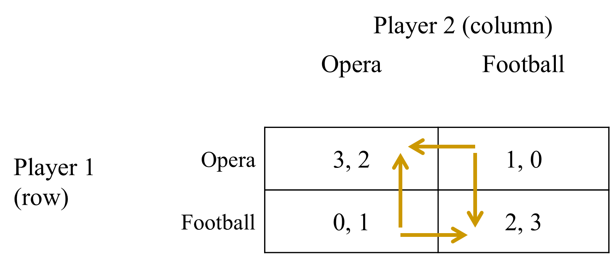
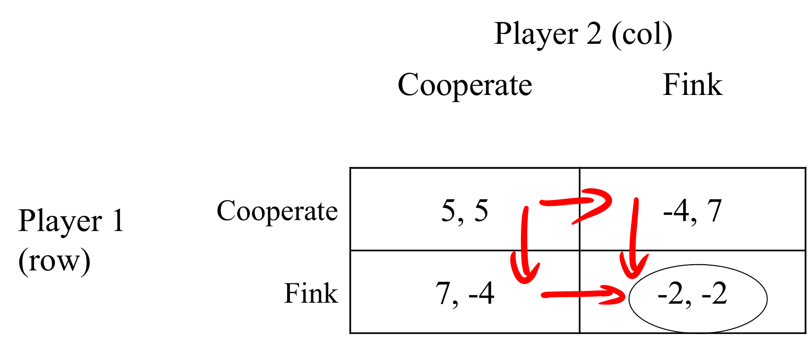
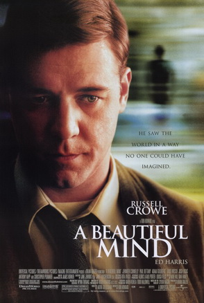
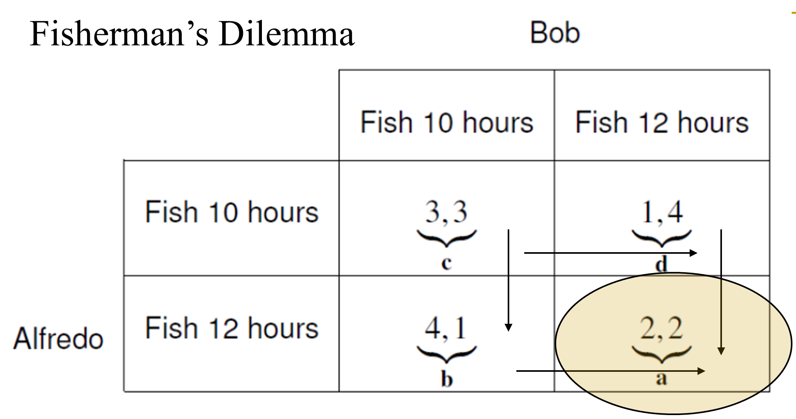

<!-- _class: divider -->

# Part I
# Strategic Behavior and Game Theory

From "what is a game?" to Nash equilibrium, in two worked examples

---

## The Big Questions

- How do individuals and societies allocate resources? Far broader than the study of markets alone
- How do agents — individuals, households, firms, groups — choose to associate, contract, and set the rules of the games they play: strategies, contracts, organizations, property rights, institutions, policy
- Outcomes: conflict or cooperation? Efficient? Equitable?
- **Mechanism design:** getting incentives right to produce better outcomes

---

## Methods, Assumptions, and Challenges

- Methodological individualism and instrumental rationality
- Optimization subject to constraints, and marginal analysis
- Feedback, interaction, and equilibrium
- *Ceteris paribus* and comparative statics

> *These assumptions face real challenges — behavioral and otherwise — that we'll return to throughout the course.*

---

## What Is a Game?

Four things define a game:

- **Who** — the players
- **What** — the strategies available to them
- **When** — the order of moves
- **How much** — the payoffs

> *Later in the course: extensive-form and repeated games, equilibrium refinements, and mechanism design (auctions, contracts, voting rules).*

---

## Representing a Game: Normal Form

The payoff to player 1 is written $\pi_1(s_1, s_2)$, where e.g. player 1's strategy set is $s_1 \in \{\text{Cooperate}, \text{Fink}\}$.

|  | Cooperate | Fink |
|---|---|---|
| **Cooperate** | 5, 5 | −4, 7 |
| **Fink** | 7, −4 | −2, −2 |

e.g. $\pi_1(\text{Fink}, \text{Cooperate}) = 7$, $\quad \pi_2(\text{Fink}, \text{Fink}) = -2$

---

## Best Response and Nash Equilibrium

Strategy $s_i$ is a **best response** to $s_{-i}$ if:

$$\pi_i(s_i, s_{-i}) \geq \pi_i(s_i', s_{-i}) \quad \text{for all } s_i' \in S_i$$

A **Nash Equilibrium** is a strategy profile where every player is playing a best response to everyone else — no one gains by unilaterally deviating.

---

## Example: Coordination Games (Opera vs. Football)

- This game has **no equilibrium in dominant strategies**
- Follow the arrows: a pure-strategy Nash equilibrium is a cell where both players' best responses coincide
- Two of them here: **(Opera, Opera)** and **(Football, Football)**

---

## Example: The Prisoner's Dilemma

- **Fink** is a dominant strategy for both players
- The dominant-strategy equilibrium **(Fink, Fink)** is also a Nash equilibrium
- The Prisoner's Dilemma is ubiquitous in economics — e.g., free-rider problems

---

## Existence and Uniqueness of Nash Equilibria

- **Existence:** a pure-strategy Nash equilibrium may not exist — but every game has *at least one* Nash equilibrium, possibly in mixed strategies
- **Uniqueness:** many games have *multiple* Nash equilibria, as the Opera/Football game just showed

> *More on mixed strategies later.*

---

## Aside: Who Was John Nash?

- Nash's 1950 PhD dissertation — just 28 pages — proved every finite game has at least one (possibly mixed-strategy) Nash equilibrium
- Cournot (1838) had used a version of the idea, but never stated it in general form
- Von Neumann & Morgenstern's *Theory of Games and Economic Behavior* couldn't pin down equilibrium concepts beyond obvious cases like dominant strategies — their minimax theorem only works for zero-sum games

---

## Aside: Nash in Popular Culture

Nash's story was popularized by Sylvia Nasar's 1998 biography *A Beautiful Mind* and Ron Howard's 2001 film adaptation starring Russell Crowe.

---

## Example: The Fisherman's Dilemma

- **Fishing 12 hours dominates fishing 10**: it pays more no matter what the other does
- Equilibrium in dominant strategies: **(12h, 12h)**, payoff (2, 2)
- But it's **inefficient** — (10h, 10h) Pareto-dominates it: both would be strictly better off at (3, 3)
- A classic common-pool-resource dilemma: individually rational overfishing, collectively wasteful

---

## Wrap-Up: What We've Learned

- A dominant-strategy equilibrium is a special, especially compelling case of Nash equilibrium
- Not every game has one — but every game has at least one Nash equilibrium, possibly in mixed strategies
- The Prisoner's Dilemma and the Fisherman's Dilemma both show how individually rational choices can produce collectively inefficient outcomes

> *Next: constrained optimization — the mathematical toolkit behind individual choice.*
