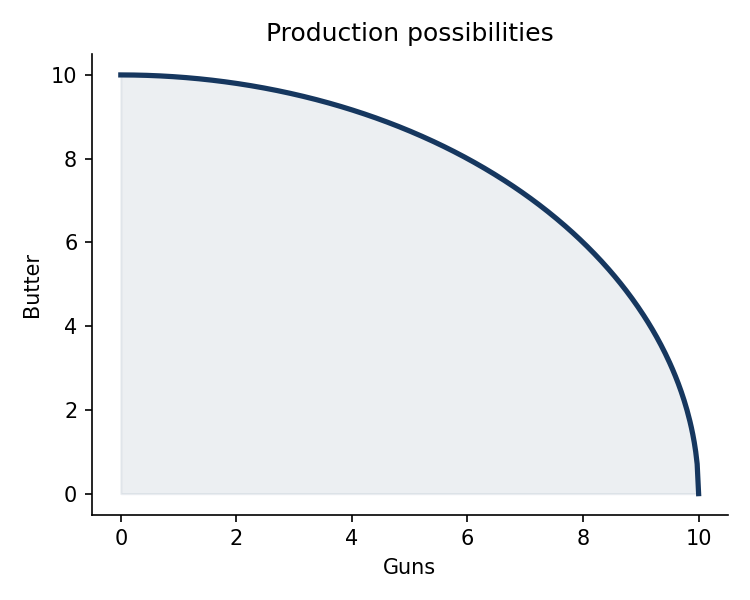

## What this deck is

This is a **companion to the source file**, not a deck to read on its own —
open `feature-tour.qmd` beside it and compare what you see with what wrote it.

::: {.incremental}
- Focus is on **presentation and layout** features, and on the Marp habits
  that need retranslating
- The older [`docs/quarto-feature-demo/quarto_demo.qmd`](../../docs/quarto-feature-demo/quarto_demo.qmd)
  covers **callouts, three-column layouts, `.r-stack`, tabsets, and Plotly
  sliders** in more depth — that one is not superseded, just complementary
- Nothing here is course content, and CI does not deploy it (see the last slide)
:::

<!-- Deliberately named feature-tour.qmd, not deck.qmd: the CI render loop
globs `find slides -mindepth 2 -maxdepth 2 -name "deck.qmd"`, so this file
is invisible to the build. Rename it to deck.qmd only if you want it live. -->

---

## The chalkboard 

Now enabled on every deck. Press these **in the rendered HTML**, not in the editor:

| Key | Does |
|---|---|
| `C` | Draw *over* the current slide |
| `B` | Open a blank chalkboard |
| `Del` | Clear the current drawing |
| `D` | Download all annotations as JSON |
| `X` / `Y` | Cycle pen color / width |

Annotations persist while the deck stays open, and vanish on reload unless you
download them. Note `B` was reveal's blackout key — chalkboard takes it over.

::: {.notes}
Live-annotation is the main thing lost in moving off a document camera or
chalkboard. Draw the budget line by hand here, over the static axes.
:::

---

## Fragments: the basic build

::: {.incremental}
- First claim appears
- Then the second
- Then the third
:::

::: {.fragment}
> And *then* a blockquote — a non-list element arriving after the list
> finishes. This is precisely what Marp's `*`-bullet trick could not do.
:::

---

## Fragments: styles beyond fade-in

Each click changes one phrase, no custom CSS:

- Consumers maximize [utility]{.fragment .highlight-blue}
- Firms maximize [profit]{.fragment .highlight-green}
- Neither maximizes [welfare]{.fragment .highlight-red}

::: {.fragment .fade-up}
`.fade-up` — arrives from below
:::

::: {.fragment .grow}
`.grow` — swells on arrival
:::

::: {.fragment .strike}
`.strike` — struck through when clicked (good for ruling out a candidate answer)
:::

---

## Fragments: reveal out of order

`fragment-index` decouples *click order* from *source order* — useful when the
punchline sits at the top of the slide:

::: {.fragment fragment-index=3}
**Third click:** …which is why the equilibrium is inefficient.
:::

::: {.fragment fragment-index=1}
**First click:** each fisher ignores the congestion they impose.
:::

::: {.fragment fragment-index=2}
**Second click:** private marginal return exceeds social marginal return.
:::

---

## Marp → Quarto: the `![bg right]` habit

::: {.columns}
::: {.column width="52%"}
Marp put the image in the *background* and let text flow over it.
Quarto puts it in a **column** beside the text.

```markdown
::: {.columns}
::: {.column width="52%"}
text here
:::
::: {.column width="48%"}

:::
:::
```

The split is a judgment call per slide — not mechanical.
:::

::: {.column width="48%"}

:::
:::

---

## Marp → Quarto: full-slide backgrounds {background-image="media/backdrop.png" background-size="cover" background-opacity="0.55"}

This slide's heading carries
`{background-image="media/backdrop.png" background-size="cover" background-opacity="0.55"}`.

That is the true analogue of Marp's `` — it fills the slide and sits
*behind* the text, rather than taking a column.

Also available: `background-color`, `background-position`, `background-repeat`,
`background-video`, and `background-iframe` for a live web page.

---

## Marp → Quarto: absolute placement

{.absolute top="140" right="60" width="330"}

For the cases where neither a column nor a background is what you want,
`.absolute` gives reveal's pixel positioning:

```markdown
{.absolute top="140" right="60" width="330"}
```

Coordinates are in the deck's own 1280×720 space, so they scale with the slide.
Use sparingly — it is the one construct that breaks if the theme's
font sizes change under it.

---

## Marp → Quarto: image sizing cheat-sheet

| Marp | Quarto |
|---|---|
| `` | `::: {.columns}` + `::: {.column width="40%"}` |
| `` | `## Title {background-image="img"}` |
| `` | `::: {.column width="40%"}` |
| `` | `{width="400"}` |
| `` | `{background-image="img" background-opacity="0.3"}` |
| — | `{.absolute top="80" left="40" width="350"}` |

A bare image still needs `{fig-align="center"}` to sit centered — Quarto does
not center a lone image the way the shared theme centers tables.

---

## When a slide overflows {.smaller}

This heading carries `{.smaller}` — Quarto's built-in shrink, the first thing
to reach for.

::: {.incremental}
- `{.smaller}` — built in, shrinks the whole slide
- `{.compact}` — this project's own class, defined in `eco701-revealjs.scss`
- `{.scrollable}` — makes the slide scroll instead of overflow
- Splitting the slide in two — usually the right answer, and the one that
  actually helps students
:::

::: {.fragment}
**`{.scrollable}` does not survive the PDF export.** decktape captures only the
visible region, so anything scrolled out of view is silently missing from the
handout. Never use it for content students need on paper.
:::

---

## Hiding the source, keeping the chart

The cell below is `#| echo: false` — students see the figure, never the code.

```{python}
#| echo: false
#| fig-align: center
import numpy as np
import plotly.graph_objects as go

q = np.linspace(0.1, 10, 200)
fig = go.Figure()
fig.add_trace(go.Scatter(x=q, y=100 / q, name="Demand: p = 100/q"))
fig.add_trace(go.Scatter(x=q, y=4 * q, name="Supply: p = 4q"))
fig.update_layout(
    # Plotly does not stretch to the slide on its own - set an explicit
    # width in the deck's 1280-wide coordinate space, then fig-align centers it.
    width=1020, height=380,
    margin=dict(l=10, r=10, t=30, b=10),
    xaxis_title="Quantity", yaxis_title="Price",
    yaxis_range=[0, 60],
    legend=dict(orientation="h", y=1.15),
)
fig
```

Hover, zoom, drag, toggle a series in the legend — all of it works on the
deployed static site, with no server behind it.

---

## What "interactive" does and does not mean

::: {.incremental}
- Python runs **at render time**, on your machine or in CI
- The figure ships as JSON plus `plotly.js`, so hover / zoom / legend-toggle
  are pure client-side JavaScript — they work anywhere the HTML is served
- A Plotly **slider or dropdown over precomputed frames** also works, since
  every frame was computed at render time
- What does **not** work: `ipywidgets.interact`, or anything that must re-run
  Python after the page loads — that needs a live kernel
- For genuine in-browser Python there is Pyodide (`quarto add r-wasm/quarto-live`),
  at the cost of a 10–30 MB first load and a blank slide in the PDF export
:::

---

## Cell options worth knowing

```{.python}
#| echo: false        # hide source, show output      <- the usual choice
#| include: false     # run it, show nothing          <- imports and setup
#| output: false      # show source, suppress output
#| warning: false     # and message: false
#| fig-align: center
#| code-line-numbers: "|1-3|5|7-9"   # reveal code in stages
```

Set them deck-wide in the YAML instead of per cell:

```yaml
execute:
  echo: false
  warning: false
  freeze: auto    # re-run only when the source changes
```

Then `#| echo: true` on the one cell whose code you *want* on screen.

---

## Speaker notes

What the audience sees is only this line.

Press `S` in the rendered HTML for the presenter window: current slide, next
slide, a timer, and the notes below.

::: {.notes}
Notes live in a `::: {.notes}` block. They never render on the main screen and
never reach the PDF — the right home for "raise this verbally if nobody asks",
which used to sit in an HTML comment nobody but the author ever read.
:::

---

## Auto-animate, part 1 {auto-animate="true"}

::: {data-id="focus-box"}
$$\max_{x,y} \; U(x,y) \quad \text{s.t.} \quad p_x x + p_y y \le m$$
:::

Matching `data-id` on the next slide makes reveal morph between the two.

---

## Auto-animate, part 2 {auto-animate="true"}

::: {data-id="focus-box"}
$$\mathcal{L} = U(x,y) + \lambda\,(m - p_x x - p_y y)$$
:::

::: {.fragment}
The box did not redraw — it *moved and rewrote itself*. Good for "same object,
one step further": adding a term, relabeling an axis, zooming into a
constraint.
:::

---

## Section divider {.divider background-color="#0b1f3a"}

### The project's own classes

`{.divider}`, `{.compact}` and the amber heading rule all live in
`slides/_shared/eco701-revealjs.scss`. Editing that file changes **every**
deck, so re-render all of them before pushing.

---

## Math

Inline $MRS = \frac{MU_x}{MU_y}$ and display:

$$\frac{\partial \mathcal{L}}{\partial x} = U_x - \lambda p_x = 0
\qquad \Rightarrow \qquad \frac{U_x}{U_y} = \frac{p_x}{p_y}$$

::: {.callout-warning}
## Two live gotchas
`\underbrace{x}_{\text{label}}` **loses its label** under this KaTeX setup —
avoid it, or check the rendered slide. And matplotlib's mathtext is stricter
than KaTeX: `\frac14` renders here but throws inside a figure label, so write
`\frac{1}{4}` in any code-generated figure.
:::

---

## Presenting: the keys that matter

::: {.columns}
::: {.column width="50%"}
| Key | Does |
|---|---|
| `→` `Space` | Next fragment / slide |
| `F` | Fullscreen |
| `S` | Speaker view |
| `O` or `Esc` | Slide overview grid |
| `.` | Blackout |
:::

::: {.column width="50%"}
| Key | Does |
|---|---|
| `C` / `B` | Chalkboard over / blank |
| `Alt`+click | Zoom into a region |
| `?` | Full keyboard help |
| `Ctrl`+`Shift`+`F` | Search the deck |
:::
:::

Jump straight to a slide by typing its number, then `Enter`.

---

## Exporting this deck

```bash
quarto render slides/demos/feature-tour.qmd
```

```bash
npx -y decktape reveal --size "1280x720" slides/demos/feature-tour.html tour.pdf
```

Faster route for a quick look: open the HTML, append `?print-pdf` to the URL,
then print to PDF from the browser.

::: {.callout-note}
## What the PDF cannot show
Fragment *order* (decktape captures the fully-revealed end state), chalkboard
annotations, speaker notes, `{.scrollable}` overflow, and anything Pyodide.
Check those in the browser.
:::

---

## Why this file is not `deck.qmd`

::: {.incremental}
- CI globs `find slides -mindepth 2 -maxdepth 2 -type f -name "deck.qmd"` — so
  a file named `deck.qmd` here would render, PDF-export, and **publish to the
  live course site**
- Named `feature-tour.qmd`, it is invisible to the build and stays a local
  authoring reference
- Rename it to `deck.qmd` if you ever do want it deployed
- Same reason `quarto_workflow.md` lives in `docs/`, not here: the Marp step
  still globs `slides/` for `.md` files and would try to build it as a deck
:::

---

## Where to look next {.divider}

`docs/quarto_workflow.md` — the written companion to this deck

`docs/quarto-feature-demo/quarto_demo.qmd` — callouts, `.r-stack`, tabsets, Plotly sliders

`HANDOFF.md` §5 and §9 — the authoring conventions and the gotchas that bit us
