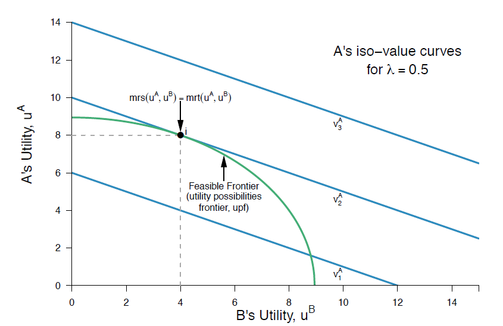

<!-- _class: title -->
<!-- footer: "**ECO 701** **Microeconomic Theory** **Definitions and Key Tools**" -->
<!-- _paginate: false -->

## ECO 701
# Microeconomic Theory
```text
Topic 1: Definitions and Key Tools
```
<br></br>
Jonathan Conning
Hunter College
Dept of Economics


---

## Course Outline: Topic 1
- **Pareto Efficiency**
- **Production Possibility Frontiers (PPF)**
- **Utility Possibility Frontiers (UPF)**
- **Basic Coordination Games**

<br></br>
*Why do we start with games? Because social dilemmas often leave us trapped inefficiently inside the possibility frontiers.*

---

### Production Possibilities

Here is the image from the textbook with a caption beneath it.



###### Figure 1: The Production Possibility Frontier showing efficient and inefficient points.

---